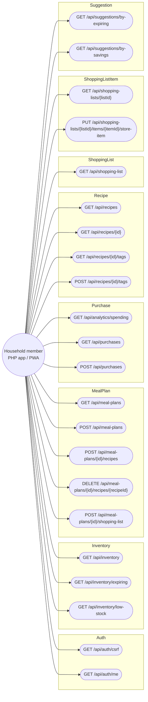
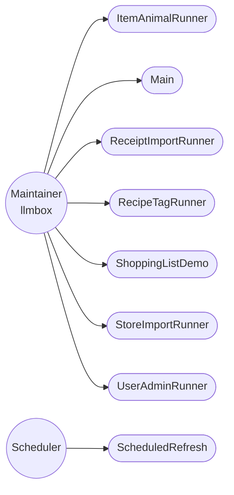

<!-- Generated by scripts/docs/generate_docs.py from src/main/java. Do not edit by hand; change the code or the generator. -->

# Use cases

Who uses DAHÄM and for what, derived from the REST controllers (members, through the PHP frontend) and the classes with a `main` method (the maintainer, on the llmbox server). Mermaid has no UML use-case notation, so actors are rounded boxes and use cases are stadium shapes.

## Household member

Each use case is one endpoint; the parameters, bodies and answers are in [API.md](API.md). What a member actually does with them:

| Goal | Endpoints |
|---|---|
| Sign in and see who I am | `/api/auth/csrf`, `/api/auth/me` |
| Browse recipes, hide what I do not eat | `/api/recipes`, `/api/recipes/{id}`, `/api/recipes/{id}/tags` |
| Plan the week and get the shopping list | `/api/meal-plans`, `/api/meal-plans/{id}/recipes`, `/api/meal-plans/{id}/shopping-list`, `/api/shopping-list` |
| Choose the store product for a list line | `/api/shopping-lists/{listId}`, `/api/shopping-lists/{listId}/items/{itemId}/store-item` |
| See what is in the pantry, what expires or runs low | `/api/inventory`, `/api/inventory/expiring`, `/api/inventory/low-stock` |
| Cook what saves money or uses expiring food | `/api/suggestions/by-savings`, `/api/suggestions/by-expiring` |
| Record a purchase and see spending | `/api/purchases`, `/api/analytics/spending` |

## Maintainer and scheduler: command-line tools

These run on the server (`java -cp target/dahaem-1.0-SNAPSHOT.jar <class> ...`) or, for the recipe importer scripts, as Python from `scripts/importer`. None of them is part of the HTTP API.

| Tool | Package | What it does |
|---|---|---|
| `ItemAnimalRunner` | tags | Command-line tool for the item → animal table (inventory_item_animal). |
| `Main` | root | Temporary console runner. |
| `ReceiptImportRunner` | receipts | Command-line entry point for importing PENNY receipts as purchase history. |
| `RecipeTagRunner` | tags | Command-line tool that derives recipe tags from DAHÄM's own data. |
| `ShoppingListDemo` | shopping | Temporary console runner for the shopping-list slice, same idea as de.dahaem.Main: proves the aggregation + store-matching logic works before there is a UI for it. |
| `StoreImportRunner` | stores | Command-line entry point for the store imports. |
| `UserAdminRunner` | auth | Command-line entry point for managing logins. |
| `ScheduledRefresh` (scheduled) | stores | Runs the weekly / monthly refresh on a cron schedule inside the long-running API process. |

Python tools in `scripts/importer` (recipe import, repair, unmatched-line finder and rematch) are described in [scripts/importer/README.md](../scripts/importer/README.md).
