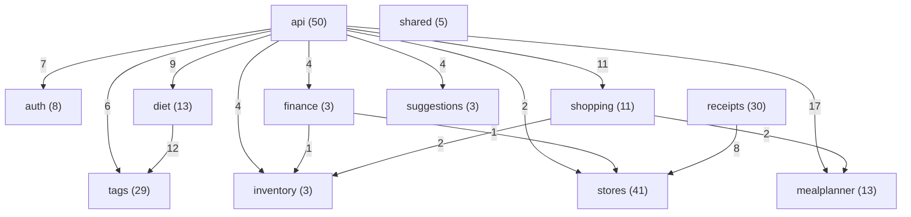

<!-- Generated by scripts/docs/generate_docs.py from src/main/java. Do not edit by hand; change the code or the generator. -->

# Class reference

Every class, record, interface and enum of the Java backend, one page per package. Each type has its own class diagram (members and direct neighbours), its description from the javadoc and a member table. Everything here is generated from `src/main/java`; the HTTP API is in [API.md](../API.md), the actors and tools in [USE_CASES.md](../USE_CASES.md), the layering rules in [ARCHITECTURE.md](../ARCHITECTURE.md).

## Packages and their imports

Arrows point from the importing package to the imported one; the number is how many import lines. `shared` is left out of the drawing: 11 of the other packages import it, and it imports none of them. A package that imports nothing else here is a leaf.

## Packages

| Package | Types | What it holds |
|---|---|---|
| [`api`](api.md) | 50 | The HTTP layer: thin Spring controllers, DTOs, security (session login, CSRF, internal token) and error handling. |
| [`auth`](auth.md) | 8 | Logins, households and memberships; the `UserAdminRunner` command-line tool. |
| [`diet`](diet.md) | 13 | The diet filter: presets, rules and the per-recipe verdict (OK / ANPASSBAR / HIDDEN / UNCLEAR). |
| [`finance`](finance.md) | 3 | Purchases and spending analytics. |
| [`inventory`](inventory.md) | 3 | The item catalogue and the pantry. |
| [`mealplanner`](mealplanner.md) | 13 | Recipes, ingredients, instructions, scaling and meal plans. |
| [`receipts`](receipts.md) | 30 | Receipt parsing (Penny, ALDI), matching to catalogue items and import. |
| [`shared`](shared.md) | 5 | The database connection pool, units and portion arithmetic. |
| [`shopping`](shopping.md) | 11 | Shopping-list generation from recipes and the store options per line. |
| [`stores`](stores.md) | 41 | Store offers: clients, the raw and verified data model, matching, promotions, scheduled refresh. |
| [`suggestions`](suggestions.md) | 3 | Recipe suggestions by savings and by expiring stock. |
| [`tags`](tags.md) | 29 | Recipe tags derived from the data, animals per item, the tagger and its runners. |

## Every type

| Type | Package | Kind | What it is |
|---|---|---|---|
| [`AccountRepository`](auth.md#accountrepository) | auth | class | All SQL for the household, app_user and household_member tables lives here. |
| [`AccountService`](auth.md#accountservice) | auth | class | Business logic for user accounts and households. |
| [`AddPlannedRecipeRequest`](api.md#addplannedreciperequest) | api | record | Body of POST /api/meal-plans/{id}/recipes, e.g. |
| [`AddTagRequest`](api.md#addtagrequest) | api | record | Body of POST /api/recipes/{id}/tags. |
| [`AdjustmentType`](receipts.md#adjustmenttype) | receipts | enum | What kind of price change or deposit movement a receipt line is. |
| [`AggregatedIngredient`](shopping.md#aggregatedingredient) | shopping | record | One inventory item's combined need across a set of recipes, before any store matching. |
| [`AggregatorClient`](stores.md#aggregatorclient) | stores | class | Pulls weekly offers from the aggregator aktionspreis.de (SECONDARY source). |
| [`AldiNordClient`](stores.md#aldinordclient) | stores | class | Reads ALDI Nord's public website. |
| [`AldiReceiptFormat`](receipts.md#aldireceiptformat) | receipts | class | ALDI layout. |
| [`AnimalClassifier`](tags.md#animalclassifier) | tags | class | Proposes the animal(s) and the alcohol flag of a catalogue item from its name. |
| [`AnimalClassifier.Confidence`](tags.md#animalclassifierconfidence) | tags | enum |  |
| [`AnimalClassifier.Hint`](tags.md#animalclassifierhint) | tags | record |  |
| [`AnimalClassifier.Proposal`](tags.md#animalclassifierproposal) | tags | record | animals are the certain ones, possibleAnimals the ones the generic item may come from; no animal is in both lists. |
| [`AnimalProducts`](tags.md#animalproducts) | tags | class | Which catalogue items stop a recipe from being vegetarisch / vegan. |
| [`Animals`](tags.md#animals) | tags | class | The animal values an item can have: the Tier tags, in display order. |
| [`ApiExceptionHandler`](api.md#apiexceptionhandler) | api | class | Turns exceptions into JSON error responses with sensible status codes. |
| [`AppUser`](auth.md#appuser) | auth | class | Plain data holder for one row of the app_user table. |
| [`AuthController`](api.md#authcontroller) | api | class | The parts of the login flow that are plain endpoints. |
| [`BadRequestException`](api.md#badrequestexception) | api | class | Thrown by a controller when request input fails validation; mapped to 400. |
| [`CatalogChange`](stores.md#catalogchange) | stores | record | One difference found by the range comparator between the last pull and this one. |
| [`CatalogChange.Type`](stores.md#catalogchangetype) | stores | enum |  |
| [`CatalogItem`](stores.md#catalogitem) | stores | record | One inventory_item catalog row, with its normalized names cached for matching. |
| [`CatalogItem`](tags.md#catalogitem) | tags | record | One inventory_item as the tag logic sees it. |
| [`CrawlResult`](stores.md#crawlresult) | stores | record | Result of crawling a chain's full range. |
| [`CreatedAccount`](auth.md#createdaccount) | auth | record | Result of AccountService.createUser: the new user, the household they were added to, and whether that household was created for them (true for the very first user). |
| [`CreateMealPlanRequest`](api.md#createmealplanrequest) | api | record | Body of POST /api/meal-plans, e.g. |
| [`CreatePurchaseRequest`](api.md#createpurchaserequest) | api | record | Body of POST /api/purchases: a purchase of a known store_item. |
| [`CsrfTokenDto`](api.md#csrftokendto) | api | record | A CSRF token and where to put it: in the headerName header (or the parameterName form field). |
| [`CurrentUserDto`](api.md#currentuserdto) | api | record | Answer of GET /api/auth/me. |
| [`CurrentUserDto.HouseholdDto`](api.md#currentuserdtohouseholddto) | api | record |  |
| [`DahaemApplication`](api.md#dahaemapplication) | api | class | Entry point for the REST API. |
| [`Database`](shared.md#database) | shared | class | Single place that knows how to open a database connection. |
| [`DerivedTag`](tags.md#derivedtag) | tags | record | A tag the tagger derives: a name in a tag group (tag_category). |
| [`DietDto`](api.md#dietdto) | api | record | What the diet rules say about a recipe, present only when rules were passed. |
| [`DietDto.Hint`](api.md#dietdtohint) | api | record |  |
| [`DietDto.Item`](api.md#dietdtoitem) | api | record |  |
| [`DietDto.SoftHits`](api.md#dietdtosofthits) | api | record |  |
| [`DietDto.Unmatched`](api.md#dietdtounmatched) | api | record |  |
| [`DietFilterRepository`](diet.md#dietfilterrepository) | diet | class | All SQL for the diet filter. |
| [`DietFilterService`](diet.md#dietfilterservice) | diet | class | Applies diet rules to recipes on the server, so the client never receives 11,000 recipes to filter itself. |
| [`DietFilterService.Judged`](diet.md#dietfilterservicejudged) | diet | record | A verdict together with the facts it was made from. |
| [`DietPreset`](diet.md#dietpreset) | diet | record | One diet preset from config/diet_presets.json: tags a recipe must NOT have (excludeTags) and tags it MUST have (requireTags). |
| [`DietPresets`](diet.md#dietpresets) | diet | class | The diet presets, read from config/diet_presets.json (no hardcoding: the lists are Nate's to change). |
| [`DietRules`](diet.md#dietrules) | diet | record | What a household does not eat, as the PHP passes it (the questionnaire itself and its storage are not part of the API). |
| [`DietStatus`](diet.md#dietstatus) | diet | enum | What the diet rules say about one recipe. |
| [`DietVerdict`](diet.md#dietverdict) | diet | record | The filter's answer for one recipe. |
| [`DietVerdict.Hint`](diet.md#dietverdicthint) | diet | record | An item with possible animals of which at least one is excluded; allowedAnimals is what remains. |
| [`DietVerdict.Item`](diet.md#dietverdictitem) | diet | record | A matched item (id and name). |
| [`DietVerdict.SoftHits`](diet.md#dietverdictsofthits) | diet | record | Soft-rule hits: tags the recipe has, ingredient items it has, and items that MAY be an avoided animal (for an avoided animal tag). |
| [`ErrorResponse`](api.md#errorresponse) | api | record | JSON body for every error response: the HTTP status, its reason phrase, and a readable message. |
| [`GeneratedShoppingListDto`](api.md#generatedshoppinglistdto) | api | record | Response of POST /api/meal-plans/{planId}/shopping-list: the id of the newly persisted list. |
| [`Household`](auth.md#household) | auth | class | Plain data holder for one row of the household table. |
| [`HouseholdMembership`](auth.md#householdmembership) | auth | record | A household together with the role one user has in it (one household_member row, joined to its household). |
| [`HouseholdRole`](auth.md#householdrole) | auth | enum | What a user may do in their household. |
| [`HttpFetcher`](stores.md#httpfetcher) | stores | class | Fetches public web pages / JSON politely: a normal browser User-Agent, timeouts, a few retries with growing backoff, and a pause after every successful request. |
| [`ImportSummary`](stores.md#importsummary) | stores | record | What one import run did; printed by StoreImportRunner. |
| [`InternalTokenFilter`](api.md#internaltokenfilter) | api | class | Shared-secret gate for the internal API. |
| [`InventoryController`](api.md#inventorycontroller) | api | class |  |
| [`InventoryRepository`](inventory.md#inventoryrepository) | inventory | class | All SQL for the inventory_item table lives here and nowhere else. |
| [`InventoryService`](inventory.md#inventoryservice) | inventory | class | Business logic for inventory. |
| [`Item`](inventory.md#item) | inventory | class | Plain data holder for one row of the inventory_item table. |
| [`ItemAnimalRepository`](tags.md#itemanimalrepository) | tags | class | All SQL for inventory_item_animal and the alcohol flag, and the read-only catalogue queries the animal tool needs. |
| [`ItemAnimalRunner`](tags.md#itemanimalrunner) | tags | class | Command-line tool for the item → animal table (inventory_item_animal). |
| [`ItemAnimalService`](tags.md#itemanimalservice) | tags | class | Proposes which animal(s) the meat / fish items of the catalogue come from, which generic items (Salami, Gelatine ...) MAY come from which animals, and which items contain alcohol, as a TSV for Nate to review; and applies the reviewed TSV. |
| [`ItemAnimalService.ApplyReport`](tags.md#itemanimalserviceapplyreport) | tags | record | Result of .apply. |
| [`ItemAnimalService.Row`](tags.md#itemanimalservicerow) | tags | record | One TSV line. |
| [`ItemDto`](api.md#itemdto) | api | record | One inventory item as returned by /api/inventory. |
| [`JsonUtil`](stores.md#jsonutil) | stores | class | Small null-safe helpers for reading store JSON. |
| [`KnownProduct`](stores.md#knownproduct) | stores | record | What the database already knows about a store product. |
| [`MatchGate`](stores.md#matchgate) | stores | class | Plausibility gate between "the name matched an inventory_item" and "create a store_item + discount". |
| [`MatchGate.References`](stores.md#matchgatereferences) | stores | class | Reference prices per base unit, by inventory_item id and unit family. |
| [`MatchGate.Verdict`](stores.md#matchgateverdict) | stores | record |  |
| [`MealPlan`](mealplanner.md#mealplan) | mealplanner | class | Plain data holder for one row of the meal_plan table. |
| [`MealPlanController`](api.md#mealplancontroller) | api | class |  |
| [`MealPlanDto`](api.md#mealplandto) | api | record | One weekly meal plan with the recipes slotted into it. |
| [`MealPlanDto.PlannedRecipe`](api.md#mealplandtoplannedrecipe) | api | record |  |
| [`MealPlanRecipe`](mealplanner.md#mealplanrecipe) | mealplanner | class | Plain data holder for one row of the meal_plan_recipe table, joined to the recipe's name. |
| [`MealPlanRepository`](mealplanner.md#mealplanrepository) | mealplanner | class | All SQL for the meal_plan and meal_plan_recipe tables lives here. |
| [`MealPlanService`](mealplanner.md#mealplanservice) | mealplanner | class | Business logic for meal plans. |
| [`Normalizer`](stores.md#normalizer) | stores | class | Turns a German product or ingredient name into a comparable key: lowercase, umlauts to ae/oe/ue/ss, allergen markers and leading ALL-CAPS brand words removed, punctuation to spaces. |
| [`NotFoundException`](api.md#notfoundexception) | api | class | Thrown by a controller when the requested resource does not exist; mapped to 404. |
| [`OfferPull`](stores.md#offerpull) | stores | record | Offers pulled from one chain, plus the requests that failed (so a run can be marked PARTIAL). |
| [`OfferRow`](stores.md#offerrow) | stores | record | One store_offer row loaded for discount promotion, with its store id. |
| [`ParsedReceipt`](receipts.md#parsedreceipt) | receipts | record | Structured result of parsing one receipt's text. |
| [`PennyClient`](stores.md#pennyclient) | stores | class | Reads Penny's weekly offers from the JSON API behind www.penny.de/angebote. |
| [`PennyClient.Market`](stores.md#pennyclientmarket) | stores | record | A Penny store and the price regions it belongs to this week and next week. |
| [`PennyReceiptFormat`](receipts.md#pennyreceiptformat) | receipts | class | PENNY (REWE Group) layout. |
| [`PennyReceiptFormat.Last`](receipts.md#pennyreceiptformatlast) | receipts | enum | What the last booked line was, so an "n Stk x p" sub-line lands on the right thing. |
| [`PersistedShoppingList`](shopping.md#persistedshoppinglist) | shopping | record | A previously generated shopping_list row, reloaded together with its persisted items. |
| [`PersistedShoppingListDto`](api.md#persistedshoppinglistdto) | api | record | A previously generated shopping list as it was persisted: its items with names, quantity still needed, every current store option for each item (cheapest till price first, but not pre-picked) and the store item the user has selected, if any |
| [`PersistedShoppingListDto.Line`](api.md#persistedshoppinglistdtoline) | api | record |  |
| [`PersistedShoppingListItem`](shopping.md#persistedshoppinglistitem) | shopping | record | One persisted shopping_list_item line: the inventory item it is for (null only for a purely manual line with no catalog match), its German/English name, how much is still needed, every current store option for it (the same options a freshly |
| [`Portions`](shared.md#portions) | shared | class | The single definition of portion scaling: a recipe written for servings people is scaled to people by the factor people / servings. |
| [`ProductVariant`](stores.md#productvariant) | stores | record | One flavour/size of a store product, e.g. |
| [`PromotableProduct`](stores.md#promotableproduct) | stores | record | A matched store_product considered for promotion into the verified store_item layer. |
| [`Purchase`](finance.md#purchase) | finance | class | Plain data holder for one row of the purchase_history table. |
| [`PurchaseController`](api.md#purchasecontroller) | api | class |  |
| [`PurchaseDto`](api.md#purchasedto) | api | record |  |
| [`PurchaseRepository`](finance.md#purchaserepository) | finance | class | All SQL for the purchase_history table lives here and nowhere else. |
| [`PurchaseService`](finance.md#purchaseservice) | finance | class | Business logic for purchases. |
| [`ReceiptAdjustment`](receipts.md#receiptadjustment) | receipts | record | A discount or deposit movement, kept apart from products (paid price != listed price != offer; deposit != discount). |
| [`ReceiptBuilder`](receipts.md#receiptbuilder) | receipts | class | Mutable accumulator shared by the store handlers. |
| [`ReceiptImportReport`](receipts.md#receiptimportreport) | receipts | record | What one receipt import did (or, in a dry run, would do): receipts new / duplicate / skipped, how the lines of the new receipts matched, the most frequent unmatched names, and per receipt the balance check (stored line paid totals + other a |
| [`ReceiptImportRunner`](receipts.md#receiptimportrunner) | receipts | class | Command-line entry point for importing PENNY receipts as purchase history. |
| [`ReceiptImportService`](receipts.md#receiptimportservice) | receipts | class | Imports PENNY receipt texts as purchase history into the receipt tables (migration 0008). |
| [`ReceiptImportService.PlannedLine`](receipts.md#receiptimportserviceplannedline) | receipts | record | One product line as it will be stored. |
| [`ReceiptImportService.ReceiptFile`](receipts.md#receiptimportservicereceiptfile) | receipts | record |  |
| [`ReceiptImportService.ReceiptResult`](receipts.md#receiptimportservicereceiptresult) | receipts | record | One receipt's outcome; receipt and lines are null/empty when it could not be read. |
| [`ReceiptImportService.Status`](receipts.md#receiptimportservicestatus) | receipts | enum |  |
| [`ReceiptLine`](receipts.md#receiptline) | receipts | record | One purchasable product. |
| [`ReceiptMatcher`](receipts.md#receiptmatcher) | receipts | class | Links one receipt line to an inventory item, or leaves it unmatched. |
| [`ReceiptMatcher.Match`](receipts.md#receiptmatchermatch) | receipts | record | itemId null = no item; excluded = an override of 0 (left out on purpose). |
| [`ReceiptMatcher.Overrides`](receipts.md#receiptmatcheroverrides) | receipts | record | Parsed config/receipt_overrides.json. |
| [`ReceiptNames`](receipts.md#receiptnames) | receipts | class | Receipt-specific name handling, used only by the receipt import (offer matching keeps Normalizer as it is). |
| [`ReceiptParser`](receipts.md#receiptparser) | receipts | class | Turns one receipt's raw text into a ParsedReceipt. |
| [`ReceiptRematchService`](receipts.md#receiptrematchservice) | receipts | class | Re-runs the receipt matcher (the current config/receipt_overrides.json plus the name rules) on receipt lines that are already stored, so names can be mapped after the import without importing again. |
| [`ReceiptRematchService.Change`](receipts.md#receiptrematchservicechange) | receipts | record | One stored line whose match changes. |
| [`ReceiptRematchService.ReceiptRematchReport`](receipts.md#receiptrematchservicereceiptrematchreport) | receipts | record | What a rematch changed (or, in a dry run, would change). |
| [`ReceiptRepository`](receipts.md#receiptrepository) | receipts | class | All SQL of the receipt import: purchase_receipt, purchase_receipt_line, purchase_receipt_adjustment (migration 0008) and the store lookup. |
| [`ReceiptRepository.StoredLine`](receipts.md#receiptrepositorystoredline) | receipts | record | A stored receipt line as the rematch reads it. |
| [`ReceiptStoreFormat`](receipts.md#receiptstoreformat) | receipts | interface | Per-store handler: recognises its receipts by header markers and parses their lines. |
| [`ReceiptText`](receipts.md#receipttext) | receipts | class | Shared text helpers for the store handlers: number parsing, privacy filter, tax-table rows. |
| [`ReceiptTextSource`](receipts.md#receipttextsource) | receipts | interface | Seam for whatever turns a receipt into text (OCR of a photo, a pasted string, a test fixture). |
| [`Recipe`](mealplanner.md#recipe) | mealplanner | class | Plain data holder for one row of the Recipe table. |
| [`RecipeController`](api.md#recipecontroller) | api | class |  |
| [`RecipeDetailDto`](api.md#recipedetaildto) | api | record | One recipe with its nutrition, ingredients and ordered instructions, as returned by /api/recipes/{id}. |
| [`RecipeDetailDto.Ingredient`](api.md#recipedetaildtoingredient) | api | record | quantity is the stored amount for the recipe as written, as a decimal (0.5 Stück); scaledQuantity is that amount for people, rounded to 2 decimals (equal to quantity when unscaled). |
| [`RecipeDetailDto.Instruction`](api.md#recipedetaildtoinstruction) | api | record | instruction is the step as stored (HelloFresh's 1 EL [1,5 EL \| 2 EL] Butter*); scaledInstruction is the same step with its amounts for people (see StepAmounts) — without people it is the stored text with each bracket resolved to the recipe' |
| [`RecipeDetailDto.Nutrition`](api.md#recipedetaildtonutrition) | api | record | Nutrition values as stored (per serving, from the HelloFresh import); any of them may be null when unknown. |
| [`RecipeDetailDto.Tag`](api.md#recipedetaildtotag) | api | record | A tag on the recipe: its name, its group (e.g. |
| [`RecipeDietFacts`](diet.md#recipedietfacts) | diet | record | What the filter needs to know about one recipe: its stored tag names, its ingredients with their certain and possible animals, and its unmatched lines (recipe_unmatched_ingredient). |
| [`RecipeDietFilter`](diet.md#recipedietfilter) | diet | class | Judges one recipe against DietRules. |
| [`RecipeFacts`](tags.md#recipefacts) | tags | record | What the tagger needs to know about one recipe. |
| [`RecipeFacts.Ingredient`](tags.md#recipefactsingredient) | tags | record | One ingredient line. |
| [`RecipeFacts.Unmatched`](tags.md#recipefactsunmatched) | tags | record | A row of recipe_unmatched_ingredient: lineNo is null for an 'unchecked' recipe. |
| [`RecipeIngredient`](mealplanner.md#recipeingredient) | mealplanner | class |  |
| [`RecipeInstruction`](mealplanner.md#recipeinstruction) | mealplanner | class |  |
| [`RecipeRepository`](mealplanner.md#reciperepository) | mealplanner | class | All SQL for the recipe, recipe_ingredient, recipe_instructions, recipe_tag tables lives here. |
| [`RecipeService`](mealplanner.md#recipeservice) | mealplanner | class | Business logic for recipes. |
| [`RecipeSuggestion`](suggestions.md#recipesuggestion) | suggestions | class | Plain data holder for one ranked recipe suggestion: the recipe, how many of its ingredients matched the signal (expiring soon / on sale), and which inventory items matched. |
| [`RecipeSuggestionDto`](api.md#recipesuggestiondto) | api | record | A ranked recipe suggestion: which recipe, how strongly it matched the signal, and why. |
| [`RecipeSummaryDto`](api.md#recipesummarydto) | api | record | A recipe in a list: identity and the numbers you'd scan a list by. |
| [`RecipeTagger`](tags.md#recipetagger) | tags | class | Works out the tags a recipe gets from DAHÄM's own data. |
| [`RecipeTagger.Derivation`](tags.md#recipetaggerderivation) | tags | record | The result for one recipe. |
| [`RecipeTagRepository`](tags.md#recipetagrepository) | tags | class | All SQL for the derived-tag run: reads the recipes and their tags, and writes derived recipe_tag rows. |
| [`RecipeTagRepository.Change`](tags.md#recipetagrepositorychange) | tags | record | One change to apply: tag a recipe as derived, or remove a derived tag. |
| [`RecipeTagRepository.StoredTag`](tags.md#recipetagrepositorystoredtag) | tags | record | One recipe_tag row as stored. |
| [`RecipeTagRunner`](tags.md#recipetagrunner) | tags | class | Command-line tool that derives recipe tags from DAHÄM's own data. |
| [`RecipeTagService`](tags.md#recipetagservice) | tags | class | Derives the tags of every recipe and replaces ONLY the recipe_tag rows whose source is 'derived'. |
| [`RecipeTagService.Plan`](tags.md#recipetagserviceplan) | tags | record | What a run would do (or did). |
| [`RefreshConfig`](stores.md#refreshconfig) | stores | class | Switches scheduling on, but only when dahaem.refresh.enabled=true: with the default (false) no scheduler infrastructure, RefreshService or ScheduledRefresh bean exists at all. |
| [`RefreshService`](stores.md#refreshservice) | stores | class | The store-data refresh pipelines, shared by the CLI (StoreImportRunner refresh ...) and the in-app scheduler (ScheduledRefresh). |
| [`RefreshService.Run`](stores.md#refreshservicerun) | stores | class | Collects step results for one flow, running every step regardless of earlier failures. |
| [`RefreshSummary`](stores.md#refreshsummary) | stores | record | Outcome of one refresh flow ("weekly" / "monthly"): the summary of every step that returned one, plus a message for every step that threw. |
| [`ReviewReports`](stores.md#reviewreports) | stores | class | Row builders for the review reports (unmatched_offers.tsv, review_matches.tsv, review_prices.tsv). |
| [`ScheduledRefresh`](stores.md#scheduledrefresh) | stores | class | Runs the weekly / monthly refresh on a cron schedule inside the long-running API process. |
| [`SecurityConfig`](api.md#securityconfig) | api | class | Who may call the API. |
| [`SelectStoreItemRequest`](api.md#selectstoreitemrequest) | api | record | Body of PUT /api/shopping-lists/{listId}/items/{itemId}/store-item, e.g. |
| [`ServiceConfig`](api.md#serviceconfig) | api | class | Wires the existing plain-Java repositories and services as Spring beans. |
| [`ShoppingList`](shopping.md#shoppinglist) | shopping | record | A shopping list built from a set of recipes: one line per distinct (item, unit) need. |
| [`ShoppingListController`](api.md#shoppinglistcontroller) | api | class |  |
| [`ShoppingListDto`](api.md#shoppinglistdto) | api | record | A shopping list built from recipes: one line per (item, unit), with every current store's option for it (cheapest till price first, but not pre-picked) and the store item the user has selected, if any. |
| [`ShoppingListDto.Line`](api.md#shoppinglistdtoline) | api | record |  |
| [`ShoppingListDto.StoreOptionDto`](api.md#shoppinglistdtostoreoptiondto) | api | record | One store's current price for a line: what it costs at the till (sale/deal price where one applies, plus deposit), plus whether this pack's unit is even comparable to what's needed. |
| [`ShoppingListItem`](shopping.md#shoppinglistitem) | shopping | record | One line of a shopping list: an inventory item, how much of it is needed in total across the recipes it came from, and every store's current option for it (ordered cheapest-till-price first, but not pre-chosen — DAHÄM surfaces the options a |
| [`ShoppingListItemController`](api.md#shoppinglistitemcontroller) | api | class |  |
| [`ShoppingListItemRow`](shopping.md#shoppinglistitemrow) | shopping | record | Raw shopping_list_item row, joined to its inventory_item's names and unit. |
| [`ShoppingListItemSelectionDto`](api.md#shoppinglistitemselectiondto) | api | record | Response of PUT /api/shopping-lists/{listId}/items/{itemId}/store-item: the line's new selection. |
| [`ShoppingListRepository`](shopping.md#shoppinglistrepository) | shopping | class | All SQL for building a shopping list lives here: summing recipe_ingredient across recipes, finding store_item candidates (with brand/store and any current store_discount) for one inventory item, and persisting a generated list to shopping_l |
| [`ShoppingListRow`](shopping.md#shoppinglistrow) | shopping | record | Raw shopping_list row, before its items are attached. |
| [`ShoppingListService`](shopping.md#shoppinglistservice) | shopping | class | Turns a set of recipes into a shopping list: sums what they need, then for each item collects every store's current option for it. |
| [`SpendingDto`](api.md#spendingdto) | api | record | Total spent; from/to are null when the total covers all purchases. |
| [`StepAmounts`](mealplanner.md#stepamounts) | mealplanner | class | Renders a cooking step's amounts for a number of people. |
| [`StepAmounts.Amount`](mealplanner.md#stepamountsamount) | mealplanner | record | A parsed amount: one value or a range, and its unit (null when none). |
| [`StepAmounts.Context`](mealplanner.md#stepamountscontext) | mealplanner | record |  |
| [`StepAmounts.Replacement`](mealplanner.md#stepamountsreplacement) | mealplanner | record | What replaces before[replaceFrom..] + bracket. |
| [`StoreConfig`](stores.md#storeconfig) | stores | class | Settings for the store importers, read from config/stores.properties (relative to the working directory, like the database path). |
| [`StoreDiscountService`](stores.md#storediscountservice) | stores | class | Turns pulled flyer offers into the verified layer: each matched offer becomes (or refreshes) a store_item shell for its chain, plus a store_discount holding the flyer price and dates. |
| [`StoreDiscountService.BrandSplit`](stores.md#storediscountservicebrandsplit) | stores | record | Brand to file the offer under (null = no brand) and the text to match against the catalog. |
| [`StoreFormat`](receipts.md#storeformat) | receipts | enum | Which store's receipt layout a text follows; .UNKNOWN when no handler recognises it. |
| [`StoreImportRunner`](stores.md#storeimportrunner) | stores | class | Command-line entry point for the store imports. |
| [`StoreImportService`](stores.md#storeimportservice) | stores | class | Runs the store imports and decides what changed. |
| [`StoreItemCandidate`](shopping.md#storeitemcandidate) | shopping | record | One store_item that can satisfy an inventory item, with its brand/store and (if one is running today) its current store_discount. |
| [`StoreMatchService`](stores.md#storematchservice) | stores | class | Links store_product/store_offer rows to inventory_item catalog rows by name (no SQL, no web). |
| [`StoreMatchService.Lookup`](stores.md#storematchservicelookup) | stores | record | id == null && !tie: no catalog term fits; tie: several equally good items, left unmatched. |
| [`StoreMatchService.Tier`](stores.md#storematchservicetier) | stores | enum |  |
| [`StoreOffer`](stores.md#storeoffer) | stores | record | One weekly offer as pulled from a chain's website; maps to a row in store_offer. |
| [`StoreOption`](shopping.md#storeoption) | shopping | record | The chosen way to buy one shopping-list line item at one store: what it costs today, whether that's a sale price, and the price you'd actually see at the till (sale/deal price where one applies, plus deposit). |
| [`StoreProduct`](stores.md#storeproduct) | stores | record | One product from a chain's full range, as pulled from its website. |
| [`StoreProductRef`](stores.md#storeproductref) | stores | record | Minimal store_product row for matching: id, name, category. |
| [`StorePromotionService`](stores.md#storepromotionservice) | stores | class | Promotes RAW store_product rows into the VERIFIED store_item layer that the shopping list reads. |
| [`StorePromotionService.Pack`](stores.md#storepromotionservicepack) | stores | record | A pack size reduced to an integer count of a base unit. |
| [`StoreRepository`](stores.md#storerepository) | stores | class | All SQL for pulled store data: store_product (+ variants, price history), store_offer, store_catalog_change and store_import_run. |
| [`SuggestionController`](api.md#suggestioncontroller) | api | class | Surfaces ranked recipe suggestions; it never picks a recipe on the user's behalf, it only ranks and presents (see SuggestionService). |
| [`SuggestionRepository`](suggestions.md#suggestionrepository) | suggestions | class | All SQL for ranking recipes by matching ingredients lives here and nowhere else. |
| [`SuggestionService`](suggestions.md#suggestionservice) | suggestions | class | Business logic for recipe suggestions. |
| [`Tag`](tags.md#tag) | tags | class | Plain data holder for one row of the tag table. |
| [`TagDto`](api.md#tagdto) | api | record |  |
| [`TagRepository`](tags.md#tagrepository) | tags | class | All SQL for the tag and recipe_tag tables lives here. |
| [`TagRepository.RecipeTag`](tags.md#tagrepositoryrecipetag) | tags | record |  |
| [`TagService`](tags.md#tagservice) | tags | class | Business logic for tags. |
| [`TagSettings`](tags.md#tagsettings) | tags | record | Thresholds for the derived recipe tags, from config/recipe_tags.properties (all per serving). |
| [`TaxBreakdownEntry`](receipts.md#taxbreakdownentry) | receipts | record | One row of the receipt's own tax table; net/tax/gross are null when the row didn't print all three. |
| [`UnauthorizedException`](api.md#unauthorizedexception) | api | class | Thrown by a controller when the request is not (or no longer) tied to a valid login; mapped to 401. |
| [`Units`](shared.md#units) | shared | class | Parses a recipe/store unit string into a physical dimension plus a factor to its base unit, so quantities can be compared or converted only when it is actually meaningful. |
| [`Units.Dimension`](shared.md#unitsdimension) | shared | enum |  |
| [`Units.Parsed`](shared.md#unitsparsed) | shared | record | A parsed unit: its dimension, and the factor that converts a quantity in it to the dimension's base unit. |
| [`UserAdminRunner`](auth.md#useradminrunner) | auth | class | Command-line entry point for managing logins. |
| [`VariantParser`](stores.md#variantparser) | stores | class | Splits the "Sorten:" block of an ALDI product description into flavour/size variants. |
