<!-- Generated by scripts/docs/generate_docs.py from src/main/java. Do not edit by hand; change the code or the generator. -->

# Package `api`

The HTTP layer: thin Spring controllers, DTOs, security (session login, CSRF, internal token) and error handling.

50 types in 37 source files (`src/main/java/de/dahaem/api`). Back to the [class index](README.md).

## Overview

```mermaid
classDiagram
    direction LR
    class api_AddPlannedRecipeRequest["AddPlannedRecipeRequest"] {
        <<record>>
    }
    class api_AddTagRequest["AddTagRequest"] {
        <<record>>
    }
    class api_ApiExceptionHandler["ApiExceptionHandler"]
    class api_AuthController["AuthController"] {
        <<controller>>
    }
    class api_BadRequestException["BadRequestException"]
    class api_CreateMealPlanRequest["CreateMealPlanRequest"] {
        <<record>>
    }
    class api_CreatePurchaseRequest["CreatePurchaseRequest"] {
        <<record>>
    }
    class api_CsrfTokenDto["CsrfTokenDto"] {
        <<record>>
    }
    class api_CurrentUserDto["CurrentUserDto"] {
        <<record>>
    }
    class api_CurrentUserDto_HouseholdDto["CurrentUserDto.HouseholdDto"] {
        <<record>>
    }
    class api_DahaemApplication["DahaemApplication"]
    class api_DietDto["DietDto"] {
        <<record>>
    }
    class api_DietDto_Hint["DietDto.Hint"] {
        <<record>>
    }
    class api_DietDto_Item["DietDto.Item"] {
        <<record>>
    }
    class api_DietDto_SoftHits["DietDto.SoftHits"] {
        <<record>>
    }
    class api_DietDto_Unmatched["DietDto.Unmatched"] {
        <<record>>
    }
    class api_ErrorResponse["ErrorResponse"] {
        <<record>>
    }
    class api_GeneratedShoppingListDto["GeneratedShoppingListDto"] {
        <<record>>
    }
    class api_InternalTokenFilter["InternalTokenFilter"] {
        <<spring>>
    }
    class api_InventoryController["InventoryController"] {
        <<controller>>
    }
    class api_ItemDto["ItemDto"] {
        <<record>>
    }
    class api_MealPlanController["MealPlanController"] {
        <<controller>>
    }
    class api_MealPlanDto["MealPlanDto"] {
        <<record>>
    }
    class api_MealPlanDto_PlannedRecipe["MealPlanDto.PlannedRecipe"] {
        <<record>>
    }
    class api_NotFoundException["NotFoundException"]
    class api_PersistedShoppingListDto["PersistedShoppingListDto"] {
        <<record>>
    }
    class api_PersistedShoppingListDto_Line["PersistedShoppingListDto.Line"] {
        <<record>>
    }
    class api_PurchaseController["PurchaseController"] {
        <<controller>>
    }
    class api_PurchaseDto["PurchaseDto"] {
        <<record>>
    }
    class api_RecipeController["RecipeController"] {
        <<controller>>
    }
    class api_RecipeDetailDto["RecipeDetailDto"] {
        <<record>>
    }
    class api_RecipeDetailDto_Tag["RecipeDetailDto.Tag"] {
        <<record>>
    }
    class api_RecipeDetailDto_Nutrition["RecipeDetailDto.Nutrition"] {
        <<record>>
    }
    class api_RecipeDetailDto_Ingredient["RecipeDetailDto.Ingredient"] {
        <<record>>
    }
    class api_RecipeDetailDto_Instruction["RecipeDetailDto.Instruction"] {
        <<record>>
    }
    class api_RecipeSuggestionDto["RecipeSuggestionDto"] {
        <<record>>
    }
    class api_RecipeSummaryDto["RecipeSummaryDto"] {
        <<record>>
    }
    class api_SecurityConfig["SecurityConfig"] {
        <<spring>>
    }
    class api_SelectStoreItemRequest["SelectStoreItemRequest"] {
        <<record>>
    }
    class api_ServiceConfig["ServiceConfig"] {
        <<spring>>
    }
    class api_ShoppingListController["ShoppingListController"] {
        <<controller>>
    }
    class api_ShoppingListDto["ShoppingListDto"] {
        <<record>>
    }
    class api_ShoppingListDto_Line["ShoppingListDto.Line"] {
        <<record>>
    }
    class api_ShoppingListDto_StoreOptionDto["ShoppingListDto.StoreOptionDto"] {
        <<record>>
    }
    class api_ShoppingListItemController["ShoppingListItemController"] {
        <<controller>>
    }
    class api_ShoppingListItemSelectionDto["ShoppingListItemSelectionDto"] {
        <<record>>
    }
    class api_SpendingDto["SpendingDto"] {
        <<record>>
    }
    class api_SuggestionController["SuggestionController"] {
        <<controller>>
    }
    class api_TagDto["TagDto"] {
        <<record>>
    }
    class api_UnauthorizedException["UnauthorizedException"]
    api_ApiExceptionHandler ..> api_ErrorResponse
    api_ApiExceptionHandler ..> api_NotFoundException
    api_ApiExceptionHandler ..> api_UnauthorizedException
    api_AuthController ..> api_CsrfTokenDto
    api_AuthController ..> api_CurrentUserDto
    api_CurrentUserDto *-- api_CurrentUserDto_HouseholdDto
    api_DietDto *-- api_DietDto_Hint
    api_DietDto *-- api_DietDto_Item
    api_DietDto *-- api_DietDto_SoftHits
    api_DietDto *-- api_DietDto_Unmatched
    api_DietDto_SoftHits --> api_DietDto_Item
    api_DietDto_SoftHits --> api_DietDto_Hint
    api_InventoryController ..> api_ItemDto
    api_MealPlanController ..> api_MealPlanDto
    api_MealPlanController ..> api_CreateMealPlanRequest
    api_MealPlanController ..> api_AddPlannedRecipeRequest
    api_MealPlanController ..> api_GeneratedShoppingListDto
    api_MealPlanDto *-- api_MealPlanDto_PlannedRecipe
    api_PersistedShoppingListDto *-- api_PersistedShoppingListDto_Line
    api_PersistedShoppingListDto_Line --> api_ShoppingListDto
    api_PurchaseController ..> api_PurchaseDto
    api_PurchaseController ..> api_CreatePurchaseRequest
    api_PurchaseController ..> api_SpendingDto
    api_RecipeController ..> api_RecipeSummaryDto
    api_RecipeController ..> api_RecipeDetailDto
    api_RecipeController ..> api_TagDto
    api_RecipeController ..> api_AddTagRequest
    api_RecipeDetailDto *-- api_RecipeDetailDto_Tag
    api_RecipeDetailDto *-- api_RecipeDetailDto_Nutrition
    api_RecipeDetailDto *-- api_RecipeDetailDto_Ingredient
    api_RecipeDetailDto *-- api_RecipeDetailDto_Instruction
    api_RecipeDetailDto --> api_DietDto
    api_RecipeSummaryDto --> api_DietDto
    api_SecurityConfig ..> api_InternalTokenFilter
    api_ShoppingListController ..> api_ShoppingListDto
    api_ShoppingListDto *-- api_ShoppingListDto_Line
    api_ShoppingListDto *-- api_ShoppingListDto_StoreOptionDto
    api_ShoppingListDto_Line --> api_ShoppingListDto_StoreOptionDto
    api_ShoppingListItemController ..> api_PersistedShoppingListDto
    api_ShoppingListItemController ..> api_SelectStoreItemRequest
    api_ShoppingListItemController ..> api_ShoppingListItemSelectionDto
    api_SuggestionController ..> api_RecipeSuggestionDto
```

Arrows: `-->` has a field or record component of that type, `..>` takes it in its constructor or mentions it in a method signature, `<|--` extends, `<|..` implements, `*--` nested type. Only relationships inside this package are drawn here; each class below also shows its neighbours in other packages.

| Type | Kind | Role | What it is |
|------|------|------|------------|
| [`AddPlannedRecipeRequest`](#addplannedreciperequest) | record |  | Body of POST /api/meal-plans/{id}/recipes, e.g. |
| [`AddTagRequest`](#addtagrequest) | record |  | Body of POST /api/recipes/{id}/tags. |
| [`ApiExceptionHandler`](#apiexceptionhandler) | class | error handler | Turns exceptions into JSON error responses with sensible status codes. |
| [`AuthController`](#authcontroller) | class | REST controller | The parts of the login flow that are plain endpoints. |
| [`BadRequestException`](#badrequestexception) | class |  | Thrown by a controller when request input fails validation; mapped to 400. |
| [`CreateMealPlanRequest`](#createmealplanrequest) | record |  | Body of POST /api/meal-plans, e.g. |
| [`CreatePurchaseRequest`](#createpurchaserequest) | record |  | Body of POST /api/purchases: a purchase of a known store_item. |
| [`CsrfTokenDto`](#csrftokendto) | record |  | A CSRF token and where to put it: in the headerName header (or the parameterName form field). |
| [`CurrentUserDto`](#currentuserdto) | record |  | Answer of GET /api/auth/me. |
| [`CurrentUserDto.HouseholdDto`](#currentuserdtohouseholddto) | record |  |  |
| [`DahaemApplication`](#dahaemapplication) | class | command-line tool | Entry point for the REST API. |
| [`DietDto`](#dietdto) | record |  | What the diet rules say about a recipe, present only when rules were passed. |
| [`DietDto.Hint`](#dietdtohint) | record |  |  |
| [`DietDto.Item`](#dietdtoitem) | record |  |  |
| [`DietDto.SoftHits`](#dietdtosofthits) | record |  |  |
| [`DietDto.Unmatched`](#dietdtounmatched) | record |  |  |
| [`ErrorResponse`](#errorresponse) | record |  | JSON body for every error response: the HTTP status, its reason phrase, and a readable message. |
| [`GeneratedShoppingListDto`](#generatedshoppinglistdto) | record |  | Response of POST /api/meal-plans/{planId}/shopping-list: the id of the newly persisted list. |
| [`InternalTokenFilter`](#internaltokenfilter) | class | Spring component | Shared-secret gate for the internal API. |
| [`InventoryController`](#inventorycontroller) | class | REST controller |  |
| [`ItemDto`](#itemdto) | record |  | One inventory item as returned by /api/inventory. |
| [`MealPlanController`](#mealplancontroller) | class | REST controller |  |
| [`MealPlanDto`](#mealplandto) | record |  | One weekly meal plan with the recipes slotted into it. |
| [`MealPlanDto.PlannedRecipe`](#mealplandtoplannedrecipe) | record |  |  |
| [`NotFoundException`](#notfoundexception) | class |  | Thrown by a controller when the requested resource does not exist; mapped to 404. |
| [`PersistedShoppingListDto`](#persistedshoppinglistdto) | record |  | A previously generated shopping list as it was persisted: its items with names, quantity still needed, every current store option for each item (cheapest till price first, but not pre-picked) and the store item the user has selected, if any |
| [`PersistedShoppingListDto.Line`](#persistedshoppinglistdtoline) | record |  |  |
| [`PurchaseController`](#purchasecontroller) | class | REST controller |  |
| [`PurchaseDto`](#purchasedto) | record |  |  |
| [`RecipeController`](#recipecontroller) | class | REST controller |  |
| [`RecipeDetailDto`](#recipedetaildto) | record |  | One recipe with its nutrition, ingredients and ordered instructions, as returned by /api/recipes/{id}. |
| [`RecipeDetailDto.Tag`](#recipedetaildtotag) | record |  | A tag on the recipe: its name, its group (e.g. |
| [`RecipeDetailDto.Nutrition`](#recipedetaildtonutrition) | record |  | Nutrition values as stored (per serving, from the HelloFresh import); any of them may be null when unknown. |
| [`RecipeDetailDto.Ingredient`](#recipedetaildtoingredient) | record |  | quantity is the stored amount for the recipe as written, as a decimal (0.5 Stück); scaledQuantity is that amount for people, rounded to 2 decimals (equal to quantity when unscaled). |
| [`RecipeDetailDto.Instruction`](#recipedetaildtoinstruction) | record |  | instruction is the step as stored (HelloFresh's 1 EL [1,5 EL \| 2 EL] Butter*); scaledInstruction is the same step with its amounts for people (see StepAmounts) — without people it is the stored text with each bracket resolved to the recipe' |
| [`RecipeSuggestionDto`](#recipesuggestiondto) | record |  | A ranked recipe suggestion: which recipe, how strongly it matched the signal, and why. |
| [`RecipeSummaryDto`](#recipesummarydto) | record |  | A recipe in a list: identity and the numbers you'd scan a list by. |
| [`SecurityConfig`](#securityconfig) | class | configuration | Who may call the API. |
| [`SelectStoreItemRequest`](#selectstoreitemrequest) | record |  | Body of PUT /api/shopping-lists/{listId}/items/{itemId}/store-item, e.g. |
| [`ServiceConfig`](#serviceconfig) | class | configuration | Wires the existing plain-Java repositories and services as Spring beans. |
| [`ShoppingListController`](#shoppinglistcontroller) | class | REST controller |  |
| [`ShoppingListDto`](#shoppinglistdto) | record |  | A shopping list built from recipes: one line per (item, unit), with every current store's option for it (cheapest till price first, but not pre-picked) and the store item the user has selected, if any. |
| [`ShoppingListDto.Line`](#shoppinglistdtoline) | record |  |  |
| [`ShoppingListDto.StoreOptionDto`](#shoppinglistdtostoreoptiondto) | record |  | One store's current price for a line: what it costs at the till (sale/deal price where one applies, plus deposit), plus whether this pack's unit is even comparable to what's needed. |
| [`ShoppingListItemController`](#shoppinglistitemcontroller) | class | REST controller |  |
| [`ShoppingListItemSelectionDto`](#shoppinglistitemselectiondto) | record |  | Response of PUT /api/shopping-lists/{listId}/items/{itemId}/store-item: the line's new selection. |
| [`SpendingDto`](#spendingdto) | record |  | Total spent; from/to are null when the total covers all purchases. |
| [`SuggestionController`](#suggestioncontroller) | class | REST controller | Surfaces ranked recipe suggestions; it never picks a recipe on the user's behalf, it only ranks and presents (see SuggestionService). |
| [`TagDto`](#tagdto) | record |  |  |
| [`UnauthorizedException`](#unauthorizedexception) | class |  | Thrown by a controller when the request is not (or no longer) tied to a valid login; mapped to 401. |

## AddPlannedRecipeRequest

*record*

Body of POST /api/meal-plans/{id}/recipes, e.g. {"recipeId": 3, "mealTime": "Abendessen"}.

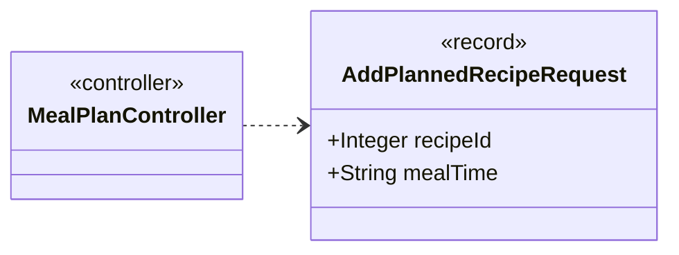

| Component | Type |
|---|---|
| `recipeId` | `Integer` |
| `mealTime` | `String` |

**Referenced by:** `MealPlanController`

## AddTagRequest

*record*

Body of POST /api/recipes/{id}/tags. category is only used when the tag does not exist yet.

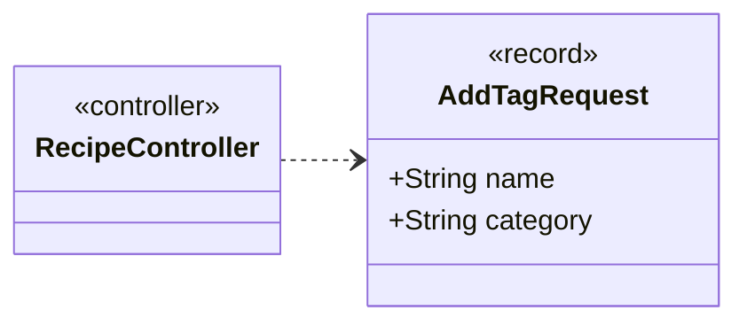

| Component | Type |
|---|---|
| `name` | `String` |
| `category` | `String` |

**Referenced by:** `RecipeController`

## ApiExceptionHandler

*class · error handler*

Turns exceptions into JSON error responses with sensible status codes.
The services report failures as plain RuntimeExceptions wrapping the SQLException,
so a constraint violation (foreign key, unique, primary key) is recognised from the cause
and reported as 409 instead of a generic 500.

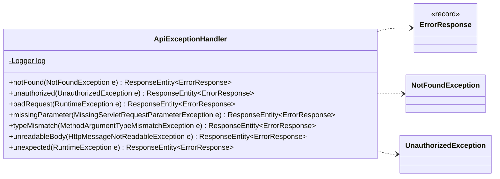

| Field | Type |
|---|---|
| `log` | `Logger` |

| Member | Visibility | What it does |
|---|---|---|
| `ResponseEntity<ErrorResponse> notFound(NotFoundException e)` | public |  |
| `ResponseEntity<ErrorResponse> unauthorized(UnauthorizedException e)` | public |  |
| `ResponseEntity<ErrorResponse> badRequest(RuntimeException e)` | public |  |
| `ResponseEntity<ErrorResponse> missingParameter(MissingServletRequestParameterException e)` | public |  |
| `ResponseEntity<ErrorResponse> typeMismatch(MethodArgumentTypeMismatchException e)` | public |  |
| `ResponseEntity<ErrorResponse> unreadableBody(HttpMessageNotReadableException e)` | public |  |
| `ResponseEntity<ErrorResponse> unexpected(RuntimeException e)` | public |  |

## AuthController

*class · REST controller*

The parts of the login flow that are plain endpoints. Login and logout themselves are handled
by Spring Security's filters (see SecurityConfig) before a request reaches a controller.

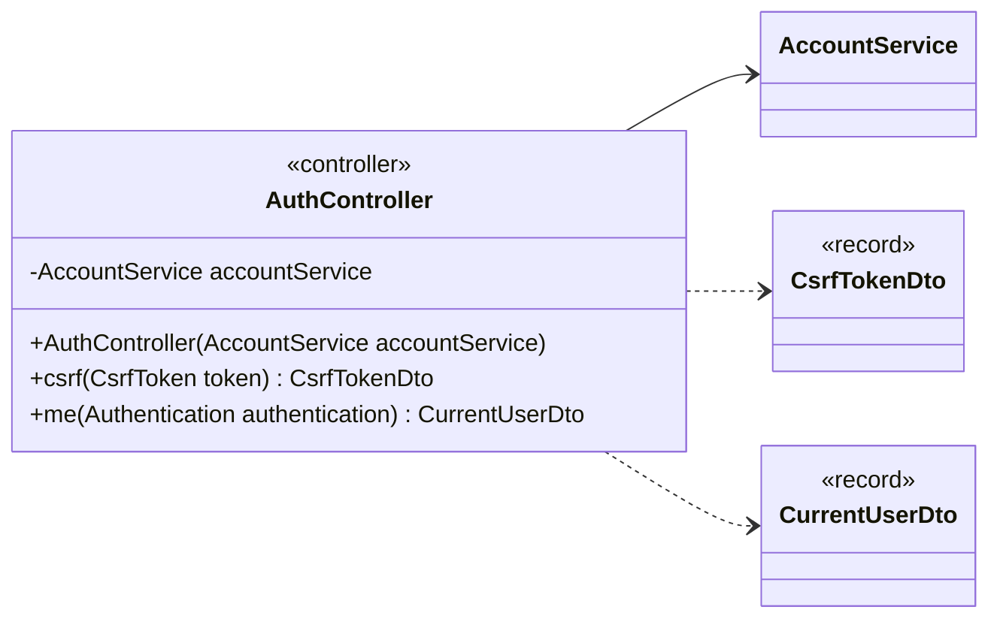

| Field | Type |
|---|---|
| `accountService` | `AccountService` |

| Member | Visibility | What it does |
|---|---|---|
| `AuthController(AccountService accountService)` | public |  |
| `CsrfTokenDto csrf(CsrfToken token)` | public | The CSRF token to send with the next POST/PUT/DELETE. |
| `CurrentUserDto me(Authentication authentication)` | public | The logged-in user and their household. |

## BadRequestException

*class · extends RuntimeException*

Thrown by a controller when request input fails validation; mapped to 400.

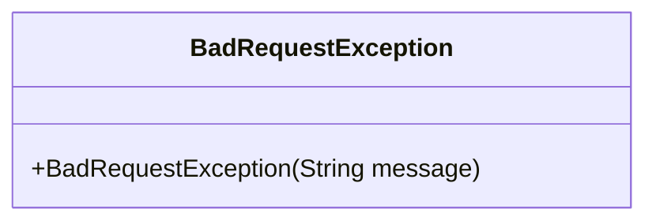

| Member | Visibility | What it does |
|---|---|---|
| `BadRequestException(String message)` | public |  |

## CreateMealPlanRequest

*record*

Body of POST /api/meal-plans, e.g. {"weekStartDate": "2026-09-28"}.

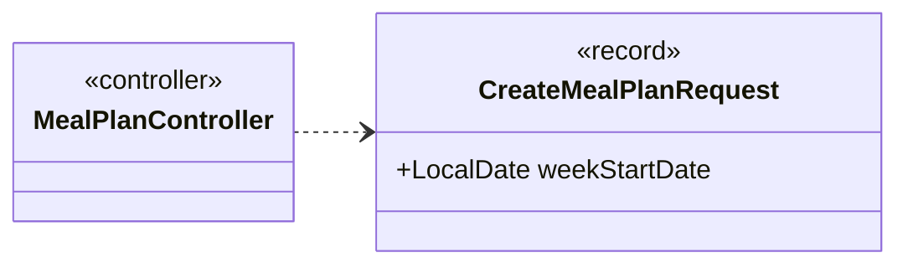

| Component | Type |
|---|---|
| `weekStartDate` | `LocalDate` |

**Referenced by:** `MealPlanController`

## CreatePurchaseRequest

*record*

Body of POST /api/purchases: a purchase of a known store_item. discountId is optional,
wasDiscounted defaults to false, purchaseDate defaults to today.

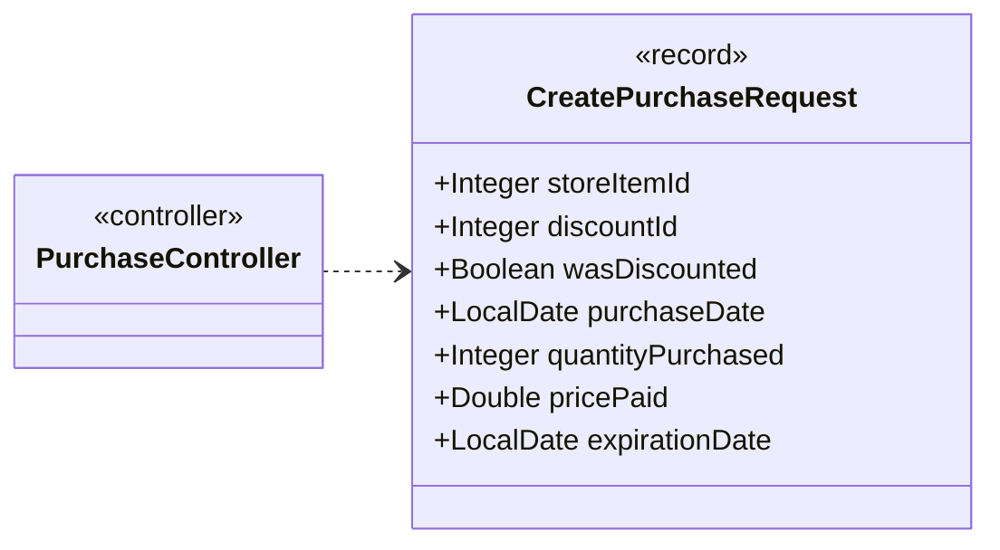

| Component | Type |
|---|---|
| `storeItemId` | `Integer` |
| `discountId` | `Integer` |
| `wasDiscounted` | `Boolean` |
| `purchaseDate` | `LocalDate` |
| `quantityPurchased` | `Integer` |
| `pricePaid` | `Double` |
| `expirationDate` | `LocalDate` |

**Referenced by:** `PurchaseController`

## CsrfTokenDto

*record*

A CSRF token and where to put it: in the headerName header (or the parameterName form field).

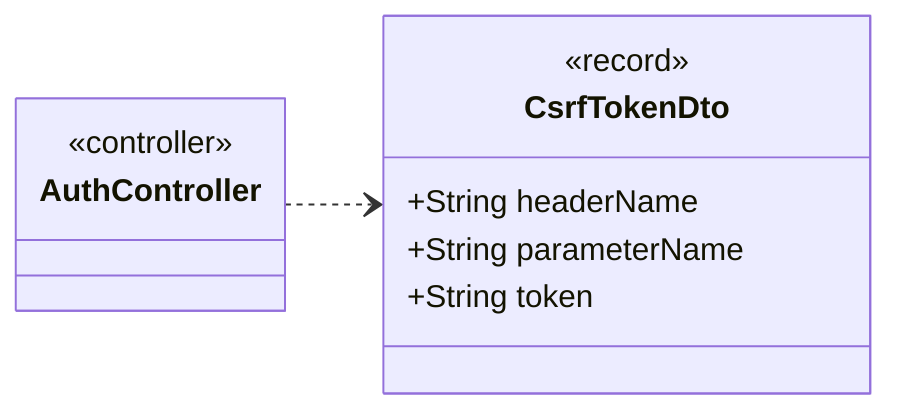

| Component | Type |
|---|---|
| `headerName` | `String` |
| `parameterName` | `String` |
| `token` | `String` |

**Referenced by:** `AuthController`

## CurrentUserDto

*record*

Answer of GET /api/auth/me. household is null for a user who is in no household. The password hash is never sent.

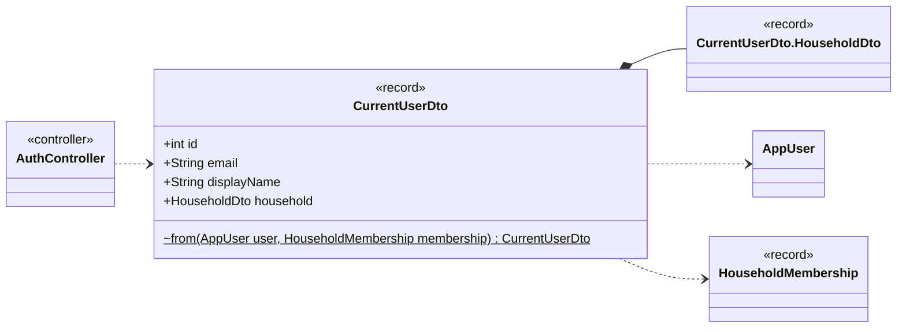

| Component | Type |
|---|---|
| `id` | `int` |
| `email` | `String` |
| `displayName` | `String` |
| `household` | `HouseholdDto` |

| Member | Visibility | What it does |
|---|---|---|
| `CurrentUserDto from(AppUser user, HouseholdMembership membership)` | package static |  |

**Referenced by:** `AuthController`

## CurrentUserDto.HouseholdDto

*record*

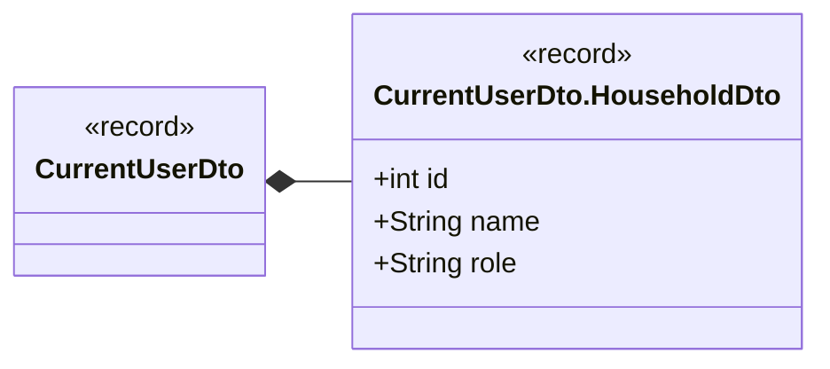

| Component | Type |
|---|---|
| `id` | `int` |
| `name` | `String` |
| `role` | `String` |

**Referenced by:** `CurrentUserDto`

## DahaemApplication

*class · command-line tool*

Entry point for the REST API. A thin web layer over the existing services: controllers
translate HTTP to service calls and service results to DTOs, nothing more.
The console runners (de.dahaem.Main, StoreImportRunner, ...) stay separate entry points.

The database is MariaDB, configured from the DAHAEM_DB_URL, DAHAEM_DB_USER
and DAHAEM_DB_PASSWORD environment variables (see de.dahaem.shared.Database).

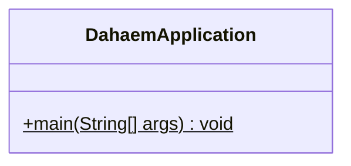

| Member | Visibility | What it does |
|---|---|---|
| `void main(String[] args)` | public static |  |

## DietDto

*record*

What the diet rules say about a recipe, present only when rules were passed.
status: OK, ANPASSBAR (excluded only through POSSIBLE animals of generic items: see hints),
UNCLEAR (a line of the recipe was not matched and a hard rule applies; only returned with includeUnclear) or
HIDDEN (excluded; returned only by GET /api/recipes/{id}, never in the list).
hints: per item that may come from an excluded animal, the animals it may still be (allowedAnimals,
e.g. Salami → Rind, Geflügel). softHits: what a soft rule (avoidTags / avoidItems) matched; absent when nothing.
unmatchedIngredients: the recipe's lines without a catalogue item (detail only).
Presets filter INGREDIENTS only; this is not a halal or kosher certification.

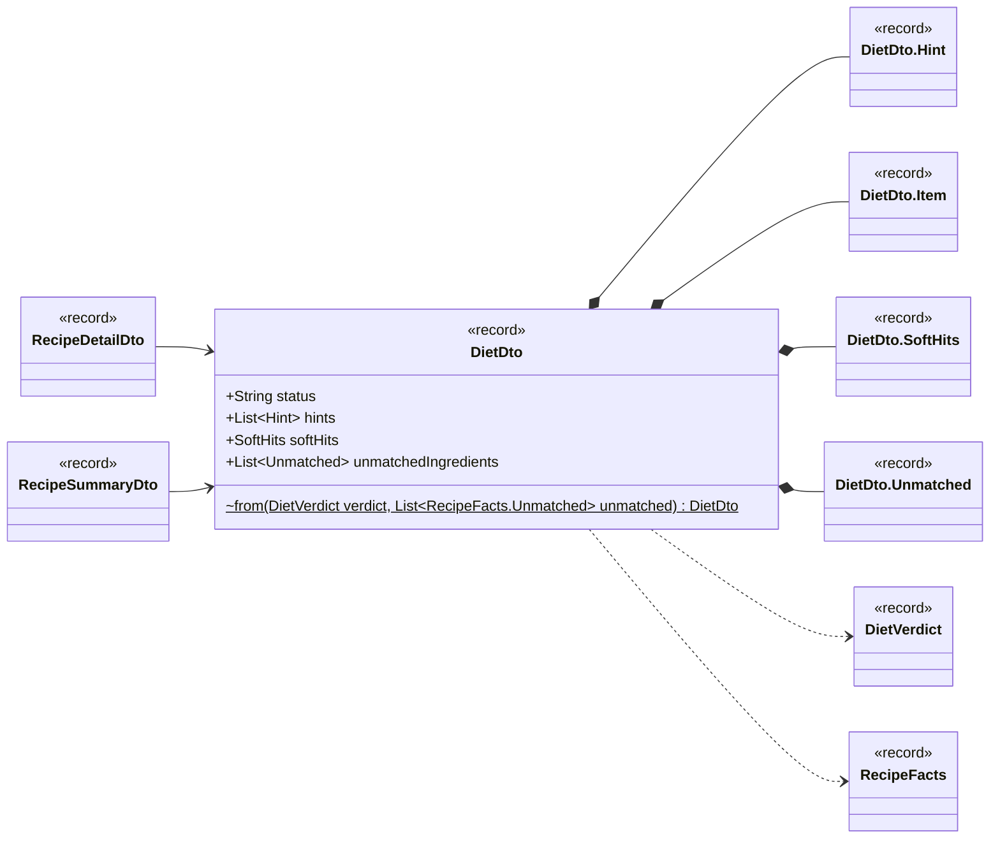

| Component | Type |
|---|---|
| `status` | `String` |
| `hints` | `List<Hint>` |
| `softHits` | `SoftHits` |
| `unmatchedIngredients` | `List<Unmatched>` |

| Member | Visibility | What it does |
|---|---|---|
| `DietDto from(DietVerdict verdict, List<RecipeFacts.Unmatched> unmatched)` | package static |  |

**Referenced by:** `RecipeDetailDto`, `RecipeSummaryDto`

## DietDto.Hint

*record*

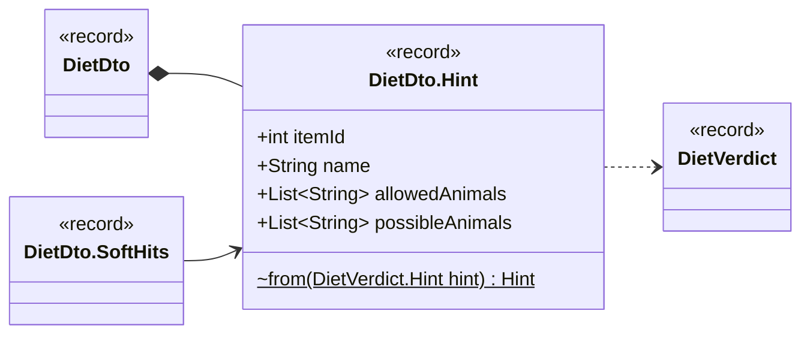

| Component | Type |
|---|---|
| `itemId` | `int` |
| `name` | `String` |
| `allowedAnimals` | `List<String>` |
| `possibleAnimals` | `List<String>` |

| Member | Visibility | What it does |
|---|---|---|
| `Hint from(DietVerdict.Hint hint)` | package static |  |

**Referenced by:** `DietDto`

## DietDto.Item

*record*

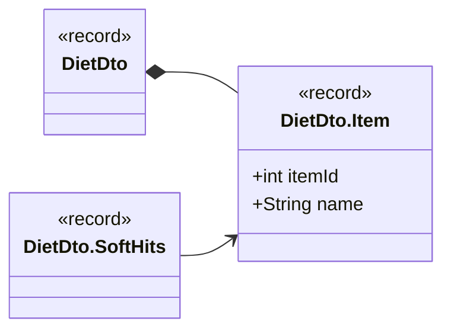

| Component | Type |
|---|---|
| `itemId` | `int` |
| `name` | `String` |

**Referenced by:** `DietDto`

## DietDto.SoftHits

*record*

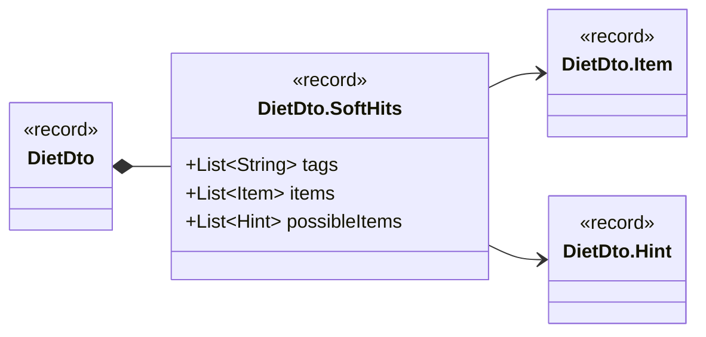

| Component | Type |
|---|---|
| `tags` | `List<String>` |
| `items` | `List<Item>` |
| `possibleItems` | `List<Hint>` |

**Referenced by:** `DietDto`

## DietDto.Unmatched

*record*

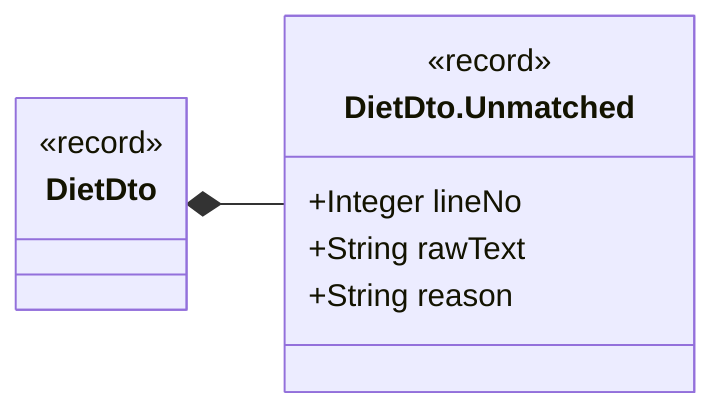

| Component | Type |
|---|---|
| `lineNo` | `Integer` |
| `rawText` | `String` |
| `reason` | `String` |

**Referenced by:** `DietDto`

## ErrorResponse

*record*

JSON body for every error response: the HTTP status, its reason phrase, and a readable message.

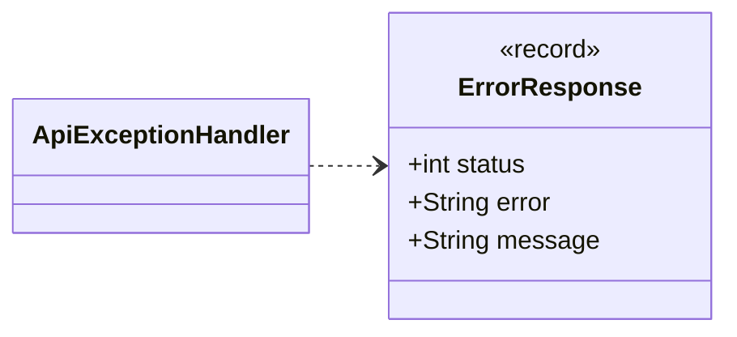

| Component | Type |
|---|---|
| `status` | `int` |
| `error` | `String` |
| `message` | `String` |

**Referenced by:** `ApiExceptionHandler`

## GeneratedShoppingListDto

*record*

Response of POST /api/meal-plans/{planId}/shopping-list: the id of the newly persisted list.

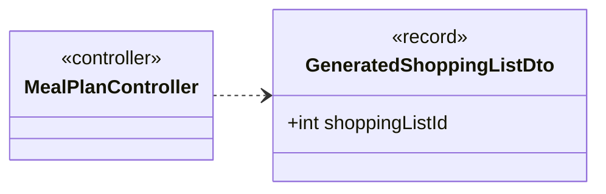

| Component | Type |
|---|---|
| `shoppingListId` | `int` |

**Referenced by:** `MealPlanController`

## InternalTokenFilter

*class · Spring component · extends OncePerRequestFilter*

Shared-secret gate for the internal API. When INTERNAL_API_TOKEN is set (property
dahaem.internal-token), every /api/** request must carry it in the
X-Internal-Token header: a missing or wrong token is answered with 401 and goes no
further. A request with the right token counts as authenticated (it is the PHP front end, which
does its own user login) and is exempt from CSRF, which only protects browser sessions.

When no token is configured the filter does nothing and the session login in
SecurityConfig applies as before (local development, tests).

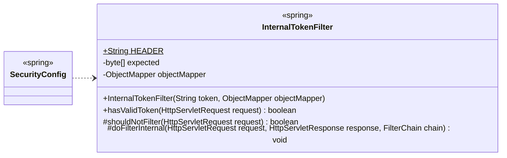

| Field | Type |
|---|---|
| `HEADER` | `String` |
| `expected` | `byte[]` |
| `objectMapper` | `ObjectMapper` |

| Member | Visibility | What it does |
|---|---|---|
| `InternalTokenFilter(String token, ObjectMapper objectMapper)` | public |  |
| `boolean hasValidToken(HttpServletRequest request)` | public | True if the request carries the configured token (never true when none is configured). |
| `boolean shouldNotFilter(HttpServletRequest request)` | protected |  |
| `void doFilterInternal(HttpServletRequest request, HttpServletResponse response, FilterChain chain)` | protected |  |

**Referenced by:** `SecurityConfig`

## InventoryController

*class · REST controller*

```mermaid
classDiagram
    direction LR
    class api_InventoryController["InventoryController"] {
        <<controller>>
        -InventoryService inventoryService
        +InventoryController(InventoryService inventoryService)
        +all() List~ItemDto~
        +expiring(int days) List~ItemDto~
        +lowStock(int threshold) List~ItemDto~
    }
    class inventory_InventoryService["InventoryService"]
    class api_ItemDto["ItemDto"] {
        <<record>>
    }
    api_InventoryController --> inventory_InventoryService
    api_InventoryController ..> api_ItemDto
```

| Field | Type |
|---|---|
| `inventoryService` | `InventoryService` |

| Member | Visibility | What it does |
|---|---|---|
| `InventoryController(InventoryService inventoryService)` | public |  |
| `List<ItemDto> all()` | public |  |
| `List<ItemDto> expiring(int days)` | public | Items expiring within the next days days (default 7). |
| `List<ItemDto> lowStock(int threshold)` | public | Items at or below threshold units in stock (default 1). |

## ItemDto

*record*

One inventory item as returned by /api/inventory.

```mermaid
classDiagram
    direction LR
    class api_ItemDto["ItemDto"] {
        <<record>>
        +int id
        +String nameEnglish
        +String nameDeutsch
        +int quantity
        +String unit
        +String category
        +String subcategory
        +LocalDate earliestExpDate
        ~from(Item item) ItemDto$
    }
    class inventory_Item["Item"]
    class api_InventoryController["InventoryController"] {
        <<controller>>
    }
    api_ItemDto ..> inventory_Item
    api_InventoryController ..> api_ItemDto
```

| Component | Type |
|---|---|
| `id` | `int` |
| `nameEnglish` | `String` |
| `nameDeutsch` | `String` |
| `quantity` | `int` |
| `unit` | `String` |
| `category` | `String` |
| `subcategory` | `String` |
| `earliestExpDate` | `LocalDate` |

| Member | Visibility | What it does |
|---|---|---|
| `ItemDto from(Item item)` | package static |  |

**Referenced by:** `InventoryController`

## MealPlanController

*class · REST controller*

```mermaid
classDiagram
    direction LR
    class api_MealPlanController["MealPlanController"] {
        <<controller>>
        -MealPlanService mealPlanService
        -RecipeService recipeService
        -ShoppingListService shoppingListService
        +MealPlanController(MealPlanService mealPlanService, RecipeService recipeService, ShoppingListService shoppingListService)
        +all() List~MealPlanDto~
        +create(CreateMealPlanRequest request) MealPlanDto
        +addRecipe(int id, AddPlannedRecipeRequest request) MealPlanDto
        +removeRecipe(int id, int recipeId) MealPlanDto
        +generateShoppingList(int id, Integer people) GeneratedShoppingListDto
    }
    class mealplanner_MealPlanService["MealPlanService"]
    class mealplanner_RecipeService["RecipeService"]
    class shopping_ShoppingListService["ShoppingListService"]
    class api_MealPlanDto["MealPlanDto"] {
        <<record>>
    }
    class api_CreateMealPlanRequest["CreateMealPlanRequest"] {
        <<record>>
    }
    class api_AddPlannedRecipeRequest["AddPlannedRecipeRequest"] {
        <<record>>
    }
    class api_GeneratedShoppingListDto["GeneratedShoppingListDto"] {
        <<record>>
    }
    api_MealPlanController --> mealplanner_MealPlanService
    api_MealPlanController --> mealplanner_RecipeService
    api_MealPlanController --> shopping_ShoppingListService
    api_MealPlanController ..> api_MealPlanDto
    api_MealPlanController ..> api_CreateMealPlanRequest
    api_MealPlanController ..> api_AddPlannedRecipeRequest
    api_MealPlanController ..> api_GeneratedShoppingListDto
```

| Field | Type |
|---|---|
| `mealPlanService` | `MealPlanService` |
| `recipeService` | `RecipeService` |
| `shoppingListService` | `ShoppingListService` |

| Member | Visibility | What it does |
|---|---|---|
| `MealPlanController(MealPlanService mealPlanService, RecipeService recipeService, ShoppingListService shoppingListService)` | public |  |
| `List<MealPlanDto> all()` | public |  |
| `MealPlanDto create(CreateMealPlanRequest request)` | public | Creates an empty plan for the week. |
| `MealPlanDto addRecipe(int id, AddPlannedRecipeRequest request)` | public | Adds a recipe to a plan and returns the updated plan. |
| `MealPlanDto removeRecipe(int id, int recipeId)` | public | Removes a recipe from a plan and returns the updated plan. |
| `GeneratedShoppingListDto generateShoppingList(int id, Integer people)` | public | Builds and persists a shopping list from a plan's recipes (see ShoppingListService.generateFromMealPlan(int)): one line per item still missing after subtracting inventory, no store item pre-chosen. |

## MealPlanDto

*record*

One weekly meal plan with the recipes slotted into it.

```mermaid
classDiagram
    direction LR
    class api_MealPlanDto["MealPlanDto"] {
        <<record>>
        +int id
        +LocalDate weekStartDate
        +List~PlannedRecipe~ recipes
        ~from(MealPlan plan, List~MealPlanRecipe~ recipes) MealPlanDto$
    }
    class api_MealPlanDto_PlannedRecipe["MealPlanDto.PlannedRecipe"] {
        <<record>>
    }
    class mealplanner_MealPlan["MealPlan"]
    class mealplanner_MealPlanRecipe["MealPlanRecipe"]
    class api_MealPlanController["MealPlanController"] {
        <<controller>>
    }
    api_MealPlanDto *-- api_MealPlanDto_PlannedRecipe
    api_MealPlanDto ..> mealplanner_MealPlan
    api_MealPlanDto ..> mealplanner_MealPlanRecipe
    api_MealPlanController ..> api_MealPlanDto
```

| Component | Type |
|---|---|
| `id` | `int` |
| `weekStartDate` | `LocalDate` |
| `recipes` | `List<PlannedRecipe>` |

| Member | Visibility | What it does |
|---|---|---|
| `MealPlanDto from(MealPlan plan, List<MealPlanRecipe> recipes)` | package static |  |

**Referenced by:** `MealPlanController`

## MealPlanDto.PlannedRecipe

*record*

```mermaid
classDiagram
    direction LR
    class api_MealPlanDto_PlannedRecipe["MealPlanDto.PlannedRecipe"] {
        <<record>>
        +int recipeId
        +String recipeName
        +String mealTime
        ~from(MealPlanRecipe recipe) PlannedRecipe$
    }
    class api_MealPlanDto["MealPlanDto"] {
        <<record>>
    }
    class mealplanner_MealPlanRecipe["MealPlanRecipe"]
    api_MealPlanDto_PlannedRecipe ..> mealplanner_MealPlanRecipe
    api_MealPlanDto *-- api_MealPlanDto_PlannedRecipe
```

| Component | Type |
|---|---|
| `recipeId` | `int` |
| `recipeName` | `String` |
| `mealTime` | `String` |

| Member | Visibility | What it does |
|---|---|---|
| `PlannedRecipe from(MealPlanRecipe recipe)` | package static |  |

**Referenced by:** `MealPlanDto`

## NotFoundException

*class · extends RuntimeException*

Thrown by a controller when the requested resource does not exist; mapped to 404.

```mermaid
classDiagram
    direction LR
    class api_NotFoundException["NotFoundException"] {
        +NotFoundException(String message)
    }
    class api_ApiExceptionHandler["ApiExceptionHandler"]
    api_ApiExceptionHandler ..> api_NotFoundException
```

| Member | Visibility | What it does |
|---|---|---|
| `NotFoundException(String message)` | public |  |

**Referenced by:** `ApiExceptionHandler`

## PersistedShoppingListDto

*record*

A previously generated shopping list as it was persisted: its items with names, quantity still
needed, every current store option for each item (cheapest till price first, but not pre-picked)
and the store item the user has selected, if any. DAHÄM surfaces the options; it never chooses
one for the user.

```mermaid
classDiagram
    direction LR
    class api_PersistedShoppingListDto["PersistedShoppingListDto"] {
        <<record>>
        +int id
        +Integer mealPlanId
        +LocalDate createdDate
        +boolean status
        +List~Line~ items
        ~from(PersistedShoppingList list) PersistedShoppingListDto$
    }
    class api_PersistedShoppingListDto_Line["PersistedShoppingListDto.Line"] {
        <<record>>
    }
    class shopping_PersistedShoppingList["PersistedShoppingList"] {
        <<record>>
    }
    class api_ShoppingListItemController["ShoppingListItemController"] {
        <<controller>>
    }
    api_PersistedShoppingListDto *-- api_PersistedShoppingListDto_Line
    api_PersistedShoppingListDto ..> shopping_PersistedShoppingList
    api_ShoppingListItemController ..> api_PersistedShoppingListDto
```

| Component | Type |
|---|---|
| `id` | `int` |
| `mealPlanId` | `Integer` |
| `createdDate` | `LocalDate` |
| `status` | `boolean` |
| `items` | `List<Line>` |

| Member | Visibility | What it does |
|---|---|---|
| `PersistedShoppingListDto from(PersistedShoppingList list)` | package static |  |

**Referenced by:** `ShoppingListItemController`

## PersistedShoppingListDto.Line

*record*

```mermaid
classDiagram
    direction LR
    class api_PersistedShoppingListDto_Line["PersistedShoppingListDto.Line"] {
        <<record>>
        +int shoppingListItemId
        +Integer inventoryItemId
        +String nameDeutsch
        +String nameEnglish
        +int quantityNeeded
        +boolean isManual
        +List~ShoppingListDto.StoreOptionDto~ storeOptions
        +Integer selectedStoreItemId
        ~from(PersistedShoppingListItem item) Line$
    }
    class api_PersistedShoppingListDto["PersistedShoppingListDto"] {
        <<record>>
    }
    class api_ShoppingListDto["ShoppingListDto"] {
        <<record>>
    }
    class shopping_PersistedShoppingListItem["PersistedShoppingListItem"] {
        <<record>>
    }
    api_PersistedShoppingListDto_Line --> api_ShoppingListDto
    api_PersistedShoppingListDto_Line ..> shopping_PersistedShoppingListItem
    api_PersistedShoppingListDto *-- api_PersistedShoppingListDto_Line
```

| Component | Type |
|---|---|
| `shoppingListItemId` | `int` |
| `inventoryItemId` | `Integer` |
| `nameDeutsch` | `String` |
| `nameEnglish` | `String` |
| `quantityNeeded` | `int` |
| `isManual` | `boolean` |
| `storeOptions` | `List<ShoppingListDto.StoreOptionDto>` |
| `selectedStoreItemId` | `Integer` |

| Member | Visibility | What it does |
|---|---|---|
| `Line from(PersistedShoppingListItem item)` | package static |  |

**Referenced by:** `PersistedShoppingListDto`

## PurchaseController

*class · REST controller*

```mermaid
classDiagram
    direction LR
    class api_PurchaseController["PurchaseController"] {
        <<controller>>
        -PurchaseService purchaseService
        +PurchaseController(PurchaseService purchaseService)
        +all() List~PurchaseDto~
        +create(CreatePurchaseRequest request) PurchaseDto
        +spending(LocalDate from, LocalDate to) SpendingDto
    }
    class finance_PurchaseService["PurchaseService"]
    class api_PurchaseDto["PurchaseDto"] {
        <<record>>
    }
    class api_CreatePurchaseRequest["CreatePurchaseRequest"] {
        <<record>>
    }
    class api_SpendingDto["SpendingDto"] {
        <<record>>
    }
    api_PurchaseController --> finance_PurchaseService
    api_PurchaseController ..> api_PurchaseDto
    api_PurchaseController ..> api_CreatePurchaseRequest
    api_PurchaseController ..> api_SpendingDto
```

| Field | Type |
|---|---|
| `purchaseService` | `PurchaseService` |

| Member | Visibility | What it does |
|---|---|---|
| `PurchaseController(PurchaseService purchaseService)` | public |  |
| `List<PurchaseDto> all()` | public |  |
| `PurchaseDto create(CreatePurchaseRequest request)` | public | Records a purchase of a known store_item and applies it to inventory (one transaction, in the service). |
| `SpendingDto spending(LocalDate from, LocalDate to)` | public | Total spending: over all purchases, or between from and to (inclusive) when both are given. |

## PurchaseDto

*record*

```mermaid
classDiagram
    direction LR
    class api_PurchaseDto["PurchaseDto"] {
        <<record>>
        +int id
        +int storeItemId
        +Integer discountId
        +boolean wasDiscounted
        +LocalDate purchaseDate
        +int quantityPurchased
        +double pricePaid
        +LocalDate expirationDate
        ~from(Purchase purchase) PurchaseDto$
    }
    class finance_Purchase["Purchase"]
    class api_PurchaseController["PurchaseController"] {
        <<controller>>
    }
    api_PurchaseDto ..> finance_Purchase
    api_PurchaseController ..> api_PurchaseDto
```

| Component | Type |
|---|---|
| `id` | `int` |
| `storeItemId` | `int` |
| `discountId` | `Integer` |
| `wasDiscounted` | `boolean` |
| `purchaseDate` | `LocalDate` |
| `quantityPurchased` | `int` |
| `pricePaid` | `double` |
| `expirationDate` | `LocalDate` |

| Member | Visibility | What it does |
|---|---|---|
| `PurchaseDto from(Purchase purchase)` | package static |  |

**Referenced by:** `PurchaseController`

## RecipeController

*class · REST controller*

```mermaid
classDiagram
    direction LR
    class api_RecipeController["RecipeController"] {
        <<controller>>
        -RecipeService recipeService
        -TagService tagService
        -DietFilterService dietFilter
        +RecipeController(RecipeService recipeService, TagService tagService, DietFilterService dietFilter)
        +all(List~String~ diet, List~String~ excludeTags, List~Integer~ excludeItems, List~String~ avoidTags, List~Integer~ avoidItems, boolean includeUnclear) List~RecipeSummaryDto~
        +byId(int id, Integer people, String basis, List~String~ diet, List~String~ excludeTags, List~Integer~ excludeItems, List~String~ avoidTags, List~Integer~ avoidItems, boolean includeUnclear) RecipeDetailDto
        +tags(int id) List~TagDto~
        +addTag(int id, AddTagRequest request) TagDto
        ~findRecipe(RecipeService recipeService, int id) Recipe$
    }
    class mealplanner_RecipeService["RecipeService"]
    class tags_TagService["TagService"]
    class diet_DietFilterService["DietFilterService"]
    class api_RecipeSummaryDto["RecipeSummaryDto"] {
        <<record>>
    }
    class api_RecipeDetailDto["RecipeDetailDto"] {
        <<record>>
    }
    class api_TagDto["TagDto"] {
        <<record>>
    }
    class api_AddTagRequest["AddTagRequest"] {
        <<record>>
    }
    class mealplanner_Recipe["Recipe"]
    api_RecipeController --> mealplanner_RecipeService
    api_RecipeController --> tags_TagService
    api_RecipeController --> diet_DietFilterService
    api_RecipeController ..> api_RecipeSummaryDto
    api_RecipeController ..> api_RecipeDetailDto
    api_RecipeController ..> api_TagDto
    api_RecipeController ..> api_AddTagRequest
    api_RecipeController ..> mealplanner_Recipe
```

| Field | Type |
|---|---|
| `recipeService` | `RecipeService` |
| `tagService` | `TagService` |
| `dietFilter` | `DietFilterService` |

| Member | Visibility | What it does |
|---|---|---|
| `RecipeController(RecipeService recipeService, TagService tagService, DietFilterService dietFilter)` | public |  |
| `List<RecipeSummaryDto> all(List<String> diet, List<String> excludeTags, List<Integer> excludeItems, List<String> avoidTags, List<Integer> avoidItems, boolean includeUnclear)` | public | All recipes by name. |
| `RecipeDetailDto byId(int id, Integer people, String basis, List<String> diet, List<String> excludeTags, List<Integer> excludeItems, List<String> avoidTags, List<Integer> avoidItems, boolean includeUnclear)` | public | The recipe with its ingredients and instructions. |
| `List<TagDto> tags(int id)` | public |  |
| `TagDto addTag(int id, AddTagRequest request)` | public | Tags the recipe, creating the tag first if no tag with that name exists. |
| `Recipe findRecipe(RecipeService recipeService, int id)` | package static |  |

## RecipeDetailDto

*record*

One recipe with its nutrition, ingredients and ordered instructions, as returned by /api/recipes/{id}.
servingsMax is the upper bound of a "3 – 4 Personen" range (servings is then the
lower bound), null when the recipe is not a range. people is the head count asked for with
?people=N (null when not asked); each ingredient's scaledQuantity is its
quantity scaled to that count, from servings by default or from servingsMax
when basis is "max", and each instruction's scaledInstruction is its step text
with the amounts for that count. basis is the one actually used: "max" only when
it was asked for and the recipe is a range. scalable is false when that servings count is
not positive, in which case nothing is scaled. The enrichment fields (description,
imageUrl, thumbnailUrl, imageSource, cuisine, ratingAvg,
ratingCount, publishedDate) are as in RecipeSummaryDto; null when missing. tags are the recipe's tags, sorted by group then name:
source is "manual" (added by a person) or "derived" (worked out from DAHÄM's data).
diet is present only when diet rules were passed (see DietDto): the status, the hints and the
recipe's unmatched ingredient lines.

```mermaid
classDiagram
    direction LR
    class api_RecipeDetailDto["RecipeDetailDto"] {
        <<record>>
        +int id
        +String name
        +int servings
        +Integer servingsMax
        +String basis
        +Integer people
        +boolean scalable
        +int prepTime
        +int cookTime
        +Nutrition nutrition
        +List~Ingredient~ ingredients
        +List~Instruction~ instructions
        +String description
        +String imageUrl
        +String thumbnailUrl
        +String imageSource
        +String cuisine
        +BigDecimal ratingAvg
        +Integer ratingCount
        +LocalDate publishedDate
        +List~Tag~ tags
        +DietDto diet
        +String BASIS_SERVINGS$
        +String BASIS_MAX$
        ~from(Recipe recipe, List~RecipeIngredient~ ingredients, List~RecipeInstruction~ instructions, List~TagRepository.RecipeTag~ tags, Integer people, boolean useMax) RecipeDetailDto$
        ~from(Recipe recipe, List~RecipeIngredient~ ingredients, List~RecipeInstruction~ instructions, List~TagRepository.RecipeTag~ tags, Integer people, boolean useMax, DietDto diet) RecipeDetailDto$
    }
    class api_RecipeDetailDto_Tag["RecipeDetailDto.Tag"] {
        <<record>>
    }
    class api_RecipeDetailDto_Nutrition["RecipeDetailDto.Nutrition"] {
        <<record>>
    }
    class api_RecipeDetailDto_Ingredient["RecipeDetailDto.Ingredient"] {
        <<record>>
    }
    class api_RecipeDetailDto_Instruction["RecipeDetailDto.Instruction"] {
        <<record>>
    }
    class api_DietDto["DietDto"] {
        <<record>>
    }
    class mealplanner_Recipe["Recipe"]
    class mealplanner_RecipeIngredient["RecipeIngredient"]
    class mealplanner_RecipeInstruction["RecipeInstruction"]
    class tags_TagRepository["TagRepository"]
    class api_RecipeController["RecipeController"] {
        <<controller>>
    }
    api_RecipeDetailDto *-- api_RecipeDetailDto_Tag
    api_RecipeDetailDto *-- api_RecipeDetailDto_Nutrition
    api_RecipeDetailDto *-- api_RecipeDetailDto_Ingredient
    api_RecipeDetailDto *-- api_RecipeDetailDto_Instruction
    api_RecipeDetailDto --> api_DietDto
    api_RecipeDetailDto ..> mealplanner_Recipe
    api_RecipeDetailDto ..> mealplanner_RecipeIngredient
    api_RecipeDetailDto ..> mealplanner_RecipeInstruction
    api_RecipeDetailDto ..> tags_TagRepository
    api_RecipeController ..> api_RecipeDetailDto
```

| Component | Type |
|---|---|
| `id` | `int` |
| `name` | `String` |
| `servings` | `int` |
| `servingsMax` | `Integer` |
| `basis` | `String` |
| `people` | `Integer` |
| `scalable` | `boolean` |
| `prepTime` | `int` |
| `cookTime` | `int` |
| `nutrition` | `Nutrition` |
| `ingredients` | `List<Ingredient>` |
| `instructions` | `List<Instruction>` |
| `description` | `String` |
| `imageUrl` | `String` |
| `thumbnailUrl` | `String` |
| `imageSource` | `String` |
| `cuisine` | `String` |
| `ratingAvg` | `BigDecimal` |
| `ratingCount` | `Integer` |
| `publishedDate` | `LocalDate` |
| `tags` | `List<Tag>` |
| `diet` | `DietDto` |
| `BASIS_SERVINGS` | `String` |
| `BASIS_MAX` | `String` |

| Member | Visibility | What it does |
|---|---|---|
| `RecipeDetailDto from(Recipe recipe, List<RecipeIngredient> ingredients, List<RecipeInstruction> instructions, List<TagRepository.RecipeTag> tags, Integer people, boolean useMax)` | package static | The recipe with ingredient quantities scaled to people (null for unscaled); people must be at least 1. |
| `RecipeDetailDto from(Recipe recipe, List<RecipeIngredient> ingredients, List<RecipeInstruction> instructions, List<TagRepository.RecipeTag> tags, Integer people, boolean useMax, DietDto diet)` | package static |  |

**Referenced by:** `RecipeController`

## RecipeDetailDto.Tag

*record*

A tag on the recipe: its name, its group (e.g. Tier, Ernährung, Zeit, Nährwerte, Küche) and its source.

```mermaid
classDiagram
    direction LR
    class api_RecipeDetailDto_Tag["RecipeDetailDto.Tag"] {
        <<record>>
        +String name
        +String category
        +String source
        ~from(TagRepository.RecipeTag tag) Tag$
    }
    class api_RecipeDetailDto["RecipeDetailDto"] {
        <<record>>
    }
    class tags_TagRepository["TagRepository"]
    api_RecipeDetailDto_Tag ..> tags_TagRepository
    api_RecipeDetailDto *-- api_RecipeDetailDto_Tag
```

| Component | Type |
|---|---|
| `name` | `String` |
| `category` | `String` |
| `source` | `String` |

| Member | Visibility | What it does |
|---|---|---|
| `Tag from(TagRepository.RecipeTag tag)` | package static |  |

**Referenced by:** `RecipeDetailDto`

## RecipeDetailDto.Nutrition

*record*

Nutrition values as stored (per serving, from the HelloFresh import); any of them may be null when unknown.

```mermaid
classDiagram
    direction LR
    class api_RecipeDetailDto_Nutrition["RecipeDetailDto.Nutrition"] {
        <<record>>
        +Integer calories
        +Integer protein
        +Integer carbs
        +Integer fat
        +Integer fiber
        +Integer sugar
    }
    class api_RecipeDetailDto["RecipeDetailDto"] {
        <<record>>
    }
    api_RecipeDetailDto *-- api_RecipeDetailDto_Nutrition
```

| Component | Type |
|---|---|
| `calories` | `Integer` |
| `protein` | `Integer` |
| `carbs` | `Integer` |
| `fat` | `Integer` |
| `fiber` | `Integer` |
| `sugar` | `Integer` |

**Referenced by:** `RecipeDetailDto`

## RecipeDetailDto.Ingredient

*record*

quantity is the stored amount for the recipe as written, as a decimal (0.5 Stück);
scaledQuantity is that amount for people, rounded to 2 decimals (equal to
quantity when unscaled). A "to taste" ingredient (toTaste true, e.g. salt) has
no amount: quantity and scaledQuantity are both null and unit is empty.

```mermaid
classDiagram
    direction LR
    class api_RecipeDetailDto_Ingredient["RecipeDetailDto.Ingredient"] {
        <<record>>
        +int itemId
        +String nameEnglish
        +String nameDeutsch
        +Double quantity
        +Double scaledQuantity
        +String unit
        +boolean toTaste
        ~from(RecipeIngredient ingredient, Integer people, int servings) Ingredient$
    }
    class api_RecipeDetailDto["RecipeDetailDto"] {
        <<record>>
    }
    class mealplanner_RecipeIngredient["RecipeIngredient"]
    api_RecipeDetailDto_Ingredient ..> mealplanner_RecipeIngredient
    api_RecipeDetailDto *-- api_RecipeDetailDto_Ingredient
```

| Component | Type |
|---|---|
| `itemId` | `int` |
| `nameEnglish` | `String` |
| `nameDeutsch` | `String` |
| `quantity` | `Double` |
| `scaledQuantity` | `Double` |
| `unit` | `String` |
| `toTaste` | `boolean` |

| Member | Visibility | What it does |
|---|---|---|
| `Ingredient from(RecipeIngredient ingredient, Integer people, int servings)` | package static |  |

**Referenced by:** `RecipeDetailDto`

## RecipeDetailDto.Instruction

*record*

instruction is the step as stored (HelloFresh's 1 EL [1,5 EL | 2 EL] Butter*);
scaledInstruction is the same step with its amounts for people (see
StepAmounts) — without people it is the stored text with each bracket resolved to
the recipe's own head count. Text that can't be read safely is left exactly as written.

```mermaid
classDiagram
    direction LR
    class api_RecipeDetailDto_Instruction["RecipeDetailDto.Instruction"] {
        <<record>>
        +int stepNumber
        +String instruction
        +String scaledInstruction
        +String notes
        +String source
        ~from(RecipeInstruction instruction, Recipe recipe, Integer people, boolean useMax) Instruction$
    }
    class api_RecipeDetailDto["RecipeDetailDto"] {
        <<record>>
    }
    class mealplanner_Recipe["Recipe"]
    class mealplanner_RecipeInstruction["RecipeInstruction"]
    api_RecipeDetailDto_Instruction ..> mealplanner_Recipe
    api_RecipeDetailDto_Instruction ..> mealplanner_RecipeInstruction
    api_RecipeDetailDto *-- api_RecipeDetailDto_Instruction
```

| Component | Type |
|---|---|
| `stepNumber` | `int` |
| `instruction` | `String` |
| `scaledInstruction` | `String` |
| `notes` | `String` |
| `source` | `String` |

| Member | Visibility | What it does |
|---|---|---|
| `Instruction from(RecipeInstruction instruction, Recipe recipe, Integer people, boolean useMax)` | package static |  |

**Referenced by:** `RecipeDetailDto`

## RecipeSuggestionDto

*record*

A ranked recipe suggestion: which recipe, how strongly it matched the signal, and why.

```mermaid
classDiagram
    direction LR
    class api_RecipeSuggestionDto["RecipeSuggestionDto"] {
        <<record>>
        +int recipeId
        +String recipeName
        +int score
        +List~Integer~ matchingItemIds
        ~from(RecipeSuggestion suggestion) RecipeSuggestionDto$
    }
    class suggestions_RecipeSuggestion["RecipeSuggestion"]
    class api_SuggestionController["SuggestionController"] {
        <<controller>>
    }
    api_RecipeSuggestionDto ..> suggestions_RecipeSuggestion
    api_SuggestionController ..> api_RecipeSuggestionDto
```

| Component | Type |
|---|---|
| `recipeId` | `int` |
| `recipeName` | `String` |
| `score` | `int` |
| `matchingItemIds` | `List<Integer>` |

| Member | Visibility | What it does |
|---|---|---|
| `RecipeSuggestionDto from(RecipeSuggestion suggestion)` | package static |  |

**Referenced by:** `SuggestionController`

## RecipeSummaryDto

*record*

A recipe in a list: identity and the numbers you'd scan a list by. servingsMax is the
upper bound of a "3 – 4 Personen" range (servings is then the lower bound), null otherwise.
The enrichment fields are null when the recipe has no such data: imageUrl / thumbnailUrl
are links (the browser loads the image from its source), imageSource says where the image
comes from (hellofresh, own or generated), cuisine is one German name,
ratingAvg is 0 - 5 with 2 decimals.
tags are the recipe's tag names (no group or source: GET /api/recipes/{id} has those),
sorted by group then name; empty when it has none.
diet is present only when diet rules were passed to GET /api/recipes (see DietDto).

```mermaid
classDiagram
    direction LR
    class api_RecipeSummaryDto["RecipeSummaryDto"] {
        <<record>>
        +int id
        +String name
        +int servings
        +Integer servingsMax
        +int prepTime
        +int cookTime
        +Integer calories
        +String description
        +String imageUrl
        +String thumbnailUrl
        +String imageSource
        +String cuisine
        +BigDecimal ratingAvg
        +Integer ratingCount
        +LocalDate publishedDate
        +List~String~ tags
        +DietDto diet
        ~from(Recipe recipe, List~String~ tags) RecipeSummaryDto$
        ~from(Recipe recipe, List~String~ tags, DietDto diet) RecipeSummaryDto$
    }
    class api_DietDto["DietDto"] {
        <<record>>
    }
    class mealplanner_Recipe["Recipe"]
    class api_RecipeController["RecipeController"] {
        <<controller>>
    }
    api_RecipeSummaryDto --> api_DietDto
    api_RecipeSummaryDto ..> mealplanner_Recipe
    api_RecipeController ..> api_RecipeSummaryDto
```

| Component | Type |
|---|---|
| `id` | `int` |
| `name` | `String` |
| `servings` | `int` |
| `servingsMax` | `Integer` |
| `prepTime` | `int` |
| `cookTime` | `int` |
| `calories` | `Integer` |
| `description` | `String` |
| `imageUrl` | `String` |
| `thumbnailUrl` | `String` |
| `imageSource` | `String` |
| `cuisine` | `String` |
| `ratingAvg` | `BigDecimal` |
| `ratingCount` | `Integer` |
| `publishedDate` | `LocalDate` |
| `tags` | `List<String>` |
| `diet` | `DietDto` |

| Member | Visibility | What it does |
|---|---|---|
| `RecipeSummaryDto from(Recipe recipe, List<String> tags)` | package static |  |
| `RecipeSummaryDto from(Recipe recipe, List<String> tags, DietDto diet)` | package static |  |

**Referenced by:** `RecipeController`

## SecurityConfig

*class · configuration*

Who may call the API. Session-based form login, meant for the same-origin PWA:

- POST /api/auth/login (form fields email, password) checks the password
      against the BCrypt hash in app_user and starts an HTTP session (JSESSIONID cookie).
      204 on success, 401 on a wrong email or password.

- POST /api/auth/logout ends the session. 204.

- Every other /api/** request needs a logged-in session, else 401 (JSON, never a redirect,
      so the frontend can react by showing its login screen).

- Everything outside /api/** is the static PWA shell and stays public, so the login
      screen itself can load.

When INTERNAL_API_TOKEN is set, InternalTokenFilter additionally requires it on
every /api/** request and lets such requests through without a session or CSRF token.

CSRF protection is on for every state-changing request, the login and logout included. The
token lives in the session; the frontend fetches it from GET /api/auth/csrf and sends it
back in the header that endpoint names. Logging in rotates both the session id and the token.

```mermaid
classDiagram
    direction LR
    class api_SecurityConfig["SecurityConfig"] {
        <<spring>>
        +internalTokenFilterRegistration(InternalTokenFilter filter) FilterRegistrationBean~InternalTokenFilter~
        +passwordEncoder() PasswordEncoder
        +userDetailsService(AccountService accountService) UserDetailsService
        +securityFilterChain(HttpSecurity http, ObjectMapper objectMapper, InternalTokenFilter internalToken) SecurityFilterChain
    }
    class api_InternalTokenFilter["InternalTokenFilter"] {
        <<spring>>
    }
    class auth_AccountService["AccountService"]
    api_SecurityConfig ..> api_InternalTokenFilter
    api_SecurityConfig ..> auth_AccountService
```

| Member | Visibility | What it does |
|---|---|---|
| `FilterRegistrationBean<InternalTokenFilter> internalTokenFilterRegistration(InternalTokenFilter filter)` | public | The token filter belongs in the Spring Security chain only, not also in the servlet container's chain. |
| `PasswordEncoder passwordEncoder()` | public |  |
| `UserDetailsService userDetailsService(AccountService accountService)` | public | Looks users up by email (the login name) through the account service; roles are not used yet. |
| `SecurityFilterChain securityFilterChain(HttpSecurity http, ObjectMapper objectMapper, InternalTokenFilter internalToken)` | public |  |

## SelectStoreItemRequest

*record*

Body of PUT /api/shopping-lists/{listId}/items/{itemId}/store-item, e.g. {"storeItemId": 5}.
A null (or omitted) storeItemId clears the line's selection.

```mermaid
classDiagram
    direction LR
    class api_SelectStoreItemRequest["SelectStoreItemRequest"] {
        <<record>>
        +Integer storeItemId
    }
    class api_ShoppingListItemController["ShoppingListItemController"] {
        <<controller>>
    }
    api_ShoppingListItemController ..> api_SelectStoreItemRequest
```

| Component | Type |
|---|---|
| `storeItemId` | `Integer` |

**Referenced by:** `ShoppingListItemController`

## ServiceConfig

*class · configuration*

Wires the existing plain-Java repositories and services as Spring beans.
The classes themselves stay free of Spring annotations; they are built here exactly
the way the console runners build them, just once per application.

```mermaid
classDiagram
    direction LR
    class api_ServiceConfig["ServiceConfig"] {
        <<spring>>
        +inventoryRepository() InventoryRepository
        +inventoryService(InventoryRepository inventoryRepository) InventoryService
        +recipeRepository() RecipeRepository
        +recipeService(RecipeRepository recipeRepository) RecipeService
        +mealPlanRepository() MealPlanRepository
        +mealPlanService(MealPlanRepository mealPlanRepository) MealPlanService
        +tagRepository() TagRepository
        +tagService(TagRepository tagRepository) TagService
        +shoppingListRepository() ShoppingListRepository
        +shoppingListService(ShoppingListRepository shoppingListRepository, MealPlanRepository mealPlanRepository, InventoryRepository inventoryRepository) ShoppingListService
        +storeRepository() StoreRepository
        +purchaseRepository() PurchaseRepository
        +purchaseService(PurchaseRepository purchaseRepository, StoreRepository storeRepository, InventoryRepository inventoryRepository) PurchaseService
        +accountRepository() AccountRepository
        +accountService(AccountRepository accountRepository, PasswordEncoder passwordEncoder) AccountService
        +suggestionRepository() SuggestionRepository
        +suggestionService(SuggestionRepository suggestionRepository) SuggestionService
        +dietFilterRepository() DietFilterRepository
        +dietPresets() DietPresets
        +dietFilterService(DietFilterRepository dietFilterRepository, DietPresets dietPresets) DietFilterService
    }
    class inventory_InventoryRepository["InventoryRepository"]
    class inventory_InventoryService["InventoryService"]
    class mealplanner_RecipeRepository["RecipeRepository"]
    class mealplanner_RecipeService["RecipeService"]
    class mealplanner_MealPlanRepository["MealPlanRepository"]
    class mealplanner_MealPlanService["MealPlanService"]
    class tags_TagRepository["TagRepository"]
    class tags_TagService["TagService"]
    class shopping_ShoppingListRepository["ShoppingListRepository"]
    class shopping_ShoppingListService["ShoppingListService"]
    class stores_StoreRepository["StoreRepository"]
    class finance_PurchaseRepository["PurchaseRepository"]
    class finance_PurchaseService["PurchaseService"]
    class auth_AccountRepository["AccountRepository"]
    class auth_AccountService["AccountService"]
    class suggestions_SuggestionRepository["SuggestionRepository"]
    api_ServiceConfig ..> inventory_InventoryRepository
    api_ServiceConfig ..> inventory_InventoryService
    api_ServiceConfig ..> mealplanner_RecipeRepository
    api_ServiceConfig ..> mealplanner_RecipeService
    api_ServiceConfig ..> mealplanner_MealPlanRepository
    api_ServiceConfig ..> mealplanner_MealPlanService
    api_ServiceConfig ..> tags_TagRepository
    api_ServiceConfig ..> tags_TagService
    api_ServiceConfig ..> shopping_ShoppingListRepository
    api_ServiceConfig ..> shopping_ShoppingListService
    api_ServiceConfig ..> stores_StoreRepository
    api_ServiceConfig ..> finance_PurchaseRepository
    api_ServiceConfig ..> finance_PurchaseService
    api_ServiceConfig ..> auth_AccountRepository
    api_ServiceConfig ..> auth_AccountService
    api_ServiceConfig ..> suggestions_SuggestionRepository
    %% 4 more neighbours not drawn
```

| Member | Visibility | What it does |
|---|---|---|
| `InventoryRepository inventoryRepository()` | public |  |
| `InventoryService inventoryService(InventoryRepository inventoryRepository)` | public |  |
| `RecipeRepository recipeRepository()` | public |  |
| `RecipeService recipeService(RecipeRepository recipeRepository)` | public |  |
| `MealPlanRepository mealPlanRepository()` | public |  |
| `MealPlanService mealPlanService(MealPlanRepository mealPlanRepository)` | public |  |
| `TagRepository tagRepository()` | public |  |
| `TagService tagService(TagRepository tagRepository)` | public |  |
| `ShoppingListRepository shoppingListRepository()` | public |  |
| `ShoppingListService shoppingListService(ShoppingListRepository shoppingListRepository, MealPlanRepository mealPlanRepository, InventoryRepository inventoryRepository)` | public |  |
| `StoreRepository storeRepository()` | public |  |
| `PurchaseRepository purchaseRepository()` | public |  |
| `PurchaseService purchaseService(PurchaseRepository purchaseRepository, StoreRepository storeRepository, InventoryRepository inventoryRepository)` | public |  |
| `AccountRepository accountRepository()` | public |  |
| `AccountService accountService(AccountRepository accountRepository, PasswordEncoder passwordEncoder)` | public |  |
| `SuggestionRepository suggestionRepository()` | public |  |
| `SuggestionService suggestionService(SuggestionRepository suggestionRepository)` | public |  |
| `DietFilterRepository dietFilterRepository()` | public |  |
| `DietPresets dietPresets()` | public | Presets come from config/diet_presets.json (relative to the working directory, /app in the container). |
| `DietFilterService dietFilterService(DietFilterRepository dietFilterRepository, DietPresets dietPresets)` | public |  |

## ShoppingListController

*class · REST controller*

```mermaid
classDiagram
    direction LR
    class api_ShoppingListController["ShoppingListController"] {
        <<controller>>
        -ShoppingListService shoppingListService
        -RecipeService recipeService
        +ShoppingListController(ShoppingListService shoppingListService, RecipeService recipeService)
        +build(List~Integer~ recipeIds, Integer people) ShoppingListDto
    }
    class shopping_ShoppingListService["ShoppingListService"]
    class mealplanner_RecipeService["RecipeService"]
    class api_ShoppingListDto["ShoppingListDto"] {
        <<record>>
    }
    api_ShoppingListController --> shopping_ShoppingListService
    api_ShoppingListController --> mealplanner_RecipeService
    api_ShoppingListController ..> api_ShoppingListDto
```

| Field | Type |
|---|---|
| `shoppingListService` | `ShoppingListService` |
| `recipeService` | `RecipeService` |

| Member | Visibility | What it does |
|---|---|---|
| `ShoppingListController(ShoppingListService shoppingListService, RecipeService recipeService)` | public |  |
| `ShoppingListDto build(List<Integer> recipeIds, Integer people)` | public | Builds (does not save) a shopping list for ?recipeIds=1,2,3 or ?recipeIds=1&recipeIds=2. |

## ShoppingListDto

*record*

A shopping list built from recipes: one line per (item, unit), with every current store's option
for it (cheapest till price first, but not pre-picked) and the store item the user has selected,
if any. DAHÄM surfaces the options; it never chooses one for the user.

```mermaid
classDiagram
    direction LR
    class api_ShoppingListDto["ShoppingListDto"] {
        <<record>>
        +List~Line~ items
        ~from(ShoppingList list) ShoppingListDto$
    }
    class api_ShoppingListDto_Line["ShoppingListDto.Line"] {
        <<record>>
    }
    class api_ShoppingListDto_StoreOptionDto["ShoppingListDto.StoreOptionDto"] {
        <<record>>
    }
    class api_PersistedShoppingListDto_Line["PersistedShoppingListDto.Line"] {
        <<record>>
    }
    class shopping_ShoppingList["ShoppingList"] {
        <<record>>
    }
    class api_ShoppingListController["ShoppingListController"] {
        <<controller>>
    }
    api_ShoppingListDto *-- api_ShoppingListDto_Line
    api_ShoppingListDto *-- api_ShoppingListDto_StoreOptionDto
    api_ShoppingListDto ..> shopping_ShoppingList
    api_PersistedShoppingListDto_Line --> api_ShoppingListDto
    api_ShoppingListController ..> api_ShoppingListDto
```

| Component | Type |
|---|---|
| `items` | `List<Line>` |

| Member | Visibility | What it does |
|---|---|---|
| `ShoppingListDto from(ShoppingList list)` | package static |  |

**Referenced by:** `ShoppingListController`

## ShoppingListDto.Line

*record*

```mermaid
classDiagram
    direction LR
    class api_ShoppingListDto_Line["ShoppingListDto.Line"] {
        <<record>>
        +int inventoryItemId
        +String nameDeutsch
        +double totalQuantity
        +String unit
        +List~Integer~ sourceRecipeIds
        +List~StoreOptionDto~ storeOptions
        +Integer selectedStoreItemId
        ~from(ShoppingListItem item) Line$
    }
    class api_ShoppingListDto["ShoppingListDto"] {
        <<record>>
    }
    class api_ShoppingListDto_StoreOptionDto["ShoppingListDto.StoreOptionDto"] {
        <<record>>
    }
    class shopping_ShoppingListItem["ShoppingListItem"] {
        <<record>>
    }
    api_ShoppingListDto_Line --> api_ShoppingListDto_StoreOptionDto
    api_ShoppingListDto_Line ..> shopping_ShoppingListItem
    api_ShoppingListDto *-- api_ShoppingListDto_Line
```

| Component | Type |
|---|---|
| `inventoryItemId` | `int` |
| `nameDeutsch` | `String` |
| `totalQuantity` | `double` |
| `unit` | `String` |
| `sourceRecipeIds` | `List<Integer>` |
| `storeOptions` | `List<StoreOptionDto>` |
| `selectedStoreItemId` | `Integer` |

| Member | Visibility | What it does |
|---|---|---|
| `Line from(ShoppingListItem item)` | package static |  |

**Referenced by:** `ShoppingListDto`

## ShoppingListDto.StoreOptionDto

*record*

One store's current price for a line: what it costs at the till (sale/deal price where one
applies, plus deposit), plus whether this pack's unit is even comparable to what's needed.
unitCompatible is false when the pack's unit is a different physical dimension (or either
unit is unrecognized) than the line needs; packsNeeded/packsTotalPrice are only ever set
when it's true — never a fabricated pack count for an incompatible unit.

```mermaid
classDiagram
    direction LR
    class api_ShoppingListDto_StoreOptionDto["ShoppingListDto.StoreOptionDto"] {
        <<record>>
        +int storeItemId
        +String storeName
        +String brandName
        +String packageUnit
        +int packageSize
        +Double normalPrice
        +boolean onSale
        +Double salePrice
        +int dealQuantity
        +Double dealPrice
        +LocalDate validUntil
        +Double deposit
        +Double tillPrice
        +boolean unitCompatible
        +Integer packsNeeded
        +Double packsTotalPrice
        ~from(StoreOption option) StoreOptionDto$
    }
    class api_ShoppingListDto["ShoppingListDto"] {
        <<record>>
    }
    class api_ShoppingListDto_Line["ShoppingListDto.Line"] {
        <<record>>
    }
    class shopping_StoreOption["StoreOption"] {
        <<record>>
    }
    api_ShoppingListDto_StoreOptionDto ..> shopping_StoreOption
    api_ShoppingListDto *-- api_ShoppingListDto_StoreOptionDto
    api_ShoppingListDto_Line --> api_ShoppingListDto_StoreOptionDto
```

| Component | Type |
|---|---|
| `storeItemId` | `int` |
| `storeName` | `String` |
| `brandName` | `String` |
| `packageUnit` | `String` |
| `packageSize` | `int` |
| `normalPrice` | `Double` |
| `onSale` | `boolean` |
| `salePrice` | `Double` |
| `dealQuantity` | `int` |
| `dealPrice` | `Double` |
| `validUntil` | `LocalDate` |
| `deposit` | `Double` |
| `tillPrice` | `Double` |
| `unitCompatible` | `boolean` |
| `packsNeeded` | `Integer` |
| `packsTotalPrice` | `Double` |

| Member | Visibility | What it does |
|---|---|---|
| `StoreOptionDto from(StoreOption option)` | package static |  |

**Referenced by:** `ShoppingListDto`

## ShoppingListItemController

*class · REST controller*

```mermaid
classDiagram
    direction LR
    class api_ShoppingListItemController["ShoppingListItemController"] {
        <<controller>>
        -ShoppingListService shoppingListService
        +ShoppingListItemController(ShoppingListService shoppingListService)
        +get(int listId) PersistedShoppingListDto
        +selectStoreItem(int listId, int itemId, SelectStoreItemRequest request) ShoppingListItemSelectionDto
    }
    class shopping_ShoppingListService["ShoppingListService"]
    class api_PersistedShoppingListDto["PersistedShoppingListDto"] {
        <<record>>
    }
    class api_SelectStoreItemRequest["SelectStoreItemRequest"] {
        <<record>>
    }
    class api_ShoppingListItemSelectionDto["ShoppingListItemSelectionDto"] {
        <<record>>
    }
    api_ShoppingListItemController --> shopping_ShoppingListService
    api_ShoppingListItemController ..> api_PersistedShoppingListDto
    api_ShoppingListItemController ..> api_SelectStoreItemRequest
    api_ShoppingListItemController ..> api_ShoppingListItemSelectionDto
```

| Field | Type |
|---|---|
| `shoppingListService` | `ShoppingListService` |

| Member | Visibility | What it does |
|---|---|---|
| `ShoppingListItemController(ShoppingListService shoppingListService)` | public |  |
| `PersistedShoppingListDto get(int listId)` | public | Reloads a previously generated/persisted shopping list, with each item's names, options, and selection. |
| `ShoppingListItemSelectionDto selectStoreItem(int listId, int itemId, SelectStoreItemRequest request)` | public | Sets which store product the user picked for a persisted line ({"storeItemId": 5}), or clears the pick ({"storeItemId": null}). |

## ShoppingListItemSelectionDto

*record*

Response of PUT /api/shopping-lists/{listId}/items/{itemId}/store-item: the line's new selection.

```mermaid
classDiagram
    direction LR
    class api_ShoppingListItemSelectionDto["ShoppingListItemSelectionDto"] {
        <<record>>
        +int shoppingListItemId
        +Integer storeItemId
    }
    class api_ShoppingListItemController["ShoppingListItemController"] {
        <<controller>>
    }
    api_ShoppingListItemController ..> api_ShoppingListItemSelectionDto
```

| Component | Type |
|---|---|
| `shoppingListItemId` | `int` |
| `storeItemId` | `Integer` |

**Referenced by:** `ShoppingListItemController`

## SpendingDto

*record*

Total spent; from/to are null when the total covers all purchases.

```mermaid
classDiagram
    direction LR
    class api_SpendingDto["SpendingDto"] {
        <<record>>
        +LocalDate from
        +LocalDate to
        +double total
    }
    class api_PurchaseController["PurchaseController"] {
        <<controller>>
    }
    api_PurchaseController ..> api_SpendingDto
```

| Component | Type |
|---|---|
| `from` | `LocalDate` |
| `to` | `LocalDate` |
| `total` | `double` |

**Referenced by:** `PurchaseController`

## SuggestionController

*class · REST controller*

Surfaces ranked recipe suggestions; it never picks a recipe on the user's behalf,
it only ranks and presents (see SuggestionService).

```mermaid
classDiagram
    direction LR
    class api_SuggestionController["SuggestionController"] {
        <<controller>>
        -SuggestionService suggestionService
        +SuggestionController(SuggestionService suggestionService)
        +bySavings() List~RecipeSuggestionDto~
        +byExpiring(int days) List~RecipeSuggestionDto~
    }
    class suggestions_SuggestionService["SuggestionService"]
    class api_RecipeSuggestionDto["RecipeSuggestionDto"] {
        <<record>>
    }
    api_SuggestionController --> suggestions_SuggestionService
    api_SuggestionController ..> api_RecipeSuggestionDto
```

| Field | Type |
|---|---|
| `suggestionService` | `SuggestionService` |

| Member | Visibility | What it does |
|---|---|---|
| `SuggestionController(SuggestionService suggestionService)` | public |  |
| `List<RecipeSuggestionDto> bySavings()` | public | Recipes ranked by how many ingredients are currently on sale. |
| `List<RecipeSuggestionDto> byExpiring(int days)` | public | Recipes ranked by how many ingredients are inventory items expiring within days days (default 7). |

## TagDto

*record*

```mermaid
classDiagram
    direction LR
    class api_TagDto["TagDto"] {
        <<record>>
        +int id
        +String name
        +String category
        ~from(Tag tag) TagDto$
    }
    class tags_Tag["Tag"]
    class api_RecipeController["RecipeController"] {
        <<controller>>
    }
    api_TagDto ..> tags_Tag
    api_RecipeController ..> api_TagDto
```

| Component | Type |
|---|---|
| `id` | `int` |
| `name` | `String` |
| `category` | `String` |

| Member | Visibility | What it does |
|---|---|---|
| `TagDto from(Tag tag)` | package static |  |

**Referenced by:** `RecipeController`

## UnauthorizedException

*class · extends RuntimeException*

Thrown by a controller when the request is not (or no longer) tied to a valid login; mapped to 401.

```mermaid
classDiagram
    direction LR
    class api_UnauthorizedException["UnauthorizedException"] {
        +UnauthorizedException(String message)
    }
    class api_ApiExceptionHandler["ApiExceptionHandler"]
    api_ApiExceptionHandler ..> api_UnauthorizedException
```

| Member | Visibility | What it does |
|---|---|---|
| `UnauthorizedException(String message)` | public |  |

**Referenced by:** `ApiExceptionHandler`
