<!-- Generated by scripts/docs/generate_docs.py from src/main/java. Do not edit by hand; change the code or the generator. -->

# Package `api`

The HTTP layer: thin Spring controllers, DTOs, security (the internal token) and error handling.

108 types in 76 source files (`src/main/java/de/dahaem/api`). Back to the [class index](README.md).

## Overview

```mermaid
classDiagram
    direction LR
    class api_AccountController["AccountController"] {
        <<controller>>
    }
    class api_ActingUser["ActingUser"]
    class api_AddMealRequest["AddMealRequest"] {
        <<record>>
    }
    class api_AddPlannedRecipeRequest["AddPlannedRecipeRequest"] {
        <<record>>
    }
    class api_AddTagRequest["AddTagRequest"] {
        <<record>>
    }
    class api_ApiExceptionHandler["ApiExceptionHandler"]
    class api_AssignBarcodeRequest["AssignBarcodeRequest"] {
        <<record>>
    }
    class api_AuditFilter["AuditFilter"] {
        <<spring>>
    }
    class api_AuditLog["AuditLog"]
    class api_AuthController["AuthController"] {
        <<controller>>
    }
    class api_BadRequestException["BadRequestException"]
    class api_BarcodeController["BarcodeController"] {
        <<controller>>
    }
    class api_BrandPageDto["BrandPageDto"] {
        <<record>>
    }
    class api_Caller["Caller"] {
        <<record>>
    }
    class api_CallerArgumentResolver["CallerArgumentResolver"] {
        <<spring>>
    }
    class api_CannotRemoveSelfException["CannotRemoveSelfException"]
    class api_ChangeEmailRequest["ChangeEmailRequest"] {
        <<record>>
    }
    class api_ChangePasswordRequest["ChangePasswordRequest"] {
        <<record>>
    }
    class api_CreateMealPlanRequest["CreateMealPlanRequest"] {
        <<record>>
    }
    class api_CreatePurchaseRequest["CreatePurchaseRequest"] {
        <<record>>
    }
    class api_CurrentUserDto["CurrentUserDto"] {
        <<record>>
    }
    class api_CurrentUserDto_HouseholdDto["CurrentUserDto.HouseholdDto"] {
        <<record>>
    }
    class api_DahaemApplication["DahaemApplication"]
    class api_DietDto["DietDto"] {
        <<record>>
    }
    class api_DietDto_Hint["DietDto.Hint"] {
        <<record>>
    }
    class api_DietDto_Item["DietDto.Item"] {
        <<record>>
    }
    class api_DietDto_SoftHits["DietDto.SoftHits"] {
        <<record>>
    }
    class api_DietDto_Unmatched["DietDto.Unmatched"] {
        <<record>>
    }
    class api_ErrorResponse["ErrorResponse"] {
        <<record>>
    }
    class api_GeneratedShoppingListDto["GeneratedShoppingListDto"] {
        <<record>>
    }
    class api_HouseholdController["HouseholdController"] {
        <<controller>>
    }
    class api_HouseholdDto["HouseholdDto"] {
        <<record>>
    }
    class api_HouseholdEquipmentController["HouseholdEquipmentController"] {
        <<controller>>
    }
    class api_HouseholdMemberController["HouseholdMemberController"] {
        <<controller>>
    }
    class api_HouseholdMemberController_MemberDto["HouseholdMemberController.MemberDto"] {
        <<record>>
    }
    class api_IntakeController["IntakeController"] {
        <<controller>>
    }
    class api_IntakeController_IntakeRequest["IntakeController.IntakeRequest"] {
        <<record>>
    }
    class api_IntakeController_IntakeResult["IntakeController.IntakeResult"] {
        <<record>>
    }
    class api_InternalTokenFilter["InternalTokenFilter"] {
        <<spring>>
    }
    class api_InventoryController["InventoryController"] {
        <<controller>>
    }
    class api_InvitationController["InvitationController"] {
        <<controller>>
    }
    class api_InvitationController_CreatedInvitationDto["InvitationController.CreatedInvitationDto"] {
        <<record>>
    }
    class api_InvitationController_InvitationDto["InvitationController.InvitationDto"] {
        <<record>>
    }
    class api_InvitationController_AcceptRequest["InvitationController.AcceptRequest"] {
        <<record>>
    }
    class api_ItemDto["ItemDto"] {
        <<record>>
    }
    class api_ItemPageDto["ItemPageDto"] {
        <<record>>
    }
    class api_MealPlanController["MealPlanController"] {
        <<controller>>
    }
    class api_MealPlanDto["MealPlanDto"] {
        <<record>>
    }
    class api_MealPlanDto_PlannedRecipe["MealPlanDto.PlannedRecipe"] {
        <<record>>
    }
    class api_MealPlanWeekDto["MealPlanWeekDto"] {
        <<record>>
    }
    class api_MealPlanWeekDto_DayDto["MealPlanWeekDto.DayDto"] {
        <<record>>
    }
    class api_MealServingsScheduleConfig["MealServingsScheduleConfig"] {
        <<spring>>
    }
    class api_NoHouseholdException["NoHouseholdException"]
    class api_NotAdminException["NotAdminException"]
    class api_NotFoundException["NotFoundException"]
    class api_PantryIngredientDto["PantryIngredientDto"] {
        <<record>>
    }
    class api_PantryOfferDto["PantryOfferDto"] {
        <<record>>
    }
    class api_PantrySuggestionDto["PantrySuggestionDto"] {
        <<record>>
    }
    class api_PantrySuggestionPageDto["PantrySuggestionPageDto"] {
        <<record>>
    }
    class api_PersistedShoppingListDto["PersistedShoppingListDto"] {
        <<record>>
    }
    class api_PersistedShoppingListDto_Line["PersistedShoppingListDto.Line"] {
        <<record>>
    }
    class api_PersistedShoppingListDto_RecipeRef["PersistedShoppingListDto.RecipeRef"] {
        <<record>>
    }
    class api_PersistedShoppingListDto_Summary["PersistedShoppingListDto.Summary"] {
        <<record>>
    }
    class api_PlannedMealController["PlannedMealController"] {
        <<controller>>
    }
    class api_PlannedMealDto["PlannedMealDto"] {
        <<record>>
    }
    class api_PreferredServingsDto["PreferredServingsDto"] {
        <<record>>
    }
    class api_PurchaseController["PurchaseController"] {
        <<controller>>
    }
    class api_PurchaseDto["PurchaseDto"] {
        <<record>>
    }
    class api_RecipeCardDto["RecipeCardDto"] {
        <<record>>
    }
    class api_RecipeController["RecipeController"] {
        <<controller>>
    }
    class api_RecipeDetailDto["RecipeDetailDto"] {
        <<record>>
    }
    class api_RecipeDetailDto_Tag["RecipeDetailDto.Tag"] {
        <<record>>
    }
    class api_RecipeDetailDto_Nutrition["RecipeDetailDto.Nutrition"] {
        <<record>>
    }
    class api_RecipeDetailDto_Ingredient["RecipeDetailDto.Ingredient"] {
        <<record>>
    }
    class api_RecipeDetailDto_Instruction["RecipeDetailDto.Instruction"] {
        <<record>>
    }
    class api_RecipePageDto["RecipePageDto"] {
        <<record>>
    }
    class api_RecipeSuggestionDto["RecipeSuggestionDto"] {
        <<record>>
    }
    class api_RecipeSummaryDto["RecipeSummaryDto"] {
        <<record>>
    }
    class api_ScheduledMealServings["ScheduledMealServings"]
    class api_SecurityConfig["SecurityConfig"] {
        <<spring>>
    }
    class api_SelectStoreItemRequest["SelectStoreItemRequest"] {
        <<record>>
    }
    class api_ServiceConfig["ServiceConfig"] {
        <<spring>>
    }
    class api_ShoppingListController["ShoppingListController"] {
        <<controller>>
    }
    class api_ShoppingListDto["ShoppingListDto"] {
        <<record>>
    }
    class api_ShoppingListDto_Line["ShoppingListDto.Line"] {
        <<record>>
    }
    class api_ShoppingListDto_StoreOptionDto["ShoppingListDto.StoreOptionDto"] {
        <<record>>
    }
    class api_ShoppingListEdits["ShoppingListEdits"]
    class api_ShoppingListEdits_PurchasedRequest["ShoppingListEdits.PurchasedRequest"] {
        <<record>>
    }
    class api_ShoppingListEdits_QuantityRequest["ShoppingListEdits.QuantityRequest"] {
        <<record>>
    }
    class api_ShoppingListEdits_AddLineRequest["ShoppingListEdits.AddLineRequest"] {
        <<record>>
    }
    class api_ShoppingListEdits_ArchivedRequest["ShoppingListEdits.ArchivedRequest"] {
        <<record>>
    }
    class api_ShoppingListEdits_ArchivedDto["ShoppingListEdits.ArchivedDto"] {
        <<record>>
    }
    class api_ShoppingListEdits_StatusRequest["ShoppingListEdits.StatusRequest"] {
        <<record>>
    }
    class api_ShoppingListEdits_PurchasedDto["ShoppingListEdits.PurchasedDto"] {
        <<record>>
    }
    class api_ShoppingListEdits_QuantityDto["ShoppingListEdits.QuantityDto"] {
        <<record>>
    }
    class api_ShoppingListEdits_AddedLineDto["ShoppingListEdits.AddedLineDto"] {
        <<record>>
    }
    class api_ShoppingListEdits_StatusDto["ShoppingListEdits.StatusDto"] {
        <<record>>
    }
    class api_ShoppingListItemController["ShoppingListItemController"] {
        <<controller>>
    }
    class api_ShoppingListItemSelectionDto["ShoppingListItemSelectionDto"] {
        <<record>>
    }
    class api_SpendingDto["SpendingDto"] {
        <<record>>
    }
    class api_StartupGuard["StartupGuard"] {
        <<spring>>
    }
    class api_StoreCatalogController["StoreCatalogController"] {
        <<controller>>
    }
    class api_SuggestionController["SuggestionController"] {
        <<controller>>
    }
    class api_TagDto["TagDto"] {
        <<record>>
    }
    class api_UnauthorizedException["UnauthorizedException"]
    class api_UseStockRequest["UseStockRequest"] {
        <<record>>
    }
    class api_VerifyRequest["VerifyRequest"] {
        <<record>>
    }
    class api_WebConfig["WebConfig"] {
        <<spring>>
    }
    api_AccountController --> api_InternalTokenFilter
    api_AccountController ..> api_ChangePasswordRequest
    api_AccountController ..> api_ChangeEmailRequest
    api_AccountController ..> api_CurrentUserDto
    api_ActingUser ..> api_InternalTokenFilter
    api_ApiExceptionHandler ..> api_ErrorResponse
    api_ApiExceptionHandler ..> api_NotFoundException
    api_ApiExceptionHandler ..> api_UnauthorizedException
    api_ApiExceptionHandler ..> api_NoHouseholdException
    api_ApiExceptionHandler ..> api_NotAdminException
    api_ApiExceptionHandler ..> api_CannotRemoveSelfException
    api_AuditFilter --> api_InternalTokenFilter
    api_AuthController --> api_InternalTokenFilter
    api_AuthController ..> api_CurrentUserDto
    api_AuthController ..> api_VerifyRequest
    api_BarcodeController ..> api_AssignBarcodeRequest
    api_CallerArgumentResolver --> api_InternalTokenFilter
    api_CurrentUserDto *-- api_CurrentUserDto_HouseholdDto
    api_DietDto *-- api_DietDto_Hint
    api_DietDto *-- api_DietDto_Item
    api_DietDto *-- api_DietDto_SoftHits
    api_DietDto *-- api_DietDto_Unmatched
    api_DietDto_SoftHits --> api_DietDto_Item
    api_DietDto_SoftHits --> api_DietDto_Hint
    api_HouseholdController ..> api_Caller
    api_HouseholdController ..> api_HouseholdDto
    api_HouseholdEquipmentController ..> api_Caller
    api_HouseholdMemberController *-- api_HouseholdMemberController_MemberDto
    api_HouseholdMemberController ..> api_Caller
    api_IntakeController *-- api_IntakeController_IntakeRequest
    api_IntakeController *-- api_IntakeController_IntakeResult
    api_IntakeController ..> api_Caller
    api_InventoryController ..> api_Caller
    api_InventoryController ..> api_ItemDto
    api_InventoryController ..> api_UseStockRequest
    api_InventoryController ..> api_ItemPageDto
    api_InvitationController *-- api_InvitationController_CreatedInvitationDto
    api_InvitationController *-- api_InvitationController_InvitationDto
    api_InvitationController *-- api_InvitationController_AcceptRequest
    api_InvitationController --> api_InternalTokenFilter
    api_InvitationController ..> api_Caller
    api_InvitationController ..> api_CurrentUserDto
    api_ItemPageDto --> api_ItemDto
    api_MealPlanController ..> api_Caller
    api_MealPlanController ..> api_MealPlanDto
    api_MealPlanController ..> api_CreateMealPlanRequest
    api_MealPlanController ..> api_AddPlannedRecipeRequest
    api_MealPlanController ..> api_GeneratedShoppingListDto
    api_MealPlanController ..> api_PersistedShoppingListDto
    api_MealPlanDto *-- api_MealPlanDto_PlannedRecipe
    api_MealPlanWeekDto *-- api_MealPlanWeekDto_DayDto
    api_MealPlanWeekDto_DayDto --> api_PlannedMealDto
    api_MealServingsScheduleConfig ..> api_ScheduledMealServings
    api_PantryIngredientDto --> api_PantryOfferDto
    api_PantrySuggestionDto --> api_RecipeCardDto
    api_PantrySuggestionDto --> api_PantryIngredientDto
    api_PantrySuggestionPageDto --> api_PantrySuggestionDto
    api_PersistedShoppingListDto *-- api_PersistedShoppingListDto_Line
    api_PersistedShoppingListDto *-- api_PersistedShoppingListDto_RecipeRef
    api_PersistedShoppingListDto *-- api_PersistedShoppingListDto_Summary
    api_PersistedShoppingListDto_Line --> api_PersistedShoppingListDto_RecipeRef
    api_PersistedShoppingListDto_Line --> api_ShoppingListDto
    api_PlannedMealController ..> api_Caller
    api_PlannedMealController ..> api_MealPlanWeekDto
    api_PlannedMealController ..> api_AddMealRequest
    api_PlannedMealController ..> api_PlannedMealDto
    api_PlannedMealController ..> api_PreferredServingsDto
    api_PurchaseController ..> api_Caller
    api_PurchaseController ..> api_PurchaseDto
    api_PurchaseController ..> api_CreatePurchaseRequest
    api_PurchaseController ..> api_SpendingDto
    api_RecipeCardDto --> api_DietDto
    api_RecipeController ..> api_Caller
    api_RecipeController ..> api_RecipeSummaryDto
    api_RecipeController ..> api_RecipePageDto
    api_RecipeController ..> api_RecipeDetailDto
    api_RecipeController ..> api_TagDto
    api_RecipeController ..> api_AddTagRequest
    api_RecipeDetailDto *-- api_RecipeDetailDto_Tag
    api_RecipeDetailDto *-- api_RecipeDetailDto_Nutrition
    api_RecipeDetailDto *-- api_RecipeDetailDto_Ingredient
    api_RecipeDetailDto *-- api_RecipeDetailDto_Instruction
    api_RecipeDetailDto --> api_DietDto
    api_RecipePageDto --> api_RecipeCardDto
    api_RecipeSummaryDto --> api_DietDto
    api_SecurityConfig ..> api_InternalTokenFilter
    api_ShoppingListController ..> api_ShoppingListDto
    api_ShoppingListDto *-- api_ShoppingListDto_Line
    api_ShoppingListDto *-- api_ShoppingListDto_StoreOptionDto
    api_ShoppingListDto_Line --> api_ShoppingListDto_StoreOptionDto
    api_ShoppingListEdits *-- api_ShoppingListEdits_PurchasedRequest
    api_ShoppingListEdits *-- api_ShoppingListEdits_QuantityRequest
    api_ShoppingListEdits *-- api_ShoppingListEdits_AddLineRequest
    api_ShoppingListEdits *-- api_ShoppingListEdits_ArchivedRequest
    api_ShoppingListEdits *-- api_ShoppingListEdits_ArchivedDto
    api_ShoppingListEdits *-- api_ShoppingListEdits_StatusRequest
    api_ShoppingListEdits *-- api_ShoppingListEdits_PurchasedDto
    api_ShoppingListEdits *-- api_ShoppingListEdits_QuantityDto
    api_ShoppingListEdits *-- api_ShoppingListEdits_AddedLineDto
    api_ShoppingListEdits *-- api_ShoppingListEdits_StatusDto
    api_ShoppingListItemController ..> api_Caller
    api_ShoppingListItemController ..> api_PersistedShoppingListDto
    api_ShoppingListItemController ..> api_GeneratedShoppingListDto
    api_ShoppingListItemController ..> api_SelectStoreItemRequest
    api_ShoppingListItemController ..> api_ShoppingListItemSelectionDto
    api_ShoppingListItemController ..> api_ShoppingListEdits
    api_StoreCatalogController ..> api_BrandPageDto
    api_SuggestionController ..> api_Caller
    api_SuggestionController ..> api_RecipeSuggestionDto
    api_SuggestionController ..> api_PantrySuggestionPageDto
    api_WebConfig --> api_CallerArgumentResolver
```

Arrows: `-->` has a field or record component of that type, `..>` takes it in its constructor or mentions it in a method signature, `<|--` extends, `<|..` implements, `*--` nested type. Only relationships inside this package are drawn here; each class below also shows its neighbours in other packages.

| Type | Kind | Role | What it is |
|------|------|------|------------|
| [`AccountController`](#accountcontroller) | class | REST controller | A logged-in user's own account. |
| [`ActingUser`](#actinguser) | class |  | The logged-in user on whose behalf the PHP front end calls: the id in the X-Acting-User header, believed only on a request that carries the internal token (the PHP owns the session and is the only one that can say who is logged in); without |
| [`AddMealRequest`](#addmealrequest) | record |  | Body of POST /api/meal-plans/meals, e.g. |
| [`AddPlannedRecipeRequest`](#addplannedreciperequest) | record |  | Body of POST /api/meal-plans/{id}/recipes, e.g. |
| [`AddTagRequest`](#addtagrequest) | record |  | Body of POST /api/recipes/{id}/tags. |
| [`ApiExceptionHandler`](#apiexceptionhandler) | class | error handler | Turns exceptions into JSON error responses with sensible status codes. |
| [`AssignBarcodeRequest`](#assignbarcoderequest) | record |  | Body of PUT /api/barcodes/{code}: what the barcode is. |
| [`AuditFilter`](#auditfilter) | class | Spring component | Writes the audit line (see AuditLog) for every request, on any path, that is a write or was refused with 401 / 403. |
| [`AuditLog`](#auditlog) | class |  | The audit trail: one line per login, failed login, write and refused request, in the logger "audit", with the client IP the PHP front end passes on. |
| [`AuthController`](#authcontroller) | class | REST controller | Checking a login for the PHP front end, which owns the user's session. |
| [`BadRequestException`](#badrequestexception) | class |  | Thrown by a controller when request input fails validation; mapped to 400. |
| [`BarcodeController`](#barcodecontroller) | class | REST controller | Barcode numbers: what a number is, and remembering it. |
| [`BrandPageDto`](#brandpagedto) | record |  | One page of GET /api/brands. |
| [`Caller`](#caller) | record |  | Who is asking: the logged-in user the PHP front end names in X-Acting-User, and the household that user belongs to. |
| [`CallerArgumentResolver`](#callerargumentresolver) | class | Spring component | Fills a controller parameter of type Caller: the acting user from X-Acting-User (believed only with the internal token, see ActingUser) and that user's household. |
| [`CannotRemoveSelfException`](#cannotremoveselfexception) | class |  | An admin tried to remove themselves from their household. |
| [`ChangeEmailRequest`](#changeemailrequest) | record |  | Body of PUT /api/account/email: the user's password and the new address. |
| [`ChangePasswordRequest`](#changepasswordrequest) | record |  | Body of PUT /api/account/password. |
| [`CreateMealPlanRequest`](#createmealplanrequest) | record |  | Body of POST /api/meal-plans, e.g. |
| [`CreatePurchaseRequest`](#createpurchaserequest) | record |  | Body of POST /api/purchases: a purchase of a known store_item. |
| [`CurrentUserDto`](#currentuserdto) | record |  | Answer of POST /api/auth/verify. |
| [`CurrentUserDto.HouseholdDto`](#currentuserdtohouseholddto) | record |  |  |
| [`DahaemApplication`](#dahaemapplication) | class | command-line tool | Entry point for the REST API. |
| [`DietDto`](#dietdto) | record |  | What the diet rules say about a recipe, present only when rules were passed. |
| [`DietDto.Hint`](#dietdtohint) | record |  |  |
| [`DietDto.Item`](#dietdtoitem) | record |  |  |
| [`DietDto.SoftHits`](#dietdtosofthits) | record |  |  |
| [`DietDto.Unmatched`](#dietdtounmatched) | record |  |  |
| [`ErrorResponse`](#errorresponse) | record |  | JSON body for every error response: the HTTP status, its reason phrase, a readable (English) message and a stable machine-readable code (for example NOT_FOUND, BAD_REQUEST, PAST_DAY, EMAIL_TAKEN, REQUEST_IN_PROGRESS, REQUEST_ID_REUSED, PAST |
| [`GeneratedShoppingListDto`](#generatedshoppinglistdto) | record |  | Response of POST /api/meal-plans/{planId}/shopping-list: the id of the newly persisted list. |
| [`HouseholdController`](#householdcontroller) | class | REST controller | The household's head count, so the app can scale portions to the people it feeds. |
| [`HouseholdDto`](#householddto) | record |  | A household as the API shows it. |
| [`HouseholdEquipmentController`](#householdequipmentcontroller) | class | REST controller | What kitchen equipment the caller's household has. |
| [`HouseholdMemberController`](#householdmembercontroller) | class | REST controller | Who belongs to the caller's household, for the household page. |
| [`HouseholdMemberController.MemberDto`](#householdmembercontrollermemberdto) | record |  | One member. |
| [`IntakeController`](#intakecontroller) | class | REST controller | Putting groceries away by barcode number (typed, or from a list): stock, batches by expiry date, store items. |
| [`IntakeController.IntakeRequest`](#intakecontrollerintakerequest) | record |  | Body: the store (an existing one, from GET /api/stores; createStore: true is needed to add a new one, so a typo cannot create a bogus store), the purchase day (default today, not in the future) and the lines. |
| [`IntakeController.IntakeResult`](#intakecontrollerintakeresult) | record |  | results has one entry per line, in order; recorded / failed count them. |
| [`InternalTokenFilter`](#internaltokenfilter) | class | Spring component | Shared-secret gate for the internal API. |
| [`InventoryController`](#inventorycontroller) | class | REST controller |  |
| [`InvitationController`](#invitationcontroller) | class | REST controller | Invitations into a household ("Konto erstellen"). |
| [`InvitationController.CreatedInvitationDto`](#invitationcontrollercreatedinvitationdto) | record |  | What the admin gets back when making an invitation. |
| [`InvitationController.InvitationDto`](#invitationcontrollerinvitationdto) | record |  | One invitation in the list: never the code, only its last four characters (hint). |
| [`InvitationController.AcceptRequest`](#invitationcontrolleracceptrequest) | record |  | Body of POST /api/invitations/accept. |
| [`ItemDto`](#itemdto) | record |  | One inventory item as returned by /api/inventory. |
| [`ItemPageDto`](#itempagedto) | record |  | One page of GET /api/inventory/search. |
| [`MealPlanController`](#mealplancontroller) | class | REST controller | Meal plans of the household of the logged-in user (X-Acting-User). |
| [`MealPlanDto`](#mealplandto) | record |  | One weekly meal plan with the recipes slotted into it. |
| [`MealPlanDto.PlannedRecipe`](#mealplandtoplannedrecipe) | record |  |  |
| [`MealPlanWeekDto`](#mealplanweekdto) | record |  | One Monday-to-Sunday week: always seven days, each with its meals in order. |
| [`MealPlanWeekDto.DayDto`](#mealplanweekdtodaydto) | record |  |  |
| [`MealServingsScheduleConfig`](#mealservingsscheduleconfig) | class | configuration | Registers the nightly servings freeze. |
| [`NoHouseholdException`](#nohouseholdexception) | class |  | The acting user belongs to no household, so there is no data to work on. |
| [`NotAdminException`](#notadminexception) | class |  | The acting user is not an admin of their household, so they may not manage invitations. |
| [`NotFoundException`](#notfoundexception) | class |  | Thrown by a controller when the requested resource does not exist; mapped to 404. |
| [`PantryIngredientDto`](#pantryingredientdto) | record |  | One ingredient of a suggested recipe. |
| [`PantryOfferDto`](#pantryofferdto) | record |  | An offer that is on sale today for an ingredient: the store, the pack it is for (packSize in packUnit, e.g. |
| [`PantrySuggestionDto`](#pantrysuggestiondto) | record |  | A suggested recipe and why it fits: the recipe card, how many of its ingredients are needed ("to taste" ones not counted), how many are in stock, how many of those expire soon, how many are missing and how many of the missing ones are on sa |
| [`PantrySuggestionPageDto`](#pantrysuggestionpagedto) | record |  | One page of GET /api/suggestions/pantry. |
| [`PersistedShoppingListDto`](#persistedshoppinglistdto) | record |  | A previously generated shopping list as it was persisted: its items with names, the amount still needed and its unit, every current store option for each item (cheapest till price first, but not pre-picked) and the store item the user has s |
| [`PersistedShoppingListDto.Line`](#persistedshoppinglistdtoline) | record |  |  |
| [`PersistedShoppingListDto.RecipeRef`](#persistedshoppinglistdtoreciperef) | record |  | A recipe that needs a line. |
| [`PersistedShoppingListDto.Summary`](#persistedshoppinglistdtosummary) | record |  | One saved list of a meal plan in short (see GET /api/meal-plans/{id/shopping-lists}); purchasedLines of its lines are ticked as bought. |
| [`PlannedMealController`](#plannedmealcontroller) | class | REST controller | The meal planner by date: read a week, plan a recipe on a day (as often as wanted), edit or move a planned meal, remove it, and set a recipe's preferred servings. |
| [`PlannedMealDto`](#plannedmealdto) | record |  | One planned meal. |
| [`PreferredServingsDto`](#preferredservingsdto) | record |  | A recipe's permanent preferred servings ("this meal is always for X people"); null = no preference. |
| [`PurchaseController`](#purchasecontroller) | class | REST controller |  |
| [`PurchaseDto`](#purchasedto) | record |  |  |
| [`RecipeCardDto`](#recipecarddto) | record |  | A recipe as a card in the list: what a card shows, nothing more (GET /api/recipes/{id} has the rest: description, nutrition, image source, publish date, ingredients, instructions). |
| [`RecipeController`](#recipecontroller) | class | REST controller |  |
| [`RecipeDetailDto`](#recipedetaildto) | record |  | One recipe with its nutrition, ingredients and ordered instructions, as returned by /api/recipes/{id}. |
| [`RecipeDetailDto.Tag`](#recipedetaildtotag) | record |  | A tag on the recipe: its name, its group (e.g. |
| [`RecipeDetailDto.Nutrition`](#recipedetaildtonutrition) | record |  | Nutrition values as stored (per serving, from the HelloFresh import); any of them may be null when unknown. |
| [`RecipeDetailDto.Ingredient`](#recipedetaildtoingredient) | record |  | quantity is the stored amount for the recipe as written, as a decimal (0.5 Stück); scaledQuantity is that amount for people, rounded to 2 decimals (equal to quantity when unscaled). |
| [`RecipeDetailDto.Instruction`](#recipedetaildtoinstruction) | record |  | instruction is the step as stored (HelloFresh's 1 EL [1,5 EL \| 2 EL] Butter*); scaledInstruction is the same step with its amounts for people (see StepAmounts) — without people it is the stored text with each bracket resolved to the recipe' |
| [`RecipePageDto`](#recipepagedto) | record |  | One page of GET /api/recipes. |
| [`RecipeSuggestionDto`](#recipesuggestiondto) | record |  | A ranked recipe suggestion: which recipe, how strongly it matched the signal, and why. |
| [`RecipeSummaryDto`](#recipesummarydto) | record |  | A recipe in a list: identity and the numbers you'd scan a list by. |
| [`ScheduledMealServings`](#scheduledmealservings) | class |  | The nightly job (default 00:01, household time zone): writes the resolved servings onto every meal of a past day that still follows the default (see MealPlanService.freezePastServings), so history no longer changes when the household number |
| [`SecurityConfig`](#securityconfig) | class | configuration | Who may call the API: only the PHP front end, which proves it with the shared secret in the X-Internal-Token header on EVERY request (see InternalTokenFilter). |
| [`SelectStoreItemRequest`](#selectstoreitemrequest) | record |  | Body of PUT /api/shopping-lists/{listId}/items/{itemId}/store-item, e.g. |
| [`ServiceConfig`](#serviceconfig) | class | configuration | Wires the existing plain-Java repositories and services as Spring beans. |
| [`ShoppingListController`](#shoppinglistcontroller) | class | REST controller |  |
| [`ShoppingListDto`](#shoppinglistdto) | record |  | A shopping list built from recipes: one line per (item, unit), with every current store's option for it (cheapest till price first, but not pre-picked) and the store item the user has selected, if any. |
| [`ShoppingListDto.Line`](#shoppinglistdtoline) | record |  |  |
| [`ShoppingListDto.StoreOptionDto`](#shoppinglistdtostoreoptiondto) | record |  | One store's current price for a line: what it costs at the till (sale/deal price where one applies, plus deposit), plus whether this pack's unit is even comparable to what's needed. |
| [`ShoppingListEdits`](#shoppinglistedits) | class |  | Request and response bodies of the shopping list edits (tick, amount, add a line, complete). |
| [`ShoppingListEdits.PurchasedRequest`](#shoppinglisteditspurchasedrequest) | record |  | PUT .../items/{itemId}/purchased: {"purchased": true}. |
| [`ShoppingListEdits.QuantityRequest`](#shoppinglisteditsquantityrequest) | record |  | PUT .../items/{itemId}/quantity: {"quantity": 2.5}; the line keeps its unit. |
| [`ShoppingListEdits.AddLineRequest`](#shoppinglisteditsaddlinerequest) | record |  | POST .../items: a line added by hand, either for a catalogue item (inventoryItemId; unit defaults to the item's own unit) or as free text (name, for things like "Backpapier"). |
| [`ShoppingListEdits.ArchivedRequest`](#shoppinglisteditsarchivedrequest) | record |  | PUT .../archived: {"archived": true} hides the list from the overview (nothing is deleted), false brings it back. |
| [`ShoppingListEdits.ArchivedDto`](#shoppinglisteditsarchiveddto) | record |  |  |
| [`ShoppingListEdits.StatusRequest`](#shoppinglisteditsstatusrequest) | record |  | PUT .../status: {"completed": true} makes the list read-only, false reopens it. |
| [`ShoppingListEdits.PurchasedDto`](#shoppinglisteditspurchaseddto) | record |  |  |
| [`ShoppingListEdits.QuantityDto`](#shoppinglisteditsquantitydto) | record |  |  |
| [`ShoppingListEdits.AddedLineDto`](#shoppinglisteditsaddedlinedto) | record |  |  |
| [`ShoppingListEdits.StatusDto`](#shoppinglisteditsstatusdto) | record |  |  |
| [`ShoppingListItemController`](#shoppinglistitemcontroller) | class | REST controller |  |
| [`ShoppingListItemSelectionDto`](#shoppinglistitemselectiondto) | record |  | Response of PUT /api/shopping-lists/{listId}/items/{itemId}/store-item: the line's new selection. |
| [`SpendingDto`](#spendingdto) | record |  | Total spent; from/to are null when the total covers all purchases. |
| [`StartupGuard`](#startupguard) | class | Spring component | Fail closed: the API does not start without its secrets. |
| [`StoreCatalogController`](#storecatalogcontroller) | class | REST controller | The stores and brands DAHÄM has, for pickers (so nobody types a store or brand name that does not exist). |
| [`SuggestionController`](#suggestioncontroller) | class | REST controller | Surfaces ranked recipe suggestions; it never picks a recipe on the user's behalf, it only ranks and presents (see SuggestionService). |
| [`TagDto`](#tagdto) | record |  |  |
| [`UnauthorizedException`](#unauthorizedexception) | class |  | Thrown by a controller when the request is not (or no longer) tied to a valid login; mapped to 401. |
| [`UseStockRequest`](#usestockrequest) | record |  | Body of POST /api/inventory/{id}/use: how much leaves stock (used or thrown away, it is the same). |
| [`VerifyRequest`](#verifyrequest) | record |  | Body of POST /api/auth/verify: the login the PHP front end received from the user. |
| [`WebConfig`](#webconfig) | class | configuration | Registers the Caller parameter resolver. |

## AccountController

*class · REST controller*

A logged-in user's own account. The PHP front end says who is logged in with the X-Acting-User header (the
user id from POST /api/auth/verify); every call here also needs the user's current password.

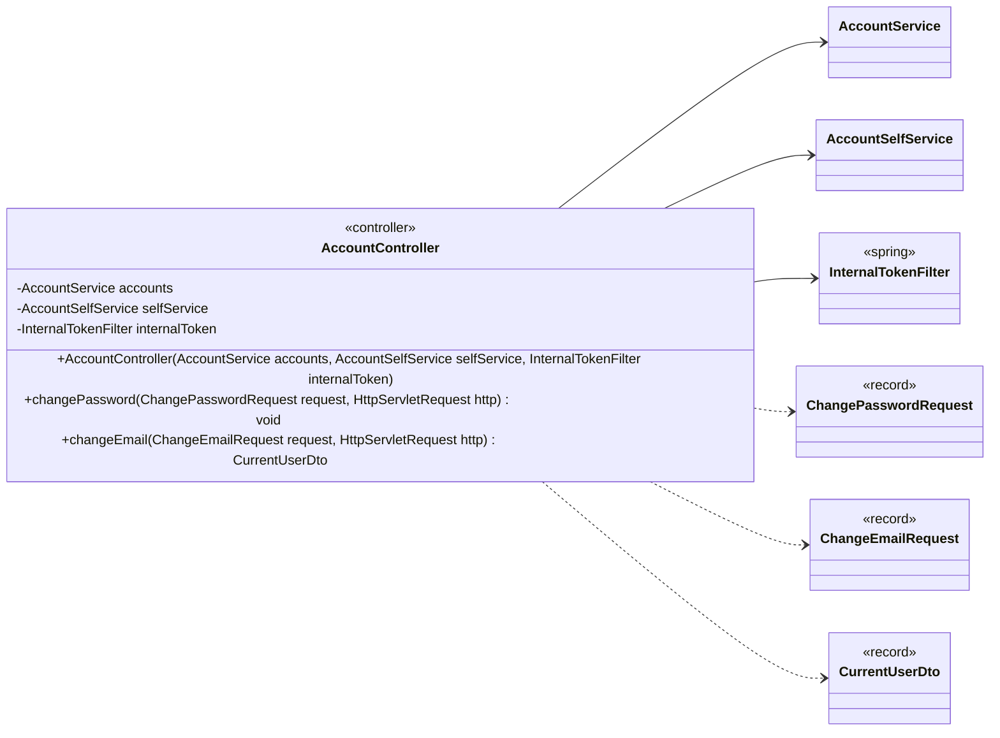

| Field | Type |
|---|---|
| `accounts` | `AccountService` |
| `selfService` | `AccountSelfService` |
| `internalToken` | `InternalTokenFilter` |

| Member | Visibility | What it does |
|---|---|---|
| `AccountController(AccountService accounts, AccountSelfService selfService, InternalTokenFilter internalToken)` | public |  |
| `void changePassword(ChangePasswordRequest request, HttpServletRequest http)` | public | Changes the password of the acting user. |
| `CurrentUserDto changeEmail(ChangeEmailRequest request, HttpServletRequest http)` | public | Changes the email (the login name) of the acting user. |

## ActingUser

*class*

The logged-in user on whose behalf the PHP front end calls: the id in the X-Acting-User header, believed only on
a request that carries the internal token (the PHP owns the session and is the only one that can say who is logged in);
without a configured token (never in production) it is taken as it comes.

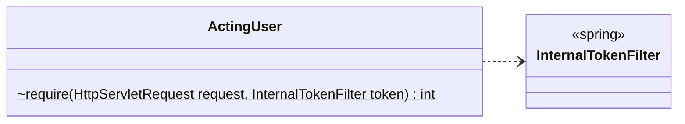

| Member | Visibility | What it does |
|---|---|---|
| `int require(HttpServletRequest request, InternalTokenFilter token)` | package static | The acting user's id; a missing, malformed or untrusted header is a BadRequestException (a bug in the caller). |

## AddMealRequest

*record*

Body of POST /api/meal-plans/meals, e.g.
{"recipeId": 3, "date": "2026-11-09", "label": "Abendessen", "servings": 4, "note": "Reste", "position": 0}.
Only recipeId and date are required. servings null = follow the default; position null = last on its day.

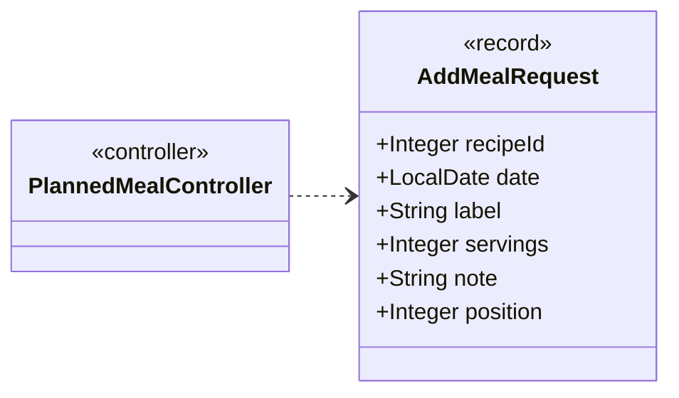

| Component | Type |
|---|---|
| `recipeId` | `Integer` |
| `date` | `LocalDate` |
| `label` | `String` |
| `servings` | `Integer` |
| `note` | `String` |
| `position` | `Integer` |

**Referenced by:** `PlannedMealController`

## AddPlannedRecipeRequest

*record*

Body of POST /api/meal-plans/{id}/recipes, e.g. {"recipeId": 3, "mealTime": "Abendessen"}.

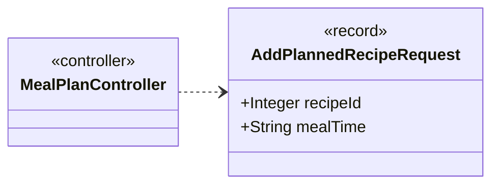

| Component | Type |
|---|---|
| `recipeId` | `Integer` |
| `mealTime` | `String` |

**Referenced by:** `MealPlanController`

## AddTagRequest

*record*

Body of POST /api/recipes/{id}/tags. category is only used when the tag does not exist yet.

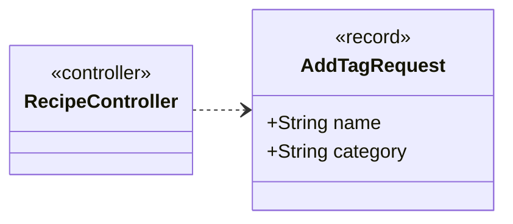

| Component | Type |
|---|---|
| `name` | `String` |
| `category` | `String` |

**Referenced by:** `RecipeController`

## ApiExceptionHandler

*class · error handler*

Turns exceptions into JSON error responses with sensible status codes.
The services report failures as plain RuntimeExceptions wrapping the SQLException,
so a constraint violation (foreign key, unique, primary key) is recognised from the cause
and reported as 409 instead of a generic 500.
Every error carries a stable machine-readable code (NOT_FOUND, PAST_DAY, LIST_COMPLETED, ...) next to the
English message, so a client can show its own text without matching message strings.

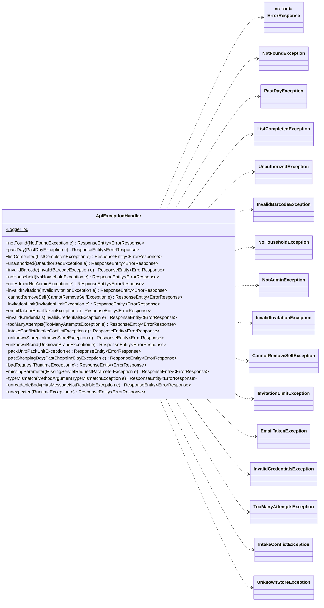

| Field | Type |
|---|---|
| `log` | `Logger` |

| Member | Visibility | What it does |
|---|---|---|
| `ResponseEntity<ErrorResponse> notFound(NotFoundException e)` | public |  |
| `ResponseEntity<ErrorResponse> pastDay(PastDayException e)` | public | A meal on a past day cannot be added, changed, moved or removed: the request conflicts with the calendar. |
| `ResponseEntity<ErrorResponse> listCompleted(ListCompletedException e)` | public | A completed shopping list cannot be edited. |
| `ResponseEntity<ErrorResponse> unauthorized(UnauthorizedException e)` | public |  |
| `ResponseEntity<ErrorResponse> invalidBarcode(InvalidBarcodeException e)` | public | A barcode number that cannot be right: a bad request with a code of its own (INVALID_BARCODE, BARCODE_CHECKSUM). |
| `ResponseEntity<ErrorResponse> noHousehold(NoHouseholdException e)` | public | The acting user belongs to no household. |
| `ResponseEntity<ErrorResponse> notAdmin(NotAdminException e)` | public | The acting user is not an admin of their household. |
| `ResponseEntity<ErrorResponse> invalidInvitation(InvalidInvitationException e)` | public | An invitation code that is wrong, used, revoked or expired (one answer for all of them). |
| `ResponseEntity<ErrorResponse> cannotRemoveSelf(CannotRemoveSelfException e)` | public | An admin tried to remove themselves from the household. |
| `ResponseEntity<ErrorResponse> invitationLimit(InvitationLimitException e)` | public | The household has too many open invitations: a conflict with its own code, INVITATION_LIMIT. |
| `ResponseEntity<ErrorResponse> emailTaken(EmailTakenException e)` | public | The email address belongs to another account. |
| `ResponseEntity<ErrorResponse> invalidCredentials(InvalidCredentialsException e)` | public | A wrong email or password (the same answer for both). |
| `ResponseEntity<ErrorResponse> tooManyAttempts(TooManyAttemptsException e)` | public | Too many failed logins: the caller is slowed down; Retry-After says for how long. |
| `ResponseEntity<ErrorResponse> intakeConflict(IntakeConflictException e)` | public | An intake request id that cannot be used again as it is: a conflict with a code of its own. |
| `ResponseEntity<ErrorResponse> unknownStore(UnknownStoreException e)` | public | A store or brand name that does not exist, where creating one was not asked for: a bad request with its own code. |
| `ResponseEntity<ErrorResponse> unknownBrand(UnknownBrandException e)` | public |  |
| `ResponseEntity<ErrorResponse> packUnit(PackUnitException e)` | public | The pack of a barcode cannot be stocked in the item's unit: a bad request with a code of its own. |
| `ResponseEntity<ErrorResponse> pastShoppingDay(PastShoppingDayException e)` | public | The shopping day of a list is in the past: a bad request with a code of its own. |
| `ResponseEntity<ErrorResponse> badRequest(RuntimeException e)` | public |  |
| `ResponseEntity<ErrorResponse> missingParameter(MissingServletRequestParameterException e)` | public |  |
| `ResponseEntity<ErrorResponse> typeMismatch(MethodArgumentTypeMismatchException e)` | public |  |
| `ResponseEntity<ErrorResponse> unreadableBody(HttpMessageNotReadableException e)` | public |  |
| `ResponseEntity<ErrorResponse> unexpected(RuntimeException e)` | public |  |

## AssignBarcodeRequest

*record*

Body of PUT /api/barcodes/{code}: what the barcode is. inventoryItemId (the catalogue item), packSize
and packUnit (500 g, 1 kg, 1,5 l, 6 stück) are required; the pack is stored in g, ml or stück like a store
item (1 kg becomes 1000 g, 1,5 l is sent as 1.5 l or 1500 ml) and must fit the item's unit (else 400 PACK_UNIT_MISMATCH); brand (blank or missing =
no brand), name (as printed) and storeItemId (also link the store item that carries it, which must be
for the same catalogue item) are optional. The brand must be an existing one (GET /api/brands); createBrand: true is needed to add a new brand, so a typo cannot create a bogus one (400 UNKNOWN_BRAND).

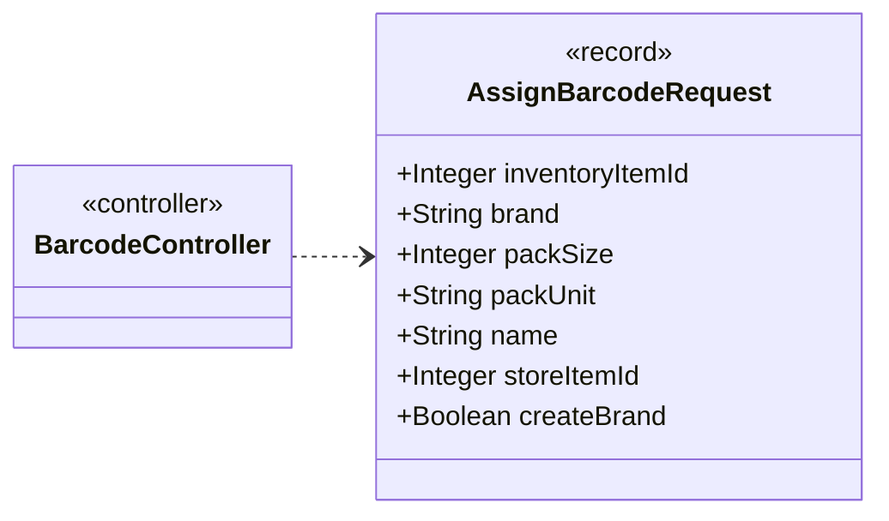

| Component | Type |
|---|---|
| `inventoryItemId` | `Integer` |
| `brand` | `String` |
| `packSize` | `Integer` |
| `packUnit` | `String` |
| `name` | `String` |
| `storeItemId` | `Integer` |
| `createBrand` | `Boolean` |

**Referenced by:** `BarcodeController`

## AuditFilter

*class · Spring component · extends OncePerRequestFilter*

Writes the audit line (see AuditLog) for every request, on any path, that is a write or was refused with 401 /
403. It runs before Spring Security, so refused requests (a wrong token) are seen too. The verify endpoint logs its own
line with the typed email. The path is not used to decide what to log (the raw path can be percent-encoded).

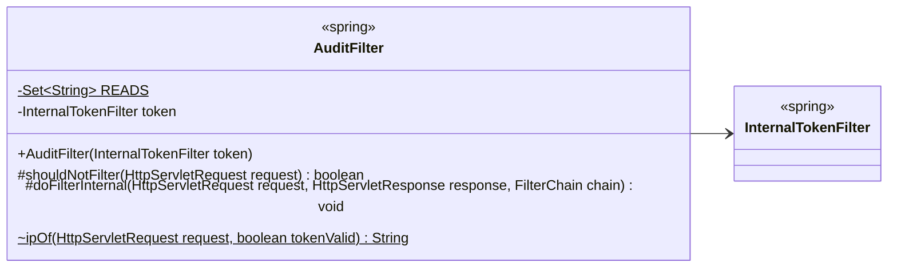

| Field | Type |
|---|---|
| `READS` | `Set<String>` |
| `token` | `InternalTokenFilter` |

| Member | Visibility | What it does |
|---|---|---|
| `AuditFilter(InternalTokenFilter token)` | public |  |
| `boolean shouldNotFilter(HttpServletRequest request)` | protected | The verify endpoint writes its own audit line (with the typed email); decided on the decoded path. |
| `void doFilterInternal(HttpServletRequest request, HttpServletResponse response, FilterChain chain)` | protected |  |
| `String ipOf(HttpServletRequest request, boolean tokenValid)` | package static | The client address for a request (see AuditLog.clientIp). |

## AuditLog

*class*

The audit trail: one line per login, failed login, write and refused request, in the logger "audit", with the client
IP the PHP front end passes on. Never a request body, a query string, a password or a token.

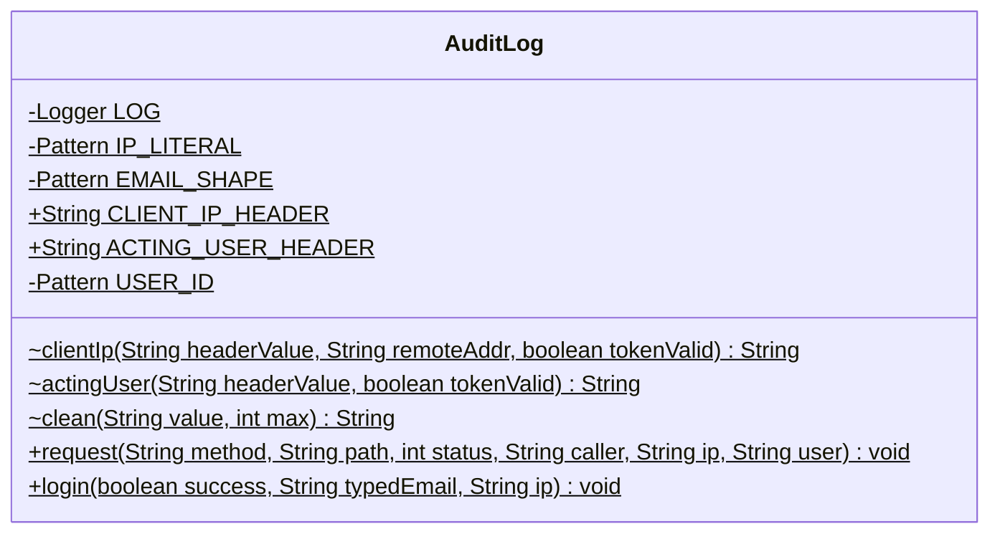

| Field | Type |
|---|---|
| `LOG` | `Logger` |
| `IP_LITERAL` | `Pattern` |
| `EMAIL_SHAPE` | `Pattern` |
| `CLIENT_IP_HEADER` | `String` |
| `ACTING_USER_HEADER` | `String` |
| `USER_ID` | `Pattern` |

| Member | Visibility | What it does |
|---|---|---|
| `String clientIp(String headerValue, String remoteAddr, boolean tokenValid)` | package static | The client address to log. |
| `String actingUser(String headerValue, boolean tokenValid)` | package static | The acting user id for the log: the header, but only with the internal token and only a plain number; else "-". |
| `String clean(String value, int max)` | package static | Takes anything that could break a log line out of a value and shortens it. |
| `void request(String method, String path, int status, String caller, String ip, String user)` | public static | A request worth keeping: a write, or any request that was refused (401 / 403). |
| `void login(boolean success, String typedEmail, String ip)` | public static | A login attempt. |

## AuthController

*class · REST controller*

Checking a login for the PHP front end, which owns the user's session. The API itself has no login page, no session
login and no CSRF endpoint.

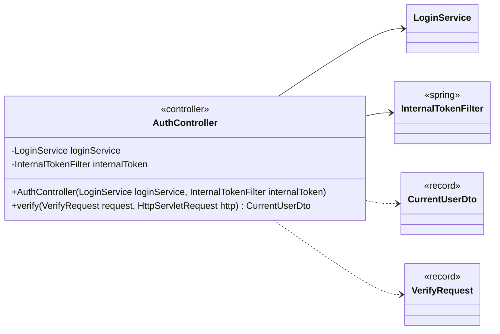

| Field | Type |
|---|---|
| `loginService` | `LoginService` |
| `internalToken` | `InternalTokenFilter` |

| Member | Visibility | What it does |
|---|---|---|
| `AuthController(LoginService loginService, InternalTokenFilter internalToken)` | public |  |
| `CurrentUserDto verify(VerifyRequest request, HttpServletRequest http)` | public | Checks an email and a password for the PHP front end, which owns the user's session. |

## BadRequestException

*class · extends RuntimeException*

Thrown by a controller when request input fails validation; mapped to 400.

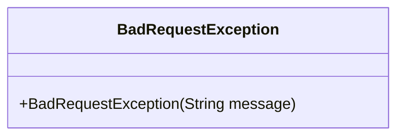

| Member | Visibility | What it does |
|---|---|---|
| `BadRequestException(String message)` | public |  |

## BarcodeController

*class · REST controller*

Barcode numbers: what a number is, and remembering it. Numbers can be typed; scanning in the app comes later.

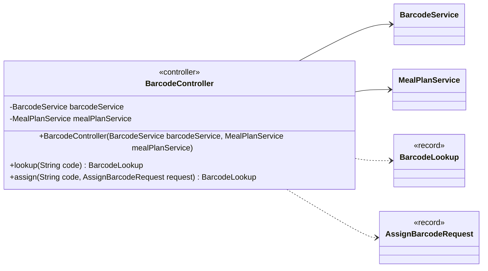

| Field | Type |
|---|---|
| `barcodeService` | `BarcodeService` |
| `mealPlanService` | `MealPlanService` |

| Member | Visibility | What it does |
|---|---|---|
| `BarcodeController(BarcodeService barcodeService, MealPlanService mealPlanService)` | public |  |
| `BarcodeLookup lookup(String code)` | public | What a barcode is. |
| `BarcodeLookup assign(String code, AssignBarcodeRequest request)` | public | Remembers what the barcode is, or replaces it (AssignBarcodeRequest). |

## BrandPageDto

*record*

One page of GET /api/brands. total is the number of brands that match in ALL pages; page (from
1) and pageSize echo the request with its defaults applied; totalPages is ceil(total / pageSize),
0 when nothing matches.

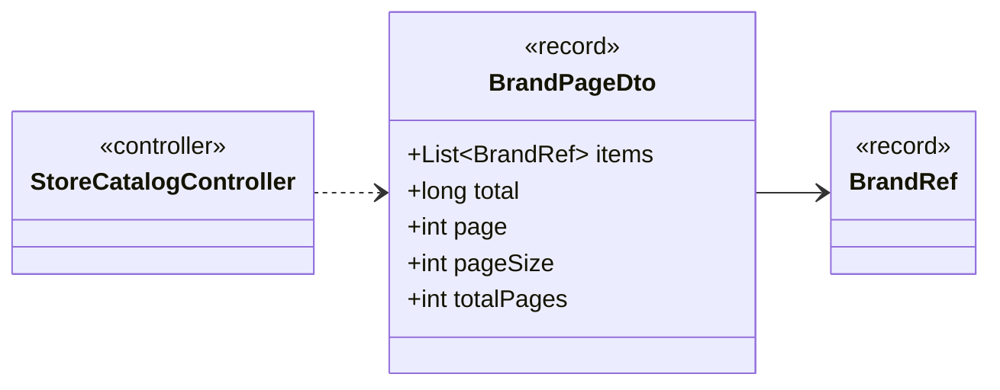

| Component | Type |
|---|---|
| `items` | `List<BrandRef>` |
| `total` | `long` |
| `page` | `int` |
| `pageSize` | `int` |
| `totalPages` | `int` |

**Referenced by:** `StoreCatalogController`

## Caller

*record*

Who is asking: the logged-in user the PHP front end names in X-Acting-User, and the household that user belongs
to. A controller method that takes a Caller works on that household's data only; the household is never taken
from the request itself.

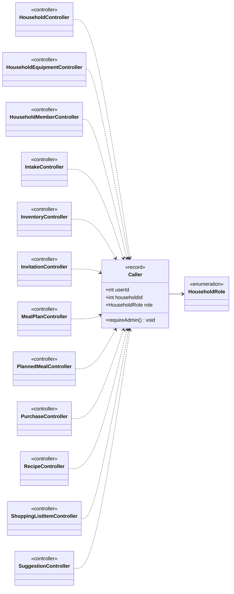

| Component | Type |
|---|---|
| `userId` | `int` |
| `householdId` | `int` |
| `role` | `HouseholdRole` |

| Member | Visibility | What it does |
|---|---|---|
| `void requireAdmin()` | public |  |

**Referenced by:** `HouseholdController`, `HouseholdEquipmentController`, `HouseholdMemberController`, `IntakeController`, `InventoryController`, `InvitationController`, `MealPlanController`, `PlannedMealController`, `PurchaseController`, `RecipeController`, `ShoppingListItemController`, `SuggestionController`

## CallerArgumentResolver

*class · Spring component · implements HandlerMethodArgumentResolver*

Fills a controller parameter of type Caller: the acting user from X-Acting-User (believed only with the
internal token, see ActingUser) and that user's household. 400 if the header is missing, 401 for a user that
does not exist, 403 NO_HOUSEHOLD for a user in no household.

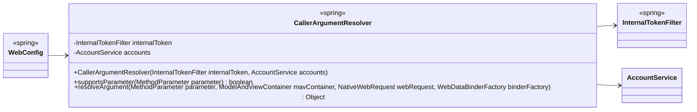

| Field | Type |
|---|---|
| `internalToken` | `InternalTokenFilter` |
| `accounts` | `AccountService` |

| Member | Visibility | What it does |
|---|---|---|
| `CallerArgumentResolver(InternalTokenFilter internalToken, AccountService accounts)` | public |  |
| `boolean supportsParameter(MethodParameter parameter)` | public |  |
| `Object resolveArgument(MethodParameter parameter, ModelAndViewContainer mavContainer, NativeWebRequest webRequest, WebDataBinderFactory binderFactory)` | public |  |

**Referenced by:** `WebConfig`

## CannotRemoveSelfException

*class · extends RuntimeException*

An admin tried to remove themselves from their household. A conflict (409) with its own code, CANNOT_REMOVE_SELF.

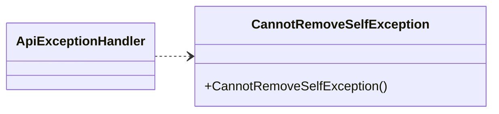

| Member | Visibility | What it does |
|---|---|---|
| `CannotRemoveSelfException()` | public |  |

**Referenced by:** `ApiExceptionHandler`

## ChangeEmailRequest

*record*

Body of PUT /api/account/email: the user's password and the new address.

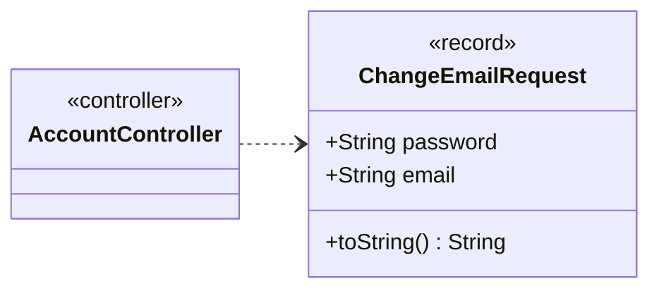

| Component | Type |
|---|---|
| `password` | `String` |
| `email` | `String` |

| Member | Visibility | What it does |
|---|---|---|
| `String toString()` | public |  |

**Referenced by:** `AccountController`

## ChangePasswordRequest

*record*

Body of PUT /api/account/password.

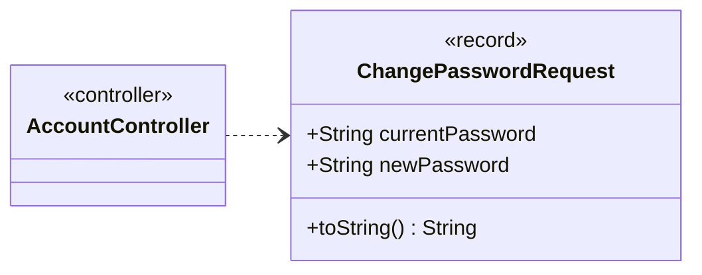

| Component | Type |
|---|---|
| `currentPassword` | `String` |
| `newPassword` | `String` |

| Member | Visibility | What it does |
|---|---|---|
| `String toString()` | public |  |

**Referenced by:** `AccountController`

## CreateMealPlanRequest

*record*

Body of POST /api/meal-plans, e.g. {"weekStartDate": "2026-09-28"}.

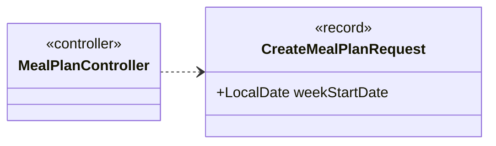

| Component | Type |
|---|---|
| `weekStartDate` | `LocalDate` |

**Referenced by:** `MealPlanController`

## CreatePurchaseRequest

*record*

Body of POST /api/purchases: a purchase of a known store_item. discountId is optional,
wasDiscounted defaults to false, purchaseDate defaults to today.

```mermaid
classDiagram
    direction LR
    class api_CreatePurchaseRequest["CreatePurchaseRequest"] {
        <<record>>
        +Integer storeItemId
        +Integer discountId
        +Boolean wasDiscounted
        +LocalDate purchaseDate
        +Integer quantityPurchased
        +Double pricePaid
        +LocalDate expirationDate
    }
    class api_PurchaseController["PurchaseController"] {
        <<controller>>
    }
    api_PurchaseController ..> api_CreatePurchaseRequest
```

| Component | Type |
|---|---|
| `storeItemId` | `Integer` |
| `discountId` | `Integer` |
| `wasDiscounted` | `Boolean` |
| `purchaseDate` | `LocalDate` |
| `quantityPurchased` | `Integer` |
| `pricePaid` | `Double` |
| `expirationDate` | `LocalDate` |

**Referenced by:** `PurchaseController`

## CurrentUserDto

*record*

Answer of POST /api/auth/verify. household is null for a user who is in no household. The password hash is never sent.

```mermaid
classDiagram
    direction LR
    class api_CurrentUserDto["CurrentUserDto"] {
        <<record>>
        +int id
        +String email
        +String displayName
        +HouseholdDto household
        ~from(AppUser user, HouseholdMembership membership) CurrentUserDto$
    }
    class api_CurrentUserDto_HouseholdDto["CurrentUserDto.HouseholdDto"] {
        <<record>>
    }
    class auth_AppUser["AppUser"]
    class auth_HouseholdMembership["HouseholdMembership"] {
        <<record>>
    }
    class api_AccountController["AccountController"] {
        <<controller>>
    }
    class api_AuthController["AuthController"] {
        <<controller>>
    }
    class api_InvitationController["InvitationController"] {
        <<controller>>
    }
    api_CurrentUserDto *-- api_CurrentUserDto_HouseholdDto
    api_CurrentUserDto ..> auth_AppUser
    api_CurrentUserDto ..> auth_HouseholdMembership
    api_AccountController ..> api_CurrentUserDto
    api_AuthController ..> api_CurrentUserDto
    api_InvitationController ..> api_CurrentUserDto
```

| Component | Type |
|---|---|
| `id` | `int` |
| `email` | `String` |
| `displayName` | `String` |
| `household` | `HouseholdDto` |

| Member | Visibility | What it does |
|---|---|---|
| `CurrentUserDto from(AppUser user, HouseholdMembership membership)` | package static |  |

**Referenced by:** `AccountController`, `AuthController`, `InvitationController`

## CurrentUserDto.HouseholdDto

*record*

```mermaid
classDiagram
    direction LR
    class api_CurrentUserDto_HouseholdDto["CurrentUserDto.HouseholdDto"] {
        <<record>>
        +int id
        +String name
        +String role
    }
    class api_CurrentUserDto["CurrentUserDto"] {
        <<record>>
    }
    api_CurrentUserDto *-- api_CurrentUserDto_HouseholdDto
```

| Component | Type |
|---|---|
| `id` | `int` |
| `name` | `String` |
| `role` | `String` |

**Referenced by:** `CurrentUserDto`

## DahaemApplication

*class · command-line tool*

Entry point for the REST API. A thin web layer over the existing services: controllers
translate HTTP to service calls and service results to DTOs, nothing more.
The console runners (StoreImportRunner, ReceiptImportRunner, ...) stay separate entry points.

The database is MariaDB, configured from the DAHAEM_DB_URL, DAHAEM_DB_USER
and DAHAEM_DB_PASSWORD environment variables (see de.dahaem.shared.Database).

```mermaid
classDiagram
    direction LR
    class api_DahaemApplication["DahaemApplication"] {
        +main(String[] args) void$
    }
```

| Member | Visibility | What it does |
|---|---|---|
| `void main(String[] args)` | public static |  |

## DietDto

*record*

What the diet rules say about a recipe, present only when rules were passed.
status: OK, ANPASSBAR (excluded only through POSSIBLE animals of generic items: see hints),
UNCLEAR (a line of the recipe was not matched and a hard rule applies; only returned with includeUnclear) or
HIDDEN (excluded; returned only by GET /api/recipes/{id}, never in the list).
hints: per item that may come from an excluded animal, the animals it may still be (allowedAnimals,
e.g. Salami → Rind, Geflügel). softHits: what a soft rule (avoidTags / avoidItems) matched; absent when nothing.
unmatchedIngredients: the recipe's lines without a catalogue item (detail only).
Presets filter INGREDIENTS only; this is not a halal or kosher certification.

```mermaid
classDiagram
    direction LR
    class api_DietDto["DietDto"] {
        <<record>>
        +String status
        +List~Hint~ hints
        +SoftHits softHits
        +List~Unmatched~ unmatchedIngredients
        ~from(DietVerdict verdict, List~RecipeFacts.Unmatched~ unmatched) DietDto$
    }
    class api_DietDto_Hint["DietDto.Hint"] {
        <<record>>
    }
    class api_DietDto_Item["DietDto.Item"] {
        <<record>>
    }
    class api_DietDto_SoftHits["DietDto.SoftHits"] {
        <<record>>
    }
    class api_DietDto_Unmatched["DietDto.Unmatched"] {
        <<record>>
    }
    class api_RecipeCardDto["RecipeCardDto"] {
        <<record>>
    }
    class api_RecipeDetailDto["RecipeDetailDto"] {
        <<record>>
    }
    class api_RecipeSummaryDto["RecipeSummaryDto"] {
        <<record>>
    }
    class diet_DietVerdict["DietVerdict"] {
        <<record>>
    }
    class tags_RecipeFacts["RecipeFacts"] {
        <<record>>
    }
    api_DietDto *-- api_DietDto_Hint
    api_DietDto *-- api_DietDto_Item
    api_DietDto *-- api_DietDto_SoftHits
    api_DietDto *-- api_DietDto_Unmatched
    api_DietDto ..> diet_DietVerdict
    api_DietDto ..> tags_RecipeFacts
    api_RecipeCardDto --> api_DietDto
    api_RecipeDetailDto --> api_DietDto
    api_RecipeSummaryDto --> api_DietDto
```

| Component | Type |
|---|---|
| `status` | `String` |
| `hints` | `List<Hint>` |
| `softHits` | `SoftHits` |
| `unmatchedIngredients` | `List<Unmatched>` |

| Member | Visibility | What it does |
|---|---|---|
| `DietDto from(DietVerdict verdict, List<RecipeFacts.Unmatched> unmatched)` | package static |  |

**Referenced by:** `RecipeCardDto`, `RecipeDetailDto`, `RecipeSummaryDto`

## DietDto.Hint

*record*

```mermaid
classDiagram
    direction LR
    class api_DietDto_Hint["DietDto.Hint"] {
        <<record>>
        +int itemId
        +String name
        +List~String~ allowedAnimals
        +List~String~ possibleAnimals
        ~from(DietVerdict.Hint hint) Hint$
    }
    class api_DietDto["DietDto"] {
        <<record>>
    }
    class api_DietDto_SoftHits["DietDto.SoftHits"] {
        <<record>>
    }
    class diet_DietVerdict["DietVerdict"] {
        <<record>>
    }
    api_DietDto_Hint ..> diet_DietVerdict
    api_DietDto *-- api_DietDto_Hint
    api_DietDto_SoftHits --> api_DietDto_Hint
```

| Component | Type |
|---|---|
| `itemId` | `int` |
| `name` | `String` |
| `allowedAnimals` | `List<String>` |
| `possibleAnimals` | `List<String>` |

| Member | Visibility | What it does |
|---|---|---|
| `Hint from(DietVerdict.Hint hint)` | package static |  |

**Referenced by:** `DietDto`

## DietDto.Item

*record*

```mermaid
classDiagram
    direction LR
    class api_DietDto_Item["DietDto.Item"] {
        <<record>>
        +int itemId
        +String name
    }
    class api_DietDto["DietDto"] {
        <<record>>
    }
    class api_DietDto_SoftHits["DietDto.SoftHits"] {
        <<record>>
    }
    api_DietDto *-- api_DietDto_Item
    api_DietDto_SoftHits --> api_DietDto_Item
```

| Component | Type |
|---|---|
| `itemId` | `int` |
| `name` | `String` |

**Referenced by:** `DietDto`

## DietDto.SoftHits

*record*

```mermaid
classDiagram
    direction LR
    class api_DietDto_SoftHits["DietDto.SoftHits"] {
        <<record>>
        +List~String~ tags
        +List~Item~ items
        +List~Hint~ possibleItems
    }
    class api_DietDto["DietDto"] {
        <<record>>
    }
    class api_DietDto_Item["DietDto.Item"] {
        <<record>>
    }
    class api_DietDto_Hint["DietDto.Hint"] {
        <<record>>
    }
    api_DietDto_SoftHits --> api_DietDto_Item
    api_DietDto_SoftHits --> api_DietDto_Hint
    api_DietDto *-- api_DietDto_SoftHits
```

| Component | Type |
|---|---|
| `tags` | `List<String>` |
| `items` | `List<Item>` |
| `possibleItems` | `List<Hint>` |

**Referenced by:** `DietDto`

## DietDto.Unmatched

*record*

```mermaid
classDiagram
    direction LR
    class api_DietDto_Unmatched["DietDto.Unmatched"] {
        <<record>>
        +Integer lineNo
        +String rawText
        +String reason
    }
    class api_DietDto["DietDto"] {
        <<record>>
    }
    api_DietDto *-- api_DietDto_Unmatched
```

| Component | Type |
|---|---|
| `lineNo` | `Integer` |
| `rawText` | `String` |
| `reason` | `String` |

**Referenced by:** `DietDto`

## ErrorResponse

*record*

JSON body for every error response: the HTTP status, its reason phrase, a readable (English) message and a stable
machine-readable code (for example NOT_FOUND, BAD_REQUEST, PAST_DAY, EMAIL_TAKEN, REQUEST_IN_PROGRESS, REQUEST_ID_REUSED, PAST_SHOPPING_DAY, INVALID_BARCODE, BARCODE_CHECKSUM, PACK_UNIT_MISMATCH, UNKNOWN_STORE, UNKNOWN_BRAND, LIST_COMPLETED, CONFLICT, LOGIN_REQUIRED,
CSRF_INVALID, NO_HOUSEHOLD, BAD_CREDENTIALS, TOO_MANY_ATTEMPTS, INVALID_TOKEN) that a client can map to its own text.

```mermaid
classDiagram
    direction LR
    class api_ErrorResponse["ErrorResponse"] {
        <<record>>
        +int status
        +String error
        +String message
        +String code
    }
    class api_ApiExceptionHandler["ApiExceptionHandler"]
    api_ApiExceptionHandler ..> api_ErrorResponse
```

| Component | Type |
|---|---|
| `status` | `int` |
| `error` | `String` |
| `message` | `String` |
| `code` | `String` |

**Referenced by:** `ApiExceptionHandler`

## GeneratedShoppingListDto

*record*

Response of POST /api/meal-plans/{planId}/shopping-list: the id of the newly persisted list.

```mermaid
classDiagram
    direction LR
    class api_GeneratedShoppingListDto["GeneratedShoppingListDto"] {
        <<record>>
        +int shoppingListId
    }
    class api_MealPlanController["MealPlanController"] {
        <<controller>>
    }
    class api_ShoppingListItemController["ShoppingListItemController"] {
        <<controller>>
    }
    api_MealPlanController ..> api_GeneratedShoppingListDto
    api_ShoppingListItemController ..> api_GeneratedShoppingListDto
```

| Component | Type |
|---|---|
| `shoppingListId` | `int` |

**Referenced by:** `MealPlanController`, `ShoppingListItemController`

## HouseholdController

*class · REST controller*

The household's head count, so the app can scale portions to the people it feeds. The household is named in the URL
and must be the acting user's own (anything else is a 404); any member of it may read and set the head count.

```mermaid
classDiagram
    direction LR
    class api_HouseholdController["HouseholdController"] {
        <<controller>>
        -AccountService accountService
        +HouseholdController(AccountService accountService)
        +get(int id, Caller caller) HouseholdDto
        +setPeople(int id, JsonNode body, Caller caller) HouseholdDto
        +rename(int id, JsonNode body, Caller caller) HouseholdDto
    }
    class auth_AccountService["AccountService"]
    class api_Caller["Caller"] {
        <<record>>
    }
    class api_HouseholdDto["HouseholdDto"] {
        <<record>>
    }
    api_HouseholdController --> auth_AccountService
    api_HouseholdController ..> api_Caller
    api_HouseholdController ..> api_HouseholdDto
```

| Field | Type |
|---|---|
| `accountService` | `AccountService` |

| Member | Visibility | What it does |
|---|---|---|
| `HouseholdController(AccountService accountService)` | public |  |
| `HouseholdDto get(int id, Caller caller)` | public |  |
| `HouseholdDto setPeople(int id, JsonNode body, Caller caller)` | public | Sets the head count and returns the household: {"people": 4}. |
| `HouseholdDto rename(int id, JsonNode body, Caller caller)` | public | Renames the caller's household: {"name": "Familie M"} (1 to 100 characters). |

## HouseholdDto

*record*

A household as the API shows it. people is the head count and null until someone has set it.

```mermaid
classDiagram
    direction LR
    class api_HouseholdDto["HouseholdDto"] {
        <<record>>
        +int id
        +String name
        +Integer people
        +LocalDate createdDate
        +from(Household household) HouseholdDto$
    }
    class auth_Household["Household"]
    class api_HouseholdController["HouseholdController"] {
        <<controller>>
    }
    api_HouseholdDto ..> auth_Household
    api_HouseholdController ..> api_HouseholdDto
```

| Component | Type |
|---|---|
| `id` | `int` |
| `name` | `String` |
| `people` | `Integer` |
| `createdDate` | `LocalDate` |

| Member | Visibility | What it does |
|---|---|---|
| `HouseholdDto from(Household household)` | public static |  |

**Referenced by:** `HouseholdController`

## HouseholdEquipmentController

*class · REST controller*

What kitchen equipment the caller's household has. Recipes that need equipment it lacks are left out of its lists.

```mermaid
classDiagram
    direction LR
    class api_HouseholdEquipmentController["HouseholdEquipmentController"] {
        <<controller>>
        -HouseholdEquipmentService equipment
        +HouseholdEquipmentController(HouseholdEquipmentService equipment)
        +list(Caller caller) List~HouseholdEquipmentService.Status~
        +set(String code, JsonNode body, Caller caller) HouseholdEquipmentService.Status
    }
    class auth_HouseholdEquipmentService["HouseholdEquipmentService"]
    class api_Caller["Caller"] {
        <<record>>
    }
    api_HouseholdEquipmentController --> auth_HouseholdEquipmentService
    api_HouseholdEquipmentController ..> api_Caller
```

| Field | Type |
|---|---|
| `equipment` | `HouseholdEquipmentService` |

| Member | Visibility | What it does |
|---|---|---|
| `HouseholdEquipmentController(HouseholdEquipmentService equipment)` | public |  |
| `List<HouseholdEquipmentService.Status> list(Caller caller)` | public | Every kind of equipment the app knows (code, name) with whether the household has it (has, true until the household says otherwise). |
| `HouseholdEquipmentService.Status set(String code, JsonNode body, Caller caller)` | public | Says whether the household has this equipment: {"has": false}. |

## HouseholdMemberController

*class · REST controller*

Who belongs to the caller's household, for the household page.

```mermaid
classDiagram
    direction LR
    class api_HouseholdMemberController["HouseholdMemberController"] {
        <<controller>>
        -AccountService accounts
        +HouseholdMemberController(AccountService accounts)
        +members(Caller caller) List~MemberDto~
        +remove(int userId, Caller caller) void
    }
    class api_HouseholdMemberController_MemberDto["HouseholdMemberController.MemberDto"] {
        <<record>>
    }
    class auth_AccountService["AccountService"]
    class api_Caller["Caller"] {
        <<record>>
    }
    api_HouseholdMemberController *-- api_HouseholdMemberController_MemberDto
    api_HouseholdMemberController --> auth_AccountService
    api_HouseholdMemberController ..> api_Caller
```

| Field | Type |
|---|---|
| `accounts` | `AccountService` |

| Member | Visibility | What it does |
|---|---|---|
| `HouseholdMemberController(AccountService accounts)` | public |  |
| `List<MemberDto> members(Caller caller)` | public | The members of the caller's household, the oldest first: id, display name and role (ADMIN or MEMBER). |
| `void remove(int userId, Caller caller)` | public | Takes a member out of the caller's household (admins only; 403 NOT_ADMIN otherwise). |

## HouseholdMemberController.MemberDto

*record*

One member. email is given to admins and for the caller's own row; it is null for everyone else.

```mermaid
classDiagram
    direction LR
    class api_HouseholdMemberController_MemberDto["HouseholdMemberController.MemberDto"] {
        <<record>>
        +int userId
        +String displayName
        +String email
        +String role
        +boolean you
    }
    class api_HouseholdMemberController["HouseholdMemberController"] {
        <<controller>>
    }
    api_HouseholdMemberController *-- api_HouseholdMemberController_MemberDto
```

| Component | Type |
|---|---|
| `userId` | `int` |
| `displayName` | `String` |
| `email` | `String` |
| `role` | `String` |
| `you` | `boolean` |

**Referenced by:** `HouseholdMemberController`

## IntakeController

*class · REST controller*

Putting groceries away by barcode number (typed, or from a list): stock, batches by expiry date, store items.

```mermaid
classDiagram
    direction LR
    class api_IntakeController["IntakeController"] {
        <<controller>>
        ~int MAX_LINES$
        -IntakeService intakeService
        -MealPlanService mealPlanService
        +IntakeController(IntakeService intakeService, MealPlanService mealPlanService)
        +intake(IntakeRequest request, Caller caller) IntakeResult
    }
    class api_IntakeController_IntakeRequest["IntakeController.IntakeRequest"] {
        <<record>>
    }
    class api_IntakeController_IntakeResult["IntakeController.IntakeResult"] {
        <<record>>
    }
    class barcode_IntakeService["IntakeService"]
    class mealplanner_MealPlanService["MealPlanService"]
    class api_Caller["Caller"] {
        <<record>>
    }
    api_IntakeController *-- api_IntakeController_IntakeRequest
    api_IntakeController *-- api_IntakeController_IntakeResult
    api_IntakeController --> barcode_IntakeService
    api_IntakeController --> mealplanner_MealPlanService
    api_IntakeController ..> api_Caller
```

| Field | Type |
|---|---|
| `MAX_LINES` | `int` |
| `intakeService` | `IntakeService` |
| `mealPlanService` | `MealPlanService` |

| Member | Visibility | What it does |
|---|---|---|
| `IntakeController(IntakeService intakeService, MealPlanService mealPlanService)` | public |  |
| `IntakeResult intake(IntakeRequest request, Caller caller)` | public | Puts the lines away. |

## IntakeController.IntakeRequest

*record*

Body: the store (an existing one, from GET /api/stores; createStore: true is needed to add a new
one, so a typo cannot create a bogus store), the purchase day (default today, not in the future) and the lines.
requestId (optional, 8 to 64 letters, digits, - or _) makes a repeat safe: see .intake.

```mermaid
classDiagram
    direction LR
    class api_IntakeController_IntakeRequest["IntakeController.IntakeRequest"] {
        <<record>>
        +String storeName
        +Boolean createStore
        +LocalDate purchaseDate
        +List~IntakeService.Line~ lines
        +String requestId
    }
    class api_IntakeController["IntakeController"] {
        <<controller>>
    }
    class barcode_IntakeService["IntakeService"]
    api_IntakeController_IntakeRequest --> barcode_IntakeService
    api_IntakeController *-- api_IntakeController_IntakeRequest
```

| Component | Type |
|---|---|
| `storeName` | `String` |
| `createStore` | `Boolean` |
| `purchaseDate` | `LocalDate` |
| `lines` | `List<IntakeService.Line>` |
| `requestId` | `String` |

**Referenced by:** `IntakeController`

## IntakeController.IntakeResult

*record*

results has one entry per line, in order; recorded / failed count them. replayed is
true when this is the stored answer to a requestId seen before: nothing was recorded again.

```mermaid
classDiagram
    direction LR
    class api_IntakeController_IntakeResult["IntakeController.IntakeResult"] {
        <<record>>
        +List~IntakeService.LineResult~ results
        +int recorded
        +int failed
        +boolean replayed
    }
    class api_IntakeController["IntakeController"] {
        <<controller>>
    }
    class barcode_IntakeService["IntakeService"]
    api_IntakeController_IntakeResult --> barcode_IntakeService
    api_IntakeController *-- api_IntakeController_IntakeResult
```

| Component | Type |
|---|---|
| `results` | `List<IntakeService.LineResult>` |
| `recorded` | `int` |
| `failed` | `int` |
| `replayed` | `boolean` |

**Referenced by:** `IntakeController`

## InternalTokenFilter

*class · Spring component · extends OncePerRequestFilter*

Shared-secret gate for the internal API. When INTERNAL_API_TOKEN is set (property
dahaem.internal-token), EVERY request, whatever its path, must carry it in the
X-Internal-Token header: a missing or wrong token is answered with 401 and goes no
further. A request with the right token counts as authenticated (it is the PHP front end, which
owns the user login) and is exempt from CSRF, which only protects browser sessions.

When no token is configured the filter does nothing and nobody is authenticated (the API starts without a token
only for local development and tests, see StartupGuard).

```mermaid
classDiagram
    direction LR
    class api_InternalTokenFilter["InternalTokenFilter"] {
        <<spring>>
        +String HEADER$
        -byte[] expected
        -ObjectMapper objectMapper
        +InternalTokenFilter(String token, ObjectMapper objectMapper)
        +isConfigured() boolean
        +hasValidToken(HttpServletRequest request) boolean
        #shouldNotFilter(HttpServletRequest request) boolean
        #doFilterInternal(HttpServletRequest request, HttpServletResponse response, FilterChain chain) void
    }
    class api_AccountController["AccountController"] {
        <<controller>>
    }
    class api_AuditFilter["AuditFilter"] {
        <<spring>>
    }
    class api_AuthController["AuthController"] {
        <<controller>>
    }
    class api_CallerArgumentResolver["CallerArgumentResolver"] {
        <<spring>>
    }
    class api_InvitationController["InvitationController"] {
        <<controller>>
    }
    class api_ActingUser["ActingUser"]
    class api_SecurityConfig["SecurityConfig"] {
        <<spring>>
    }
    api_AccountController --> api_InternalTokenFilter
    api_ActingUser ..> api_InternalTokenFilter
    api_AuditFilter --> api_InternalTokenFilter
    api_AuthController --> api_InternalTokenFilter
    api_CallerArgumentResolver --> api_InternalTokenFilter
    api_InvitationController --> api_InternalTokenFilter
    api_SecurityConfig ..> api_InternalTokenFilter
```

| Field | Type |
|---|---|
| `HEADER` | `String` |
| `expected` | `byte[]` |
| `objectMapper` | `ObjectMapper` |

| Member | Visibility | What it does |
|---|---|---|
| `InternalTokenFilter(String token, ObjectMapper objectMapper)` | public |  |
| `boolean isConfigured()` | public | True if a token is configured (always, in production: see StartupGuard). |
| `boolean hasValidToken(HttpServletRequest request)` | public | True if the request carries the configured token (never true when none is configured). |
| `boolean shouldNotFilter(HttpServletRequest request)` | protected |  |
| `void doFilterInternal(HttpServletRequest request, HttpServletResponse response, FilterChain chain)` | protected |  |

**Referenced by:** `AccountController`, `ActingUser`, `AuditFilter`, `AuthController`, `CallerArgumentResolver`, `InvitationController`, `SecurityConfig`

## InventoryController

*class · REST controller*

```mermaid
classDiagram
    direction LR
    class api_InventoryController["InventoryController"] {
        <<controller>>
        -InventoryService inventoryService
        -StockService stockService
        +InventoryController(InventoryService inventoryService, StockService stockService)
        +use(int id, UseStockRequest request, Caller caller) ItemDto
        +batches(int id, boolean all, Caller caller) List~StockBatch~
        +all(Caller caller) List~ItemDto~
        +search(String q, String category, Integer page, Integer pageSize, Caller caller) ItemPageDto
        +expiring(int days, Caller caller) List~ItemDto~
        +lowStock(int threshold, Caller caller) List~ItemDto~
    }
    class inventory_InventoryService["InventoryService"]
    class finance_StockService["StockService"]
    class api_Caller["Caller"] {
        <<record>>
    }
    class api_ItemDto["ItemDto"] {
        <<record>>
    }
    class api_UseStockRequest["UseStockRequest"] {
        <<record>>
    }
    class finance_StockBatch["StockBatch"] {
        <<record>>
    }
    class api_ItemPageDto["ItemPageDto"] {
        <<record>>
    }
    api_InventoryController --> inventory_InventoryService
    api_InventoryController --> finance_StockService
    api_InventoryController ..> api_Caller
    api_InventoryController ..> api_ItemDto
    api_InventoryController ..> api_UseStockRequest
    api_InventoryController ..> finance_StockBatch
    api_InventoryController ..> api_ItemPageDto
```

| Field | Type |
|---|---|
| `inventoryService` | `InventoryService` |
| `stockService` | `StockService` |

| Member | Visibility | What it does |
|---|---|---|
| `InventoryController(InventoryService inventoryService, StockService stockService)` | public |  |
| `ItemDto use(int id, UseStockRequest request, Caller caller)` | public | Takes quantity out of stock, from the batch that expires first (used or thrown away: the same). |
| `List<StockBatch> batches(int id, boolean all, Caller caller)` | public | The batches (purchases) of an item in the order they are used, earliest expiry first: store, brand, purchase date, expiry date, packs and pack size bought, and what is left in the item's own unit (remaining, unit). |
| `List<ItemDto> all(Caller caller)` | public |  |
| `ItemPageDto search(String q, String category, Integer page, Integer pageSize, Caller caller)` | public | Search the catalogue, one page of items plus the total. |
| `List<ItemDto> expiring(int days, Caller caller)` | public | Items expiring within the next days days (default 7). |
| `List<ItemDto> lowStock(int threshold, Caller caller)` | public | Items at or below threshold units in stock (default 1). |

## InvitationController

*class · REST controller*

Invitations into a household ("Konto erstellen"). An admin of the household makes an invitation and gets its code ONCE;
whoever enters the code on the sign-up page gets an account as a MEMBER of that household. There is no open sign-up.
The PHP front end shows the pages; every call needs the internal token. The admin calls also need X-Acting-User.

```mermaid
classDiagram
    direction LR
    class api_InvitationController["InvitationController"] {
        <<controller>>
        -InvitationService invitations
        -InternalTokenFilter internalToken
        +InvitationController(InvitationService invitations, InternalTokenFilter internalToken)
        +create(JsonNode body, Caller caller) CreatedInvitationDto
        +list(Caller caller) List~InvitationDto~
        +revoke(int id, Caller caller) void
        +accept(AcceptRequest request, HttpServletRequest http) CurrentUserDto
    }
    class api_InvitationController_CreatedInvitationDto["InvitationController.CreatedInvitationDto"] {
        <<record>>
    }
    class api_InvitationController_InvitationDto["InvitationController.InvitationDto"] {
        <<record>>
    }
    class api_InvitationController_AcceptRequest["InvitationController.AcceptRequest"] {
        <<record>>
    }
    class auth_InvitationService["InvitationService"]
    class api_InternalTokenFilter["InternalTokenFilter"] {
        <<spring>>
    }
    class api_Caller["Caller"] {
        <<record>>
    }
    class api_CurrentUserDto["CurrentUserDto"] {
        <<record>>
    }
    api_InvitationController *-- api_InvitationController_CreatedInvitationDto
    api_InvitationController *-- api_InvitationController_InvitationDto
    api_InvitationController *-- api_InvitationController_AcceptRequest
    api_InvitationController --> auth_InvitationService
    api_InvitationController --> api_InternalTokenFilter
    api_InvitationController ..> api_Caller
    api_InvitationController ..> api_CurrentUserDto
```

| Field | Type |
|---|---|
| `invitations` | `InvitationService` |
| `internalToken` | `InternalTokenFilter` |

| Member | Visibility | What it does |
|---|---|---|
| `InvitationController(InvitationService invitations, InternalTokenFilter internalToken)` | public |  |
| `CreatedInvitationDto create(JsonNode body, Caller caller)` | public | Makes an invitation into the caller's household (admins only; 403 NOT_ADMIN otherwise). |
| `List<InvitationDto> list(Caller caller)` | public | The newest invitations of the caller's household (admins only), newest first, at most 50. |
| `void revoke(int id, Caller caller)` | public | Revokes an invitation that can still be used (admins only). |
| `CurrentUserDto accept(AcceptRequest request, HttpServletRequest http)` | public | Uses a code to make an account ("Konto erstellen"): body code (typed as shown, dashes and case do not matter), email, displayName, password (at least 10 characters). |

## InvitationController.CreatedInvitationDto

*record*

What the admin gets back when making an invitation. code is shown only here, never again.

```mermaid
classDiagram
    direction LR
    class api_InvitationController_CreatedInvitationDto["InvitationController.CreatedInvitationDto"] {
        <<record>>
        +int id
        +String code
        +String note
        +Instant expiresAt
    }
    class api_InvitationController["InvitationController"] {
        <<controller>>
    }
    api_InvitationController *-- api_InvitationController_CreatedInvitationDto
```

| Component | Type |
|---|---|
| `id` | `int` |
| `code` | `String` |
| `note` | `String` |
| `expiresAt` | `Instant` |

**Referenced by:** `InvitationController`

## InvitationController.InvitationDto

*record*

One invitation in the list: never the code, only its last four characters (hint). status: OPEN, USED, REVOKED, EXPIRED.

```mermaid
classDiagram
    direction LR
    class api_InvitationController_InvitationDto["InvitationController.InvitationDto"] {
        <<record>>
        +int id
        +String hint
        +String note
        +String status
        +Instant createdAt
        +Instant expiresAt
        +String usedByEmail
    }
    class api_InvitationController["InvitationController"] {
        <<controller>>
    }
    api_InvitationController *-- api_InvitationController_InvitationDto
```

| Component | Type |
|---|---|
| `id` | `int` |
| `hint` | `String` |
| `note` | `String` |
| `status` | `String` |
| `createdAt` | `Instant` |
| `expiresAt` | `Instant` |
| `usedByEmail` | `String` |

**Referenced by:** `InvitationController`

## InvitationController.AcceptRequest

*record*

Body of POST /api/invitations/accept.

```mermaid
classDiagram
    direction LR
    class api_InvitationController_AcceptRequest["InvitationController.AcceptRequest"] {
        <<record>>
        +String code
        +String email
        +String displayName
        +String password
    }
    class api_InvitationController["InvitationController"] {
        <<controller>>
    }
    api_InvitationController *-- api_InvitationController_AcceptRequest
```

| Component | Type |
|---|---|
| `code` | `String` |
| `email` | `String` |
| `displayName` | `String` |
| `password` | `String` |

**Referenced by:** `InvitationController`

## ItemDto

*record*

One inventory item as returned by /api/inventory.

```mermaid
classDiagram
    direction LR
    class api_ItemDto["ItemDto"] {
        <<record>>
        +int id
        +String nameEnglish
        +String nameDeutsch
        +int quantity
        +String unit
        +String category
        +String subcategory
        +LocalDate earliestExpDate
        ~from(Item item) ItemDto$
    }
    class api_ItemPageDto["ItemPageDto"] {
        <<record>>
    }
    class inventory_Item["Item"]
    class api_InventoryController["InventoryController"] {
        <<controller>>
    }
    api_ItemDto ..> inventory_Item
    api_InventoryController ..> api_ItemDto
    api_ItemPageDto --> api_ItemDto
```

| Component | Type |
|---|---|
| `id` | `int` |
| `nameEnglish` | `String` |
| `nameDeutsch` | `String` |
| `quantity` | `int` |
| `unit` | `String` |
| `category` | `String` |
| `subcategory` | `String` |
| `earliestExpDate` | `LocalDate` |

| Member | Visibility | What it does |
|---|---|---|
| `ItemDto from(Item item)` | package static |  |

**Referenced by:** `InventoryController`, `ItemPageDto`

## ItemPageDto

*record*

One page of GET /api/inventory/search. total is the number of items that match in ALL pages;
page (from 1) and pageSize echo the request with its defaults applied; totalPages is
ceil(total / pageSize), 0 when nothing matches. A page past the end has empty items.

```mermaid
classDiagram
    direction LR
    class api_ItemPageDto["ItemPageDto"] {
        <<record>>
        +List~ItemDto~ items
        +long total
        +int page
        +int pageSize
        +int totalPages
    }
    class api_ItemDto["ItemDto"] {
        <<record>>
    }
    class api_InventoryController["InventoryController"] {
        <<controller>>
    }
    api_ItemPageDto --> api_ItemDto
    api_InventoryController ..> api_ItemPageDto
```

| Component | Type |
|---|---|
| `items` | `List<ItemDto>` |
| `total` | `long` |
| `page` | `int` |
| `pageSize` | `int` |
| `totalPages` | `int` |

**Referenced by:** `InventoryController`

## MealPlanController

*class · REST controller*

Meal plans of the household of the logged-in user (X-Acting-User). A plan, meal or list of another household is
not found (404), and two households can each have a plan for the same week.

```mermaid
classDiagram
    direction LR
    class api_MealPlanController["MealPlanController"] {
        <<controller>>
        -MealPlanService mealPlanService
        -RecipeService recipeService
        -ShoppingListService shoppingListService
        -AccountService accountService
        +MealPlanController(MealPlanService mealPlanService, RecipeService recipeService, ShoppingListService shoppingListService, AccountService accountService)
        +all(Caller caller) List~MealPlanDto~
        +create(CreateMealPlanRequest request, Caller caller) MealPlanDto
        +addRecipe(int id, AddPlannedRecipeRequest request, Caller caller) MealPlanDto
        +removeRecipe(int id, int recipeId, Caller caller) MealPlanDto
        +generateShoppingList(int id, Integer people, LocalDate shoppingDate, LocalDate from, Caller caller) GeneratedShoppingListDto
        +shoppingLists(int id, boolean archived, Caller caller) List~PersistedShoppingListDto.Summary~
    }
    class mealplanner_MealPlanService["MealPlanService"]
    class mealplanner_RecipeService["RecipeService"]
    class shopping_ShoppingListService["ShoppingListService"]
    class auth_AccountService["AccountService"]
    class api_Caller["Caller"] {
        <<record>>
    }
    class api_MealPlanDto["MealPlanDto"] {
        <<record>>
    }
    class api_CreateMealPlanRequest["CreateMealPlanRequest"] {
        <<record>>
    }
    class api_AddPlannedRecipeRequest["AddPlannedRecipeRequest"] {
        <<record>>
    }
    class api_GeneratedShoppingListDto["GeneratedShoppingListDto"] {
        <<record>>
    }
    class api_PersistedShoppingListDto["PersistedShoppingListDto"] {
        <<record>>
    }
    api_MealPlanController --> mealplanner_MealPlanService
    api_MealPlanController --> mealplanner_RecipeService
    api_MealPlanController --> shopping_ShoppingListService
    api_MealPlanController --> auth_AccountService
    api_MealPlanController ..> api_Caller
    api_MealPlanController ..> api_MealPlanDto
    api_MealPlanController ..> api_CreateMealPlanRequest
    api_MealPlanController ..> api_AddPlannedRecipeRequest
    api_MealPlanController ..> api_GeneratedShoppingListDto
    api_MealPlanController ..> api_PersistedShoppingListDto
```

| Field | Type |
|---|---|
| `mealPlanService` | `MealPlanService` |
| `recipeService` | `RecipeService` |
| `shoppingListService` | `ShoppingListService` |
| `accountService` | `AccountService` |

| Member | Visibility | What it does |
|---|---|---|
| `MealPlanController(MealPlanService mealPlanService, RecipeService recipeService, ShoppingListService shoppingListService, AccountService accountService)` | public |  |
| `List<MealPlanDto> all(Caller caller)` | public |  |
| `MealPlanDto create(CreateMealPlanRequest request, Caller caller)` | public | Creates an empty plan for the week. |
| `MealPlanDto addRecipe(int id, AddPlannedRecipeRequest request, Caller caller)` | public | Adds a recipe to a plan and returns the updated plan. |
| `MealPlanDto removeRecipe(int id, int recipeId, Caller caller)` | public | Removes a recipe from a plan and returns the updated plan. |
| `GeneratedShoppingListDto generateShoppingList(int id, Integer people, LocalDate shoppingDate, LocalDate from, Caller caller)` | public | Builds and persists a shopping list from a plan's meals: one line per item still missing after subtracting inventory, no store item pre-chosen. |
| `List<PersistedShoppingListDto.Summary> shoppingLists(int id, boolean archived, Caller caller)` | public | The saved shopping lists of a plan, newest first (each generation is its own list; none is ever rewritten). |

## MealPlanDto

*record*

One weekly meal plan with the recipes slotted into it.

```mermaid
classDiagram
    direction LR
    class api_MealPlanDto["MealPlanDto"] {
        <<record>>
        +int id
        +LocalDate weekStartDate
        +List~PlannedRecipe~ recipes
        ~from(MealPlan plan, List~MealPlanRecipe~ recipes) MealPlanDto$
    }
    class api_MealPlanDto_PlannedRecipe["MealPlanDto.PlannedRecipe"] {
        <<record>>
    }
    class mealplanner_MealPlan["MealPlan"]
    class mealplanner_MealPlanRecipe["MealPlanRecipe"]
    class api_MealPlanController["MealPlanController"] {
        <<controller>>
    }
    api_MealPlanDto *-- api_MealPlanDto_PlannedRecipe
    api_MealPlanDto ..> mealplanner_MealPlan
    api_MealPlanDto ..> mealplanner_MealPlanRecipe
    api_MealPlanController ..> api_MealPlanDto
```

| Component | Type |
|---|---|
| `id` | `int` |
| `weekStartDate` | `LocalDate` |
| `recipes` | `List<PlannedRecipe>` |

| Member | Visibility | What it does |
|---|---|---|
| `MealPlanDto from(MealPlan plan, List<MealPlanRecipe> recipes)` | package static |  |

**Referenced by:** `MealPlanController`

## MealPlanDto.PlannedRecipe

*record*

```mermaid
classDiagram
    direction LR
    class api_MealPlanDto_PlannedRecipe["MealPlanDto.PlannedRecipe"] {
        <<record>>
        +int recipeId
        +String recipeName
        +String mealTime
        ~from(MealPlanRecipe recipe) PlannedRecipe$
    }
    class api_MealPlanDto["MealPlanDto"] {
        <<record>>
    }
    class mealplanner_MealPlanRecipe["MealPlanRecipe"]
    api_MealPlanDto_PlannedRecipe ..> mealplanner_MealPlanRecipe
    api_MealPlanDto *-- api_MealPlanDto_PlannedRecipe
```

| Component | Type |
|---|---|
| `recipeId` | `int` |
| `recipeName` | `String` |
| `mealTime` | `String` |

| Member | Visibility | What it does |
|---|---|---|
| `PlannedRecipe from(MealPlanRecipe recipe)` | package static |  |

**Referenced by:** `MealPlanDto`

## MealPlanWeekDto

*record*

One Monday-to-Sunday week: always seven days, each with its meals in order. planId is null while
nothing has been planned for the week (the first meal added creates the plan). householdPeople is the
household head count that was used to resolve the servings (null when no household was named or none is set).

```mermaid
classDiagram
    direction LR
    class api_MealPlanWeekDto["MealPlanWeekDto"] {
        <<record>>
        +LocalDate weekStart
        +Integer planId
        +Integer householdPeople
        +List~DayDto~ days
        ~from(MealPlanService.Week week, Integer householdPeople) MealPlanWeekDto$
    }
    class api_MealPlanWeekDto_DayDto["MealPlanWeekDto.DayDto"] {
        <<record>>
    }
    class mealplanner_MealPlanService["MealPlanService"]
    class api_PlannedMealController["PlannedMealController"] {
        <<controller>>
    }
    api_MealPlanWeekDto *-- api_MealPlanWeekDto_DayDto
    api_MealPlanWeekDto ..> mealplanner_MealPlanService
    api_PlannedMealController ..> api_MealPlanWeekDto
```

| Component | Type |
|---|---|
| `weekStart` | `LocalDate` |
| `planId` | `Integer` |
| `householdPeople` | `Integer` |
| `days` | `List<DayDto>` |

| Member | Visibility | What it does |
|---|---|---|
| `MealPlanWeekDto from(MealPlanService.Week week, Integer householdPeople)` | package static |  |

**Referenced by:** `PlannedMealController`

## MealPlanWeekDto.DayDto

*record*

```mermaid
classDiagram
    direction LR
    class api_MealPlanWeekDto_DayDto["MealPlanWeekDto.DayDto"] {
        <<record>>
        +LocalDate date
        +List~PlannedMealDto~ meals
    }
    class api_MealPlanWeekDto["MealPlanWeekDto"] {
        <<record>>
    }
    class api_PlannedMealDto["PlannedMealDto"] {
        <<record>>
    }
    api_MealPlanWeekDto_DayDto --> api_PlannedMealDto
    api_MealPlanWeekDto *-- api_MealPlanWeekDto_DayDto
```

| Component | Type |
|---|---|
| `date` | `LocalDate` |
| `meals` | `List<PlannedMealDto>` |

**Referenced by:** `MealPlanWeekDto`

## MealServingsScheduleConfig

*class · configuration*

Registers the nightly servings freeze. On by default (it only writes numbers onto meals of past days, no external
site is touched); switch it off with dahaem.mealplan.freeze-enabled=false. Scheduling itself is switched on
here, independent of the store refresh.

```mermaid
classDiagram
    direction LR
    class api_MealServingsScheduleConfig["MealServingsScheduleConfig"] {
        <<spring>>
        ~scheduledMealServings(MealPlanService mealPlanService, AccountService accountService) ScheduledMealServings
    }
    class auth_AccountService["AccountService"]
    class mealplanner_MealPlanService["MealPlanService"]
    class api_ScheduledMealServings["ScheduledMealServings"]
    api_MealServingsScheduleConfig ..> auth_AccountService
    api_MealServingsScheduleConfig ..> mealplanner_MealPlanService
    api_MealServingsScheduleConfig ..> api_ScheduledMealServings
```

| Member | Visibility | What it does |
|---|---|---|
| `ScheduledMealServings scheduledMealServings(MealPlanService mealPlanService, AccountService accountService)` | package |  |

## NoHouseholdException

*class · extends RuntimeException*

The acting user belongs to no household, so there is no data to work on. A 403 with its own code, NO_HOUSEHOLD.

```mermaid
classDiagram
    direction LR
    class api_NoHouseholdException["NoHouseholdException"] {
        +NoHouseholdException()
    }
    class api_ApiExceptionHandler["ApiExceptionHandler"]
    api_ApiExceptionHandler ..> api_NoHouseholdException
```

| Member | Visibility | What it does |
|---|---|---|
| `NoHouseholdException()` | public |  |

**Referenced by:** `ApiExceptionHandler`

## NotAdminException

*class · extends RuntimeException*

The acting user is not an admin of their household, so they may not manage invitations. A 403 with its own code, NOT_ADMIN.

```mermaid
classDiagram
    direction LR
    class api_NotAdminException["NotAdminException"] {
        +NotAdminException()
    }
    class api_ApiExceptionHandler["ApiExceptionHandler"]
    api_ApiExceptionHandler ..> api_NotAdminException
```

| Member | Visibility | What it does |
|---|---|---|
| `NotAdminException()` | public |  |

**Referenced by:** `ApiExceptionHandler`

## NotFoundException

*class · extends RuntimeException*

Thrown by a controller when the requested resource does not exist; mapped to 404.

```mermaid
classDiagram
    direction LR
    class api_NotFoundException["NotFoundException"] {
        +NotFoundException(String message)
    }
    class api_ApiExceptionHandler["ApiExceptionHandler"]
    api_ApiExceptionHandler ..> api_NotFoundException
```

| Member | Visibility | What it does |
|---|---|---|
| `NotFoundException(String message)` | public |  |

**Referenced by:** `ApiExceptionHandler`

## PantryIngredientDto

*record*

One ingredient of a suggested recipe. status is IN_STOCK, EXPIRING (in stock and expires
within the look-ahead), EXPIRED (some is in stock but its date has passed: shown with the amount and the
date, not counted as usable stock), MISSING or TO_TASTE. neededQuantity / neededUnit is what
the recipe asks for (quantity null for "to taste"); stockQuantity / stockUnit is what the household
has, in the item's own unit; expiresOn is the earliest expiry date of the stock (null when unknown).
offers lists, for a missing or expired ingredient, every offer that is on sale today (see PantryOfferDto);
empty otherwise.

```mermaid
classDiagram
    direction LR
    class api_PantryIngredientDto["PantryIngredientDto"] {
        <<record>>
        +int itemId
        +String nameDeutsch
        +String nameEnglish
        +String status
        +Double neededQuantity
        +String neededUnit
        +int stockQuantity
        +String stockUnit
        +LocalDate expiresOn
        +List~PantryOfferDto~ offers
        ~from(PantryLine line) PantryIngredientDto$
    }
    class api_PantryOfferDto["PantryOfferDto"] {
        <<record>>
    }
    class api_PantrySuggestionDto["PantrySuggestionDto"] {
        <<record>>
    }
    class suggestions_PantryLine["PantryLine"] {
        <<record>>
    }
    api_PantryIngredientDto --> api_PantryOfferDto
    api_PantryIngredientDto ..> suggestions_PantryLine
    api_PantrySuggestionDto --> api_PantryIngredientDto
```

| Component | Type |
|---|---|
| `itemId` | `int` |
| `nameDeutsch` | `String` |
| `nameEnglish` | `String` |
| `status` | `String` |
| `neededQuantity` | `Double` |
| `neededUnit` | `String` |
| `stockQuantity` | `int` |
| `stockUnit` | `String` |
| `expiresOn` | `LocalDate` |
| `offers` | `List<PantryOfferDto>` |

| Member | Visibility | What it does |
|---|---|---|
| `PantryIngredientDto from(PantryLine line)` | package static |  |

**Referenced by:** `PantrySuggestionDto`

## PantryOfferDto

*record*

An offer that is on sale today for an ingredient: the store, the pack it is for (packSize in
packUnit, e.g. 600 g; a price without its pack misleads), the sale price and the regular price (null when
unknown), both for that pack in euros, and the last day of the offer. Offers are listed by store name and pack
size, not by price: the user chooses. salePricePerBase / regularPricePerBase are the same prices per kg,
per l or per piece (basePriceUnit "kg", "l", "Stück"), null when the unit is not recognised.

```mermaid
classDiagram
    direction LR
    class api_PantryOfferDto["PantryOfferDto"] {
        <<record>>
        +String storeName
        +int packSize
        +String packUnit
        +double salePrice
        +Double regularPrice
        +LocalDate validUntil
        +Double salePricePerBase
        +Double regularPricePerBase
        +String basePriceUnit
        ~from(PantryOffer offer) PantryOfferDto$
    }
    class api_PantryIngredientDto["PantryIngredientDto"] {
        <<record>>
    }
    class suggestions_PantryOffer["PantryOffer"] {
        <<record>>
    }
    api_PantryOfferDto ..> suggestions_PantryOffer
    api_PantryIngredientDto --> api_PantryOfferDto
```

| Component | Type |
|---|---|
| `storeName` | `String` |
| `packSize` | `int` |
| `packUnit` | `String` |
| `salePrice` | `double` |
| `regularPrice` | `Double` |
| `validUntil` | `LocalDate` |
| `salePricePerBase` | `Double` |
| `regularPricePerBase` | `Double` |
| `basePriceUnit` | `String` |

| Member | Visibility | What it does |
|---|---|---|
| `PantryOfferDto from(PantryOffer offer)` | package static |  |

**Referenced by:** `PantryIngredientDto`

## PantrySuggestionDto

*record*

A suggested recipe and why it fits: the recipe card, how many of its ingredients are needed ("to taste" ones not
counted), how many are in stock, how many of those expire soon, how many are missing and how many of the missing
ones are on sale, and every ingredient with its state. Counts are of ingredients, not of amounts: an ingredient is
in stock when the household has any of it that has not expired; stock past its date is shown as EXPIRED and
counts as still to buy (missing). With diet rules the recipe card carries diet (status OK / ANPASSBAR
/ UNCLEAR, hints, softHits), as in the recipe search. Nothing here is a choice made for the user.

```mermaid
classDiagram
    direction LR
    class api_PantrySuggestionDto["PantrySuggestionDto"] {
        <<record>>
        +RecipeCardDto recipe
        +int ingredientsNeeded
        +int inStock
        +int expiringSoon
        +int missing
        +int missingOnSale
        +List~PantryIngredientDto~ ingredients
        ~from(PantrySuggestionService.Entry entry) PantrySuggestionDto$
    }
    class api_RecipeCardDto["RecipeCardDto"] {
        <<record>>
    }
    class api_PantryIngredientDto["PantryIngredientDto"] {
        <<record>>
    }
    class api_PantrySuggestionPageDto["PantrySuggestionPageDto"] {
        <<record>>
    }
    class suggestions_PantrySuggestionService["PantrySuggestionService"]
    api_PantrySuggestionDto --> api_RecipeCardDto
    api_PantrySuggestionDto --> api_PantryIngredientDto
    api_PantrySuggestionDto ..> suggestions_PantrySuggestionService
    api_PantrySuggestionPageDto --> api_PantrySuggestionDto
```

| Component | Type |
|---|---|
| `recipe` | `RecipeCardDto` |
| `ingredientsNeeded` | `int` |
| `inStock` | `int` |
| `expiringSoon` | `int` |
| `missing` | `int` |
| `missingOnSale` | `int` |
| `ingredients` | `List<PantryIngredientDto>` |

| Member | Visibility | What it does |
|---|---|---|
| `PantrySuggestionDto from(PantrySuggestionService.Entry entry)` | package static |  |

**Referenced by:** `PantrySuggestionPageDto`

## PantrySuggestionPageDto

*record*

One page of GET /api/suggestions/pantry. items are the suggested recipes of this page in the
requested order; total is the number of recipes in ALL pages of this list, at most 200 (the best ones in the
requested order); totalMatching is how many fit before that cap and capped says whether the list was
cut: the rest is found with the recipe search (GET /api/recipes/search); page (from 1) and
pageSize echo the request with its defaults applied; totalPages is ceil(total / pageSize),
0 when nothing fits. A page past the end has empty items.

```mermaid
classDiagram
    direction LR
    class api_PantrySuggestionPageDto["PantrySuggestionPageDto"] {
        <<record>>
        +List~PantrySuggestionDto~ items
        +long total
        +long totalMatching
        +boolean capped
        +int page
        +int pageSize
        +int totalPages
    }
    class api_PantrySuggestionDto["PantrySuggestionDto"] {
        <<record>>
    }
    class api_SuggestionController["SuggestionController"] {
        <<controller>>
    }
    api_PantrySuggestionPageDto --> api_PantrySuggestionDto
    api_SuggestionController ..> api_PantrySuggestionPageDto
```

| Component | Type |
|---|---|
| `items` | `List<PantrySuggestionDto>` |
| `total` | `long` |
| `totalMatching` | `long` |
| `capped` | `boolean` |
| `page` | `int` |
| `pageSize` | `int` |
| `totalPages` | `int` |

**Referenced by:** `SuggestionController`

## PersistedShoppingListDto

*record*

A previously generated shopping list as it was persisted: its items with names, the amount still needed and its
unit, every current store option for each item (cheapest till price first, but not pre-picked) and the store item
the user has selected, if any. DAHÄM surfaces the options; it never chooses one for the user.

shoppingDate is the day of the trip the list was made for: the offers in the store options are the ones
that run on that day (validFrom / validUntil on each option say when). fromDate is the first
meal day the list counts. Both are null on a list made before they existed.

Each line: available is false when no store currently sells the item (the line is kept, never silently
dropped); needsReview is true when stock exists but in another unit than the line's, so nothing was
subtracted and a person checks it (stockQuantity / stockUnit show what the household has);
recipes are the recipes that need the line; purchased is the tick "bought" on the trip.

archived true = hidden from the overview (nothing is deleted); a free-text line (added with a name)
has no inventoryItemId, its text is in nameDeutsch and nameEnglish, and it has no store options.

status true = completed (read-only). storeTotals: for each store that sells something on the list,
how many of the lines still to buy it covers and what those lines cost there (the cheapest pack option per line);
shown side by side, never picked for the user.

```mermaid
classDiagram
    direction LR
    class api_PersistedShoppingListDto["PersistedShoppingListDto"] {
        <<record>>
        +int id
        +Integer mealPlanId
        +LocalDate createdDate
        +LocalDate shoppingDate
        +LocalDate fromDate
        +boolean status
        +boolean archived
        +List~Line~ items
        +List~StoreTotal~ storeTotals
        ~from(PersistedShoppingList list) PersistedShoppingListDto$
    }
    class api_PersistedShoppingListDto_Line["PersistedShoppingListDto.Line"] {
        <<record>>
    }
    class api_PersistedShoppingListDto_RecipeRef["PersistedShoppingListDto.RecipeRef"] {
        <<record>>
    }
    class api_PersistedShoppingListDto_Summary["PersistedShoppingListDto.Summary"] {
        <<record>>
    }
    class shopping_StoreTotal["StoreTotal"] {
        <<record>>
    }
    class shopping_PersistedShoppingList["PersistedShoppingList"] {
        <<record>>
    }
    class api_MealPlanController["MealPlanController"] {
        <<controller>>
    }
    class api_ShoppingListItemController["ShoppingListItemController"] {
        <<controller>>
    }
    api_PersistedShoppingListDto *-- api_PersistedShoppingListDto_Line
    api_PersistedShoppingListDto *-- api_PersistedShoppingListDto_RecipeRef
    api_PersistedShoppingListDto *-- api_PersistedShoppingListDto_Summary
    api_PersistedShoppingListDto --> shopping_StoreTotal
    api_PersistedShoppingListDto ..> shopping_PersistedShoppingList
    api_MealPlanController ..> api_PersistedShoppingListDto
    api_ShoppingListItemController ..> api_PersistedShoppingListDto
```

| Component | Type |
|---|---|
| `id` | `int` |
| `mealPlanId` | `Integer` |
| `createdDate` | `LocalDate` |
| `shoppingDate` | `LocalDate` |
| `fromDate` | `LocalDate` |
| `status` | `boolean` |
| `archived` | `boolean` |
| `items` | `List<Line>` |
| `storeTotals` | `List<StoreTotal>` |

| Member | Visibility | What it does |
|---|---|---|
| `PersistedShoppingListDto from(PersistedShoppingList list)` | package static |  |

**Referenced by:** `MealPlanController`, `ShoppingListItemController`

## PersistedShoppingListDto.Line

*record*

```mermaid
classDiagram
    direction LR
    class api_PersistedShoppingListDto_Line["PersistedShoppingListDto.Line"] {
        <<record>>
        +int shoppingListItemId
        +Integer inventoryItemId
        +String nameDeutsch
        +String nameEnglish
        +double quantityNeeded
        +String unit
        +boolean available
        +boolean needsReview
        +boolean purchased
        +Integer stockQuantity
        +String stockUnit
        +boolean isManual
        +List~RecipeRef~ recipes
        +List~ShoppingListDto.StoreOptionDto~ storeOptions
        +Integer selectedStoreItemId
        ~from(PersistedShoppingListItem item) Line$
    }
    class api_PersistedShoppingListDto["PersistedShoppingListDto"] {
        <<record>>
    }
    class api_PersistedShoppingListDto_RecipeRef["PersistedShoppingListDto.RecipeRef"] {
        <<record>>
    }
    class api_ShoppingListDto["ShoppingListDto"] {
        <<record>>
    }
    class shopping_PersistedShoppingListItem["PersistedShoppingListItem"] {
        <<record>>
    }
    api_PersistedShoppingListDto_Line --> api_PersistedShoppingListDto_RecipeRef
    api_PersistedShoppingListDto_Line --> api_ShoppingListDto
    api_PersistedShoppingListDto_Line ..> shopping_PersistedShoppingListItem
    api_PersistedShoppingListDto *-- api_PersistedShoppingListDto_Line
```

| Component | Type |
|---|---|
| `shoppingListItemId` | `int` |
| `inventoryItemId` | `Integer` |
| `nameDeutsch` | `String` |
| `nameEnglish` | `String` |
| `quantityNeeded` | `double` |
| `unit` | `String` |
| `available` | `boolean` |
| `needsReview` | `boolean` |
| `purchased` | `boolean` |
| `stockQuantity` | `Integer` |
| `stockUnit` | `String` |
| `isManual` | `boolean` |
| `recipes` | `List<RecipeRef>` |
| `storeOptions` | `List<ShoppingListDto.StoreOptionDto>` |
| `selectedStoreItemId` | `Integer` |

| Member | Visibility | What it does |
|---|---|---|
| `Line from(PersistedShoppingListItem item)` | package static |  |

**Referenced by:** `PersistedShoppingListDto`

## PersistedShoppingListDto.RecipeRef

*record*

A recipe that needs a line.

```mermaid
classDiagram
    direction LR
    class api_PersistedShoppingListDto_RecipeRef["PersistedShoppingListDto.RecipeRef"] {
        <<record>>
        +int id
        +String name
    }
    class api_PersistedShoppingListDto["PersistedShoppingListDto"] {
        <<record>>
    }
    class api_PersistedShoppingListDto_Line["PersistedShoppingListDto.Line"] {
        <<record>>
    }
    api_PersistedShoppingListDto *-- api_PersistedShoppingListDto_RecipeRef
    api_PersistedShoppingListDto_Line --> api_PersistedShoppingListDto_RecipeRef
```

| Component | Type |
|---|---|
| `id` | `int` |
| `name` | `String` |

**Referenced by:** `PersistedShoppingListDto`

## PersistedShoppingListDto.Summary

*record*

One saved list of a meal plan in short (see GET /api/meal-plans/{id/shopping-lists}); purchasedLines of its lines are ticked as bought.

```mermaid
classDiagram
    direction LR
    class api_PersistedShoppingListDto_Summary["PersistedShoppingListDto.Summary"] {
        <<record>>
        +int id
        +Integer mealPlanId
        +LocalDate createdDate
        +LocalDate shoppingDate
        +LocalDate fromDate
        +boolean status
        +boolean archived
        +int lines
        +int purchasedLines
        ~from(ShoppingListSummary s) Summary$
    }
    class api_PersistedShoppingListDto["PersistedShoppingListDto"] {
        <<record>>
    }
    class shopping_ShoppingListSummary["ShoppingListSummary"] {
        <<record>>
    }
    api_PersistedShoppingListDto_Summary ..> shopping_ShoppingListSummary
    api_PersistedShoppingListDto *-- api_PersistedShoppingListDto_Summary
```

| Component | Type |
|---|---|
| `id` | `int` |
| `mealPlanId` | `Integer` |
| `createdDate` | `LocalDate` |
| `shoppingDate` | `LocalDate` |
| `fromDate` | `LocalDate` |
| `status` | `boolean` |
| `archived` | `boolean` |
| `lines` | `int` |
| `purchasedLines` | `int` |

| Member | Visibility | What it does |
|---|---|---|
| `Summary from(ShoppingListSummary s)` | package static |  |

**Referenced by:** `PersistedShoppingListDto`

## PlannedMealController

*class · REST controller*

The meal planner by date: read a week, plan a recipe on a day (as often as wanted), edit or move a planned meal,
remove it, and set a recipe's preferred servings. Every meal is addressed by its own entryId. A plan is
one Monday-to-Sunday week; the first meal added to a week creates its plan, so a page never has to create one.

Everything here is the household of the logged-in user (X-Acting-User): its week, its meals, and its head
count for the servings. A meal of another household is a 404. A meal that has no number of its own, no recipe
preference and a household without a head count is cooked for 2.

```mermaid
classDiagram
    direction LR
    class api_PlannedMealController["PlannedMealController"] {
        <<controller>>
        -MealPlanService mealPlanService
        -RecipeService recipeService
        -AccountService accountService
        +PlannedMealController(MealPlanService mealPlanService, RecipeService recipeService, AccountService accountService)
        +week(LocalDate date, Caller caller) MealPlanWeekDto
        +addMeal(AddMealRequest request, Caller caller) PlannedMealDto
        +editMeal(int entryId, JsonNode body, Caller caller) PlannedMealDto
        +removeMeal(int entryId, Caller caller) void
        +setPreferredServings(int id, JsonNode body, Caller caller) PreferredServingsDto
    }
    class mealplanner_MealPlanService["MealPlanService"]
    class mealplanner_RecipeService["RecipeService"]
    class auth_AccountService["AccountService"]
    class api_Caller["Caller"] {
        <<record>>
    }
    class api_MealPlanWeekDto["MealPlanWeekDto"] {
        <<record>>
    }
    class api_AddMealRequest["AddMealRequest"] {
        <<record>>
    }
    class api_PlannedMealDto["PlannedMealDto"] {
        <<record>>
    }
    class api_PreferredServingsDto["PreferredServingsDto"] {
        <<record>>
    }
    api_PlannedMealController --> mealplanner_MealPlanService
    api_PlannedMealController --> mealplanner_RecipeService
    api_PlannedMealController --> auth_AccountService
    api_PlannedMealController ..> api_Caller
    api_PlannedMealController ..> api_MealPlanWeekDto
    api_PlannedMealController ..> api_AddMealRequest
    api_PlannedMealController ..> api_PlannedMealDto
    api_PlannedMealController ..> api_PreferredServingsDto
```

| Field | Type |
|---|---|
| `mealPlanService` | `MealPlanService` |
| `recipeService` | `RecipeService` |
| `accountService` | `AccountService` |

| Member | Visibility | What it does |
|---|---|---|
| `PlannedMealController(MealPlanService mealPlanService, RecipeService recipeService, AccountService accountService)` | public |  |
| `MealPlanWeekDto week(LocalDate date, Caller caller)` | public | The week that contains date (today when omitted): seven days with their meals. |
| `PlannedMealDto addMeal(AddMealRequest request, Caller caller)` | public | Plans a recipe on a day and returns the meal. |
| `PlannedMealDto editMeal(int entryId, JsonNode body, Caller caller)` | public | Edits or moves a meal. |
| `void removeMeal(int entryId, Caller caller)` | public | Removes one planned meal by its own id. |
| `PreferredServingsDto setPreferredServings(int id, JsonNode body, Caller caller)` | public | Sets how many people this recipe is always cooked for, e.g. |

## PlannedMealDto

*record*

One planned meal. servings is the number the meal is cooked for (resolved, always at least 1) and
servingsSource says where it came from: meal (set on the meal itself), recipe (the
recipe's preferred servings), household (the household's head count) or default (2).
ownServings is only what was set on the meal (null = follows the default), so a page can tell a
hand-set number from a followed one. recipePreferredServings is the recipe's permanent preference.

```mermaid
classDiagram
    direction LR
    class api_PlannedMealDto["PlannedMealDto"] {
        <<record>>
        +int entryId
        +int planId
        +int recipeId
        +String recipeName
        +String recipeThumbnailUrl
        +LocalDate date
        +String label
        +int position
        +String note
        +int servings
        +String servingsSource
        +Integer ownServings
        +Integer recipePreferredServings
        ~from(PlannedMeal meal, Integer householdPeople) PlannedMealDto$
    }
    class api_MealPlanWeekDto_DayDto["MealPlanWeekDto.DayDto"] {
        <<record>>
    }
    class mealplanner_PlannedMeal["PlannedMeal"]
    class api_PlannedMealController["PlannedMealController"] {
        <<controller>>
    }
    api_PlannedMealDto ..> mealplanner_PlannedMeal
    api_MealPlanWeekDto_DayDto --> api_PlannedMealDto
    api_PlannedMealController ..> api_PlannedMealDto
```

| Component | Type |
|---|---|
| `entryId` | `int` |
| `planId` | `int` |
| `recipeId` | `int` |
| `recipeName` | `String` |
| `recipeThumbnailUrl` | `String` |
| `date` | `LocalDate` |
| `label` | `String` |
| `position` | `int` |
| `note` | `String` |
| `servings` | `int` |
| `servingsSource` | `String` |
| `ownServings` | `Integer` |
| `recipePreferredServings` | `Integer` |

| Member | Visibility | What it does |
|---|---|---|
| `PlannedMealDto from(PlannedMeal meal, Integer householdPeople)` | package static |  |

**Referenced by:** `PlannedMealController`

## PreferredServingsDto

*record*

A recipe's permanent preferred servings ("this meal is always for X people"); null = no preference.

```mermaid
classDiagram
    direction LR
    class api_PreferredServingsDto["PreferredServingsDto"] {
        <<record>>
        +int recipeId
        +Integer preferredServings
    }
    class api_PlannedMealController["PlannedMealController"] {
        <<controller>>
    }
    api_PlannedMealController ..> api_PreferredServingsDto
```

| Component | Type |
|---|---|
| `recipeId` | `int` |
| `preferredServings` | `Integer` |

**Referenced by:** `PlannedMealController`

## PurchaseController

*class · REST controller*

```mermaid
classDiagram
    direction LR
    class api_PurchaseController["PurchaseController"] {
        <<controller>>
        -PurchaseService purchaseService
        +PurchaseController(PurchaseService purchaseService)
        +all(Caller caller) List~PurchaseDto~
        +create(CreatePurchaseRequest request, Caller caller) PurchaseDto
        +spending(LocalDate from, LocalDate to, Caller caller) SpendingDto
    }
    class finance_PurchaseService["PurchaseService"]
    class api_Caller["Caller"] {
        <<record>>
    }
    class api_PurchaseDto["PurchaseDto"] {
        <<record>>
    }
    class api_CreatePurchaseRequest["CreatePurchaseRequest"] {
        <<record>>
    }
    class api_SpendingDto["SpendingDto"] {
        <<record>>
    }
    api_PurchaseController --> finance_PurchaseService
    api_PurchaseController ..> api_Caller
    api_PurchaseController ..> api_PurchaseDto
    api_PurchaseController ..> api_CreatePurchaseRequest
    api_PurchaseController ..> api_SpendingDto
```

| Field | Type |
|---|---|
| `purchaseService` | `PurchaseService` |

| Member | Visibility | What it does |
|---|---|---|
| `PurchaseController(PurchaseService purchaseService)` | public |  |
| `List<PurchaseDto> all(Caller caller)` | public |  |
| `PurchaseDto create(CreatePurchaseRequest request, Caller caller)` | public | Records a purchase of a known store_item and applies it to inventory (one transaction, in the service). |
| `SpendingDto spending(LocalDate from, LocalDate to, Caller caller)` | public | Total spending: over all purchases, or between from and to (inclusive) when both are given. |

## PurchaseDto

*record*

```mermaid
classDiagram
    direction LR
    class api_PurchaseDto["PurchaseDto"] {
        <<record>>
        +int id
        +int storeItemId
        +Integer discountId
        +boolean wasDiscounted
        +LocalDate purchaseDate
        +int quantityPurchased
        +double pricePaid
        +LocalDate expirationDate
        ~from(Purchase purchase) PurchaseDto$
    }
    class finance_Purchase["Purchase"]
    class api_PurchaseController["PurchaseController"] {
        <<controller>>
    }
    api_PurchaseDto ..> finance_Purchase
    api_PurchaseController ..> api_PurchaseDto
```

| Component | Type |
|---|---|
| `id` | `int` |
| `storeItemId` | `int` |
| `discountId` | `Integer` |
| `wasDiscounted` | `boolean` |
| `purchaseDate` | `LocalDate` |
| `quantityPurchased` | `int` |
| `pricePaid` | `double` |
| `expirationDate` | `LocalDate` |

| Member | Visibility | What it does |
|---|---|---|
| `PurchaseDto from(Purchase purchase)` | package static |  |

**Referenced by:** `PurchaseController`

## RecipeCardDto

*record*

A recipe as a card in the list: what a card shows, nothing more (GET /api/recipes/{id} has the rest:
description, nutrition, image source, publish date, ingredients, instructions). totalTime is
prepTime + cookTime in minutes (0 when the recipe has no time). servings is the number of people;
servingsMax is the upper bound of a "3 – 4 Personen" range (servings is then the lower bound),
null otherwise. imageUrl / thumbnailUrl are links the browser loads from their source (null when
the recipe has no image: show a fallback; use the thumbnail in lists). cuisine is one German name,
ratingAvg is 0 - 5 with 2 decimals; both null when unknown. tags are the recipe's tag names (no
group or source: the detail has those), sorted by group then name; empty when it has none.
diet is present only when diet rules were passed to GET /api/recipes (see DietDto).

```mermaid
classDiagram
    direction LR
    class api_RecipeCardDto["RecipeCardDto"] {
        <<record>>
        +int id
        +String name
        +String imageUrl
        +String thumbnailUrl
        +int prepTime
        +int cookTime
        +int totalTime
        +int servings
        +Integer servingsMax
        +String cuisine
        +BigDecimal ratingAvg
        +List~String~ tags
        +DietDto diet
        ~from(Recipe recipe, List~String~ tags, DietDto diet) RecipeCardDto$
    }
    class api_DietDto["DietDto"] {
        <<record>>
    }
    class api_PantrySuggestionDto["PantrySuggestionDto"] {
        <<record>>
    }
    class api_RecipePageDto["RecipePageDto"] {
        <<record>>
    }
    class mealplanner_Recipe["Recipe"]
    api_RecipeCardDto --> api_DietDto
    api_RecipeCardDto ..> mealplanner_Recipe
    api_PantrySuggestionDto --> api_RecipeCardDto
    api_RecipePageDto --> api_RecipeCardDto
```

| Component | Type |
|---|---|
| `id` | `int` |
| `name` | `String` |
| `imageUrl` | `String` |
| `thumbnailUrl` | `String` |
| `prepTime` | `int` |
| `cookTime` | `int` |
| `totalTime` | `int` |
| `servings` | `int` |
| `servingsMax` | `Integer` |
| `cuisine` | `String` |
| `ratingAvg` | `BigDecimal` |
| `tags` | `List<String>` |
| `diet` | `DietDto` |

| Member | Visibility | What it does |
|---|---|---|
| `RecipeCardDto from(Recipe recipe, List<String> tags, DietDto diet)` | package static |  |

**Referenced by:** `PantrySuggestionDto`, `RecipePageDto`

## RecipeController

*class · REST controller*

```mermaid
classDiagram
    direction LR
    class api_RecipeController["RecipeController"] {
        <<controller>>
        -RecipeService recipeService
        -TagService tagService
        -DietFilterService dietFilter
        -RecipeSearchService searchService
        -HouseholdEquipmentService equipment
        +RecipeController(RecipeService recipeService, TagService tagService, DietFilterService dietFilter, RecipeSearchService searchService, HouseholdEquipmentService equipment)
        +all(List~String~ diet, List~String~ excludeTags, List~Integer~ excludeItems, List~String~ avoidTags, List~Integer~ avoidItems, boolean includeUnclear, Caller caller) List~RecipeSummaryDto~
        +search(String q, List~String~ ingredient, List~String~ tags, Integer minTime, Integer maxTime, Integer servings, String sort, Integer page, Integer pageSize, List~String~ diet, List~String~ excludeTags, List~Integer~ excludeItems, List~String~ avoidTags, List~Integer~ avoidItems, boolean includeUnclear, Caller caller) RecipePageDto
        +byId(int id, Integer people, String basis, List~String~ diet, List~String~ excludeTags, List~Integer~ excludeItems, List~String~ avoidTags, List~Integer~ avoidItems, boolean includeUnclear, Caller caller) RecipeDetailDto
        +tags(int id) List~TagDto~
        +addTag(int id, AddTagRequest request) TagDto
        ~findRecipe(RecipeService recipeService, int id) Recipe$
    }
    class mealplanner_RecipeService["RecipeService"]
    class tags_TagService["TagService"]
    class diet_DietFilterService["DietFilterService"]
    class mealplanner_RecipeSearchService["RecipeSearchService"]
    class auth_HouseholdEquipmentService["HouseholdEquipmentService"]
    class api_Caller["Caller"] {
        <<record>>
    }
    class api_RecipeSummaryDto["RecipeSummaryDto"] {
        <<record>>
    }
    class api_RecipePageDto["RecipePageDto"] {
        <<record>>
    }
    class api_RecipeDetailDto["RecipeDetailDto"] {
        <<record>>
    }
    class api_TagDto["TagDto"] {
        <<record>>
    }
    class api_AddTagRequest["AddTagRequest"] {
        <<record>>
    }
    class mealplanner_Recipe["Recipe"]
    api_RecipeController --> mealplanner_RecipeService
    api_RecipeController --> tags_TagService
    api_RecipeController --> diet_DietFilterService
    api_RecipeController --> mealplanner_RecipeSearchService
    api_RecipeController --> auth_HouseholdEquipmentService
    api_RecipeController ..> api_Caller
    api_RecipeController ..> api_RecipeSummaryDto
    api_RecipeController ..> api_RecipePageDto
    api_RecipeController ..> api_RecipeDetailDto
    api_RecipeController ..> api_TagDto
    api_RecipeController ..> api_AddTagRequest
    api_RecipeController ..> mealplanner_Recipe
```

| Field | Type |
|---|---|
| `recipeService` | `RecipeService` |
| `tagService` | `TagService` |
| `dietFilter` | `DietFilterService` |
| `searchService` | `RecipeSearchService` |
| `equipment` | `HouseholdEquipmentService` |

| Member | Visibility | What it does |
|---|---|---|
| `RecipeController(RecipeService recipeService, TagService tagService, DietFilterService dietFilter, RecipeSearchService searchService, HouseholdEquipmentService equipment)` | public |  |
| `List<RecipeSummaryDto> all(List<String> diet, List<String> excludeTags, List<Integer> excludeItems, List<String> avoidTags, List<Integer> avoidItems, boolean includeUnclear, Caller caller)` | public | All recipes by name. |
| `RecipePageDto search(String q, List<String> ingredient, List<String> tags, Integer minTime, Integer maxTime, Integer servings, String sort, Integer page, Integer pageSize, List<String> diet, List<String> excludeTags, List<Integer> excludeItems, List<String> avoidTags, List<Integer> avoidItems, boolean includeUnclear, Caller caller)` | public | GET /api/recipes/search: search the recipes, one page of cards plus the total. |
| `RecipeDetailDto byId(int id, Integer people, String basis, List<String> diet, List<String> excludeTags, List<Integer> excludeItems, List<String> avoidTags, List<Integer> avoidItems, boolean includeUnclear, Caller caller)` | public | The recipe with its ingredients and instructions. |
| `List<TagDto> tags(int id)` | public |  |
| `TagDto addTag(int id, AddTagRequest request)` | public | Tags the recipe, creating the tag first if no tag with that name exists. |
| `Recipe findRecipe(RecipeService recipeService, int id)` | package static |  |

## RecipeDetailDto

*record*

One recipe with its nutrition, ingredients and ordered instructions, as returned by /api/recipes/{id}.
servingsMax is the upper bound of a "3 – 4 Personen" range (servings is then the
lower bound), null when the recipe is not a range. people is the head count asked for with
?people=N (null when not asked); each ingredient's scaledQuantity is its
quantity scaled to that count, from servings by default or from servingsMax
when basis is "max", and each instruction's scaledInstruction is its step text
with the amounts for that count. basis is the one actually used: "max" only when
it was asked for and the recipe is a range. scalable is false when that servings count is
not positive, in which case nothing is scaled. The enrichment fields (description,
imageUrl, thumbnailUrl, imageSource, cuisine, ratingAvg,
ratingCount, publishedDate) are as in RecipeSummaryDto; null when missing. tags are the recipe's tags, sorted by group then name:
source is "manual" (added by a person) or "derived" (worked out from DAHÄM's data).
diet is present only when diet rules were passed (see DietDto): the status, the hints and the
recipe's unmatched ingredient lines. householdPreferredServings is the caller's household's permanent
"always for X people" number for this recipe (null when it has none); other households' numbers are never shown.

```mermaid
classDiagram
    direction LR
    class api_RecipeDetailDto["RecipeDetailDto"] {
        <<record>>
        +int id
        +String name
        +int servings
        +Integer servingsMax
        +String basis
        +Integer people
        +boolean scalable
        +int prepTime
        +int cookTime
        +Nutrition nutrition
        +List~Ingredient~ ingredients
        +List~Instruction~ instructions
        +String description
        +String imageUrl
        +String thumbnailUrl
        +String imageSource
        +String cuisine
        +BigDecimal ratingAvg
        +Integer ratingCount
        +LocalDate publishedDate
        +List~Tag~ tags
        +DietDto diet
        +Integer householdPreferredServings
        +String BASIS_SERVINGS$
        +String BASIS_MAX$
        ~from(Recipe recipe, List~RecipeIngredient~ ingredients, List~RecipeInstruction~ instructions, List~TagRepository.RecipeTag~ tags, Integer people, boolean useMax) RecipeDetailDto$
        ~from(Recipe recipe, List~RecipeIngredient~ ingredients, List~RecipeInstruction~ instructions, List~TagRepository.RecipeTag~ tags, Integer people, boolean useMax, DietDto diet, Integer householdPreferredServings) RecipeDetailDto$
    }
    class api_RecipeDetailDto_Tag["RecipeDetailDto.Tag"] {
        <<record>>
    }
    class api_RecipeDetailDto_Nutrition["RecipeDetailDto.Nutrition"] {
        <<record>>
    }
    class api_RecipeDetailDto_Ingredient["RecipeDetailDto.Ingredient"] {
        <<record>>
    }
    class api_RecipeDetailDto_Instruction["RecipeDetailDto.Instruction"] {
        <<record>>
    }
    class api_DietDto["DietDto"] {
        <<record>>
    }
    class mealplanner_Recipe["Recipe"]
    class mealplanner_RecipeIngredient["RecipeIngredient"]
    class mealplanner_RecipeInstruction["RecipeInstruction"]
    class tags_TagRepository["TagRepository"]
    class api_RecipeController["RecipeController"] {
        <<controller>>
    }
    api_RecipeDetailDto *-- api_RecipeDetailDto_Tag
    api_RecipeDetailDto *-- api_RecipeDetailDto_Nutrition
    api_RecipeDetailDto *-- api_RecipeDetailDto_Ingredient
    api_RecipeDetailDto *-- api_RecipeDetailDto_Instruction
    api_RecipeDetailDto --> api_DietDto
    api_RecipeDetailDto ..> mealplanner_Recipe
    api_RecipeDetailDto ..> mealplanner_RecipeIngredient
    api_RecipeDetailDto ..> mealplanner_RecipeInstruction
    api_RecipeDetailDto ..> tags_TagRepository
    api_RecipeController ..> api_RecipeDetailDto
```

| Component | Type |
|---|---|
| `id` | `int` |
| `name` | `String` |
| `servings` | `int` |
| `servingsMax` | `Integer` |
| `basis` | `String` |
| `people` | `Integer` |
| `scalable` | `boolean` |
| `prepTime` | `int` |
| `cookTime` | `int` |
| `nutrition` | `Nutrition` |
| `ingredients` | `List<Ingredient>` |
| `instructions` | `List<Instruction>` |
| `description` | `String` |
| `imageUrl` | `String` |
| `thumbnailUrl` | `String` |
| `imageSource` | `String` |
| `cuisine` | `String` |
| `ratingAvg` | `BigDecimal` |
| `ratingCount` | `Integer` |
| `publishedDate` | `LocalDate` |
| `tags` | `List<Tag>` |
| `diet` | `DietDto` |
| `householdPreferredServings` | `Integer` |
| `BASIS_SERVINGS` | `String` |
| `BASIS_MAX` | `String` |

| Member | Visibility | What it does |
|---|---|---|
| `RecipeDetailDto from(Recipe recipe, List<RecipeIngredient> ingredients, List<RecipeInstruction> instructions, List<TagRepository.RecipeTag> tags, Integer people, boolean useMax)` | package static | The recipe with ingredient quantities scaled to people (null for unscaled); people must be at least 1. |
| `RecipeDetailDto from(Recipe recipe, List<RecipeIngredient> ingredients, List<RecipeInstruction> instructions, List<TagRepository.RecipeTag> tags, Integer people, boolean useMax, DietDto diet, Integer householdPreferredServings)` | package static |  |

**Referenced by:** `RecipeController`

## RecipeDetailDto.Tag

*record*

A tag on the recipe: its name, its group (e.g. Tier, Ernährung, Zeit, Nährwerte, Küche) and its source.

```mermaid
classDiagram
    direction LR
    class api_RecipeDetailDto_Tag["RecipeDetailDto.Tag"] {
        <<record>>
        +String name
        +String category
        +String source
        ~from(TagRepository.RecipeTag tag) Tag$
    }
    class api_RecipeDetailDto["RecipeDetailDto"] {
        <<record>>
    }
    class tags_TagRepository["TagRepository"]
    api_RecipeDetailDto_Tag ..> tags_TagRepository
    api_RecipeDetailDto *-- api_RecipeDetailDto_Tag
```

| Component | Type |
|---|---|
| `name` | `String` |
| `category` | `String` |
| `source` | `String` |

| Member | Visibility | What it does |
|---|---|---|
| `Tag from(TagRepository.RecipeTag tag)` | package static |  |

**Referenced by:** `RecipeDetailDto`

## RecipeDetailDto.Nutrition

*record*

Nutrition values as stored (per serving, from the HelloFresh import); any of them may be null when unknown.

```mermaid
classDiagram
    direction LR
    class api_RecipeDetailDto_Nutrition["RecipeDetailDto.Nutrition"] {
        <<record>>
        +Integer calories
        +Integer protein
        +Integer carbs
        +Integer fat
        +Integer fiber
        +Integer sugar
    }
    class api_RecipeDetailDto["RecipeDetailDto"] {
        <<record>>
    }
    api_RecipeDetailDto *-- api_RecipeDetailDto_Nutrition
```

| Component | Type |
|---|---|
| `calories` | `Integer` |
| `protein` | `Integer` |
| `carbs` | `Integer` |
| `fat` | `Integer` |
| `fiber` | `Integer` |
| `sugar` | `Integer` |

**Referenced by:** `RecipeDetailDto`

## RecipeDetailDto.Ingredient

*record*

quantity is the stored amount for the recipe as written, as a decimal (0.5 Stück);
scaledQuantity is that amount for people, rounded to 2 decimals (equal to
quantity when unscaled). A "to taste" ingredient (toTaste true, e.g. salt) has
no amount: quantity and scaledQuantity are both null and unit is empty.

```mermaid
classDiagram
    direction LR
    class api_RecipeDetailDto_Ingredient["RecipeDetailDto.Ingredient"] {
        <<record>>
        +int itemId
        +String nameEnglish
        +String nameDeutsch
        +Double quantity
        +Double scaledQuantity
        +String unit
        +boolean toTaste
        ~from(RecipeIngredient ingredient, Integer people, int servings) Ingredient$
    }
    class api_RecipeDetailDto["RecipeDetailDto"] {
        <<record>>
    }
    class mealplanner_RecipeIngredient["RecipeIngredient"]
    api_RecipeDetailDto_Ingredient ..> mealplanner_RecipeIngredient
    api_RecipeDetailDto *-- api_RecipeDetailDto_Ingredient
```

| Component | Type |
|---|---|
| `itemId` | `int` |
| `nameEnglish` | `String` |
| `nameDeutsch` | `String` |
| `quantity` | `Double` |
| `scaledQuantity` | `Double` |
| `unit` | `String` |
| `toTaste` | `boolean` |

| Member | Visibility | What it does |
|---|---|---|
| `Ingredient from(RecipeIngredient ingredient, Integer people, int servings)` | package static |  |

**Referenced by:** `RecipeDetailDto`

## RecipeDetailDto.Instruction

*record*

instruction is the step as stored (HelloFresh's 1 EL [1,5 EL | 2 EL] Butter*);
scaledInstruction is the same step with its amounts for people (see
StepAmounts) — without people it is the stored text with each bracket resolved to
the recipe's own head count. Text that can't be read safely is left exactly as written.

```mermaid
classDiagram
    direction LR
    class api_RecipeDetailDto_Instruction["RecipeDetailDto.Instruction"] {
        <<record>>
        +int stepNumber
        +String instruction
        +String scaledInstruction
        +String notes
        +String source
        ~from(RecipeInstruction instruction, Recipe recipe, Integer people, boolean useMax) Instruction$
    }
    class api_RecipeDetailDto["RecipeDetailDto"] {
        <<record>>
    }
    class mealplanner_Recipe["Recipe"]
    class mealplanner_RecipeInstruction["RecipeInstruction"]
    api_RecipeDetailDto_Instruction ..> mealplanner_Recipe
    api_RecipeDetailDto_Instruction ..> mealplanner_RecipeInstruction
    api_RecipeDetailDto *-- api_RecipeDetailDto_Instruction
```

| Component | Type |
|---|---|
| `stepNumber` | `int` |
| `instruction` | `String` |
| `scaledInstruction` | `String` |
| `notes` | `String` |
| `source` | `String` |

| Member | Visibility | What it does |
|---|---|---|
| `Instruction from(RecipeInstruction instruction, Recipe recipe, Integer people, boolean useMax)` | package static |  |

**Referenced by:** `RecipeDetailDto`

## RecipePageDto

*record*

One page of GET /api/recipes. items are the cards of this page, in the requested sort order;
total is the number of recipes that match in ALL pages (after search, filters and diet rules);
page (from 1) and pageSize echo the request with its defaults applied; totalPages is
ceil(total / pageSize), 0 when nothing matches. A page past the end has empty items.

```mermaid
classDiagram
    direction LR
    class api_RecipePageDto["RecipePageDto"] {
        <<record>>
        +List~RecipeCardDto~ items
        +long total
        +int page
        +int pageSize
        +int totalPages
    }
    class api_RecipeCardDto["RecipeCardDto"] {
        <<record>>
    }
    class api_RecipeController["RecipeController"] {
        <<controller>>
    }
    api_RecipePageDto --> api_RecipeCardDto
    api_RecipeController ..> api_RecipePageDto
```

| Component | Type |
|---|---|
| `items` | `List<RecipeCardDto>` |
| `total` | `long` |
| `page` | `int` |
| `pageSize` | `int` |
| `totalPages` | `int` |

**Referenced by:** `RecipeController`

## RecipeSuggestionDto

*record*

A ranked recipe suggestion: which recipe, how strongly it matched the signal, and why.

```mermaid
classDiagram
    direction LR
    class api_RecipeSuggestionDto["RecipeSuggestionDto"] {
        <<record>>
        +int recipeId
        +String recipeName
        +int score
        +List~Integer~ matchingItemIds
        ~from(RecipeSuggestion suggestion) RecipeSuggestionDto$
    }
    class suggestions_RecipeSuggestion["RecipeSuggestion"]
    class api_SuggestionController["SuggestionController"] {
        <<controller>>
    }
    api_RecipeSuggestionDto ..> suggestions_RecipeSuggestion
    api_SuggestionController ..> api_RecipeSuggestionDto
```

| Component | Type |
|---|---|
| `recipeId` | `int` |
| `recipeName` | `String` |
| `score` | `int` |
| `matchingItemIds` | `List<Integer>` |

| Member | Visibility | What it does |
|---|---|---|
| `RecipeSuggestionDto from(RecipeSuggestion suggestion)` | package static |  |

**Referenced by:** `SuggestionController`

## RecipeSummaryDto

*record*

A recipe in a list: identity and the numbers you'd scan a list by. servingsMax is the
upper bound of a "3 – 4 Personen" range (servings is then the lower bound), null otherwise.
The enrichment fields are null when the recipe has no such data: imageUrl / thumbnailUrl
are links (the browser loads the image from its source), imageSource says where the image
comes from (hellofresh, own or generated), cuisine is one German name,
ratingAvg is 0 - 5 with 2 decimals.
tags are the recipe's tag names (no group or source: GET /api/recipes/{id} has those),
sorted by group then name; empty when it has none.
diet is present only when diet rules were passed to GET /api/recipes (see DietDto).

```mermaid
classDiagram
    direction LR
    class api_RecipeSummaryDto["RecipeSummaryDto"] {
        <<record>>
        +int id
        +String name
        +int servings
        +Integer servingsMax
        +int prepTime
        +int cookTime
        +Integer calories
        +String description
        +String imageUrl
        +String thumbnailUrl
        +String imageSource
        +String cuisine
        +BigDecimal ratingAvg
        +Integer ratingCount
        +LocalDate publishedDate
        +List~String~ tags
        +DietDto diet
        ~from(Recipe recipe, List~String~ tags) RecipeSummaryDto$
        ~from(Recipe recipe, List~String~ tags, DietDto diet) RecipeSummaryDto$
    }
    class api_DietDto["DietDto"] {
        <<record>>
    }
    class mealplanner_Recipe["Recipe"]
    class api_RecipeController["RecipeController"] {
        <<controller>>
    }
    api_RecipeSummaryDto --> api_DietDto
    api_RecipeSummaryDto ..> mealplanner_Recipe
    api_RecipeController ..> api_RecipeSummaryDto
```

| Component | Type |
|---|---|
| `id` | `int` |
| `name` | `String` |
| `servings` | `int` |
| `servingsMax` | `Integer` |
| `prepTime` | `int` |
| `cookTime` | `int` |
| `calories` | `Integer` |
| `description` | `String` |
| `imageUrl` | `String` |
| `thumbnailUrl` | `String` |
| `imageSource` | `String` |
| `cuisine` | `String` |
| `ratingAvg` | `BigDecimal` |
| `ratingCount` | `Integer` |
| `publishedDate` | `LocalDate` |
| `tags` | `List<String>` |
| `diet` | `DietDto` |

| Member | Visibility | What it does |
|---|---|---|
| `RecipeSummaryDto from(Recipe recipe, List<String> tags)` | package static |  |
| `RecipeSummaryDto from(Recipe recipe, List<String> tags, DietDto diet)` | package static |  |

**Referenced by:** `RecipeController`

## ScheduledMealServings

*class*

The nightly job (default 00:01, household time zone): writes the resolved servings onto every meal of a past day
that still follows the default (see MealPlanService.freezePastServings), so history no longer changes when
the household number or a recipe's preference does. It also catches up on any night the API was not running.
Each household is frozen with its own head count. The scheduled method never throws, so a failure cannot stop later runs.

```mermaid
classDiagram
    direction LR
    class api_ScheduledMealServings["ScheduledMealServings"] {
        -Logger log$
        -MealPlanService mealPlanService
        -AccountService accountService
        +ScheduledMealServings(MealPlanService mealPlanService, AccountService accountService)
        +freeze() void
        +run() int
    }
    class mealplanner_MealPlanService["MealPlanService"]
    class auth_AccountService["AccountService"]
    class api_MealServingsScheduleConfig["MealServingsScheduleConfig"] {
        <<spring>>
    }
    api_ScheduledMealServings --> mealplanner_MealPlanService
    api_ScheduledMealServings --> auth_AccountService
    api_MealServingsScheduleConfig ..> api_ScheduledMealServings
```

| Field | Type |
|---|---|
| `log` | `Logger` |
| `mealPlanService` | `MealPlanService` |
| `accountService` | `AccountService` |

| Member | Visibility | What it does |
|---|---|---|
| `ScheduledMealServings(MealPlanService mealPlanService, AccountService accountService)` | public |  |
| `void freeze()` | public |  |
| `int run()` | public | One run; public so an operator or a test can call it directly. |

**Referenced by:** `MealServingsScheduleConfig`

## SecurityConfig

*class · configuration*

Who may call the API: only the PHP front end, which proves it with the shared secret in the X-Internal-Token
header on EVERY request (see InternalTokenFilter). The PHP front end owns the user login and the user session
(POST /api/auth/verify checks a password); the API has no login page, no session login and no static pages.

- /api/** needs the token (or, in tests, a mock user), else 401 as JSON, never a redirect.

- Everything else is denied (the API serves no pages). /error stays open only so that error responses can
      be rendered.

CSRF protection stays on for state-changing requests that do not carry the token; with the token required on every
path none can reach a controller in production. The PHP front end has its own CSRF tokens on its forms.

```mermaid
classDiagram
    direction LR
    class api_SecurityConfig["SecurityConfig"] {
        <<spring>>
        +internalTokenFilterRegistration(InternalTokenFilter filter) FilterRegistrationBean~InternalTokenFilter~
        +passwordEncoder(int strength) PasswordEncoder
        +securityFilterChain(HttpSecurity http, ObjectMapper objectMapper, InternalTokenFilter internalToken) SecurityFilterChain
    }
    class api_InternalTokenFilter["InternalTokenFilter"] {
        <<spring>>
    }
    api_SecurityConfig ..> api_InternalTokenFilter
```

| Member | Visibility | What it does |
|---|---|---|
| `FilterRegistrationBean<InternalTokenFilter> internalTokenFilterRegistration(InternalTokenFilter filter)` | public | The token filter belongs in the Spring Security chain only, not also in the servlet container's chain. |
| `PasswordEncoder passwordEncoder(int strength)` | public | BCrypt (salted per hash). |
| `SecurityFilterChain securityFilterChain(HttpSecurity http, ObjectMapper objectMapper, InternalTokenFilter internalToken)` | public |  |

## SelectStoreItemRequest

*record*

Body of PUT /api/shopping-lists/{listId}/items/{itemId}/store-item, e.g. {"storeItemId": 5}.
A null (or omitted) storeItemId clears the line's selection.

```mermaid
classDiagram
    direction LR
    class api_SelectStoreItemRequest["SelectStoreItemRequest"] {
        <<record>>
        +Integer storeItemId
    }
    class api_ShoppingListItemController["ShoppingListItemController"] {
        <<controller>>
    }
    api_ShoppingListItemController ..> api_SelectStoreItemRequest
```

| Component | Type |
|---|---|
| `storeItemId` | `Integer` |

**Referenced by:** `ShoppingListItemController`

## ServiceConfig

*class · configuration*

Wires the existing plain-Java repositories and services as Spring beans.
The classes themselves stay free of Spring annotations; they are built here exactly
the way the console runners build them, just once per application.

```mermaid
classDiagram
    direction LR
    class api_ServiceConfig["ServiceConfig"] {
        <<spring>>
        +inventoryRepository() InventoryRepository
        +inventoryService(InventoryRepository inventoryRepository) InventoryService
        +recipeRepository() RecipeRepository
        +recipeService(RecipeRepository recipeRepository) RecipeService
        +mealPlanRepository() MealPlanRepository
        +mealPlanService(MealPlanRepository mealPlanRepository, String zone) MealPlanService
        +tagRepository() TagRepository
        +tagService(TagRepository tagRepository) TagService
        +shoppingListRepository() ShoppingListRepository
        +shoppingListService(ShoppingListRepository shoppingListRepository, MealPlanRepository mealPlanRepository, InventoryRepository inventoryRepository) ShoppingListService
        +storeRepository() StoreRepository
        +purchaseRepository() PurchaseRepository
        +purchaseService(PurchaseRepository purchaseRepository, StoreRepository storeRepository, InventoryRepository inventoryRepository) PurchaseService
        +productBarcodeRepository() ProductBarcodeRepository
        +productDataSource(String mode, String url, int perMinute) ProductDataSource
        +barcodeService(ProductBarcodeRepository productBarcodeRepository, InventoryRepository inventoryRepository, StoreRepository storeRepository, ProductDataSource productDataSource) BarcodeService
        +loginThrottle() LoginThrottle
        +loginService(AccountService accountService, LoginThrottle loginThrottle) LoginService
        +accountSelfService(AccountService accountService, LoginThrottle loginThrottle) AccountSelfService
        +householdEquipmentRepository() HouseholdEquipmentRepository
        +householdEquipmentService(HouseholdEquipmentRepository householdEquipmentRepository) HouseholdEquipmentService
        +invitationRepository() InvitationRepository
        +invitationService(InvitationRepository invitationRepository, AccountRepository accountRepository, AccountService accountService, LoginThrottle loginThrottle) InvitationService
        +storeCatalogService(StoreRepository storeRepository) StoreCatalogService
        +intakeRequestRepository() IntakeRequestRepository
        +intakeService(ProductBarcodeRepository productBarcodeRepository, PurchaseService purchaseService, StoreRepository storeRepository, IntakeRequestRepository intakeRequestRepository) IntakeService
        +stockService(PurchaseRepository purchaseRepository, InventoryRepository inventoryRepository) StockService
        +accountRepository() AccountRepository
        +accountService(AccountRepository accountRepository, PasswordEncoder passwordEncoder) AccountService
        +suggestionRepository() SuggestionRepository
        +suggestionService(SuggestionRepository suggestionRepository) SuggestionService
        +pantrySuggestionService(SuggestionRepository suggestionRepository, RecipeRepository recipeRepository, TagService tagService, DietFilterService dietFilterService, String zone, int minIngredients) PantrySuggestionService
        +dietFilterRepository() DietFilterRepository
        +dietPresets() DietPresets
        +dietFilterService(DietFilterRepository dietFilterRepository, DietPresets dietPresets, long cacheSeconds) DietFilterService
        +recipeSearchService(RecipeRepository recipeRepository, TagService tagService, DietFilterService dietFilterService) RecipeSearchService
    }
    class inventory_InventoryRepository["InventoryRepository"]
    class inventory_InventoryService["InventoryService"]
    class mealplanner_RecipeRepository["RecipeRepository"]
    class mealplanner_RecipeService["RecipeService"]
    class mealplanner_MealPlanRepository["MealPlanRepository"]
    class mealplanner_MealPlanService["MealPlanService"]
    class tags_TagRepository["TagRepository"]
    class tags_TagService["TagService"]
    class shopping_ShoppingListRepository["ShoppingListRepository"]
    class shopping_ShoppingListService["ShoppingListService"]
    class stores_StoreRepository["StoreRepository"]
    class finance_PurchaseRepository["PurchaseRepository"]
    class finance_PurchaseService["PurchaseService"]
    class barcode_ProductBarcodeRepository["ProductBarcodeRepository"]
    class barcode_ProductDataSource["ProductDataSource"] {
        <<interface>>
    }
    class barcode_BarcodeService["BarcodeService"]
    api_ServiceConfig ..> inventory_InventoryRepository
    api_ServiceConfig ..> inventory_InventoryService
    api_ServiceConfig ..> mealplanner_RecipeRepository
    api_ServiceConfig ..> mealplanner_RecipeService
    api_ServiceConfig ..> mealplanner_MealPlanRepository
    api_ServiceConfig ..> mealplanner_MealPlanService
    api_ServiceConfig ..> tags_TagRepository
    api_ServiceConfig ..> tags_TagService
    api_ServiceConfig ..> shopping_ShoppingListRepository
    api_ServiceConfig ..> shopping_ShoppingListService
    api_ServiceConfig ..> stores_StoreRepository
    api_ServiceConfig ..> finance_PurchaseRepository
    api_ServiceConfig ..> finance_PurchaseService
    api_ServiceConfig ..> barcode_ProductBarcodeRepository
    api_ServiceConfig ..> barcode_ProductDataSource
    api_ServiceConfig ..> barcode_BarcodeService
    %% 20 more neighbours not drawn
```

| Member | Visibility | What it does |
|---|---|---|
| `InventoryRepository inventoryRepository()` | public |  |
| `InventoryService inventoryService(InventoryRepository inventoryRepository)` | public |  |
| `RecipeRepository recipeRepository()` | public |  |
| `RecipeService recipeService(RecipeRepository recipeRepository)` | public |  |
| `MealPlanRepository mealPlanRepository()` | public |  |
| `MealPlanService mealPlanService(MealPlanRepository mealPlanRepository, String zone)` | public |  |
| `TagRepository tagRepository()` | public |  |
| `TagService tagService(TagRepository tagRepository)` | public |  |
| `ShoppingListRepository shoppingListRepository()` | public |  |
| `ShoppingListService shoppingListService(ShoppingListRepository shoppingListRepository, MealPlanRepository mealPlanRepository, InventoryRepository inventoryRepository)` | public |  |
| `StoreRepository storeRepository()` | public |  |
| `PurchaseRepository purchaseRepository()` | public |  |
| `PurchaseService purchaseService(PurchaseRepository purchaseRepository, StoreRepository storeRepository, InventoryRepository inventoryRepository)` | public |  |
| `ProductBarcodeRepository productBarcodeRepository()` | public |  |
| `ProductDataSource productDataSource(String mode, String url, int perMinute)` | public | Where unknown barcodes are looked up: dahaem.barcode.lookup=openfoodfacts (env DAHAEM_BARCODE_LOOKUP) asks Open Food Facts, with only the number sent; the default is off, so nothing leaves the server unless it is switched on. |
| `BarcodeService barcodeService(ProductBarcodeRepository productBarcodeRepository, InventoryRepository inventoryRepository, StoreRepository storeRepository, ProductDataSource productDataSource)` | public |  |
| `LoginThrottle loginThrottle()` | public |  |
| `LoginService loginService(AccountService accountService, LoginThrottle loginThrottle)` | public |  |
| `AccountSelfService accountSelfService(AccountService accountService, LoginThrottle loginThrottle)` | public |  |
| `HouseholdEquipmentRepository householdEquipmentRepository()` | public |  |
| `HouseholdEquipmentService householdEquipmentService(HouseholdEquipmentRepository householdEquipmentRepository)` | public |  |
| `InvitationRepository invitationRepository()` | public |  |
| `InvitationService invitationService(InvitationRepository invitationRepository, AccountRepository accountRepository, AccountService accountService, LoginThrottle loginThrottle)` | public |  |
| `StoreCatalogService storeCatalogService(StoreRepository storeRepository)` | public |  |
| `IntakeRequestRepository intakeRequestRepository()` | public |  |
| `IntakeService intakeService(ProductBarcodeRepository productBarcodeRepository, PurchaseService purchaseService, StoreRepository storeRepository, IntakeRequestRepository intakeRequestRepository)` | public |  |
| `StockService stockService(PurchaseRepository purchaseRepository, InventoryRepository inventoryRepository)` | public |  |
| `AccountRepository accountRepository()` | public |  |
| `AccountService accountService(AccountRepository accountRepository, PasswordEncoder passwordEncoder)` | public |  |
| `SuggestionRepository suggestionRepository()` | public |  |
| `SuggestionService suggestionService(SuggestionRepository suggestionRepository)` | public |  |
| `PantrySuggestionService pantrySuggestionService(SuggestionRepository suggestionRepository, RecipeRepository recipeRepository, TagService tagService, DietFilterService dietFilterService, String zone, int minIngredients)` | public |  |
| `DietFilterRepository dietFilterRepository()` | public |  |
| `DietPresets dietPresets()` | public | Presets come from config/diet_presets.json (relative to the working directory, /app in the container). |
| `DietFilterService dietFilterService(DietFilterRepository dietFilterRepository, DietPresets dietPresets, long cacheSeconds)` | public |  |
| `RecipeSearchService recipeSearchService(RecipeRepository recipeRepository, TagService tagService, DietFilterService dietFilterService)` | public |  |

## ShoppingListController

*class · REST controller*

```mermaid
classDiagram
    direction LR
    class api_ShoppingListController["ShoppingListController"] {
        <<controller>>
        ~int MAX_RECIPES$
        -ShoppingListService shoppingListService
        -RecipeService recipeService
        +ShoppingListController(ShoppingListService shoppingListService, RecipeService recipeService)
        +build(List~Integer~ recipeIds, Integer people) ShoppingListDto
    }
    class shopping_ShoppingListService["ShoppingListService"]
    class mealplanner_RecipeService["RecipeService"]
    class api_ShoppingListDto["ShoppingListDto"] {
        <<record>>
    }
    api_ShoppingListController --> shopping_ShoppingListService
    api_ShoppingListController --> mealplanner_RecipeService
    api_ShoppingListController ..> api_ShoppingListDto
```

| Field | Type |
|---|---|
| `MAX_RECIPES` | `int` |
| `shoppingListService` | `ShoppingListService` |
| `recipeService` | `RecipeService` |

| Member | Visibility | What it does |
|---|---|---|
| `ShoppingListController(ShoppingListService shoppingListService, RecipeService recipeService)` | public |  |
| `ShoppingListDto build(List<Integer> recipeIds, Integer people)` | public | Builds (does not save) a shopping list for ?recipeIds=1,2,3 or ?recipeIds=1&recipeIds=2. |

## ShoppingListDto

*record*

A shopping list built from recipes: one line per (item, unit), with every current store's option
for it (cheapest till price first, but not pre-picked) and the store item the user has selected,
if any. DAHÄM surfaces the options; it never chooses one for the user.

```mermaid
classDiagram
    direction LR
    class api_ShoppingListDto["ShoppingListDto"] {
        <<record>>
        +List~Line~ items
        ~from(ShoppingList list) ShoppingListDto$
    }
    class api_ShoppingListDto_Line["ShoppingListDto.Line"] {
        <<record>>
    }
    class api_ShoppingListDto_StoreOptionDto["ShoppingListDto.StoreOptionDto"] {
        <<record>>
    }
    class api_PersistedShoppingListDto_Line["PersistedShoppingListDto.Line"] {
        <<record>>
    }
    class shopping_ShoppingList["ShoppingList"] {
        <<record>>
    }
    class api_ShoppingListController["ShoppingListController"] {
        <<controller>>
    }
    api_ShoppingListDto *-- api_ShoppingListDto_Line
    api_ShoppingListDto *-- api_ShoppingListDto_StoreOptionDto
    api_ShoppingListDto ..> shopping_ShoppingList
    api_PersistedShoppingListDto_Line --> api_ShoppingListDto
    api_ShoppingListController ..> api_ShoppingListDto
```

| Component | Type |
|---|---|
| `items` | `List<Line>` |

| Member | Visibility | What it does |
|---|---|---|
| `ShoppingListDto from(ShoppingList list)` | package static |  |

**Referenced by:** `ShoppingListController`

## ShoppingListDto.Line

*record*

```mermaid
classDiagram
    direction LR
    class api_ShoppingListDto_Line["ShoppingListDto.Line"] {
        <<record>>
        +int inventoryItemId
        +String nameDeutsch
        +double totalQuantity
        +String unit
        +List~Integer~ sourceRecipeIds
        +List~StoreOptionDto~ storeOptions
        +Integer selectedStoreItemId
        ~from(ShoppingListItem item) Line$
    }
    class api_ShoppingListDto["ShoppingListDto"] {
        <<record>>
    }
    class api_ShoppingListDto_StoreOptionDto["ShoppingListDto.StoreOptionDto"] {
        <<record>>
    }
    class shopping_ShoppingListItem["ShoppingListItem"] {
        <<record>>
    }
    api_ShoppingListDto_Line --> api_ShoppingListDto_StoreOptionDto
    api_ShoppingListDto_Line ..> shopping_ShoppingListItem
    api_ShoppingListDto *-- api_ShoppingListDto_Line
```

| Component | Type |
|---|---|
| `inventoryItemId` | `int` |
| `nameDeutsch` | `String` |
| `totalQuantity` | `double` |
| `unit` | `String` |
| `sourceRecipeIds` | `List<Integer>` |
| `storeOptions` | `List<StoreOptionDto>` |
| `selectedStoreItemId` | `Integer` |

| Member | Visibility | What it does |
|---|---|---|
| `Line from(ShoppingListItem item)` | package static |  |

**Referenced by:** `ShoppingListDto`

## ShoppingListDto.StoreOptionDto

*record*

One store's current price for a line: what it costs at the till (sale/deal price where one
applies, plus deposit), plus whether this pack's unit is even comparable to what's needed.
unitCompatible is false when the pack's unit is a different physical dimension (or either
unit is unrecognized) than the line needs; packsNeeded/packsTotalPrice are only ever set
when it's true — never a fabricated pack count for an incompatible unit.

```mermaid
classDiagram
    direction LR
    class api_ShoppingListDto_StoreOptionDto["ShoppingListDto.StoreOptionDto"] {
        <<record>>
        +int storeItemId
        +String storeName
        +String brandName
        +String packageUnit
        +int packageSize
        +Double normalPrice
        +boolean onSale
        +Double salePrice
        +int dealQuantity
        +Double dealPrice
        +LocalDate validFrom
        +LocalDate validUntil
        +Double deposit
        +Double tillPrice
        +boolean unitCompatible
        +Integer packsNeeded
        +Double packsTotalPrice
        +Double basePrice
        +String basePriceUnit
        +boolean packsPlausible
        ~from(StoreOption option) StoreOptionDto$
    }
    class api_ShoppingListDto["ShoppingListDto"] {
        <<record>>
    }
    class api_ShoppingListDto_Line["ShoppingListDto.Line"] {
        <<record>>
    }
    class shopping_StoreOption["StoreOption"] {
        <<record>>
    }
    api_ShoppingListDto_StoreOptionDto ..> shopping_StoreOption
    api_ShoppingListDto *-- api_ShoppingListDto_StoreOptionDto
    api_ShoppingListDto_Line --> api_ShoppingListDto_StoreOptionDto
```

| Component | Type |
|---|---|
| `storeItemId` | `int` |
| `storeName` | `String` |
| `brandName` | `String` |
| `packageUnit` | `String` |
| `packageSize` | `int` |
| `normalPrice` | `Double` |
| `onSale` | `boolean` |
| `salePrice` | `Double` |
| `dealQuantity` | `int` |
| `dealPrice` | `Double` |
| `validFrom` | `LocalDate` |
| `validUntil` | `LocalDate` |
| `deposit` | `Double` |
| `tillPrice` | `Double` |
| `unitCompatible` | `boolean` |
| `packsNeeded` | `Integer` |
| `packsTotalPrice` | `Double` |
| `basePrice` | `Double` |
| `basePriceUnit` | `String` |
| `packsPlausible` | `boolean` |

| Member | Visibility | What it does |
|---|---|---|
| `StoreOptionDto from(StoreOption option)` | package static |  |

**Referenced by:** `ShoppingListDto`

## ShoppingListEdits

*class*

Request and response bodies of the shopping list edits (tick, amount, add a line, complete).

```mermaid
classDiagram
    direction LR
    class api_ShoppingListEdits["ShoppingListEdits"]
    class api_ShoppingListEdits_PurchasedRequest["ShoppingListEdits.PurchasedRequest"] {
        <<record>>
    }
    class api_ShoppingListEdits_QuantityRequest["ShoppingListEdits.QuantityRequest"] {
        <<record>>
    }
    class api_ShoppingListEdits_AddLineRequest["ShoppingListEdits.AddLineRequest"] {
        <<record>>
    }
    class api_ShoppingListEdits_ArchivedRequest["ShoppingListEdits.ArchivedRequest"] {
        <<record>>
    }
    class api_ShoppingListEdits_ArchivedDto["ShoppingListEdits.ArchivedDto"] {
        <<record>>
    }
    class api_ShoppingListEdits_StatusRequest["ShoppingListEdits.StatusRequest"] {
        <<record>>
    }
    class api_ShoppingListEdits_PurchasedDto["ShoppingListEdits.PurchasedDto"] {
        <<record>>
    }
    class api_ShoppingListEdits_QuantityDto["ShoppingListEdits.QuantityDto"] {
        <<record>>
    }
    class api_ShoppingListEdits_AddedLineDto["ShoppingListEdits.AddedLineDto"] {
        <<record>>
    }
    class api_ShoppingListEdits_StatusDto["ShoppingListEdits.StatusDto"] {
        <<record>>
    }
    class api_ShoppingListItemController["ShoppingListItemController"] {
        <<controller>>
    }
    api_ShoppingListEdits *-- api_ShoppingListEdits_PurchasedRequest
    api_ShoppingListEdits *-- api_ShoppingListEdits_QuantityRequest
    api_ShoppingListEdits *-- api_ShoppingListEdits_AddLineRequest
    api_ShoppingListEdits *-- api_ShoppingListEdits_ArchivedRequest
    api_ShoppingListEdits *-- api_ShoppingListEdits_ArchivedDto
    api_ShoppingListEdits *-- api_ShoppingListEdits_StatusRequest
    api_ShoppingListEdits *-- api_ShoppingListEdits_PurchasedDto
    api_ShoppingListEdits *-- api_ShoppingListEdits_QuantityDto
    api_ShoppingListEdits *-- api_ShoppingListEdits_AddedLineDto
    api_ShoppingListEdits *-- api_ShoppingListEdits_StatusDto
    api_ShoppingListItemController ..> api_ShoppingListEdits
```

**Referenced by:** `ShoppingListItemController`

## ShoppingListEdits.PurchasedRequest

*record*

PUT .../items/{itemId}/purchased: {"purchased": true}.

```mermaid
classDiagram
    direction LR
    class api_ShoppingListEdits_PurchasedRequest["ShoppingListEdits.PurchasedRequest"] {
        <<record>>
        +Boolean purchased
    }
    class api_ShoppingListEdits["ShoppingListEdits"]
    api_ShoppingListEdits *-- api_ShoppingListEdits_PurchasedRequest
```

| Component | Type |
|---|---|
| `purchased` | `Boolean` |

**Referenced by:** `ShoppingListEdits`

## ShoppingListEdits.QuantityRequest

*record*

PUT .../items/{itemId}/quantity: {"quantity": 2.5}; the line keeps its unit.

```mermaid
classDiagram
    direction LR
    class api_ShoppingListEdits_QuantityRequest["ShoppingListEdits.QuantityRequest"] {
        <<record>>
        +Double quantity
    }
    class api_ShoppingListEdits["ShoppingListEdits"]
    api_ShoppingListEdits *-- api_ShoppingListEdits_QuantityRequest
```

| Component | Type |
|---|---|
| `quantity` | `Double` |

**Referenced by:** `ShoppingListEdits`

## ShoppingListEdits.AddLineRequest

*record*

POST .../items: a line added by hand, either for a catalogue item (inventoryItemId; unit defaults to
the item's own unit) or as free text (name, for things like "Backpapier"). Exactly one of the two.

```mermaid
classDiagram
    direction LR
    class api_ShoppingListEdits_AddLineRequest["ShoppingListEdits.AddLineRequest"] {
        <<record>>
        +Integer inventoryItemId
        +String name
        +Double quantity
        +String unit
    }
    class api_ShoppingListEdits["ShoppingListEdits"]
    api_ShoppingListEdits *-- api_ShoppingListEdits_AddLineRequest
```

| Component | Type |
|---|---|
| `inventoryItemId` | `Integer` |
| `name` | `String` |
| `quantity` | `Double` |
| `unit` | `String` |

**Referenced by:** `ShoppingListEdits`

## ShoppingListEdits.ArchivedRequest

*record*

PUT .../archived: {"archived": true} hides the list from the overview (nothing is deleted), false brings it back.

```mermaid
classDiagram
    direction LR
    class api_ShoppingListEdits_ArchivedRequest["ShoppingListEdits.ArchivedRequest"] {
        <<record>>
        +Boolean archived
    }
    class api_ShoppingListEdits["ShoppingListEdits"]
    api_ShoppingListEdits *-- api_ShoppingListEdits_ArchivedRequest
```

| Component | Type |
|---|---|
| `archived` | `Boolean` |

**Referenced by:** `ShoppingListEdits`

## ShoppingListEdits.ArchivedDto

*record*

```mermaid
classDiagram
    direction LR
    class api_ShoppingListEdits_ArchivedDto["ShoppingListEdits.ArchivedDto"] {
        <<record>>
        +int id
        +boolean archived
    }
    class api_ShoppingListEdits["ShoppingListEdits"]
    api_ShoppingListEdits *-- api_ShoppingListEdits_ArchivedDto
```

| Component | Type |
|---|---|
| `id` | `int` |
| `archived` | `boolean` |

**Referenced by:** `ShoppingListEdits`

## ShoppingListEdits.StatusRequest

*record*

PUT .../status: {"completed": true} makes the list read-only, false reopens it.

```mermaid
classDiagram
    direction LR
    class api_ShoppingListEdits_StatusRequest["ShoppingListEdits.StatusRequest"] {
        <<record>>
        +Boolean completed
    }
    class api_ShoppingListEdits["ShoppingListEdits"]
    api_ShoppingListEdits *-- api_ShoppingListEdits_StatusRequest
```

| Component | Type |
|---|---|
| `completed` | `Boolean` |

**Referenced by:** `ShoppingListEdits`

## ShoppingListEdits.PurchasedDto

*record*

```mermaid
classDiagram
    direction LR
    class api_ShoppingListEdits_PurchasedDto["ShoppingListEdits.PurchasedDto"] {
        <<record>>
        +int shoppingListItemId
        +boolean purchased
    }
    class api_ShoppingListEdits["ShoppingListEdits"]
    api_ShoppingListEdits *-- api_ShoppingListEdits_PurchasedDto
```

| Component | Type |
|---|---|
| `shoppingListItemId` | `int` |
| `purchased` | `boolean` |

**Referenced by:** `ShoppingListEdits`

## ShoppingListEdits.QuantityDto

*record*

```mermaid
classDiagram
    direction LR
    class api_ShoppingListEdits_QuantityDto["ShoppingListEdits.QuantityDto"] {
        <<record>>
        +int shoppingListItemId
        +double quantity
    }
    class api_ShoppingListEdits["ShoppingListEdits"]
    api_ShoppingListEdits *-- api_ShoppingListEdits_QuantityDto
```

| Component | Type |
|---|---|
| `shoppingListItemId` | `int` |
| `quantity` | `double` |

**Referenced by:** `ShoppingListEdits`

## ShoppingListEdits.AddedLineDto

*record*

```mermaid
classDiagram
    direction LR
    class api_ShoppingListEdits_AddedLineDto["ShoppingListEdits.AddedLineDto"] {
        <<record>>
        +int shoppingListItemId
    }
    class api_ShoppingListEdits["ShoppingListEdits"]
    api_ShoppingListEdits *-- api_ShoppingListEdits_AddedLineDto
```

| Component | Type |
|---|---|
| `shoppingListItemId` | `int` |

**Referenced by:** `ShoppingListEdits`

## ShoppingListEdits.StatusDto

*record*

```mermaid
classDiagram
    direction LR
    class api_ShoppingListEdits_StatusDto["ShoppingListEdits.StatusDto"] {
        <<record>>
        +int id
        +boolean completed
    }
    class api_ShoppingListEdits["ShoppingListEdits"]
    api_ShoppingListEdits *-- api_ShoppingListEdits_StatusDto
```

| Component | Type |
|---|---|
| `id` | `int` |
| `completed` | `boolean` |

**Referenced by:** `ShoppingListEdits`

## ShoppingListItemController

*class · REST controller*

```mermaid
classDiagram
    direction LR
    class api_ShoppingListItemController["ShoppingListItemController"] {
        <<controller>>
        -ShoppingListService shoppingListService
        -MealPlanService mealPlanService
        +ShoppingListItemController(ShoppingListService shoppingListService, MealPlanService mealPlanService)
        +all(boolean archived, Caller caller) List~PersistedShoppingListDto.Summary~
        +create(LocalDate shoppingDate, Caller caller) GeneratedShoppingListDto
        +get(int listId, Caller caller) PersistedShoppingListDto
        +selectStoreItem(int listId, int itemId, SelectStoreItemRequest request, Caller caller) ShoppingListItemSelectionDto
        +setPurchased(int listId, int itemId, ShoppingListEdits.PurchasedRequest request, Caller caller) ShoppingListEdits.PurchasedDto
        +setQuantity(int listId, int itemId, ShoppingListEdits.QuantityRequest request, Caller caller) ShoppingListEdits.QuantityDto
        +removeItem(int listId, int itemId, Caller caller) void
        +addItem(int listId, ShoppingListEdits.AddLineRequest request, Caller caller) ShoppingListEdits.AddedLineDto
        +setArchived(int listId, ShoppingListEdits.ArchivedRequest request, Caller caller) ShoppingListEdits.ArchivedDto
        +setStatus(int listId, ShoppingListEdits.StatusRequest request, Caller caller) ShoppingListEdits.StatusDto
    }
    class shopping_ShoppingListService["ShoppingListService"]
    class mealplanner_MealPlanService["MealPlanService"]
    class api_Caller["Caller"] {
        <<record>>
    }
    class api_PersistedShoppingListDto["PersistedShoppingListDto"] {
        <<record>>
    }
    class api_GeneratedShoppingListDto["GeneratedShoppingListDto"] {
        <<record>>
    }
    class api_SelectStoreItemRequest["SelectStoreItemRequest"] {
        <<record>>
    }
    class api_ShoppingListItemSelectionDto["ShoppingListItemSelectionDto"] {
        <<record>>
    }
    class api_ShoppingListEdits["ShoppingListEdits"]
    api_ShoppingListItemController --> shopping_ShoppingListService
    api_ShoppingListItemController --> mealplanner_MealPlanService
    api_ShoppingListItemController ..> api_Caller
    api_ShoppingListItemController ..> api_PersistedShoppingListDto
    api_ShoppingListItemController ..> api_GeneratedShoppingListDto
    api_ShoppingListItemController ..> api_SelectStoreItemRequest
    api_ShoppingListItemController ..> api_ShoppingListItemSelectionDto
    api_ShoppingListItemController ..> api_ShoppingListEdits
```

| Field | Type |
|---|---|
| `shoppingListService` | `ShoppingListService` |
| `mealPlanService` | `MealPlanService` |

| Member | Visibility | What it does |
|---|---|---|
| `ShoppingListItemController(ShoppingListService shoppingListService, MealPlanService mealPlanService)` | public |  |
| `List<PersistedShoppingListDto.Summary> all(boolean archived, Caller caller)` | public | Every saved list, newest first, with its lines and how many are ticked; mealPlanId is null for a list without a plan. |
| `GeneratedShoppingListDto create(LocalDate shoppingDate, Caller caller)` | public | Makes an empty list that belongs to no meal plan, for a trip without planned meals; the lines are added by hand (POST /{listId/items}). |
| `PersistedShoppingListDto get(int listId, Caller caller)` | public | Reloads a previously generated/persisted shopping list, with each item's names, options, and selection. |
| `ShoppingListItemSelectionDto selectStoreItem(int listId, int itemId, SelectStoreItemRequest request, Caller caller)` | public | Sets which store product the user picked for a persisted line ({"storeItemId": 5}), or clears the pick ({"storeItemId": null}). |
| `ShoppingListEdits.PurchasedDto setPurchased(int listId, int itemId, ShoppingListEdits.PurchasedRequest request, Caller caller)` | public | Ticks a line as bought on the shopping trip ({"purchased": true}) or unticks it. |
| `ShoppingListEdits.QuantityDto setQuantity(int listId, int itemId, ShoppingListEdits.QuantityRequest request, Caller caller)` | public | Changes the amount of a line ({"quantity": 2.5}, above 0); the unit stays. |
| `void removeItem(int listId, int itemId, Caller caller)` | public | Removes a line from a list that is not completed. |
| `ShoppingListEdits.AddedLineDto addItem(int listId, ShoppingListEdits.AddLineRequest request, Caller caller)` | public | Adds a line by hand: for a catalogue item ({"inventoryItemId": 5, "quantity": 2, "unit": "kg"}, unit optional) or as free text ({"name": "Backpapier", "quantity": 1}, unit optional). |
| `ShoppingListEdits.ArchivedDto setArchived(int listId, ShoppingListEdits.ArchivedRequest request, Caller caller)` | public | Archives a list ({"archived": true}: hidden from the overview, nothing is deleted) or brings it back. |
| `ShoppingListEdits.StatusDto setStatus(int listId, ShoppingListEdits.StatusRequest request, Caller caller)` | public | Completes a list ({"completed": true}: it becomes read-only) or reopens it. |

## ShoppingListItemSelectionDto

*record*

Response of PUT /api/shopping-lists/{listId}/items/{itemId}/store-item: the line's new selection.

```mermaid
classDiagram
    direction LR
    class api_ShoppingListItemSelectionDto["ShoppingListItemSelectionDto"] {
        <<record>>
        +int shoppingListItemId
        +Integer storeItemId
    }
    class api_ShoppingListItemController["ShoppingListItemController"] {
        <<controller>>
    }
    api_ShoppingListItemController ..> api_ShoppingListItemSelectionDto
```

| Component | Type |
|---|---|
| `shoppingListItemId` | `int` |
| `storeItemId` | `Integer` |

**Referenced by:** `ShoppingListItemController`

## SpendingDto

*record*

Total spent; from/to are null when the total covers all purchases.

```mermaid
classDiagram
    direction LR
    class api_SpendingDto["SpendingDto"] {
        <<record>>
        +LocalDate from
        +LocalDate to
        +double total
    }
    class api_PurchaseController["PurchaseController"] {
        <<controller>>
    }
    api_PurchaseController ..> api_SpendingDto
```

| Component | Type |
|---|---|
| `from` | `LocalDate` |
| `to` | `LocalDate` |
| `total` | `double` |

**Referenced by:** `PurchaseController`

## StartupGuard

*class · Spring component*

Fail closed: the API does not start without its secrets. A missing or blank INTERNAL_API_TOKEN would leave
only the session login in front of the data, and missing database settings would only show up as errors on the first
request, so both stop the start-up with a message that names the variables (never their values).

For local development only, -Ddahaem.require-secrets=false switches the check off (the tests do this
through src/test/resources/config/application.properties). It is never off by default.

```mermaid
classDiagram
    direction LR
    class api_StartupGuard["StartupGuard"] {
        <<spring>>
        -Logger log$
        ~String TOKEN_ENV$
        ~int RECOMMENDED_TOKEN_LENGTH$
        +StartupGuard(boolean required, String token)
        ~check(boolean required, String token, UnaryOperator~String~ env) void$
    }
```

| Field | Type |
|---|---|
| `log` | `Logger` |
| `TOKEN_ENV` | `String` |
| `RECOMMENDED_TOKEN_LENGTH` | `int` |

| Member | Visibility | What it does |
|---|---|---|
| `StartupGuard(boolean required, String token)` | public |  |
| `void check(boolean required, String token, UnaryOperator<String> env)` | package static | Throws if a required secret is missing or blank. |

## StoreCatalogController

*class · REST controller*

The stores and brands DAHÄM has, for pickers (so nobody types a store or brand name that does not exist).

```mermaid
classDiagram
    direction LR
    class api_StoreCatalogController["StoreCatalogController"] {
        <<controller>>
        -StoreCatalogService service
        +StoreCatalogController(StoreCatalogService service)
        +stores() List~StoreRef~
        +brands(String q, Integer page, Integer pageSize) BrandPageDto
    }
    class stores_StoreCatalogService["StoreCatalogService"]
    class stores_StoreRef["StoreRef"] {
        <<record>>
    }
    class api_BrandPageDto["BrandPageDto"] {
        <<record>>
    }
    api_StoreCatalogController --> stores_StoreCatalogService
    api_StoreCatalogController ..> stores_StoreRef
    api_StoreCatalogController ..> api_BrandPageDto
```

| Field | Type |
|---|---|
| `service` | `StoreCatalogService` |

| Member | Visibility | What it does |
|---|---|---|
| `StoreCatalogController(StoreCatalogService service)` | public |  |
| `List<StoreRef> stores()` | public | Every store, by name: [{id, name]}. |
| `BrandPageDto brands(String q, Integer page, Integer pageSize)` | public | Brands, by name, one page: q matches the name as a case-insensitive substring (optional); page (from 1, default 1) and pageSize (1 - 100, default 24) like GET /api/recipes/search. |

## SuggestionController

*class · REST controller*

Surfaces ranked recipe suggestions; it never picks a recipe on the user's behalf,
it only ranks and presents (see SuggestionService).

```mermaid
classDiagram
    direction LR
    class api_SuggestionController["SuggestionController"] {
        <<controller>>
        -SuggestionService suggestionService
        -PantrySuggestionService pantrySuggestions
        -DietFilterService dietFilter
        -HouseholdEquipmentService equipment
        +SuggestionController(SuggestionService suggestionService, PantrySuggestionService pantrySuggestions, DietFilterService dietFilter, HouseholdEquipmentService equipment)
        +bySavings(Caller caller) List~RecipeSuggestionDto~
        +byExpiring(int days, Caller caller) List~RecipeSuggestionDto~
        +pantry(String q, Integer maxTime, String store, Integer minMatches, Integer days, String sort, Integer page, Integer pageSize, List~String~ diet, List~String~ excludeTags, List~Integer~ excludeItems, List~String~ avoidTags, List~Integer~ avoidItems, boolean includeUnclear, Caller caller) PantrySuggestionPageDto
    }
    class suggestions_SuggestionService["SuggestionService"]
    class suggestions_PantrySuggestionService["PantrySuggestionService"]
    class diet_DietFilterService["DietFilterService"]
    class auth_HouseholdEquipmentService["HouseholdEquipmentService"]
    class api_Caller["Caller"] {
        <<record>>
    }
    class api_RecipeSuggestionDto["RecipeSuggestionDto"] {
        <<record>>
    }
    class api_PantrySuggestionPageDto["PantrySuggestionPageDto"] {
        <<record>>
    }
    api_SuggestionController --> suggestions_SuggestionService
    api_SuggestionController --> suggestions_PantrySuggestionService
    api_SuggestionController --> diet_DietFilterService
    api_SuggestionController --> auth_HouseholdEquipmentService
    api_SuggestionController ..> api_Caller
    api_SuggestionController ..> api_RecipeSuggestionDto
    api_SuggestionController ..> api_PantrySuggestionPageDto
```

| Field | Type |
|---|---|
| `suggestionService` | `SuggestionService` |
| `pantrySuggestions` | `PantrySuggestionService` |
| `dietFilter` | `DietFilterService` |
| `equipment` | `HouseholdEquipmentService` |

| Member | Visibility | What it does |
|---|---|---|
| `SuggestionController(SuggestionService suggestionService, PantrySuggestionService pantrySuggestions, DietFilterService dietFilter, HouseholdEquipmentService equipment)` | public |  |
| `List<RecipeSuggestionDto> bySavings(Caller caller)` | public | Recipes ranked by how many ingredients are currently on sale. |
| `List<RecipeSuggestionDto> byExpiring(int days, Caller caller)` | public | Recipes ranked by how many ingredients are inventory items expiring within days days (default 7). |
| `PantrySuggestionPageDto pantry(String q, Integer maxTime, String store, Integer minMatches, Integer days, String sort, Integer page, Integer pageSize, List<String> diet, List<String> excludeTags, List<Integer> excludeItems, List<String> avoidTags, List<Integer> avoidItems, boolean includeUnclear, Caller caller)` | public | GET /api/suggestions/pantry: recipes that fit what the household has and what is on sale, one page of suggestions plus the total. |

## TagDto

*record*

```mermaid
classDiagram
    direction LR
    class api_TagDto["TagDto"] {
        <<record>>
        +int id
        +String name
        +String category
        ~from(Tag tag) TagDto$
    }
    class tags_Tag["Tag"]
    class api_RecipeController["RecipeController"] {
        <<controller>>
    }
    api_TagDto ..> tags_Tag
    api_RecipeController ..> api_TagDto
```

| Component | Type |
|---|---|
| `id` | `int` |
| `name` | `String` |
| `category` | `String` |

| Member | Visibility | What it does |
|---|---|---|
| `TagDto from(Tag tag)` | package static |  |

**Referenced by:** `RecipeController`

## UnauthorizedException

*class · extends RuntimeException*

Thrown by a controller when the request is not (or no longer) tied to a valid login; mapped to 401.

```mermaid
classDiagram
    direction LR
    class api_UnauthorizedException["UnauthorizedException"] {
        +UnauthorizedException(String message)
    }
    class api_ApiExceptionHandler["ApiExceptionHandler"]
    api_ApiExceptionHandler ..> api_UnauthorizedException
```

| Member | Visibility | What it does |
|---|---|---|
| `UnauthorizedException(String message)` | public |  |

**Referenced by:** `ApiExceptionHandler`

## UseStockRequest

*record*

Body of POST /api/inventory/{id}/use: how much leaves stock (used or thrown away, it is the same).

```mermaid
classDiagram
    direction LR
    class api_UseStockRequest["UseStockRequest"] {
        <<record>>
        +Integer quantity
    }
    class api_InventoryController["InventoryController"] {
        <<controller>>
    }
    api_InventoryController ..> api_UseStockRequest
```

| Component | Type |
|---|---|
| `quantity` | `Integer` |

**Referenced by:** `InventoryController`

## VerifyRequest

*record*

Body of POST /api/auth/verify: the login the PHP front end received from the user.

```mermaid
classDiagram
    direction LR
    class api_VerifyRequest["VerifyRequest"] {
        <<record>>
        +String email
        +String password
        +toString() String
    }
    class api_AuthController["AuthController"] {
        <<controller>>
    }
    api_AuthController ..> api_VerifyRequest
```

| Component | Type |
|---|---|
| `email` | `String` |
| `password` | `String` |

| Member | Visibility | What it does |
|---|---|---|
| `String toString()` | public |  |

**Referenced by:** `AuthController`

## WebConfig

*class · configuration · implements WebMvcConfigurer*

Registers the Caller parameter resolver.

```mermaid
classDiagram
    direction LR
    class api_WebConfig["WebConfig"] {
        <<spring>>
        -CallerArgumentResolver callerResolver
        +WebConfig(CallerArgumentResolver callerResolver)
        +addArgumentResolvers(List~HandlerMethodArgumentResolver~ resolvers) void
    }
    class api_CallerArgumentResolver["CallerArgumentResolver"] {
        <<spring>>
    }
    api_WebConfig --> api_CallerArgumentResolver
```

| Field | Type |
|---|---|
| `callerResolver` | `CallerArgumentResolver` |

| Member | Visibility | What it does |
|---|---|---|
| `WebConfig(CallerArgumentResolver callerResolver)` | public |  |
| `void addArgumentResolvers(List<HandlerMethodArgumentResolver> resolvers)` | public |  |
