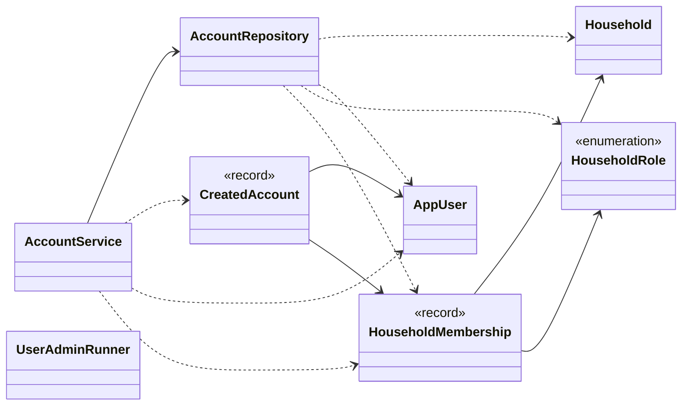
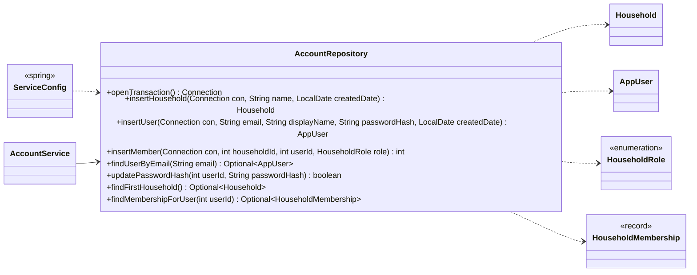
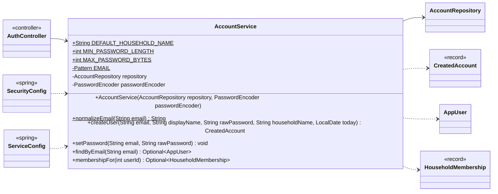
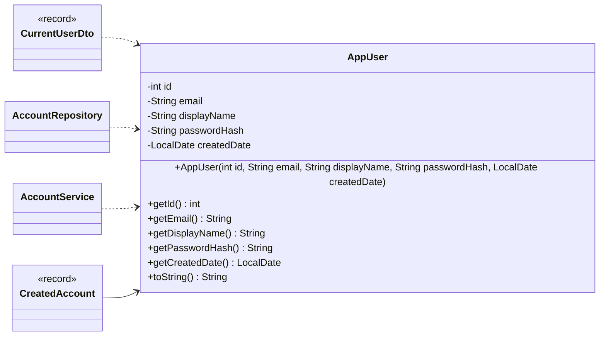
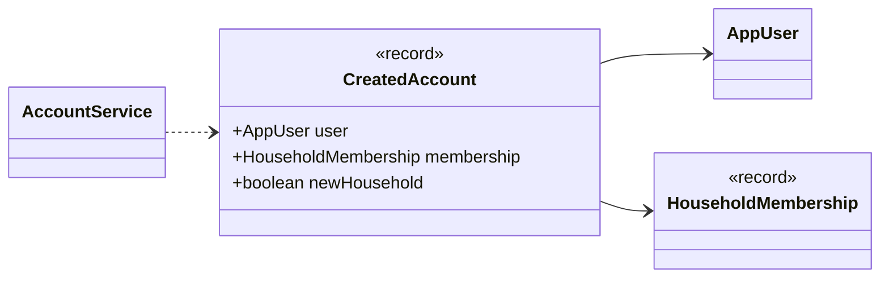
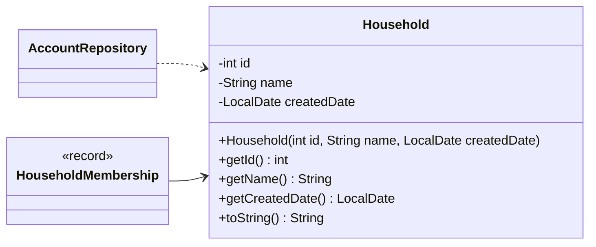
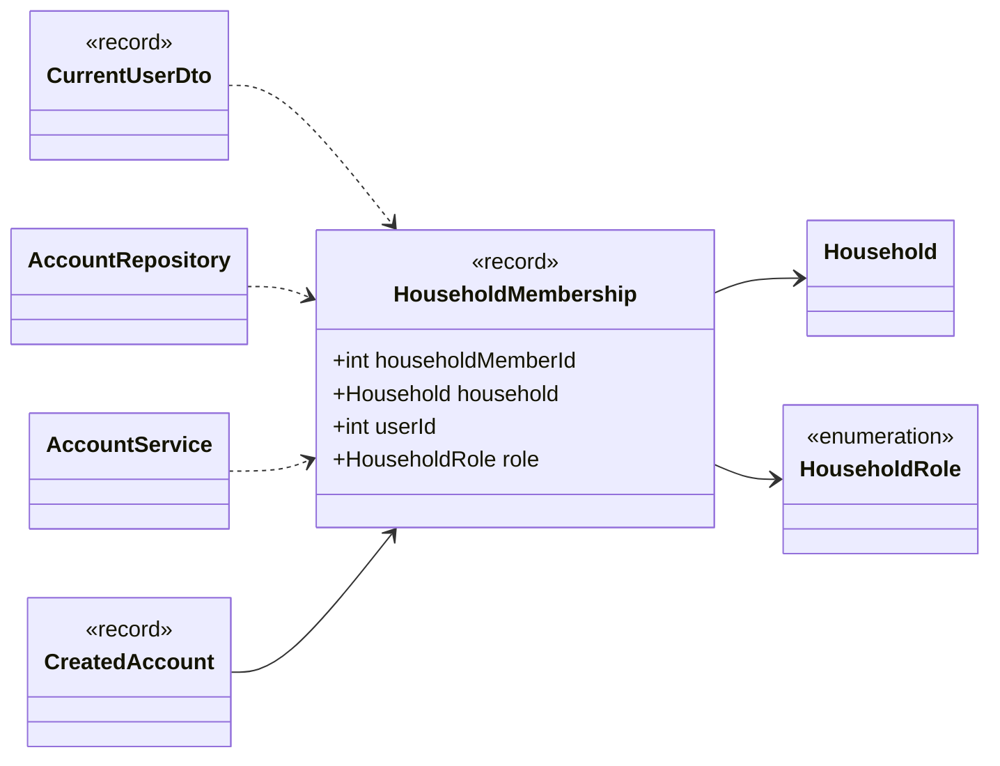
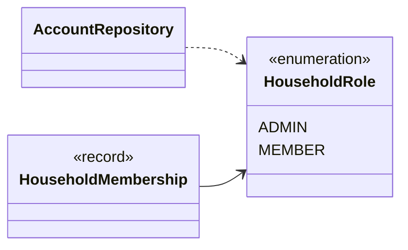
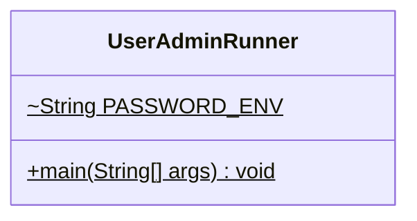

<!-- Generated by scripts/docs/generate_docs.py from src/main/java. Do not edit by hand; change the code or the generator. -->

# Package `auth`

Logins, households and memberships; the `UserAdminRunner` command-line tool.

8 types in 8 source files (`src/main/java/de/dahaem/auth`). Back to the [class index](README.md).

## Overview

Arrows: `-->` has a field or record component of that type, `..>` takes it in its constructor or mentions it in a method signature, `<|--` extends, `<|..` implements, `*--` nested type. Only relationships inside this package are drawn here; each class below also shows its neighbours in other packages.

| Type | Kind | Role | What it is |
|------|------|------|------------|
| [`AccountRepository`](#accountrepository) | class |  | All SQL for the household, app_user and household_member tables lives here. |
| [`AccountService`](#accountservice) | class |  | Business logic for user accounts and households. |
| [`AppUser`](#appuser) | class |  | Plain data holder for one row of the app_user table. |
| [`CreatedAccount`](#createdaccount) | record |  | Result of AccountService.createUser: the new user, the household they were added to, and whether that household was created for them (true for the very first user). |
| [`Household`](#household) | class |  | Plain data holder for one row of the household table. |
| [`HouseholdMembership`](#householdmembership) | record |  | A household together with the role one user has in it (one household_member row, joined to its household). |
| [`HouseholdRole`](#householdrole) | enum |  | What a user may do in their household. |
| [`UserAdminRunner`](#useradminrunner) | class | command-line tool | Command-line entry point for managing logins. |

## AccountRepository

*class*

All SQL for the household, app_user and household_member tables lives here.
The rest of the app never writes SQL against the database; it calls these methods.

The insert methods run on a caller-supplied connection (see .openTransaction()) so the
service can create a household, its first user and the membership linking them atomically.

| Member | Visibility | What it does |
|---|---|---|
| `Connection openTransaction()` | public | Opens a connection with auto-commit off, for a caller that needs to combine several writes atomically. |
| `Household insertHousehold(Connection con, String name, LocalDate createdDate)` | public | Inserts a household row, on the caller's transaction. |
| `AppUser insertUser(Connection con, String email, String displayName, String passwordHash, LocalDate createdDate)` | public | Inserts an app_user row, on the caller's transaction. |
| `int insertMember(Connection con, int householdId, int userId, HouseholdRole role)` | public | Inserts a household_member row, on the caller's transaction. |
| `Optional<AppUser> findUserByEmail(String email)` | public | Finds the user with exactly this (already normalized) email. |
| `boolean updatePasswordHash(int userId, String passwordHash)` | public | Replaces a user's password hash. |
| `Optional<Household> findFirstHousehold()` | public | The oldest household, i.e. |
| `Optional<HouseholdMembership> findMembershipForUser(int userId)` | public | The household a user belongs to, with their role in it. |

**Referenced by:** `AccountService`, `ServiceConfig`

## AccountService

*class*

Business logic for user accounts and households. No SQL here, no UI here.

Passwords only ever pass through here on their way into the PasswordEncoder (BCrypt in
the app); only the resulting hash is handed to the repository. Emails are trimmed and lower-cased
before they are stored or looked up, so "Anna@Example.de" and "anna@example.de" are one account.

There is deliberately no public sign-up: accounts are created by the operator through
UserAdminRunner. For now there is a single shared household: the first user creates it
(as HouseholdRole.ADMIN), everyone after joins it as HouseholdRole.MEMBER.

| Field | Type |
|---|---|
| `DEFAULT_HOUSEHOLD_NAME` | `String` |
| `MIN_PASSWORD_LENGTH` | `int` |
| `MAX_PASSWORD_BYTES` | `int` |
| `EMAIL` | `Pattern` |
| `repository` | `AccountRepository` |
| `passwordEncoder` | `PasswordEncoder` |

| Member | Visibility | What it does |
|---|---|---|
| `AccountService(AccountRepository repository, PasswordEncoder passwordEncoder)` | public |  |
| `String normalizeEmail(String email)` | public static | Trims and lower-cases an email so lookups and the UNIQUE constraint ignore case. |
| `CreatedAccount createUser(String email, String displayName, String rawPassword, String householdName, LocalDate today)` | public | Creates a login. |
| `void setPassword(String email, String rawPassword)` | public | Sets a new password for an existing user (the operator's stand-in for "forgot password"). |
| `Optional<AppUser> findByEmail(String email)` | public |  |
| `Optional<HouseholdMembership> membershipFor(int userId)` | public |  |

**Referenced by:** `AuthController`, `SecurityConfig`, `ServiceConfig`

## AppUser

*class*

Plain data holder for one row of the app_user table.
passwordHash is the BCrypt hash, never the password itself; toString() leaves it out
so it cannot end up in a log line by accident.

| Field | Type |
|---|---|
| `id` | `int` |
| `email` | `String` |
| `displayName` | `String` |
| `passwordHash` | `String` |
| `createdDate` | `LocalDate` |

| Member | Visibility | What it does |
|---|---|---|
| `AppUser(int id, String email, String displayName, String passwordHash, LocalDate createdDate)` | public |  |
| `int getId()` | public |  |
| `String getEmail()` | public |  |
| `String getDisplayName()` | public |  |
| `String getPasswordHash()` | public |  |
| `LocalDate getCreatedDate()` | public |  |
| `String toString()` | public |  |

**Referenced by:** `AccountRepository`, `AccountService`, `CreatedAccount`, `CurrentUserDto`

## CreatedAccount

*record*

Result of AccountService.createUser: the new user, the household they were added to,
and whether that household was created for them (true for the very first user).

| Component | Type |
|---|---|
| `user` | `AppUser` |
| `membership` | `HouseholdMembership` |
| `newHousehold` | `boolean` |

**Referenced by:** `AccountService`

## Household

*class*

Plain data holder for one row of the household table.
No logic here on purpose just the fields, a constructor, and getters.

| Field | Type |
|---|---|
| `id` | `int` |
| `name` | `String` |
| `createdDate` | `LocalDate` |

| Member | Visibility | What it does |
|---|---|---|
| `Household(int id, String name, LocalDate createdDate)` | public |  |
| `int getId()` | public |  |
| `String getName()` | public |  |
| `LocalDate getCreatedDate()` | public |  |
| `String toString()` | public |  |

**Referenced by:** `AccountRepository`, `HouseholdMembership`

## HouseholdMembership

*record*

A household together with the role one user has in it (one household_member row, joined to
its household). Plain data, no logic.

| Component | Type |
|---|---|
| `householdMemberId` | `int` |
| `household` | `Household` |
| `userId` | `int` |
| `role` | `HouseholdRole` |

**Referenced by:** `AccountRepository`, `AccountService`, `CreatedAccount`, `CurrentUserDto`

## HouseholdRole

*enum*

What a user may do in their household. Stored by name in household_member.role.

**Values:** `ADMIN`, `MEMBER`

**Referenced by:** `AccountRepository`, `HouseholdMembership`

## UserAdminRunner

*class · command-line tool*

Command-line entry point for managing logins. DAHÄM is self-hosted, so there is no public
sign-up endpoint: the operator creates the accounts on the server. Run it from the app directory
(the one containing data/), against the same database the API uses:

  create-user   [householdName]
      The first user creates the household (default name "DAHÄM") and becomes its ADMIN;
      later users join that household as MEMBER.
  set-password
      Sets a new password for an existing user (there are no password-reset emails).

The password is read from the DAHAEM_PASSWORD environment variable if it is set (for scripted
setups), otherwise prompted for twice on the console without echo. It is never taken as an
argument, so it does not end up in shell history or the process list.

Exit code: 0 = OK, 1 = failed, 2 = bad arguments.

| Field | Type |
|---|---|
| `PASSWORD_ENV` | `String` |

| Member | Visibility | What it does |
|---|---|---|
| `void main(String[] args)` | public static |  |
