<!-- Generated by scripts/docs/generate_docs.py from src/main/java. Do not edit by hand; change the code or the generator. -->

# Package `auth`

Logins, households and memberships; the `UserAdminRunner` command-line tool.

25 types in 18 source files (`src/main/java/de/dahaem/auth`). Back to the [class index](README.md).

## Overview

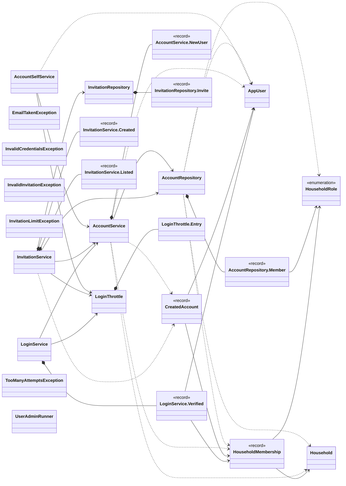

Arrows: `-->` has a field or record component of that type, `..>` takes it in its constructor or mentions it in a method signature, `<|--` extends, `<|..` implements, `*--` nested type. Only relationships inside this package are drawn here; each class below also shows its neighbours in other packages.

| Type | Kind | Role | What it is |
|------|------|------|------------|
| [`AccountRepository`](#accountrepository) | class |  | All SQL for the household, app_user and household_member tables lives here. |
| [`AccountRepository.Member`](#accountrepositorymember) | record |  | One member of a household with the account's name and email. |
| [`AccountSelfService`](#accountselfservice) | class |  | What a logged-in user may do to their own account: change the email and the password. |
| [`AccountService`](#accountservice) | class |  | Business logic for user accounts and households. |
| [`AccountService.NewUser`](#accountservicenewuser) | record |  | A validated new account, not saved yet: the email as it is stored, the name, and the BCrypt hash of the password. |
| [`AppUser`](#appuser) | class |  | Plain data holder for one row of the app_user table. |
| [`CreatedAccount`](#createdaccount) | record |  | Result of AccountService.createUser: the new user, the household they were added to, and whether that household was created for them (true for the very first user). |
| [`EmailTakenException`](#emailtakenexception) | class |  | The email address already belongs to another account. |
| [`Household`](#household) | class |  | Plain data holder for one row of the household table. |
| [`HouseholdMembership`](#householdmembership) | record |  | A household together with the role one user has in it (one household_member row, joined to its household). |
| [`HouseholdRole`](#householdrole) | enum |  | What a user may do in their household. |
| [`InvalidCredentialsException`](#invalidcredentialsexception) | class |  | The email or the password is wrong. |
| [`InvalidInvitationException`](#invalidinvitationexception) | class |  | The invitation code is not usable: wrong, used, revoked or expired. |
| [`InvitationLimitException`](#invitationlimitexception) | class |  | The household already has the most open invitations it may have. |
| [`InvitationRepository`](#invitationrepository) | class |  | All SQL for the household_invite table lives here and nowhere else. |
| [`InvitationRepository.Invite`](#invitationrepositoryinvite) | record |  | One invitation. |
| [`InvitationService`](#invitationservice) | class |  | Invitations into a household: an admin makes one, the code is shown ONCE, and whoever enters it (with an email, a name and a password) becomes a HouseholdRole.MEMBER of that household. |
| [`InvitationService.Created`](#invitationservicecreated) | record |  | A new invitation, with the one chance to see its code. |
| [`InvitationService.Listed`](#invitationservicelisted) | record |  | What an admin sees in the list: never the code. |
| [`LoginService`](#loginservice) | class |  | Checks an email and a password for the PHP front end, which owns the user's session: no session is started here, the answer says who the user is. |
| [`LoginService.Verified`](#loginserviceverified) | record |  | The user and their household membership (null if in no household). |
| [`LoginThrottle`](#loginthrottle) | class |  | A delay that grows with login attempts from one client address, not a lockout. |
| [`LoginThrottle.Entry`](#loginthrottleentry) | class |  |  |
| [`TooManyAttemptsException`](#toomanyattemptsexception) | class |  | Too many failed logins from this address or for this email: try again after retryAfterSeconds. |
| [`UserAdminRunner`](#useradminrunner) | class | command-line tool | Command-line entry point for managing logins. |

## AccountRepository

*class*

All SQL for the household, app_user and household_member tables lives here.
The rest of the app never writes SQL against the database; it calls these methods.

The insert methods run on a caller-supplied connection (see .openTransaction()) so the
service can create a household, its first user and the membership linking them atomically.

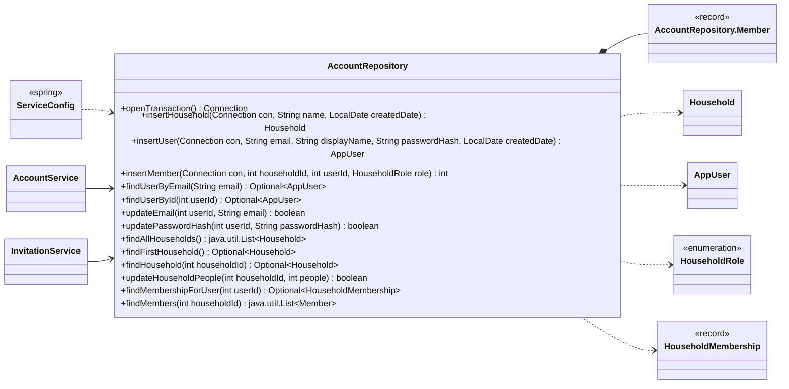

| Member | Visibility | What it does |
|---|---|---|
| `Connection openTransaction()` | public | Opens a connection with auto-commit off, for a caller that needs to combine several writes atomically. |
| `Household insertHousehold(Connection con, String name, LocalDate createdDate)` | public | Inserts a household row, on the caller's transaction. |
| `AppUser insertUser(Connection con, String email, String displayName, String passwordHash, LocalDate createdDate)` | public | Inserts an app_user row, on the caller's transaction. |
| `int insertMember(Connection con, int householdId, int userId, HouseholdRole role)` | public | Inserts a household_member row, on the caller's transaction. |
| `Optional<AppUser> findUserByEmail(String email)` | public | Finds the user with exactly this (already normalized) email. |
| `Optional<AppUser> findUserById(int userId)` | public | Finds the user with this id. |
| `boolean updateEmail(int userId, String email)` | public | Sets a user's (already normalized) email. |
| `boolean updatePasswordHash(int userId, String passwordHash)` | public | Replaces a user's password hash. |
| `java.util.List<Household> findAllHouseholds()` | public | Every household, oldest first. |
| `Optional<Household> findFirstHousehold()` | public | The oldest household, i.e. |
| `Optional<Household> findHousehold(int householdId)` | public | The household with this id, or empty when there is none. |
| `boolean updateHouseholdPeople(int householdId, int people)` | public | Sets the household's head count. |
| `Optional<HouseholdMembership> findMembershipForUser(int userId)` | public | The household a user belongs to, with their role in it. |
| `java.util.List<Member> findMembers(int householdId)` | public | The members of a household, the oldest membership first. |

**Referenced by:** `AccountService`, `InvitationService`, `ServiceConfig`

## AccountRepository.Member

*record*

One member of a household with the account's name and email.

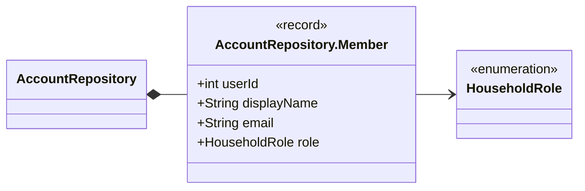

| Component | Type |
|---|---|
| `userId` | `int` |
| `displayName` | `String` |
| `email` | `String` |
| `role` | `HouseholdRole` |

**Referenced by:** `AccountRepository`

## AccountSelfService

*class*

What a logged-in user may do to their own account: change the email and the password. Both need the current password,
and a wrong one counts as a login attempt from that client address (LoginThrottle), so a stolen session cannot
be used to guess it. No SQL here, no UI here.

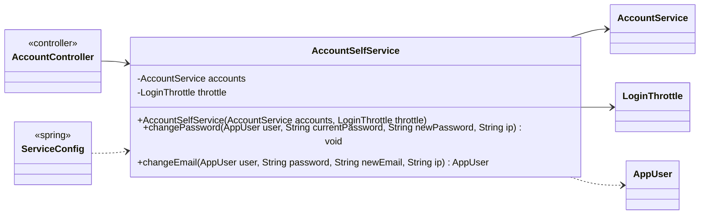

| Field | Type |
|---|---|
| `accounts` | `AccountService` |
| `throttle` | `LoginThrottle` |

| Member | Visibility | What it does |
|---|---|---|
| `AccountSelfService(AccountService accounts, LoginThrottle throttle)` | public |  |
| `void changePassword(AppUser user, String currentPassword, String newPassword, String ip)` | public |  |
| `AppUser changeEmail(AppUser user, String password, String newEmail, String ip)` | public |  |

**Referenced by:** `AccountController`, `ServiceConfig`

## AccountService

*class*

Business logic for user accounts and households. No SQL here, no UI here.

Passwords only ever pass through here on their way into the PasswordEncoder (BCrypt in
the app); only the resulting hash is handed to the repository. Emails are trimmed and lower-cased
before they are stored or looked up, so "Anna@Example.de" and "anna@example.de" are one account.

There is deliberately no public sign-up: accounts are created by the operator through
UserAdminRunner. For now there is a single shared household: the first user creates it
(as HouseholdRole.ADMIN), everyone after joins it as HouseholdRole.MEMBER.

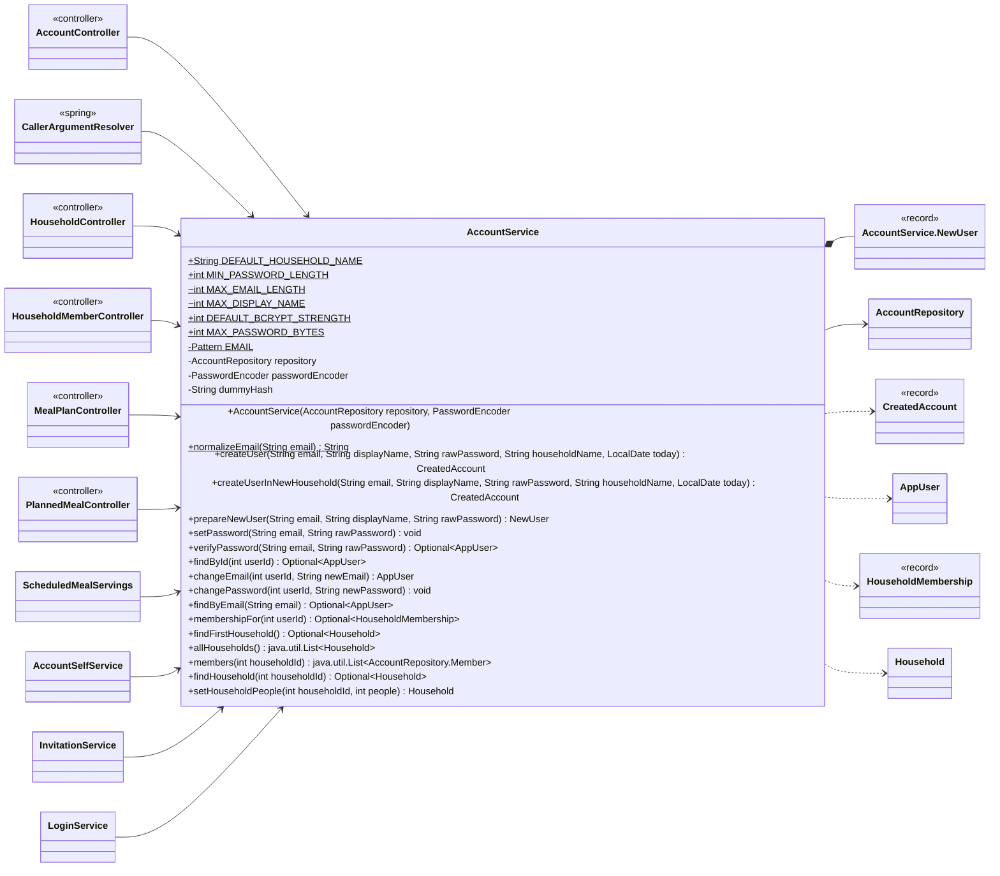

| Field | Type |
|---|---|
| `DEFAULT_HOUSEHOLD_NAME` | `String` |
| `MIN_PASSWORD_LENGTH` | `int` |
| `MAX_EMAIL_LENGTH` | `int` |
| `MAX_DISPLAY_NAME` | `int` |
| `DEFAULT_BCRYPT_STRENGTH` | `int` |
| `MAX_PASSWORD_BYTES` | `int` |
| `EMAIL` | `Pattern` |
| `repository` | `AccountRepository` |
| `passwordEncoder` | `PasswordEncoder` |
| `dummyHash` | `String` |

| Member | Visibility | What it does |
|---|---|---|
| `AccountService(AccountRepository repository, PasswordEncoder passwordEncoder)` | public |  |
| `String normalizeEmail(String email)` | public static | Trims and lower-cases an email so lookups and the UNIQUE constraint ignore case. |
| `CreatedAccount createUser(String email, String displayName, String rawPassword, String householdName, LocalDate today)` | public | Creates a login. |
| `CreatedAccount createUserInNewHousehold(String email, String displayName, String rawPassword, String householdName, LocalDate today)` | public | Creates a login in a NEW household (named householdName, which must not be blank), whatever households exist: the user is its ADMIN. |
| `NewUser prepareNewUser(String email, String displayName, String rawPassword)` | public | Checks the data of a new account and hashes the password, without saving anything (the caller saves it in its own transaction, e.g. |
| `void setPassword(String email, String rawPassword)` | public | Sets a new password for an existing user (the operator's stand-in for "forgot password"). |
| `Optional<AppUser> verifyPassword(String email, String rawPassword)` | public | Checks a password. |
| `Optional<AppUser> findById(int userId)` | public |  |
| `AppUser changeEmail(int userId, String newEmail)` | public | Sets a new email for a user (the caller has already checked the user's password). |
| `void changePassword(int userId, String newPassword)` | public | Sets a new password for a user (the caller has already checked the old one). |
| `Optional<AppUser> findByEmail(String email)` | public |  |
| `Optional<HouseholdMembership> membershipFor(int userId)` | public |  |
| `Optional<Household> findFirstHousehold()` | public | The shared household of this installation (the oldest one), or empty on a fresh database. |
| `java.util.List<Household> allHouseholds()` | public | Every household, oldest first. |
| `java.util.List<AccountRepository.Member> members(int householdId)` | public | The members of a household, the oldest membership first. |
| `Optional<Household> findHousehold(int householdId)` | public |  |
| `Household setHouseholdPeople(int householdId, int people)` | public | Sets how many people the household feeds (household_people). |

**Referenced by:** `AccountController`, `AccountSelfService`, `CallerArgumentResolver`, `HouseholdController`, `HouseholdMemberController`, `InvitationService`, `LoginService`, `MealPlanController`, `MealServingsScheduleConfig`, `PlannedMealController`, `ScheduledMealServings`, `ServiceConfig`

## AccountService.NewUser

*record*

A validated new account, not saved yet: the email as it is stored, the name, and the BCrypt hash of the password.

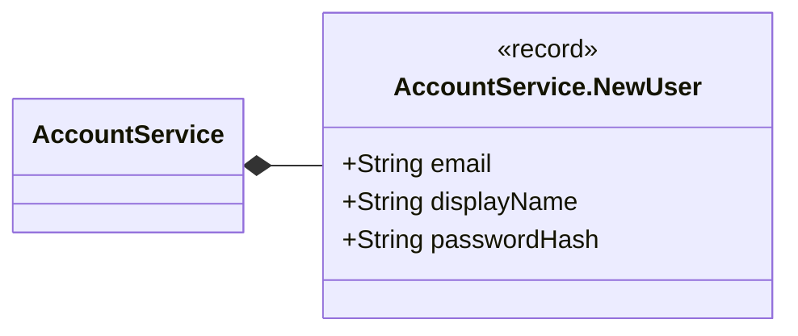

| Component | Type |
|---|---|
| `email` | `String` |
| `displayName` | `String` |
| `passwordHash` | `String` |

**Referenced by:** `AccountService`

## AppUser

*class*

Plain data holder for one row of the app_user table.
passwordHash is the BCrypt hash, never the password itself; toString() leaves it out
so it cannot end up in a log line by accident.

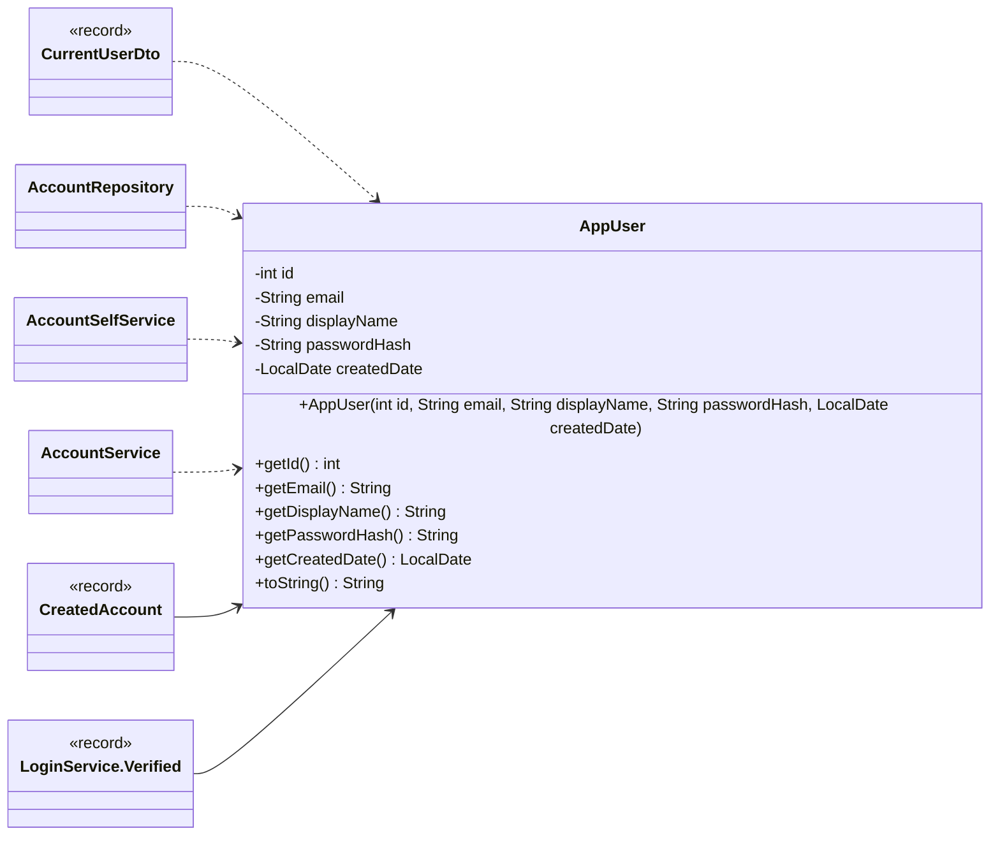

| Field | Type |
|---|---|
| `id` | `int` |
| `email` | `String` |
| `displayName` | `String` |
| `passwordHash` | `String` |
| `createdDate` | `LocalDate` |

| Member | Visibility | What it does |
|---|---|---|
| `AppUser(int id, String email, String displayName, String passwordHash, LocalDate createdDate)` | public |  |
| `int getId()` | public |  |
| `String getEmail()` | public |  |
| `String getDisplayName()` | public |  |
| `String getPasswordHash()` | public |  |
| `LocalDate getCreatedDate()` | public |  |
| `String toString()` | public |  |

**Referenced by:** `AccountRepository`, `AccountSelfService`, `AccountService`, `CreatedAccount`, `CurrentUserDto`

## CreatedAccount

*record*

Result of AccountService.createUser: the new user, the household they were added to,
and whether that household was created for them (true for the very first user).

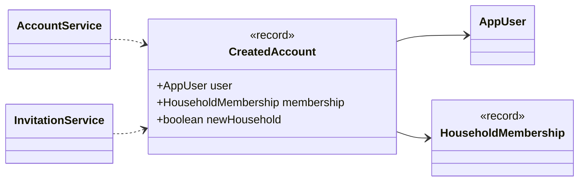

| Component | Type |
|---|---|
| `user` | `AppUser` |
| `membership` | `HouseholdMembership` |
| `newHousehold` | `boolean` |

**Referenced by:** `AccountService`, `InvitationService`

## EmailTakenException

*class · extends IllegalStateException*

The email address already belongs to another account. A conflict (409) with its own code, EMAIL_TAKEN.

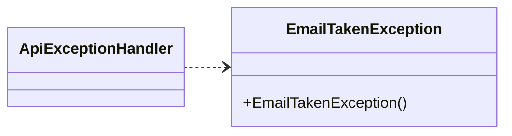

| Member | Visibility | What it does |
|---|---|---|
| `EmailTakenException()` | public |  |

**Referenced by:** `ApiExceptionHandler`

## Household

*class*

Plain data holder for one row of the household table.
No logic here on purpose just the fields, a constructor, and getters.

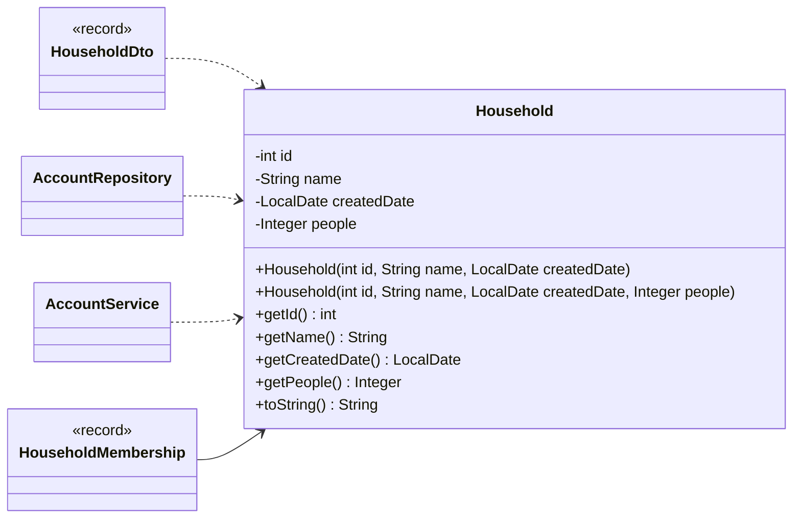

| Field | Type |
|---|---|
| `id` | `int` |
| `name` | `String` |
| `createdDate` | `LocalDate` |
| `people` | `Integer` |

| Member | Visibility | What it does |
|---|---|---|
| `Household(int id, String name, LocalDate createdDate)` | public |  |
| `Household(int id, String name, LocalDate createdDate, Integer people)` | public | people is the household's head count (household_people); null until someone has set it. |
| `int getId()` | public |  |
| `String getName()` | public |  |
| `LocalDate getCreatedDate()` | public |  |
| `Integer getPeople()` | public |  |
| `String toString()` | public |  |

**Referenced by:** `AccountRepository`, `AccountService`, `HouseholdDto`, `HouseholdMembership`

## HouseholdMembership

*record*

A household together with the role one user has in it (one household_member row, joined to
its household). Plain data, no logic.

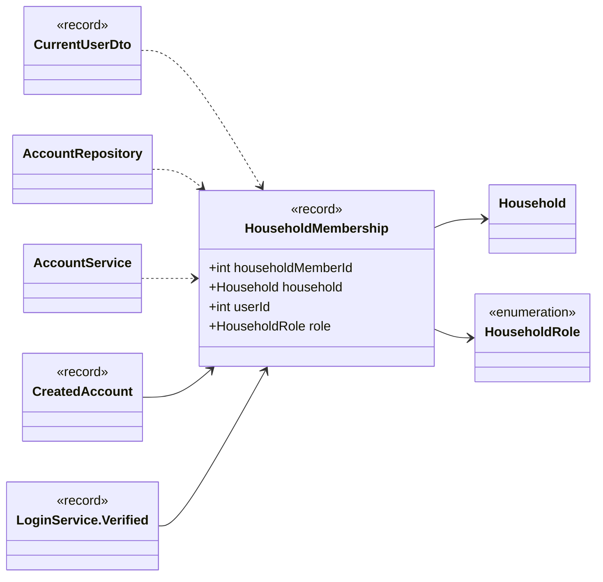

| Component | Type |
|---|---|
| `householdMemberId` | `int` |
| `household` | `Household` |
| `userId` | `int` |
| `role` | `HouseholdRole` |

**Referenced by:** `AccountRepository`, `AccountService`, `CreatedAccount`, `CurrentUserDto`

## HouseholdRole

*enum*

What a user may do in their household. Stored by name in household_member.role.

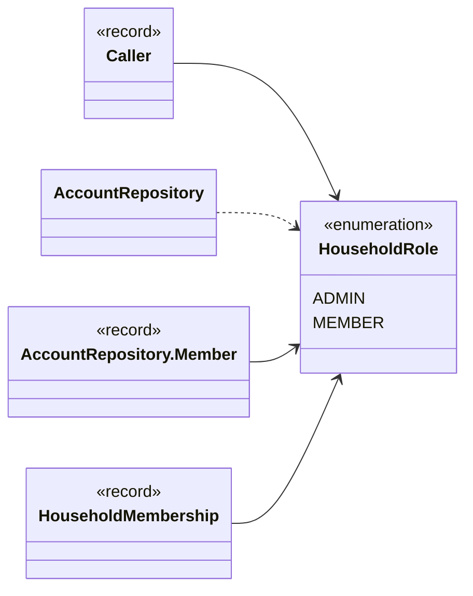

**Values:** `ADMIN`, `MEMBER`

**Referenced by:** `AccountRepository`, `Caller`, `HouseholdMembership`

## InvalidCredentialsException

*class · extends RuntimeException*

The email or the password is wrong. One exception for both on purpose, so an answer never says which.

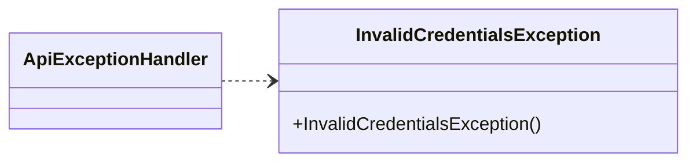

| Member | Visibility | What it does |
|---|---|---|
| `InvalidCredentialsException()` | public |  |

**Referenced by:** `ApiExceptionHandler`

## InvalidInvitationException

*class · extends RuntimeException*

The invitation code is not usable: wrong, used, revoked or expired. One answer for all of them (a 400 with its own code,
INVALID_INVITATION), so nobody can find out what a guessed code once was.

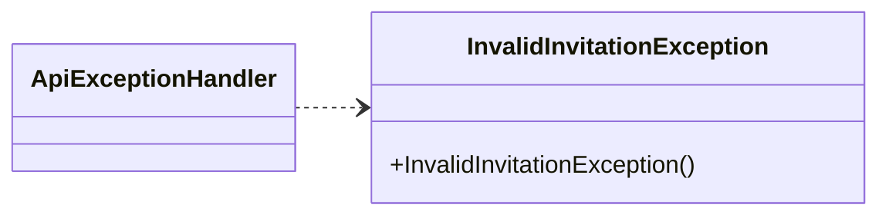

| Member | Visibility | What it does |
|---|---|---|
| `InvalidInvitationException()` | public |  |

**Referenced by:** `ApiExceptionHandler`

## InvitationLimitException

*class · extends RuntimeException*

The household already has the most open invitations it may have. A conflict (409) with its own code, INVITATION_LIMIT.

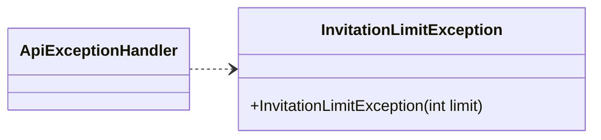

| Member | Visibility | What it does |
|---|---|---|
| `InvitationLimitException(int limit)` | public |  |

**Referenced by:** `ApiExceptionHandler`

## InvitationRepository

*class*

All SQL for the household_invite table lives here and nowhere else. The code of an invitation is never stored, only its
hash. Times are UTC.

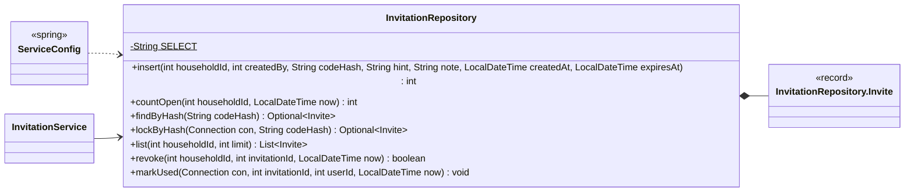

| Field | Type |
|---|---|
| `SELECT` | `String` |

| Member | Visibility | What it does |
|---|---|---|
| `int insert(int householdId, int createdBy, String codeHash, String hint, String note, LocalDateTime createdAt, LocalDateTime expiresAt)` | public |  |
| `int countOpen(int householdId, LocalDateTime now)` | public | How many invitations of the household can still be used at now. |
| `Optional<Invite> findByHash(String codeHash)` | public |  |
| `Optional<Invite> lockByHash(Connection con, String codeHash)` | public | The invitation with this code hash, locked for the caller's transaction. |
| `List<Invite> list(int householdId, int limit)` | public | The newest invitations of a household first, at most limit. |
| `boolean revoke(int householdId, int invitationId, LocalDateTime now)` | public | Revokes an invitation of this household that can still be used. |
| `void markUsed(Connection con, int invitationId, int userId, LocalDateTime now)` | public | Marks the invitation as used by this user, on the caller's transaction. |

**Referenced by:** `InvitationService`, `ServiceConfig`

## InvitationRepository.Invite

*record*

One invitation. usedByEmail is null while it is unused.

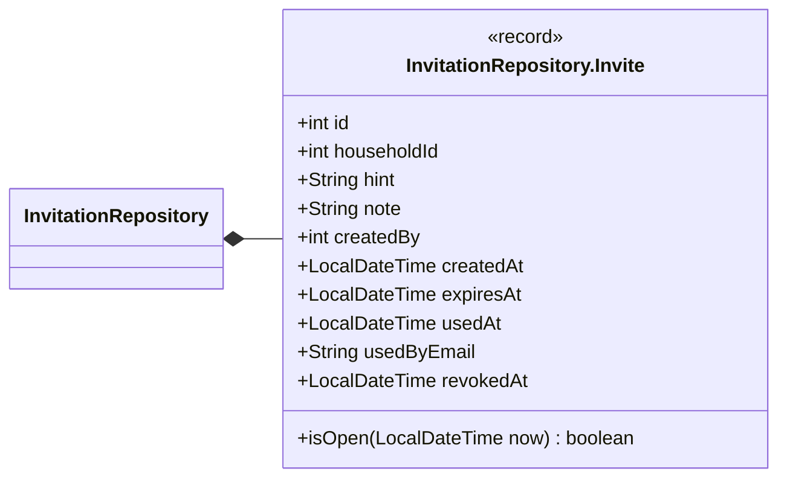

| Component | Type |
|---|---|
| `id` | `int` |
| `householdId` | `int` |
| `hint` | `String` |
| `note` | `String` |
| `createdBy` | `int` |
| `createdAt` | `LocalDateTime` |
| `expiresAt` | `LocalDateTime` |
| `usedAt` | `LocalDateTime` |
| `usedByEmail` | `String` |
| `revokedAt` | `LocalDateTime` |

| Member | Visibility | What it does |
|---|---|---|
| `boolean isOpen(LocalDateTime now)` | public | Neither used nor revoked nor expired at now. |

**Referenced by:** `InvitationRepository`

## InvitationService

*class*

Invitations into a household: an admin makes one, the code is shown ONCE, and whoever enters it (with an email, a name and
a password) becomes a HouseholdRole.MEMBER of that household. There is no open sign-up: without a valid code nobody
can make an account.

The code is 16 characters from an alphabet of 32 without look-alikes (80 bits), shown as XXXX-XXXX-XXXX-XXXX. Only its
SHA-256 is stored. An invitation works once, for #VALID_DAYS days, and an admin can revoke it. Entering a code
counts as an attempt of the client address (LoginThrottle, the same slow-down as a login); a right code gives
the attempt back. No SQL here, no UI here.

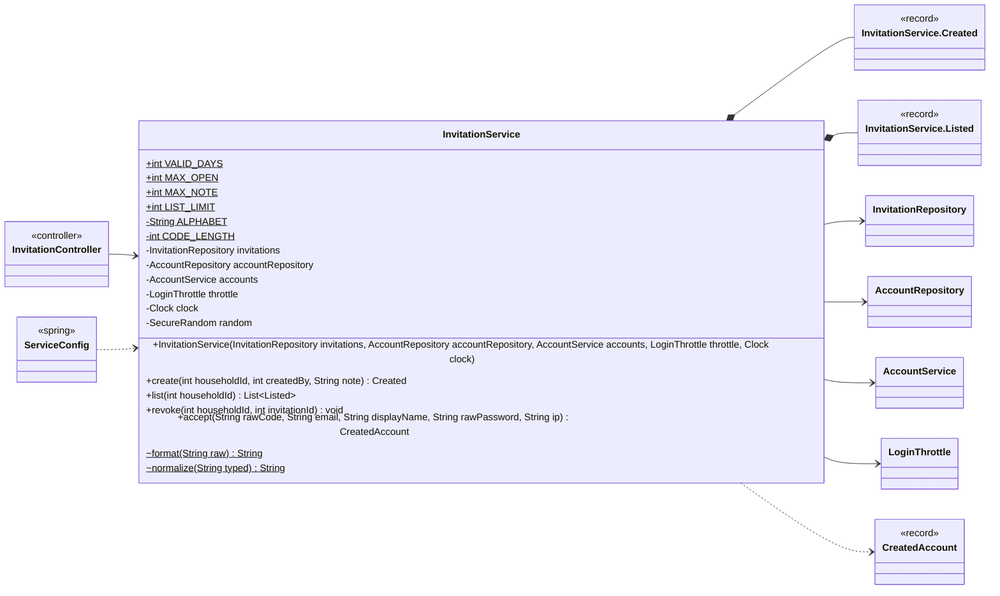

| Field | Type |
|---|---|
| `VALID_DAYS` | `int` |
| `MAX_OPEN` | `int` |
| `MAX_NOTE` | `int` |
| `LIST_LIMIT` | `int` |
| `ALPHABET` | `String` |
| `CODE_LENGTH` | `int` |
| `invitations` | `InvitationRepository` |
| `accountRepository` | `AccountRepository` |
| `accounts` | `AccountService` |
| `throttle` | `LoginThrottle` |
| `clock` | `Clock` |
| `random` | `SecureRandom` |

| Member | Visibility | What it does |
|---|---|---|
| `InvitationService(InvitationRepository invitations, AccountRepository accountRepository, AccountService accounts, LoginThrottle throttle, Clock clock)` | public |  |
| `Created create(int householdId, int createdBy, String note)` | public | Makes an invitation into the household and returns its code, which is not stored and cannot be shown again. |
| `List<Listed> list(int householdId)` | public | The newest invitations of the household (at most #LIST_LIMIT), with their status. |
| `void revoke(int householdId, int invitationId)` | public |  |
| `CreatedAccount accept(String rawCode, String email, String displayName, String rawPassword, String ip)` | public | Uses a code: makes the account and puts it into the household of the invitation as a MEMBER, in one transaction (the invitation is used up in the same step, so two people cannot both use it). |
| `String format(String raw)` | package static | XXXX-XXXX-XXXX-XXXX |
| `String normalize(String typed)` | package static | The 16 characters of a typed code (spaces and dashes ignored, any case), or null if it cannot be a code. |

**Referenced by:** `InvitationController`, `ServiceConfig`

## InvitationService.Created

*record*

A new invitation, with the one chance to see its code.

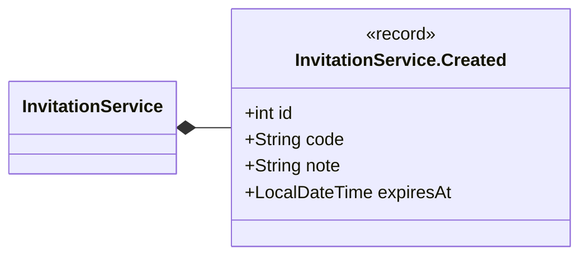

| Component | Type |
|---|---|
| `id` | `int` |
| `code` | `String` |
| `note` | `String` |
| `expiresAt` | `LocalDateTime` |

**Referenced by:** `InvitationService`

## InvitationService.Listed

*record*

What an admin sees in the list: never the code.

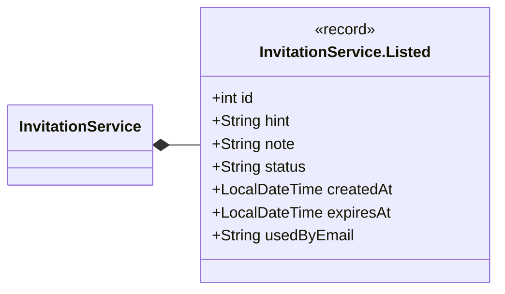

| Component | Type |
|---|---|
| `id` | `int` |
| `hint` | `String` |
| `note` | `String` |
| `status` | `String` |
| `createdAt` | `LocalDateTime` |
| `expiresAt` | `LocalDateTime` |
| `usedByEmail` | `String` |

**Referenced by:** `InvitationService`

## LoginService

*class*

Checks an email and a password for the PHP front end, which owns the user's session: no session is started here, the
answer says who the user is. Attempts from one client address slow that address down (LoginThrottle). No SQL
here, no UI here.

```mermaid
classDiagram
    direction LR
    class auth_LoginService["LoginService"] {
        -AccountService accounts
        -LoginThrottle throttle
        +LoginService(AccountService accounts, LoginThrottle throttle)
        +verify(String email, String rawPassword, String ip) Verified
    }
    class auth_LoginService_Verified["LoginService.Verified"] {
        <<record>>
    }
    class auth_AccountService["AccountService"]
    class auth_LoginThrottle["LoginThrottle"]
    class api_AuthController["AuthController"] {
        <<controller>>
    }
    class api_ServiceConfig["ServiceConfig"] {
        <<spring>>
    }
    auth_LoginService *-- auth_LoginService_Verified
    auth_LoginService --> auth_AccountService
    auth_LoginService --> auth_LoginThrottle
    api_AuthController --> auth_LoginService
    api_ServiceConfig ..> auth_LoginService
```

| Field | Type |
|---|---|
| `accounts` | `AccountService` |
| `throttle` | `LoginThrottle` |

| Member | Visibility | What it does |
|---|---|---|
| `LoginService(AccountService accounts, LoginThrottle throttle)` | public |  |
| `Verified verify(String email, String rawPassword, String ip)` | public |  |

**Referenced by:** `AuthController`, `ServiceConfig`

## LoginService.Verified

*record*

The user and their household membership (null if in no household).

```mermaid
classDiagram
    direction LR
    class auth_LoginService_Verified["LoginService.Verified"] {
        <<record>>
        +AppUser user
        +HouseholdMembership membership
    }
    class auth_LoginService["LoginService"]
    class auth_AppUser["AppUser"]
    class auth_HouseholdMembership["HouseholdMembership"] {
        <<record>>
    }
    auth_LoginService_Verified --> auth_AppUser
    auth_LoginService_Verified --> auth_HouseholdMembership
    auth_LoginService *-- auth_LoginService_Verified
```

| Component | Type |
|---|---|
| `user` | `AppUser` |
| `membership` | `HouseholdMembership` |

**Referenced by:** `LoginService`

## LoginThrottle

*class*

A delay that grows with login attempts from one client address, not a lockout. The attempt is counted BEFORE the
password is looked at (so many attempts sent at the same moment cannot all slip through while the first is still being
checked): the first #THRESHOLD attempts are allowed, the next ones are refused for 30 seconds, then 60, 120 ...
up to 15 minutes. A correct password gives its own attempt back. Attempts are forgotten after an hour without one.

There is deliberately no limit per email: such a limit lets anybody who knows an email address keep the real user
out by guessing wrong once in a while. Guessing spread over many addresses is for the edge (Cloudflare) to stop.
In memory: a restart clears it. Thread-safe (one lock; the work under it is tiny, the password check is outside).

```mermaid
classDiagram
    direction LR
    class auth_LoginThrottle["LoginThrottle"] {
        +int THRESHOLD$
        -long SECOND$
        -long BASE_COOLDOWN$
        -long MAX_COOLDOWN$
        -long FORGET_AFTER$
        -int MAX_ENTRIES$
        -Map~String, Entry~ byIp
        -LongSupplier nanoClock
        +LoginThrottle(LongSupplier nanoClock)
        +begin(String ip) OptionalLong
        +succeeded(String ip) void
    }
    class auth_LoginThrottle_Entry["LoginThrottle.Entry"]
    class auth_AccountSelfService["AccountSelfService"]
    class auth_InvitationService["InvitationService"]
    class auth_LoginService["LoginService"]
    class api_ServiceConfig["ServiceConfig"] {
        <<spring>>
    }
    auth_LoginThrottle *-- auth_LoginThrottle_Entry
    api_ServiceConfig ..> auth_LoginThrottle
    auth_AccountSelfService --> auth_LoginThrottle
    auth_InvitationService --> auth_LoginThrottle
    auth_LoginService --> auth_LoginThrottle
```

| Field | Type |
|---|---|
| `THRESHOLD` | `int` |
| `SECOND` | `long` |
| `BASE_COOLDOWN` | `long` |
| `MAX_COOLDOWN` | `long` |
| `FORGET_AFTER` | `long` |
| `MAX_ENTRIES` | `int` |
| `byIp` | `Map<String, Entry>` |
| `nanoClock` | `LongSupplier` |

| Member | Visibility | What it does |
|---|---|---|
| `LoginThrottle(LongSupplier nanoClock)` | public |  |
| `OptionalLong begin(String ip)` | public | Asks to make an attempt. |
| `void succeeded(String ip)` | public | The password was right: the attempt does not count (and does not leave a block behind that only it caused). |

**Referenced by:** `AccountSelfService`, `InvitationService`, `LoginService`, `ServiceConfig`

## LoginThrottle.Entry

*class*

```mermaid
classDiagram
    direction LR
    class auth_LoginThrottle_Entry["LoginThrottle.Entry"] {
        ~int attempts
        ~long lastAttempt
        ~long blockedUntil
    }
    class auth_LoginThrottle["LoginThrottle"]
    auth_LoginThrottle *-- auth_LoginThrottle_Entry
```

| Field | Type |
|---|---|
| `attempts` | `int` |
| `lastAttempt` | `long` |
| `blockedUntil` | `long` |

**Referenced by:** `LoginThrottle`

## TooManyAttemptsException

*class · extends RuntimeException*

Too many failed logins from this address or for this email: try again after retryAfterSeconds.

```mermaid
classDiagram
    direction LR
    class auth_TooManyAttemptsException["TooManyAttemptsException"] {
        -long retryAfterSeconds
        +TooManyAttemptsException(long retryAfterSeconds)
        +retryAfterSeconds() long
    }
    class api_ApiExceptionHandler["ApiExceptionHandler"]
    api_ApiExceptionHandler ..> auth_TooManyAttemptsException
```

| Field | Type |
|---|---|
| `retryAfterSeconds` | `long` |

| Member | Visibility | What it does |
|---|---|---|
| `TooManyAttemptsException(long retryAfterSeconds)` | public |  |
| `long retryAfterSeconds()` | public |  |

**Referenced by:** `ApiExceptionHandler`

## UserAdminRunner

*class · command-line tool*

Command-line entry point for managing logins. DAHÄM is self-hosted, so there is no public
sign-up endpoint: the operator creates the accounts on the server. Run it from the app directory
(the one containing data/), against the same database the API uses:

  create-user   [householdName]
      The first user creates the household (default name "DAHÄM") and becomes its ADMIN;
      later users join that household as MEMBER.
  create-household-user
      Starts a NEW household with this user as its ADMIN, even if households exist (a second household). Everyone else
      joins it by invitation (the admin makes one in the app).
  set-password
      Sets a new password for an existing user (there are no password-reset emails).

The password is read from the DAHAEM_PASSWORD environment variable if it is set (for scripted
setups), otherwise prompted for twice on the console without echo. It is never taken as an
argument, so it does not end up in shell history or the process list.

Exit code: 0 = OK, 1 = failed, 2 = bad arguments.

```mermaid
classDiagram
    direction LR
    class auth_UserAdminRunner["UserAdminRunner"] {
        ~String PASSWORD_ENV$
        +main(String[] args) void$
    }
```

| Field | Type |
|---|---|
| `PASSWORD_ENV` | `String` |

| Member | Visibility | What it does |
|---|---|---|
| `void main(String[] args)` | public static |  |
