<!-- Generated by scripts/docs/generate_docs.py from src/main/java. Do not edit by hand; change the code or the generator. -->

# Package `barcode`

16 types in 11 source files (`src/main/java/de/dahaem/barcode`). Back to the [class index](README.md).

## Overview

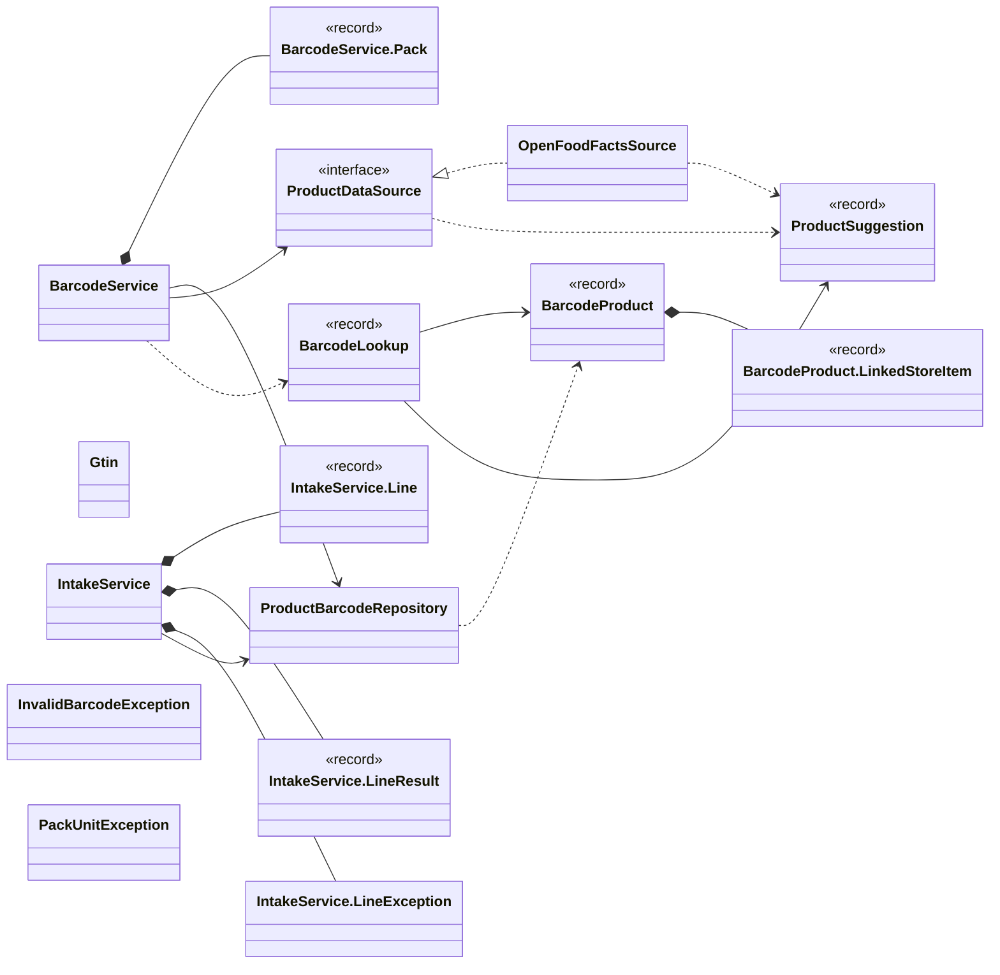

Arrows: `-->` has a field or record component of that type, `..>` takes it in its constructor or mentions it in a method signature, `<|--` extends, `<|..` implements, `*--` nested type. Only relationships inside this package are drawn here; each class below also shows its neighbours in other packages.

| Type | Kind | Role | What it is |
|------|------|------|------------|
| [`BarcodeLookup`](#barcodelookup) | record |  | The answer to "what is this barcode?". |
| [`BarcodeProduct`](#barcodeproduct) | record |  | What DAHÄM knows about a barcode: the catalogue item it is (itemUnit is the unit its stock is counted in), the brand (null = none), the pack (size in unit, like a store item) and the name as printed (may be null), plus the store items that  |
| [`BarcodeProduct.LinkedStoreItem`](#barcodeproductlinkedstoreitem) | record |  | A store item that carries the barcode: which store, and its current normal price (null if unknown). |
| [`BarcodeService`](#barcodeservice) | class |  | Barcodes: what a number is, and remembering it. |
| [`BarcodeService.Pack`](#barcodeservicepack) | record |  | A pack as it is stored: the same units a store item and the shopping list use. |
| [`Gtin`](#gtin) | class |  | Barcode numbers (GTIN: EAN-8, UPC-A, EAN-13, GTIN-14). |
| [`IntakeService`](#intakeservice) | class |  | Puts groceries away by barcode: for each line (barcode, packs, expiry date, price) the store item for (store, brand, catalogue item, pack) is found or created, linked to the barcode, and the purchase recorded, which adds packs x pack size t |
| [`IntakeService.Line`](#intakeserviceline) | record |  | One line to put away. |
| [`IntakeService.LineResult`](#intakeservicelineresult) | record |  | What happened to one line: recorded (purchase, store item, how much stock was added in which unit) or why not. |
| [`IntakeService.LineException`](#intakeservicelineexception) | class |  |  |
| [`InvalidBarcodeException`](#invalidbarcodeexception) | class |  | A barcode number that cannot be right: not digits, a length no barcode has (INVALID_BARCODE), or a check digit that does not fit the other digits, which is what a typing error looks like (BARCODE_CHECKSUM). |
| [`OpenFoodFactsSource`](#openfoodfactssource) | class |  | Open Food Facts (open data, no key): name, brand and quantity of a product by its barcode. |
| [`PackUnitException`](#packunitexception) | class |  | The pack of a barcode cannot be stocked in the catalogue item's unit (a pack in ml for an item counted in g, or a unit nobody knows). |
| [`ProductBarcodeRepository`](#productbarcoderepository) | class |  | All SQL for product_barcode and product_barcode_store_item lives here and nowhere else. |
| [`ProductDataSource`](#productdatasource) | interface |  | Where a barcode DAHÄM does not know can be looked up (an open data source). |
| [`ProductSuggestion`](#productsuggestion) | record |  | What an open data source says about a barcode DAHÄM does not know yet. |

## BarcodeLookup

*record*

The answer to "what is this barcode?". code is the normalised number. status:
KNOWN (it is in DAHÄM, see product); FOUND (not in DAHÄM, an open data source describes it, see
suggestion); NOT_FOUND (neither); DISABLED (not in DAHÄM and the outside lookup is switched off);
UNAVAILABLE (the outside lookup was tried and failed: try again or enter the product by hand).

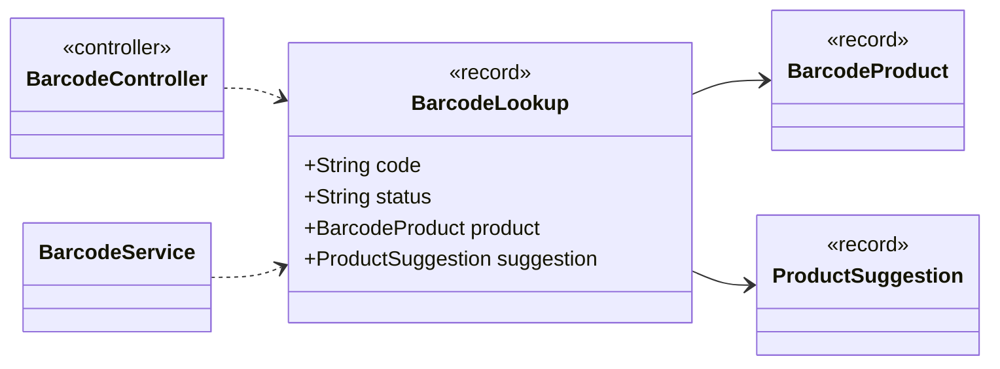

| Component | Type |
|---|---|
| `code` | `String` |
| `status` | `String` |
| `product` | `BarcodeProduct` |
| `suggestion` | `ProductSuggestion` |

**Referenced by:** `BarcodeController`, `BarcodeService`

## BarcodeProduct

*record*

What DAHÄM knows about a barcode: the catalogue item it is (itemUnit is the unit its stock is counted in), the brand (null = none), the pack (size in unit, like a
store item) and the name as printed (may be null), plus the store items that carry it (one per store that sells it).

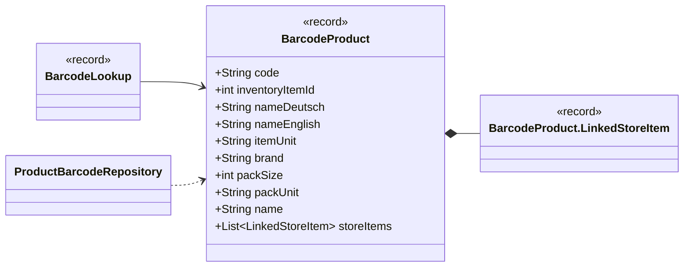

| Component | Type |
|---|---|
| `code` | `String` |
| `inventoryItemId` | `int` |
| `nameDeutsch` | `String` |
| `nameEnglish` | `String` |
| `itemUnit` | `String` |
| `brand` | `String` |
| `packSize` | `int` |
| `packUnit` | `String` |
| `name` | `String` |
| `storeItems` | `List<LinkedStoreItem>` |

**Referenced by:** `BarcodeLookup`, `ProductBarcodeRepository`

## BarcodeProduct.LinkedStoreItem

*record*

A store item that carries the barcode: which store, and its current normal price (null if unknown).

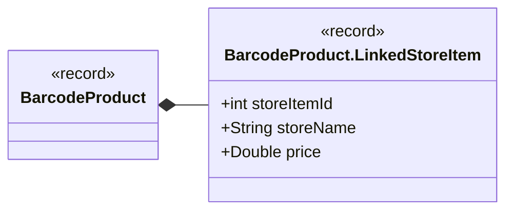

| Component | Type |
|---|---|
| `storeItemId` | `int` |
| `storeName` | `String` |
| `price` | `Double` |

**Referenced by:** `BarcodeProduct`

## BarcodeService

*class*

Barcodes: what a number is, and remembering it. A barcode DAHÄM knows is answered from its own table; an unknown one
may be described by an open data source (a suggestion only, never saved by itself). No SQL here, no UI here.

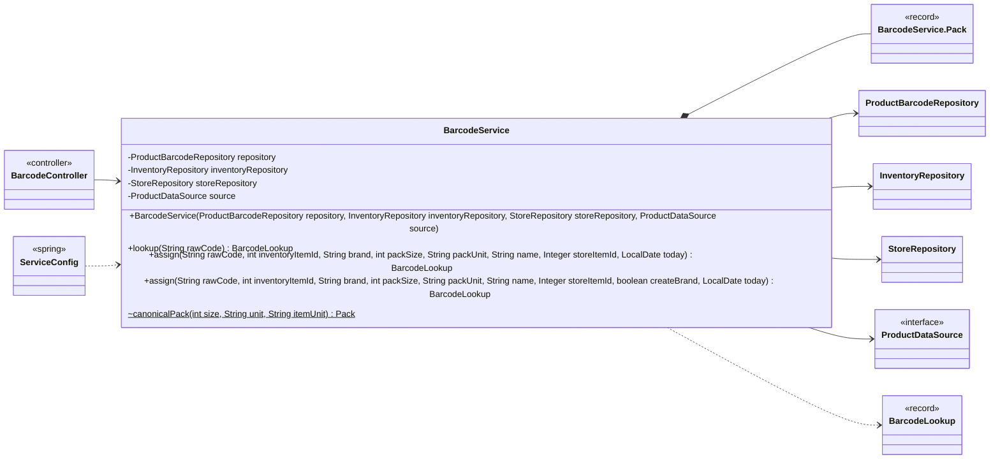

| Field | Type |
|---|---|
| `repository` | `ProductBarcodeRepository` |
| `inventoryRepository` | `InventoryRepository` |
| `storeRepository` | `StoreRepository` |
| `source` | `ProductDataSource` |

| Member | Visibility | What it does |
|---|---|---|
| `BarcodeService(ProductBarcodeRepository repository, InventoryRepository inventoryRepository, StoreRepository storeRepository, ProductDataSource source)` | public |  |
| `BarcodeLookup lookup(String rawCode)` | public | What the barcode is: from DAHÄM if known, else a suggestion from the open data source if it is switched on. |
| `BarcodeLookup assign(String rawCode, int inventoryItemId, String brand, int packSize, String packUnit, String name, Integer storeItemId, LocalDate today)` | public | Remembers what a barcode is (or replaces it): the catalogue item, the brand (blank = none; a new brand is created), the pack and the name as printed. |
| `BarcodeLookup assign(String rawCode, int inventoryItemId, String brand, int packSize, String packUnit, String name, Integer storeItemId, boolean createBrand, LocalDate today)` | public | Like .assign(String, int, String, int, String, String, Integer, LocalDate), but a brand that does not exist is only created when createBrand is true; otherwise an UnknownBrandException (400 UNKNOWN_BRAND) and nothing is saved, so a typo can |
| `Pack canonicalPack(int size, String unit, String itemUnit)` | package static | The pack in the units the shopping list works in: mass in g, volume in ml, pieces in stück ("1 kg" is 1000 g, "1,5 l" is 1500 ml), so a barcode's pack is the same as the matching store item's and the stock of the item. |

**Referenced by:** `BarcodeController`, `ServiceConfig`

## BarcodeService.Pack

*record*

A pack as it is stored: the same units a store item and the shopping list use.

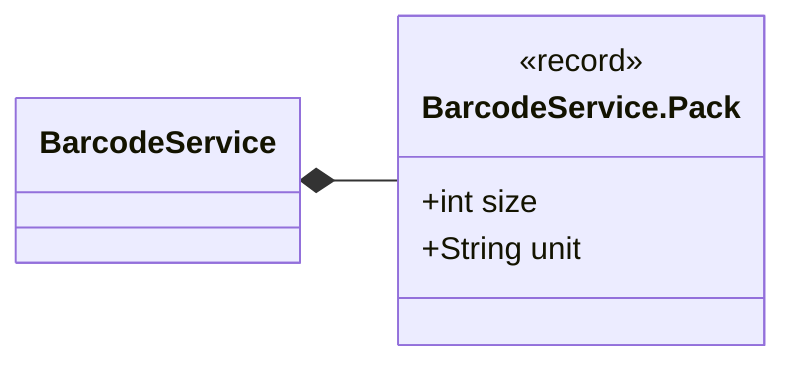

| Component | Type |
|---|---|
| `size` | `int` |
| `unit` | `String` |

**Referenced by:** `BarcodeService`

## Gtin

*class*

Barcode numbers (GTIN: EAN-8, UPC-A, EAN-13, GTIN-14). .normalize accepts what a person types (spaces and
hyphens allowed), checks the length and the check digit, and returns the number in one form: a 12-digit UPC-A is the
same product as the EAN-13 with a leading 0, so it is stored as that; 8 and 14 digits stay as they are.

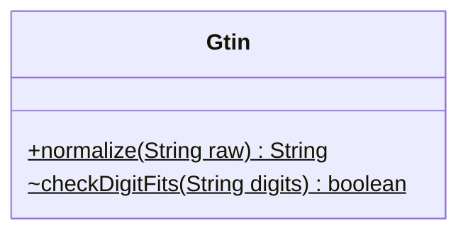

| Member | Visibility | What it does |
|---|---|---|
| `String normalize(String raw)` | public static |  |
| `boolean checkDigitFits(String digits)` | package static | The last digit must make the weighted sum (weights 3, 1, 3, 1 ... |

## IntakeService

*class*

Puts groceries away by barcode: for each line (barcode, packs, expiry date, price) the store item for (store, brand,
catalogue item, pack) is found or created, linked to the barcode, and the purchase recorded, which adds packs x pack size
to the item's stock in the item's own unit and keeps the expiry date as a batch. Every line stands on its own: one bad
line is reported and the rest are still put away. No SQL here, no UI here.

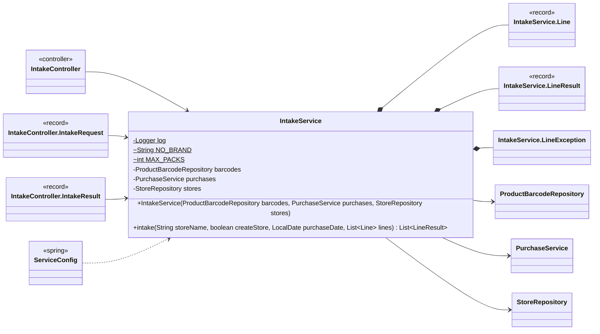

| Field | Type |
|---|---|
| `log` | `Logger` |
| `NO_BRAND` | `String` |
| `MAX_PACKS` | `int` |
| `barcodes` | `ProductBarcodeRepository` |
| `purchases` | `PurchaseService` |
| `stores` | `StoreRepository` |

| Member | Visibility | What it does |
|---|---|---|
| `IntakeService(ProductBarcodeRepository barcodes, PurchaseService purchases, StoreRepository stores)` | public |  |
| `List<LineResult> intake(String storeName, boolean createStore, LocalDate purchaseDate, List<Line> lines)` | public | Puts the lines away at the store. |

**Referenced by:** `IntakeController`, `IntakeController.IntakeRequest`, `IntakeController.IntakeResult`, `ServiceConfig`

## IntakeService.Line

*record*

One line to put away. packs defaults to 1; expirationDate is required; pricePaid is the total
for all the packs of the line and, when missing, the known price of the store item times the packs (a line for a
product with no known price at this store needs it); packSize / packUnit (both or neither) replace
the barcode's pack for this purchase, for a special package.

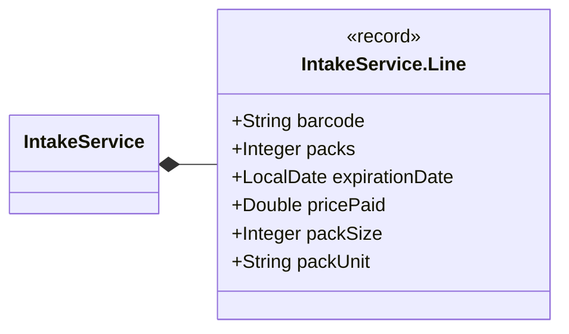

| Component | Type |
|---|---|
| `barcode` | `String` |
| `packs` | `Integer` |
| `expirationDate` | `LocalDate` |
| `pricePaid` | `Double` |
| `packSize` | `Integer` |
| `packUnit` | `String` |

**Referenced by:** `IntakeService`

## IntakeService.LineResult

*record*

What happened to one line: recorded (purchase, store item, how much stock was added in which unit) or why not.

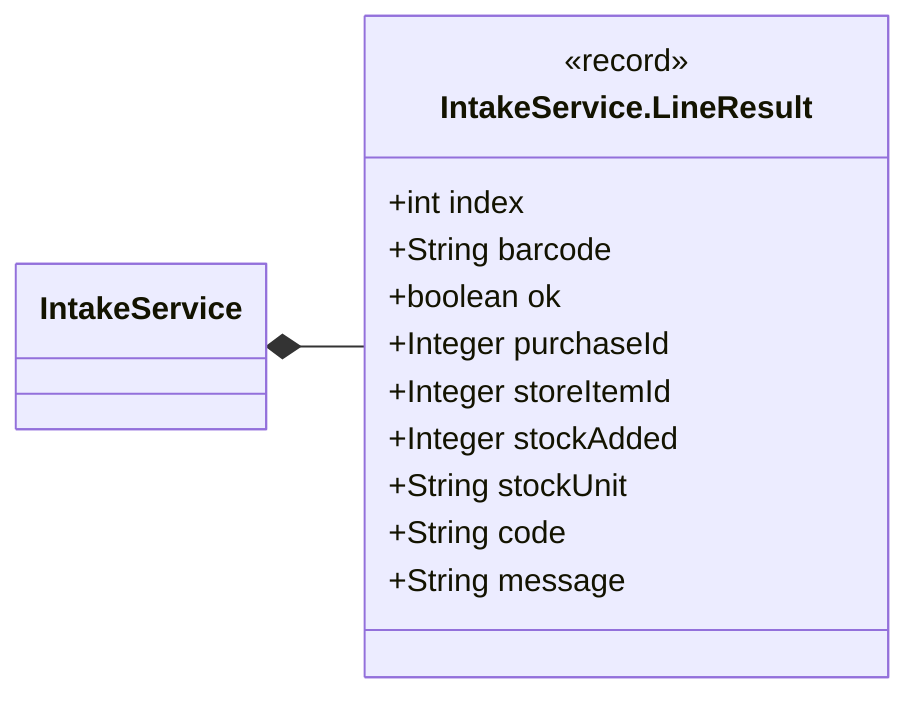

| Component | Type |
|---|---|
| `index` | `int` |
| `barcode` | `String` |
| `ok` | `boolean` |
| `purchaseId` | `Integer` |
| `storeItemId` | `Integer` |
| `stockAdded` | `Integer` |
| `stockUnit` | `String` |
| `code` | `String` |
| `message` | `String` |

**Referenced by:** `IntakeService`

## IntakeService.LineException

*class · extends RuntimeException*

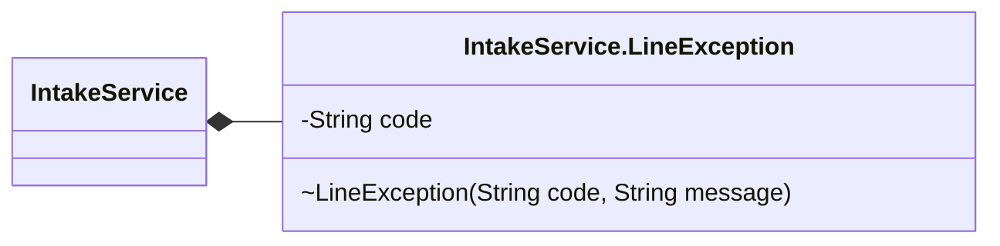

| Field | Type |
|---|---|
| `code` | `String` |

| Member | Visibility | What it does |
|---|---|---|
| `LineException(String code, String message)` | package |  |

**Referenced by:** `IntakeService`

## InvalidBarcodeException

*class · extends IllegalArgumentException*

A barcode number that cannot be right: not digits, a length no barcode has (INVALID_BARCODE), or a check digit that
does not fit the other digits, which is what a typing error looks like (BARCODE_CHECKSUM). A bad request (400) that
carries its own code so a client can show a precise message.

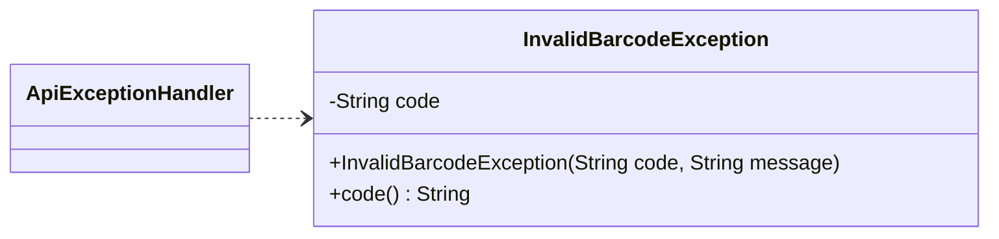

| Field | Type |
|---|---|
| `code` | `String` |

| Member | Visibility | What it does |
|---|---|---|
| `InvalidBarcodeException(String code, String message)` | public |  |
| `String code()` | public |  |

**Referenced by:** `ApiExceptionHandler`

## OpenFoodFactsSource

*class · implements ProductDataSource*

Open Food Facts (open data, no key): name, brand and quantity of a product by its barcode. Only the barcode number is
sent, with a generic client name. Used for suggestions only.

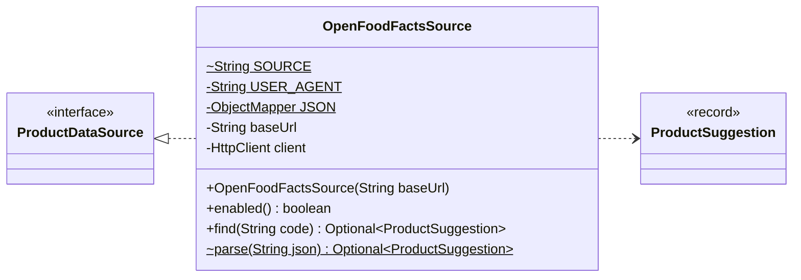

| Field | Type |
|---|---|
| `SOURCE` | `String` |
| `USER_AGENT` | `String` |
| `JSON` | `ObjectMapper` |
| `baseUrl` | `String` |
| `client` | `HttpClient` |

| Member | Visibility | What it does |
|---|---|---|
| `OpenFoodFactsSource(String baseUrl)` | public |  |
| `boolean enabled()` | public |  |
| `Optional<ProductSuggestion> find(String code)` | public |  |
| `Optional<ProductSuggestion> parse(String json)` | package static | Reads an Open Food Facts product answer; empty when it says the product is unknown or has no name. |

## PackUnitException

*class · extends IllegalArgumentException*

The pack of a barcode cannot be stocked in the catalogue item's unit (a pack in ml for an item counted in g, or a unit
nobody knows). A bad request (400) with its own code, PACK_UNIT_MISMATCH, so a client can show a precise message.

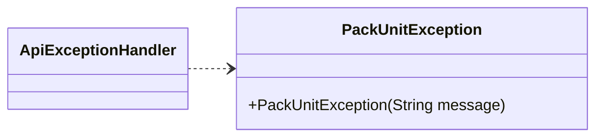

| Member | Visibility | What it does |
|---|---|---|
| `PackUnitException(String message)` | public |  |

**Referenced by:** `ApiExceptionHandler`

## ProductBarcodeRepository

*class*

All SQL for product_barcode and product_barcode_store_item lives here and nowhere else.

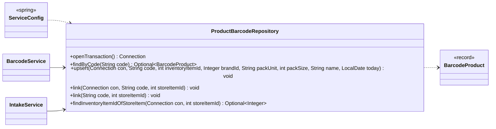

| Member | Visibility | What it does |
|---|---|---|
| `Connection openTransaction()` | public | Opens a connection with auto-commit off, for a caller that needs to combine several writes atomically. |
| `Optional<BarcodeProduct> findByCode(String code)` | public | The product a normalised barcode identifies, with the store items that carry it; empty if DAHÄM does not know it. |
| `void upsert(Connection con, String code, int inventoryItemId, Integer brandId, String packUnit, int packSize, String name, LocalDate today)` | public | Creates the barcode, or replaces what it identifies (the day it was first entered stays). |
| `void link(Connection con, String code, int storeItemId)` | public | Links a store item to the barcode (already linked is fine). |
| `void link(String code, int storeItemId)` | public | Links a store item to the barcode on its own connection (already linked is fine). |
| `Optional<Integer> findInventoryItemIdOfStoreItem(Connection con, int storeItemId)` | public | The catalogue item a store item is for, or empty if there is no such store item. |

**Referenced by:** `BarcodeService`, `IntakeService`, `ServiceConfig`

## ProductDataSource

*interface*

Where a barcode DAHÄM does not know can be looked up (an open data source). Only the number is ever sent.

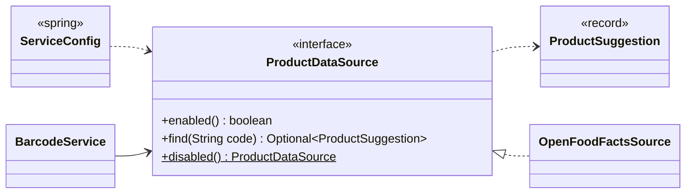

| Member | Visibility | What it does |
|---|---|---|
| `boolean enabled()` | public | False when the outside lookup is switched off. |
| `Optional<ProductSuggestion> find(String code)` | public | The product for a normalised barcode, empty if the source does not know it; an IOException if it cannot be reached. |
| `ProductDataSource disabled()` | public static | The switched-off source: nothing leaves the server. |

**Referenced by:** `BarcodeService`, `OpenFoodFactsSource`, `ServiceConfig`

## ProductSuggestion

*record*

What an open data source says about a barcode DAHÄM does not know yet. A suggestion only: nothing is saved until the
user assigns the barcode to a catalogue item. packSize / packUnit are null when the quantity text could not be read.

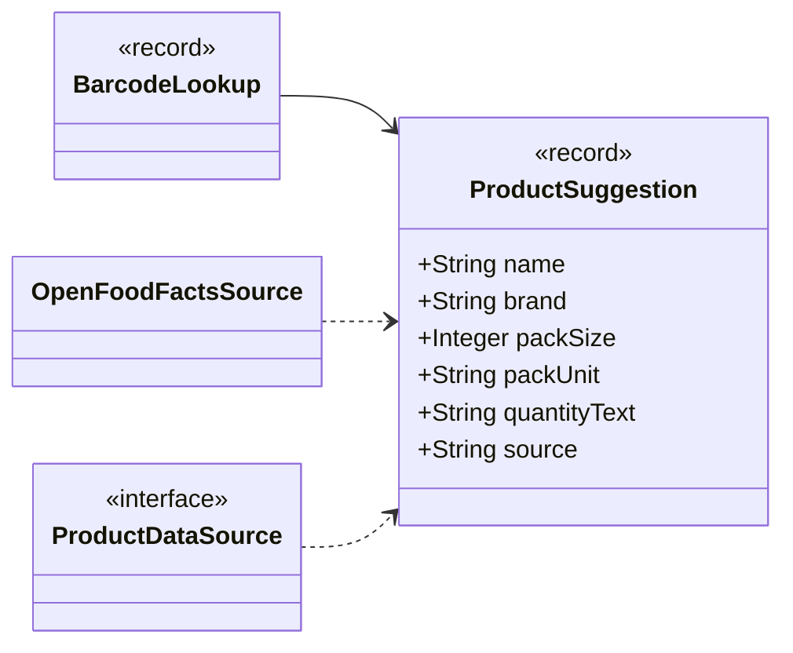

| Component | Type |
|---|---|
| `name` | `String` |
| `brand` | `String` |
| `packSize` | `Integer` |
| `packUnit` | `String` |
| `quantityText` | `String` |
| `source` | `String` |

**Referenced by:** `BarcodeLookup`, `OpenFoodFactsSource`, `ProductDataSource`
