<!-- Generated by scripts/docs/generate_docs.py from src/main/java. Do not edit by hand; change the code or the generator. -->

# Package `diet`

The diet filter: presets, rules and the per-recipe verdict (OK / ANPASSBAR / HIDDEN / UNCLEAR).

13 types in 9 source files (`src/main/java/de/dahaem/diet`). Back to the [class index](README.md).

## Overview

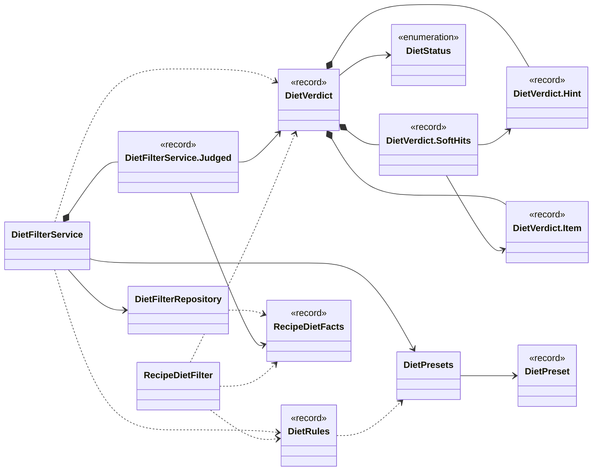

Arrows: `-->` has a field or record component of that type, `..>` takes it in its constructor or mentions it in a method signature, `<|--` extends, `<|..` implements, `*--` nested type. Only relationships inside this package are drawn here; each class below also shows its neighbours in other packages.

| Type | Kind | Role | What it is |
|------|------|------|------------|
| [`DietFilterRepository`](#dietfilterrepository) | class |  | All SQL for the diet filter. |
| [`DietFilterService`](#dietfilterservice) | class |  | Applies diet rules to recipes on the server, so the client never receives 11,000 recipes to filter itself. |
| [`DietFilterService.Judged`](#dietfilterservicejudged) | record |  | A verdict together with the facts it was made from. |
| [`DietPreset`](#dietpreset) | record |  | One diet preset from config/diet_presets.json: tags a recipe must NOT have (excludeTags) and tags it MUST have (requireTags). |
| [`DietPresets`](#dietpresets) | class |  | The diet presets, read from config/diet_presets.json (no hardcoding: the lists are Nate's to change). |
| [`DietRules`](#dietrules) | record |  | What a household does not eat, as the PHP passes it (the questionnaire itself and its storage are not part of the API). |
| [`DietStatus`](#dietstatus) | enum |  | What the diet rules say about one recipe. |
| [`DietVerdict`](#dietverdict) | record |  | The filter's answer for one recipe. |
| [`DietVerdict.Hint`](#dietverdicthint) | record |  | An item with possible animals of which at least one is excluded; allowedAnimals is what remains. |
| [`DietVerdict.Item`](#dietverdictitem) | record |  | A matched item (id and name). |
| [`DietVerdict.SoftHits`](#dietverdictsofthits) | record |  | Soft-rule hits: tags the recipe has, ingredient items it has, and items that MAY be an avoided animal (for an avoided animal tag). |
| [`RecipeDietFacts`](#recipedietfacts) | record |  | What the filter needs to know about one recipe: its stored tag names, its ingredients with their certain and possible animals, and its unmatched lines (recipe_unmatched_ingredient). |
| [`RecipeDietFilter`](#recipedietfilter) | class |  | Judges one recipe against DietRules. |

## DietFilterRepository

*class*

All SQL for the diet filter. Read-only: it never writes.

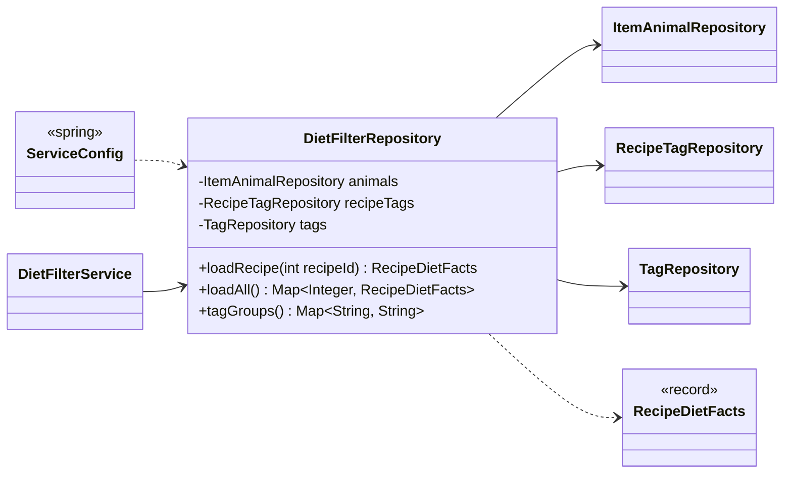

| Field | Type |
|---|---|
| `animals` | `ItemAnimalRepository` |
| `recipeTags` | `RecipeTagRepository` |
| `tags` | `TagRepository` |

| Member | Visibility | What it does |
|---|---|---|
| `RecipeDietFacts loadRecipe(int recipeId)` | public | The facts of one recipe, or empty facts when it has none. |
| `Map<Integer, RecipeDietFacts> loadAll()` | public | The facts of every recipe, by recipe id. |
| `Map<String, String> tagGroups()` | public | tag name → group (tag_category) for every tag; the filter needs it to know which tags depend on the ingredients. |

**Referenced by:** `DietFilterService`, `ServiceConfig`

## DietFilterService

*class*

Applies diet rules to recipes on the server, so the client never receives 11,000 recipes to filter itself.
Reusable: .judgeAll and .judge take rules and return verdicts by recipe id; the recipe list
(and later the full search / paging) only decides what to do with them. No SQL here.

Presets filter INGREDIENTS only. DAHÄM cannot certify halal or kosher (slaughter, certification): meat
certification stays the shopper's responsibility.

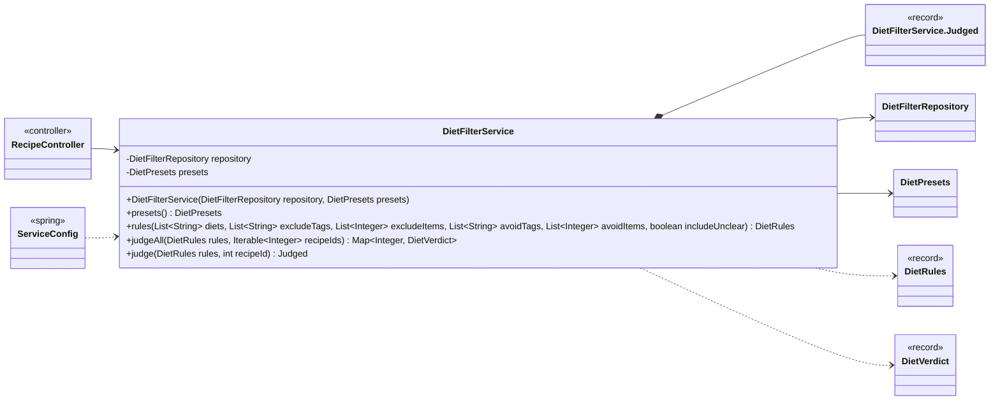

| Field | Type |
|---|---|
| `repository` | `DietFilterRepository` |
| `presets` | `DietPresets` |

| Member | Visibility | What it does |
|---|---|---|
| `DietFilterService(DietFilterRepository repository, DietPresets presets)` | public |  |
| `DietPresets presets()` | public |  |
| `DietRules rules(List<String> diets, List<String> excludeTags, List<Integer> excludeItems, List<String> avoidTags, List<Integer> avoidItems, boolean includeUnclear)` | public | The rules for the given request parameters; an unknown preset is an IllegalArgumentException. |
| `Map<Integer, DietVerdict> judgeAll(DietRules rules, Iterable<Integer> recipeIds)` | public | A verdict for EVERY recipe that has any facts, by recipe id (recipes without ingredients are UNCLEAR). |
| `Judged judge(DietRules rules, int recipeId)` | public | The verdict for one recipe, with its unmatched lines in RecipeDietFacts.unmatched(). |

**Referenced by:** `RecipeController`, `ServiceConfig`

## DietFilterService.Judged

*record*

A verdict together with the facts it was made from.

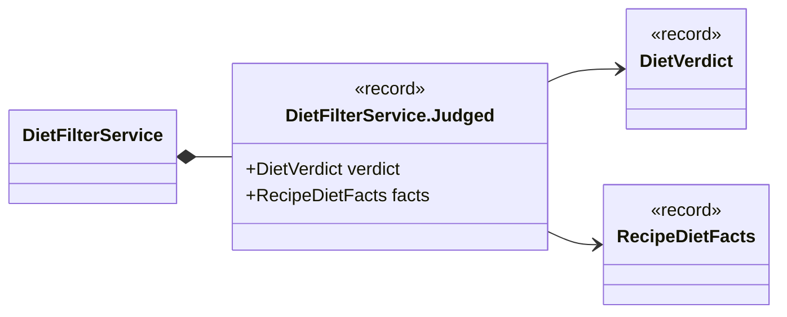

| Component | Type |
|---|---|
| `verdict` | `DietVerdict` |
| `facts` | `RecipeDietFacts` |

**Referenced by:** `DietFilterService`

## DietPreset

*record*

One diet preset from config/diet_presets.json: tags a recipe must NOT have (excludeTags) and tags it
MUST have (requireTags). A preset filters INGREDIENTS only; note says what it cannot know.

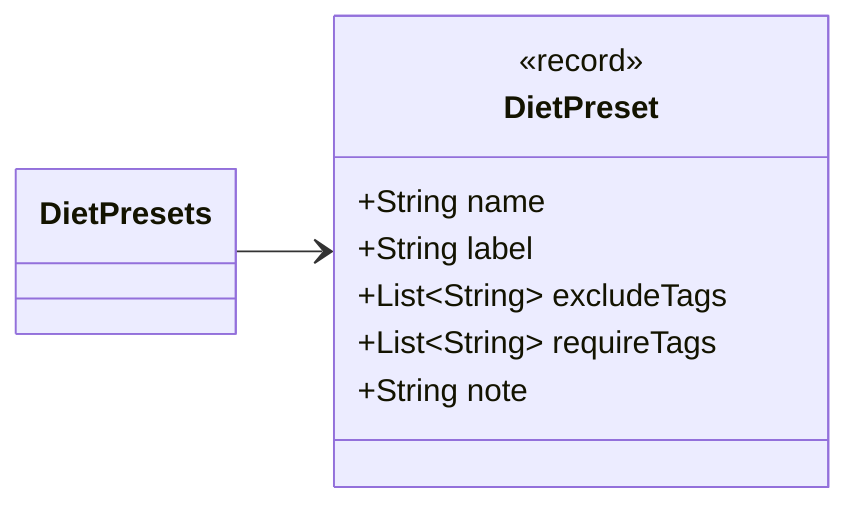

| Component | Type |
|---|---|
| `name` | `String` |
| `label` | `String` |
| `excludeTags` | `List<String>` |
| `requireTags` | `List<String>` |
| `note` | `String` |

**Referenced by:** `DietPresets`

## DietPresets

*class*

The diet presets, read from config/diet_presets.json (no hardcoding: the lists are Nate's to change).
Format: {"presets": {"": {"label": "...", "excludeTags": [...], "requireTags": [...], "note": "..."}}};
keys starting with an underscore are comments. A malformed file stops the start with a clear message.

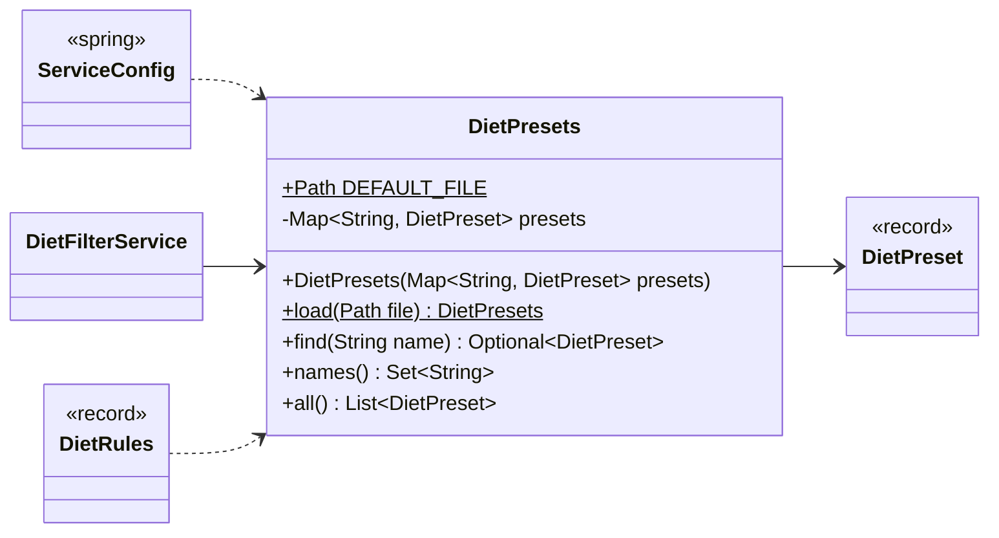

| Field | Type |
|---|---|
| `DEFAULT_FILE` | `Path` |
| `presets` | `Map<String, DietPreset>` |

| Member | Visibility | What it does |
|---|---|---|
| `DietPresets(Map<String, DietPreset> presets)` | public |  |
| `DietPresets load(Path file)` | public static |  |
| `Optional<DietPreset> find(String name)` | public |  |
| `Set<String> names()` | public |  |
| `List<DietPreset> all()` | public |  |

**Referenced by:** `DietFilterService`, `DietRules`, `ServiceConfig`

## DietRules

*record*

What a household does not eat, as the PHP passes it (the questionnaire itself and its storage are not part of
the API). HARD rules ("Was esse ich nicht?") hide recipes; SOFT rules ("Was esse ich lieber nicht?") only mark
them. requireTags come from presets (vegetarisch, vegan). includeUnclear: also return the
recipes whose status is UNCLEAR (flagged).

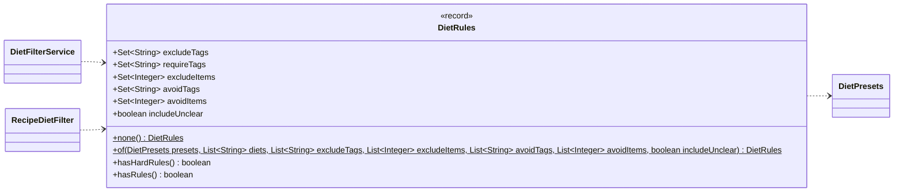

| Component | Type |
|---|---|
| `excludeTags` | `Set<String>` |
| `requireTags` | `Set<String>` |
| `excludeItems` | `Set<Integer>` |
| `avoidTags` | `Set<String>` |
| `avoidItems` | `Set<Integer>` |
| `includeUnclear` | `boolean` |

| Member | Visibility | What it does |
|---|---|---|
| `DietRules none()` | public static |  |
| `DietRules of(DietPresets presets, List<String> diets, List<String> excludeTags, List<Integer> excludeItems, List<String> avoidTags, List<Integer> avoidItems, boolean includeUnclear)` | public static | Resolves the presets by name and adds the explicit tags / items. |
| `boolean hasHardRules()` | public | True if any hard rule (exclusion or required tag) is set. |
| `boolean hasRules()` | public | True if any rule at all is set (includeUnclear alone is no rule). |

**Referenced by:** `DietFilterService`, `RecipeDietFilter`

## DietStatus

*enum*

What the diet rules say about one recipe.

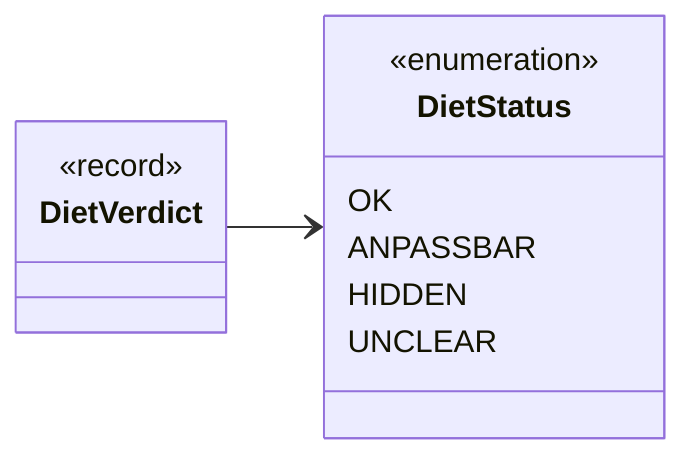

**Values:** `OK`, `ANPASSBAR`, `HIDDEN`, `UNCLEAR`

**Referenced by:** `DietVerdict`

## DietVerdict

*record*

The filter's answer for one recipe. hints (ANPASSBAR, and UNCLEAR when it applies too): per item that
may come from an excluded animal, the animals it may still be. soft: what a soft rule matched, null when
nothing (or no soft rule).

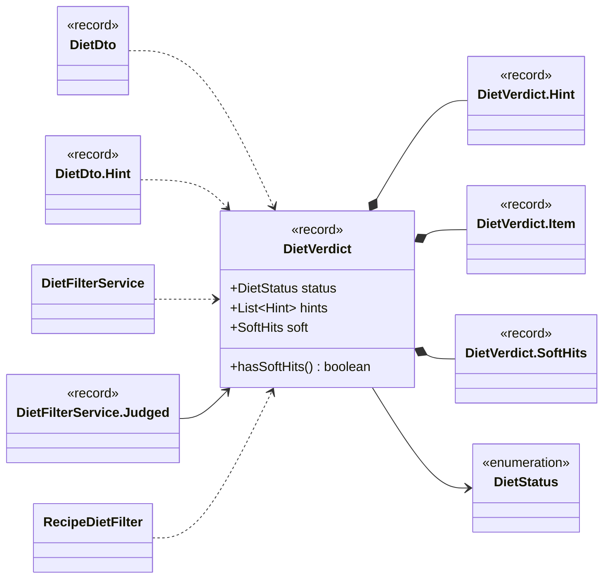

| Component | Type |
|---|---|
| `status` | `DietStatus` |
| `hints` | `List<Hint>` |
| `soft` | `SoftHits` |

| Member | Visibility | What it does |
|---|---|---|
| `boolean hasSoftHits()` | public |  |

**Referenced by:** `DietDto`, `DietDto.Hint`, `DietFilterService`, `RecipeDietFilter`

## DietVerdict.Hint

*record*

An item with possible animals of which at least one is excluded; allowedAnimals is what remains.

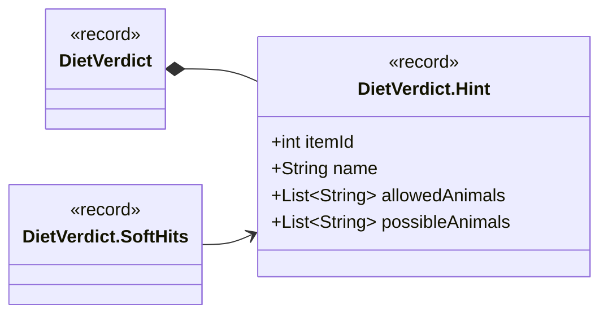

| Component | Type |
|---|---|
| `itemId` | `int` |
| `name` | `String` |
| `allowedAnimals` | `List<String>` |
| `possibleAnimals` | `List<String>` |

**Referenced by:** `DietVerdict`

## DietVerdict.Item

*record*

A matched item (id and name).

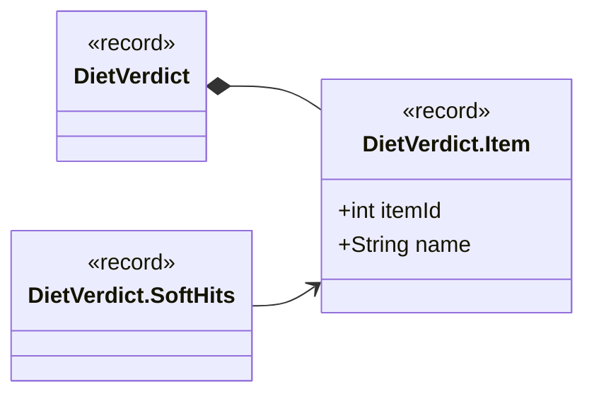

| Component | Type |
|---|---|
| `itemId` | `int` |
| `name` | `String` |

**Referenced by:** `DietVerdict`

## DietVerdict.SoftHits

*record*

Soft-rule hits: tags the recipe has, ingredient items it has, and items that MAY be an avoided animal
(for an avoided animal tag).

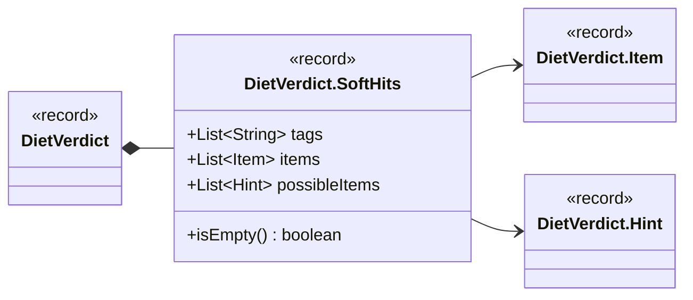

| Component | Type |
|---|---|
| `tags` | `List<String>` |
| `items` | `List<Item>` |
| `possibleItems` | `List<Hint>` |

| Member | Visibility | What it does |
|---|---|---|
| `boolean isEmpty()` | public |  |

**Referenced by:** `DietVerdict`

## RecipeDietFacts

*record*

What the filter needs to know about one recipe: its stored tag names, its ingredients with their certain and
possible animals, and its unmatched lines (recipe_unmatched_ingredient). No SQL.

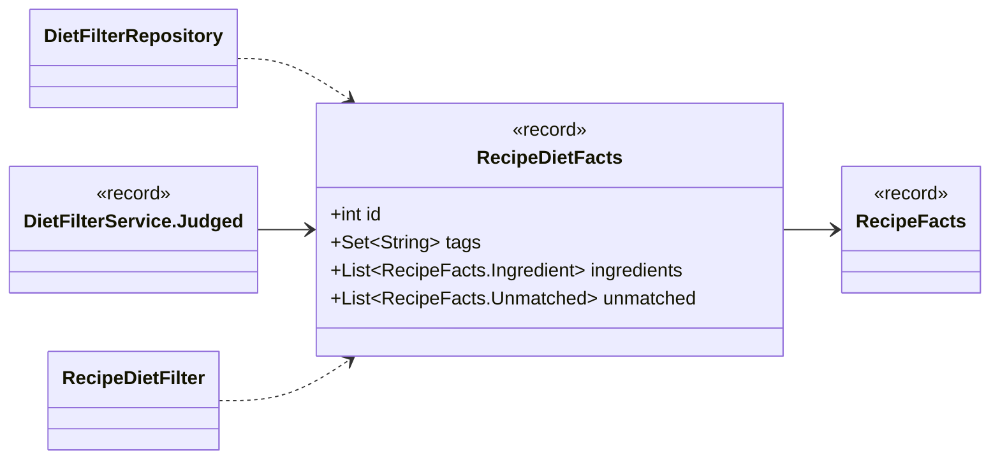

| Component | Type |
|---|---|
| `id` | `int` |
| `tags` | `Set<String>` |
| `ingredients` | `List<RecipeFacts.Ingredient>` |
| `unmatched` | `List<RecipeFacts.Unmatched>` |

**Referenced by:** `DietFilterRepository`, `RecipeDietFilter`

## RecipeDietFilter

*class*

Judges one recipe against DietRules. Pure: no SQL, no I/O; reusable for the full recipe search.

The principle is "surface, don't decide, never claim what is not known": a recipe is only OK when nothing in it
is excluded AND nothing about it is unknown. The facts are checked both through the stored tags and directly from
the ingredients, so a stale tag can only make the answer safer, never less safe:

- an excluded tag the recipe has, an excluded animal of a certain item, an excluded item → HIDDEN;

- an excluded animal that only a POSSIBLE animal of a generic item could bring: ANPASSBAR with a hint per
      item (the animals it may still be); when every possible animal is excluded the item cannot be saved →
      HIDDEN;

- a required tag (vegetarisch, vegan): satisfied only with the tag, no unmatched line, and no ingredient that
      blocks it; a missing tag with unmatched lines and no known blocker → UNCLEAR, otherwise HIDDEN;

- a hard rule that depends on the ingredients (Tier, Ernährung, Inhalt tags, items) and a recipe with
      unmatched lines or without ingredients → UNCLEAR;

- soft rules never change the status; they list what matched.

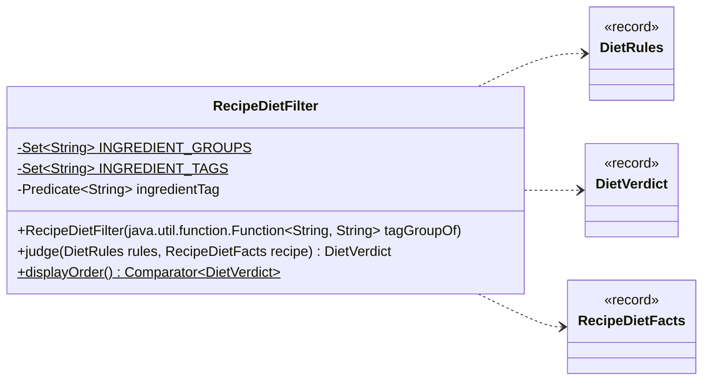

| Field | Type |
|---|---|
| `INGREDIENT_GROUPS` | `Set<String>` |
| `INGREDIENT_TAGS` | `Set<String>` |
| `ingredientTag` | `Predicate<String>` |

| Member | Visibility | What it does |
|---|---|---|
| `RecipeDietFilter(java.util.function.Function<String, String> tagGroupOf)` | public |  |
| `DietVerdict judge(DietRules rules, RecipeDietFacts recipe)` | public |  |
| `Comparator<DietVerdict> displayOrder()` | public static | Orders recipes for the response: no soft hit before soft hits, then OK, ANPASSBAR, UNCLEAR. |
