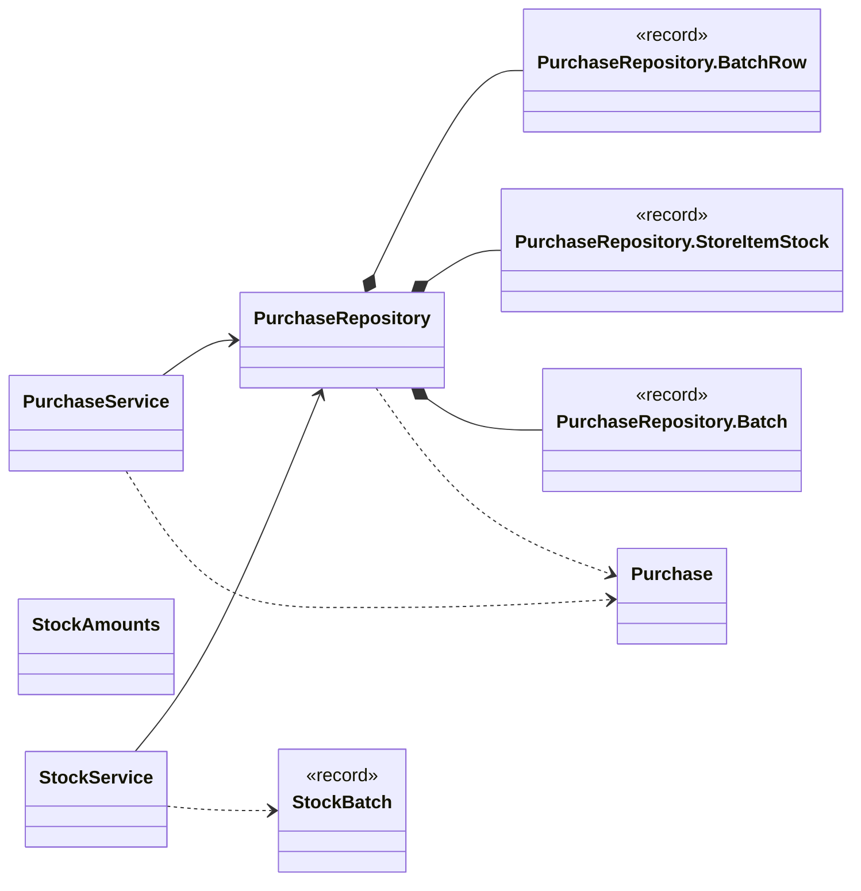
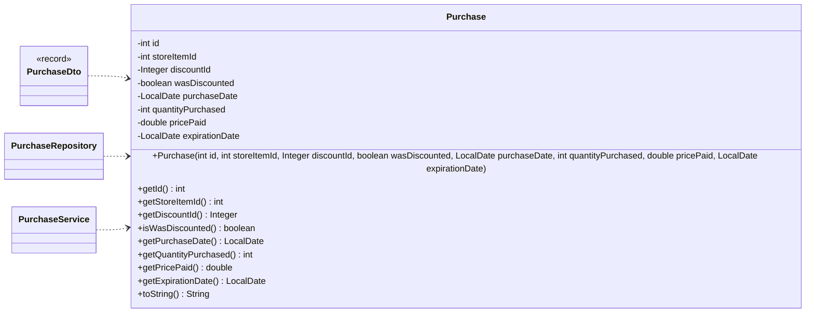
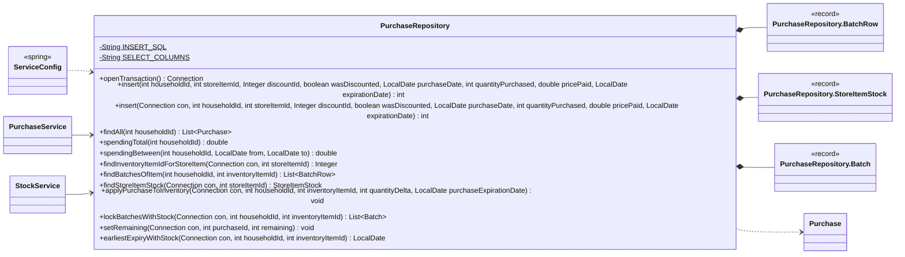
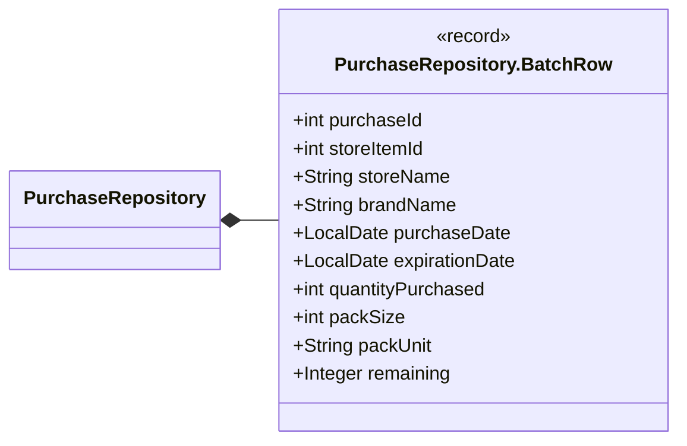
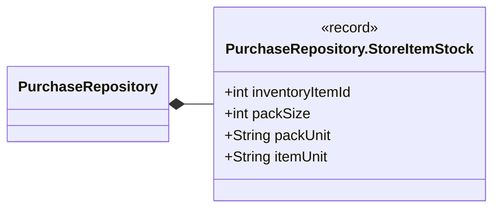
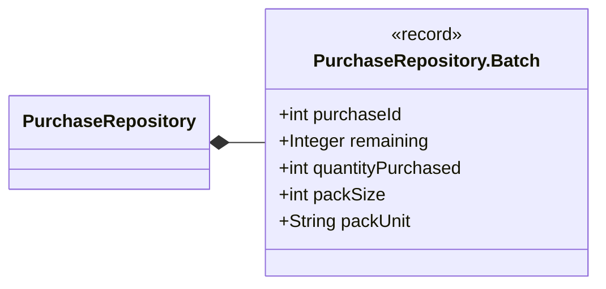
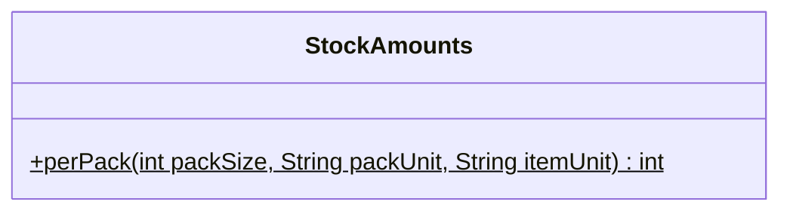
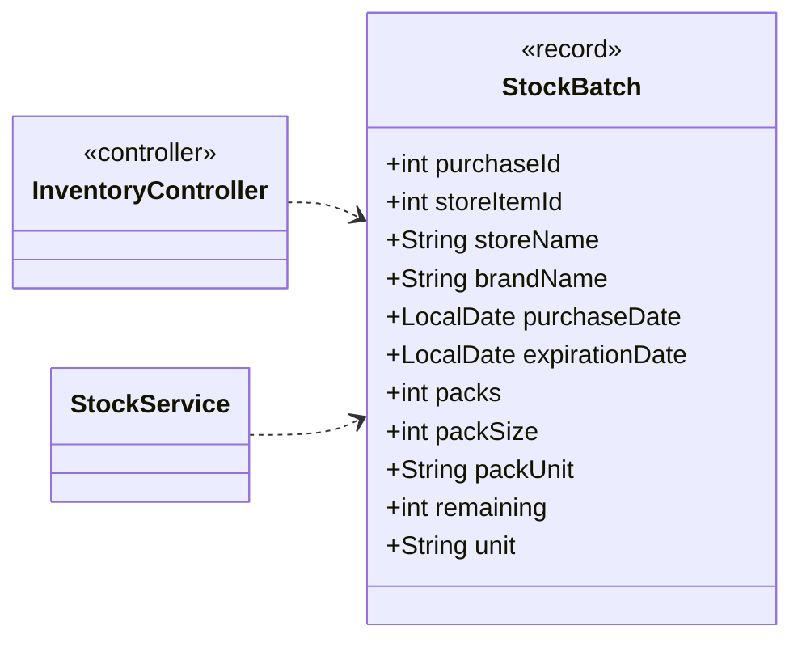
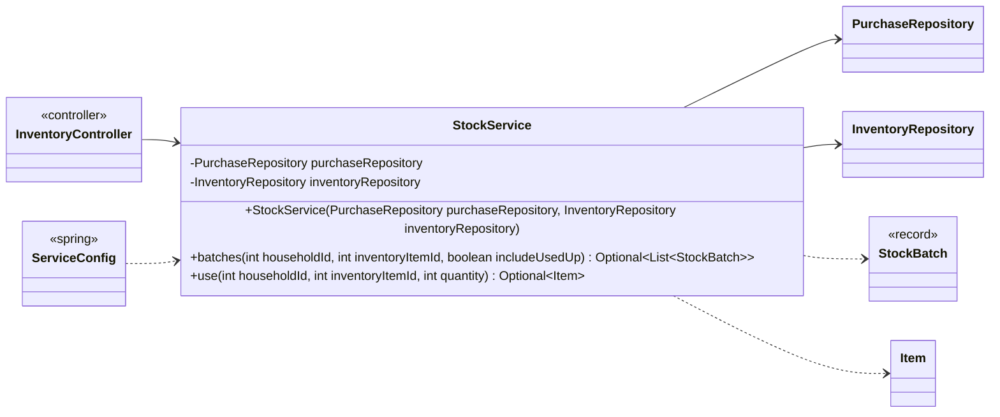

<!-- Generated by scripts/docs/generate_docs.py from src/main/java. Do not edit by hand; change the code or the generator. -->

# Package `finance`

Purchases and spending analytics.

9 types in 6 source files (`src/main/java/de/dahaem/finance`). Back to the [class index](README.md).

## Overview

Arrows: `-->` has a field or record component of that type, `..>` takes it in its constructor or mentions it in a method signature, `<|--` extends, `<|..` implements, `*--` nested type. Only relationships inside this package are drawn here; each class below also shows its neighbours in other packages.

| Type | Kind | Role | What it is |
|------|------|------|------------|
| [`Purchase`](#purchase) | class |  | Plain data holder for one row of the purchase_history table. |
| [`PurchaseRepository`](#purchaserepository) | class |  | All SQL for the purchase_history table lives here and nowhere else. |
| [`PurchaseRepository.BatchRow`](#purchaserepositorybatchrow) | record |  | One purchase of an item with the facts a batch listing needs; remaining is null = nothing used yet. |
| [`PurchaseRepository.StoreItemStock`](#purchaserepositorystoreitemstock) | record |  | What a purchase of a store item adds to stock: the catalogue item, the pack (size + unit) and the item's own unit. |
| [`PurchaseRepository.Batch`](#purchaserepositorybatch) | record |  | One purchase (a batch of one inventory item) with what it needs to tell how much is left: remaining in the item's unit (null = nothing used yet, all of it is left), the packs bought and the pack (size + unit). |
| [`PurchaseService`](#purchaseservice) | class |  | Business logic for purchases. |
| [`StockAmounts`](#stockamounts) | class |  | Stock is counted in the catalogue item's own unit (g, ml, Stück), as the shopping list compares it with a line's unit. |
| [`StockBatch`](#stockbatch) | record |  | One batch of an item's stock = one purchase: where and when it was bought, when it expires, how many packs of which size were bought, and how much of it is left in the item's own unit (unit). |
| [`StockService`](#stockservice) | class |  | Takes food out of a household's stock, in the item's own unit (g, ml, Stück). |

## Purchase

*class*

Plain data holder for one row of the purchase_history table.
No logic here on purpose: just the fields, a constructor, and getters.

| Field | Type |
|---|---|
| `id` | `int` |
| `storeItemId` | `int` |
| `discountId` | `Integer` |
| `wasDiscounted` | `boolean` |
| `purchaseDate` | `LocalDate` |
| `quantityPurchased` | `int` |
| `pricePaid` | `double` |
| `expirationDate` | `LocalDate` |

| Member | Visibility | What it does |
|---|---|---|
| `Purchase(int id, int storeItemId, Integer discountId, boolean wasDiscounted, LocalDate purchaseDate, int quantityPurchased, double pricePaid, LocalDate expirationDate)` | public |  |
| `int getId()` | public |  |
| `int getStoreItemId()` | public |  |
| `Integer getDiscountId()` | public |  |
| `boolean isWasDiscounted()` | public |  |
| `LocalDate getPurchaseDate()` | public |  |
| `int getQuantityPurchased()` | public |  |
| `double getPricePaid()` | public |  |
| `LocalDate getExpirationDate()` | public |  |
| `String toString()` | public |  |

**Referenced by:** `PurchaseDto`, `PurchaseRepository`, `PurchaseService`

## PurchaseRepository

*class*

All SQL for the purchase_history table lives here and nowhere else.
The rest of the app never writes SQL against purchases; it calls these methods.

insert/find/spending methods manage their own connection. The Connection-accepting
overloads exist so PurchaseService can combine a purchase insert with an inventory_item
update (via store_item.store_item_item_id) in a single transaction; see openTransaction().

| Field | Type |
|---|---|
| `INSERT_SQL` | `String` |
| `SELECT_COLUMNS` | `String` |

| Member | Visibility | What it does |
|---|---|---|
| `Connection openTransaction()` | public | Opens a connection with auto-commit off, for a caller that needs to combine several writes atomically. |
| `int insert(int householdId, int storeItemId, Integer discountId, boolean wasDiscounted, LocalDate purchaseDate, int quantityPurchased, double pricePaid, LocalDate expirationDate)` | public |  |
| `int insert(Connection con, int householdId, int storeItemId, Integer discountId, boolean wasDiscounted, LocalDate purchaseDate, int quantityPurchased, double pricePaid, LocalDate expirationDate)` | public | Same insert, on a connection the caller manages (does not commit). |
| `List<Purchase> findAll(int householdId)` | public | The purchases of one household, newest first. |
| `double spendingTotal(int householdId)` | public | Sum of price paid across every purchase of the household. |
| `double spendingBetween(int householdId, LocalDate from, LocalDate to)` | public | Sum of price paid for the household's purchases dated between from and to, inclusive. |
| `Integer findInventoryItemIdForStoreItem(Connection con, int storeItemId)` | public | The inventory_item this store_item is linked to (store_item.store_item_item_id), or null if the store_item is unknown. |
| `List<BatchRow> findBatchesOfItem(int householdId, int inventoryItemId)` | public | Every purchase of an inventory item by this household, earliest expiry first (older purchase first on a tie). |
| `StoreItemStock findStoreItemStock(Connection con, int storeItemId)` | public | The stock facts of a store item, or null if there is no such store item. |
| `void applyPurchaseToInventory(Connection con, int householdId, int inventoryItemId, int quantityDelta, LocalDate purchaseExpirationDate)` | public | Adds quantityDelta to the household's stock of the item and pulls its earliest expiry date down to purchaseExpirationDate if that is earlier than what is already stored (or nothing is stored yet). |
| `List<Batch> lockBatchesWithStock(Connection con, int householdId, int inventoryItemId)` | public | The purchases of an inventory item that still have something left, earliest expiry first (older purchase first on a tie), locked for the caller's transaction. |
| `void setRemaining(Connection con, int purchaseId, int remaining)` | public |  |
| `LocalDate earliestExpiryWithStock(Connection con, int householdId, int inventoryItemId)` | public | The earliest expiry among the household's purchases of an inventory item that still have something left, or null if none. |

**Referenced by:** `PurchaseService`, `ServiceConfig`, `StockService`

## PurchaseRepository.BatchRow

*record*

One purchase of an item with the facts a batch listing needs; remaining is null = nothing used yet.

| Component | Type |
|---|---|
| `purchaseId` | `int` |
| `storeItemId` | `int` |
| `storeName` | `String` |
| `brandName` | `String` |
| `purchaseDate` | `LocalDate` |
| `expirationDate` | `LocalDate` |
| `quantityPurchased` | `int` |
| `packSize` | `int` |
| `packUnit` | `String` |
| `remaining` | `Integer` |

**Referenced by:** `PurchaseRepository`

## PurchaseRepository.StoreItemStock

*record*

What a purchase of a store item adds to stock: the catalogue item, the pack (size + unit) and the item's own unit.

| Component | Type |
|---|---|
| `inventoryItemId` | `int` |
| `packSize` | `int` |
| `packUnit` | `String` |
| `itemUnit` | `String` |

**Referenced by:** `PurchaseRepository`

## PurchaseRepository.Batch

*record*

One purchase (a batch of one inventory item) with what it needs to tell how much is left: remaining in the
item's unit (null = nothing used yet, all of it is left), the packs bought and the pack (size + unit).

| Component | Type |
|---|---|
| `purchaseId` | `int` |
| `remaining` | `Integer` |
| `quantityPurchased` | `int` |
| `packSize` | `int` |
| `packUnit` | `String` |

**Referenced by:** `PurchaseRepository`

## PurchaseService

*class*

Business logic for purchases. No SQL here, no UI here.
Recording a purchase touches both purchase_history and the household's stock of the linked inventory_item,
so it runs both writes in one transaction: either both land or neither does.

```mermaid
classDiagram
    direction LR
    class finance_PurchaseService["PurchaseService"] {
        -PurchaseRepository repository
        -StoreRepository storeRepository
        -InventoryRepository inventoryRepository
        +PurchaseService(PurchaseRepository repository)
        +PurchaseService(PurchaseRepository repository, StoreRepository storeRepository, InventoryRepository inventoryRepository)
        +allPurchases(int householdId) List~Purchase~
        +spendingTotal(int householdId) double
        +spendingBetween(int householdId, LocalDate from, LocalDate to) double
        +recordPurchase(int householdId, int storeItemId, Integer discountId, boolean wasDiscounted, LocalDate purchaseDate, int quantityPurchased, double pricePaid, LocalDate expirationDate) int
        +recordNewProductPurchase(int householdId, String storeName, String brandName, Integer existingInventoryItemId, String newItemNameEnglish, String newItemNameDeutsch, String newItemCategory, String packageUnit, int packageSize, Double normalPrice, int quantityPurchased, double pricePaid, LocalDate purchaseDate, LocalDate expirationDate) int
        +findOrCreateStoreItem(String storeName, String brandName, Integer existingInventoryItemId, String newItemNameEnglish, String newItemNameDeutsch, String newItemCategory, String packageUnit, int packageSize, Double normalPrice) int
    }
    class finance_PurchaseRepository["PurchaseRepository"]
    class stores_StoreRepository["StoreRepository"]
    class inventory_InventoryRepository["InventoryRepository"]
    class api_PurchaseController["PurchaseController"] {
        <<controller>>
    }
    class barcode_IntakeService["IntakeService"]
    class finance_Purchase["Purchase"]
    class api_ServiceConfig["ServiceConfig"] {
        <<spring>>
    }
    finance_PurchaseService --> finance_PurchaseRepository
    finance_PurchaseService --> stores_StoreRepository
    finance_PurchaseService --> inventory_InventoryRepository
    finance_PurchaseService ..> finance_Purchase
    api_PurchaseController --> finance_PurchaseService
    api_ServiceConfig ..> finance_PurchaseService
    barcode_IntakeService --> finance_PurchaseService
```

| Field | Type |
|---|---|
| `repository` | `PurchaseRepository` |
| `storeRepository` | `StoreRepository` |
| `inventoryRepository` | `InventoryRepository` |

| Member | Visibility | What it does |
|---|---|---|
| `PurchaseService(PurchaseRepository repository)` | public |  |
| `PurchaseService(PurchaseRepository repository, StoreRepository storeRepository, InventoryRepository inventoryRepository)` | public |  |
| `List<Purchase> allPurchases(int householdId)` | public |  |
| `double spendingTotal(int householdId)` | public |  |
| `double spendingBetween(int householdId, LocalDate from, LocalDate to)` | public |  |
| `int recordPurchase(int householdId, int storeItemId, Integer discountId, boolean wasDiscounted, LocalDate purchaseDate, int quantityPurchased, double pricePaid, LocalDate expirationDate)` | public | Records a purchase and applies it to inventory in one transaction: inserts the purchase_history row, then (via store_item.store_item_item_id) increases the household's stock of the linked inventory_item by quantityPurchased and pulls its ea |
| `int recordNewProductPurchase(int householdId, String storeName, String brandName, Integer existingInventoryItemId, String newItemNameEnglish, String newItemNameDeutsch, String newItemCategory, String packageUnit, int packageSize, Double normalPrice, int quantityPurchased, double pricePaid, LocalDate purchaseDate, LocalDate expirationDate)` | public | Records a purchase of a product that isn't in the catalog yet — an off-list buy, e.g. |
| `int findOrCreateStoreItem(String storeName, String brandName, Integer existingInventoryItemId, String newItemNameEnglish, String newItemNameDeutsch, String newItemCategory, String packageUnit, int packageSize, Double normalPrice)` | public | Finds or creates the store, the brand, the catalogue item (an existing one, or a new generic one) and the store_item for (store, brand, item, unit, size), in one transaction, and returns the store_item's id. |

**Referenced by:** `IntakeService`, `PurchaseController`, `ServiceConfig`

## StockAmounts

*class*

Stock is counted in the catalogue item's own unit (g, ml, Stück), as the shopping list compares it with a line's unit.
A purchase is counted in packs, so one pack adds .perPack: the pack's size converted to the item's unit.

| Member | Visibility | What it does |
|---|---|---|
| `int perPack(int packSize, String packUnit, String itemUnit)` | public static | How much of the item's unit one pack is: 500 g into an item counted in g is 500, 1000 g into an item counted in kg is 1. |

## StockBatch

*record*

One batch of an item's stock = one purchase: where and when it was bought, when it expires, how many packs of which size
were bought, and how much of it is left in the item's own unit (unit). Used earliest-expiring first.

| Component | Type |
|---|---|
| `purchaseId` | `int` |
| `storeItemId` | `int` |
| `storeName` | `String` |
| `brandName` | `String` |
| `purchaseDate` | `LocalDate` |
| `expirationDate` | `LocalDate` |
| `packs` | `int` |
| `packSize` | `int` |
| `packUnit` | `String` |
| `remaining` | `int` |
| `unit` | `String` |

**Referenced by:** `InventoryController`, `StockService`

## StockService

*class*

Takes food out of a household's stock, in the item's own unit (g, ml, Stück). Using it and throwing it away are the same action: the
amount leaves the batch that expires first, the item's quantity goes down, and its earliest expiry date is worked out again from the batches that are left.
No SQL here. Everything runs in one transaction on the item's locked row.

| Field | Type |
|---|---|
| `purchaseRepository` | `PurchaseRepository` |
| `inventoryRepository` | `InventoryRepository` |

| Member | Visibility | What it does |
|---|---|---|
| `StockService(PurchaseRepository purchaseRepository, InventoryRepository inventoryRepository)` | public |  |
| `Optional<List<StockBatch>> batches(int householdId, int inventoryItemId, boolean includeUsedUp)` | public | The batches (purchases) of an item, in the order they are used (earliest expiry first), with what is left of each in the item's own unit. |
| `Optional<Item> use(int householdId, int inventoryItemId, int quantity)` | public | Removes quantity of an inventory item from stock and returns the item as it is now, or empty if there is no such item. |

**Referenced by:** `InventoryController`, `ServiceConfig`
