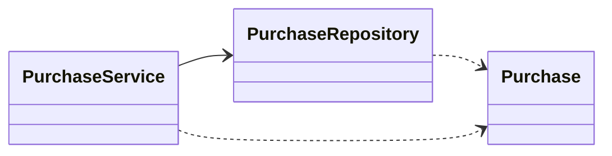
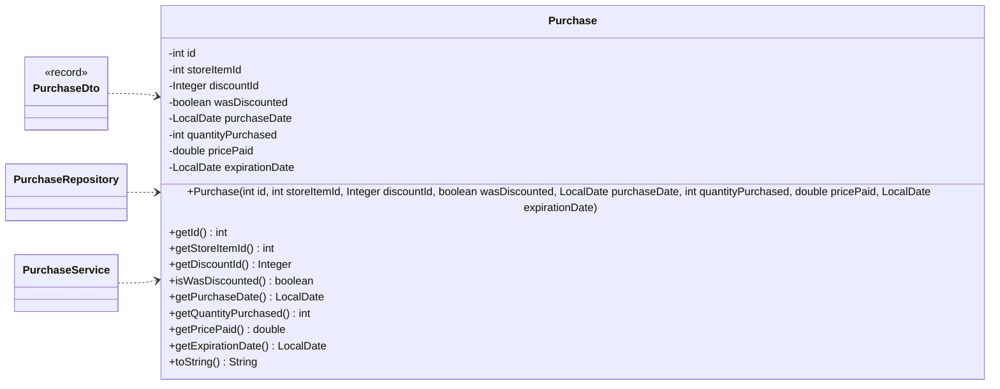
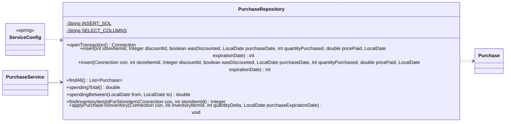
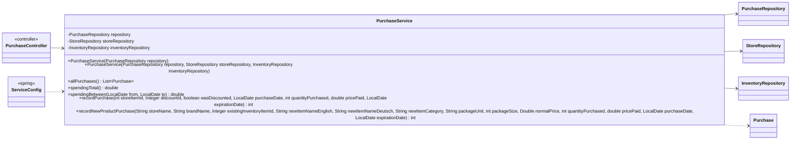

<!-- Generated by scripts/docs/generate_docs.py from src/main/java. Do not edit by hand; change the code or the generator. -->

# Package `finance`

Purchases and spending analytics.

3 types in 3 source files (`src/main/java/de/dahaem/finance`). Back to the [class index](README.md).

## Overview

Arrows: `-->` has a field or record component of that type, `..>` takes it in its constructor or mentions it in a method signature, `<|--` extends, `<|..` implements, `*--` nested type. Only relationships inside this package are drawn here; each class below also shows its neighbours in other packages.

| Type | Kind | Role | What it is |
|------|------|------|------------|
| [`Purchase`](#purchase) | class |  | Plain data holder for one row of the purchase_history table. |
| [`PurchaseRepository`](#purchaserepository) | class |  | All SQL for the purchase_history table lives here and nowhere else. |
| [`PurchaseService`](#purchaseservice) | class |  | Business logic for purchases. |

## Purchase

*class*

Plain data holder for one row of the purchase_history table.
No logic here on purpose: just the fields, a constructor, and getters.

| Field | Type |
|---|---|
| `id` | `int` |
| `storeItemId` | `int` |
| `discountId` | `Integer` |
| `wasDiscounted` | `boolean` |
| `purchaseDate` | `LocalDate` |
| `quantityPurchased` | `int` |
| `pricePaid` | `double` |
| `expirationDate` | `LocalDate` |

| Member | Visibility | What it does |
|---|---|---|
| `Purchase(int id, int storeItemId, Integer discountId, boolean wasDiscounted, LocalDate purchaseDate, int quantityPurchased, double pricePaid, LocalDate expirationDate)` | public |  |
| `int getId()` | public |  |
| `int getStoreItemId()` | public |  |
| `Integer getDiscountId()` | public |  |
| `boolean isWasDiscounted()` | public |  |
| `LocalDate getPurchaseDate()` | public |  |
| `int getQuantityPurchased()` | public |  |
| `double getPricePaid()` | public |  |
| `LocalDate getExpirationDate()` | public |  |
| `String toString()` | public |  |

**Referenced by:** `PurchaseDto`, `PurchaseRepository`, `PurchaseService`

## PurchaseRepository

*class*

All SQL for the purchase_history table lives here and nowhere else.
The rest of the app never writes SQL against purchases; it calls these methods.

insert/find/spending methods manage their own connection. The Connection-accepting
overloads exist so PurchaseService can combine a purchase insert with an inventory_item
update (via store_item.store_item_item_id) in a single transaction; see openTransaction().

| Field | Type |
|---|---|
| `INSERT_SQL` | `String` |
| `SELECT_COLUMNS` | `String` |

| Member | Visibility | What it does |
|---|---|---|
| `Connection openTransaction()` | public | Opens a connection with auto-commit off, for a caller that needs to combine several writes atomically. |
| `int insert(int storeItemId, Integer discountId, boolean wasDiscounted, LocalDate purchaseDate, int quantityPurchased, double pricePaid, LocalDate expirationDate)` | public |  |
| `int insert(Connection con, int storeItemId, Integer discountId, boolean wasDiscounted, LocalDate purchaseDate, int quantityPurchased, double pricePaid, LocalDate expirationDate)` | public | Same insert, on a connection the caller manages (does not commit). |
| `List<Purchase> findAll()` | public |  |
| `double spendingTotal()` | public | Sum of price paid across every recorded purchase. |
| `double spendingBetween(LocalDate from, LocalDate to)` | public | Sum of price paid for purchases dated between from and to, inclusive. |
| `Integer findInventoryItemIdForStoreItem(Connection con, int storeItemId)` | public | The inventory_item this store_item is linked to (store_item.store_item_item_id), or null if the store_item is unknown. |
| `void applyPurchaseToInventory(Connection con, int inventoryItemId, int quantityDelta, LocalDate purchaseExpirationDate)` | public | Increases inventory_item_quantity by quantityDelta and pulls inventory_item_earliest_exp_date down to purchaseExpirationDate if that is earlier than what is already stored (or nothing is stored yet). |

**Referenced by:** `PurchaseService`, `ServiceConfig`

## PurchaseService

*class*

Business logic for purchases. No SQL here, no UI here.
Recording a purchase touches both purchase_history and the linked inventory_item,
so it runs both writes in one transaction: either both land or neither does.

| Field | Type |
|---|---|
| `repository` | `PurchaseRepository` |
| `storeRepository` | `StoreRepository` |
| `inventoryRepository` | `InventoryRepository` |

| Member | Visibility | What it does |
|---|---|---|
| `PurchaseService(PurchaseRepository repository)` | public |  |
| `PurchaseService(PurchaseRepository repository, StoreRepository storeRepository, InventoryRepository inventoryRepository)` | public |  |
| `List<Purchase> allPurchases()` | public |  |
| `double spendingTotal()` | public |  |
| `double spendingBetween(LocalDate from, LocalDate to)` | public |  |
| `int recordPurchase(int storeItemId, Integer discountId, boolean wasDiscounted, LocalDate purchaseDate, int quantityPurchased, double pricePaid, LocalDate expirationDate)` | public | Records a purchase and applies it to inventory in one transaction: inserts the purchase_history row, then (via store_item.store_item_item_id) increases the linked inventory_item's quantity by quantityPurchased and pulls its earliest expirat |
| `int recordNewProductPurchase(String storeName, String brandName, Integer existingInventoryItemId, String newItemNameEnglish, String newItemNameDeutsch, String newItemCategory, String packageUnit, int packageSize, Double normalPrice, int quantityPurchased, double pricePaid, LocalDate purchaseDate, LocalDate expirationDate)` | public | Records a purchase of a product that isn't in the catalog yet — an off-list buy, e.g. |

**Referenced by:** `PurchaseController`, `ServiceConfig`
