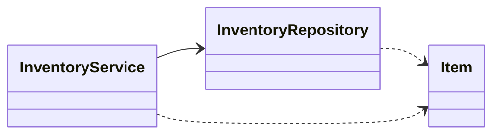
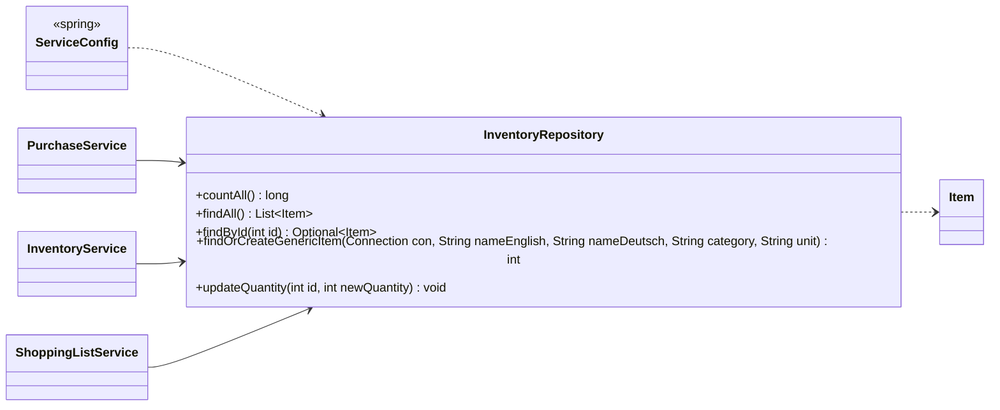
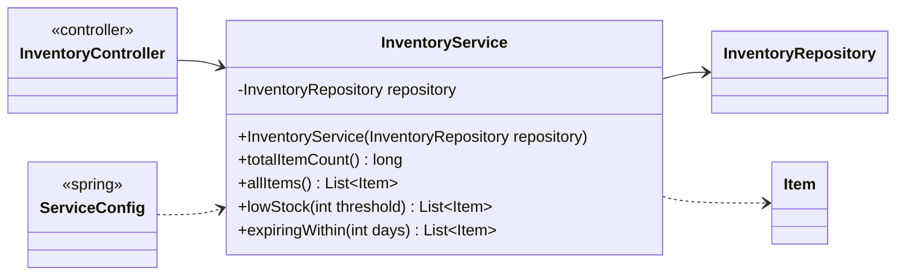
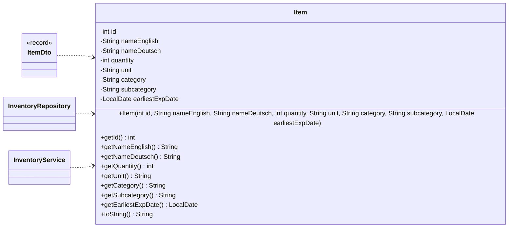

<!-- Generated by scripts/docs/generate_docs.py from src/main/java. Do not edit by hand; change the code or the generator. -->

# Package `inventory`

The item catalogue and the pantry.

3 types in 3 source files (`src/main/java/de/dahaem/inventory`). Back to the [class index](README.md).

## Overview

Arrows: `-->` has a field or record component of that type, `..>` takes it in its constructor or mentions it in a method signature, `<|--` extends, `<|..` implements, `*--` nested type. Only relationships inside this package are drawn here; each class below also shows its neighbours in other packages.

| Type | Kind | Role | What it is |
|------|------|------|------------|
| [`InventoryRepository`](#inventoryrepository) | class |  | All SQL for the inventory_item table lives here and nowhere else. |
| [`InventoryService`](#inventoryservice) | class |  | Business logic for inventory. |
| [`Item`](#item) | class |  | Plain data holder for one row of the inventory_item table. |

## InventoryRepository

*class*

All SQL for the inventory_item table lives here and nowhere else.
The rest of the app never writes SQL against inventory; it calls these methods.

| Member | Visibility | What it does |
|---|---|---|
| `long countAll()` | public |  |
| `List<Item> findAll()` | public |  |
| `Optional<Item> findById(int id)` | public |  |
| `int findOrCreateGenericItem(Connection con, String nameEnglish, String nameDeutsch, String category, String unit)` | public | Find-or-create a generic inventory_item by (name_english, category), on the caller's transaction (see PurchaseRepository.openTransaction()/StoreRepository.openTransaction()). |
| `void updateQuantity(int id, int newQuantity)` | public |  |

**Referenced by:** `InventoryService`, `PurchaseService`, `ServiceConfig`, `ShoppingListService`

## InventoryService

*class*

Business logic for inventory. No SQL here, no UI here.
It asks the repository for data and answers questions about it.
This is the class your future web controllers will call.

| Field | Type |
|---|---|
| `repository` | `InventoryRepository` |

| Member | Visibility | What it does |
|---|---|---|
| `InventoryService(InventoryRepository repository)` | public |  |
| `long totalItemCount()` | public |  |
| `List<Item> allItems()` | public |  |
| `List<Item> lowStock(int threshold)` | public | Items at or below a stock threshold, e.g. |
| `List<Item> expiringWithin(int days)` | public | Items with a known expiry date within the next N days. |

**Referenced by:** `InventoryController`, `ServiceConfig`

## Item

*class*

Plain data holder for one row of the inventory_item table.
No logic here on purpose: just the fields, a constructor, and getters.

| Field | Type |
|---|---|
| `id` | `int` |
| `nameEnglish` | `String` |
| `nameDeutsch` | `String` |
| `quantity` | `int` |
| `unit` | `String` |
| `category` | `String` |
| `subcategory` | `String` |
| `earliestExpDate` | `LocalDate` |

| Member | Visibility | What it does |
|---|---|---|
| `Item(int id, String nameEnglish, String nameDeutsch, int quantity, String unit, String category, String subcategory, LocalDate earliestExpDate)` | public |  |
| `int getId()` | public |  |
| `String getNameEnglish()` | public |  |
| `String getNameDeutsch()` | public |  |
| `int getQuantity()` | public |  |
| `String getUnit()` | public |  |
| `String getCategory()` | public |  |
| `String getSubcategory()` | public |  |
| `LocalDate getEarliestExpDate()` | public |  |
| `String toString()` | public |  |

**Referenced by:** `InventoryRepository`, `InventoryService`, `ItemDto`
