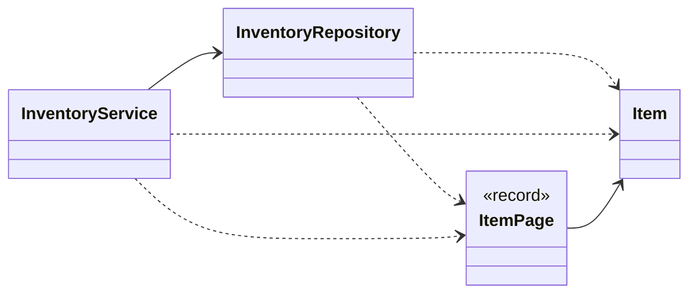
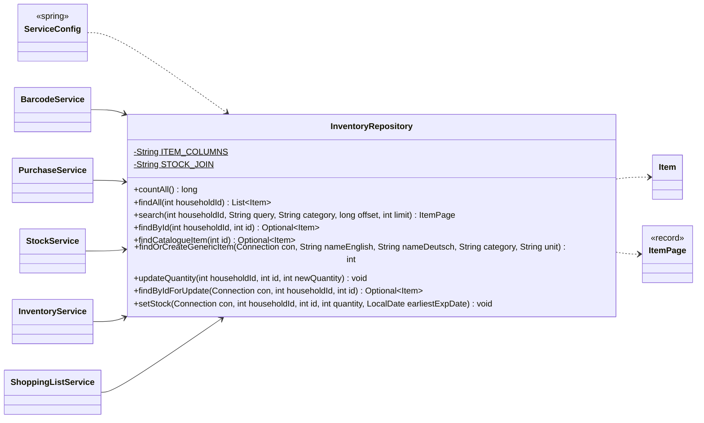
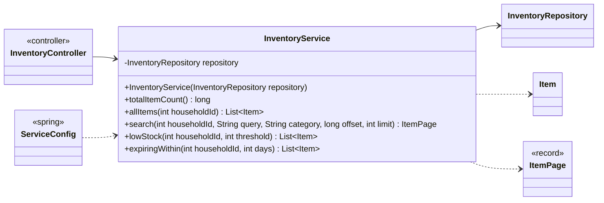
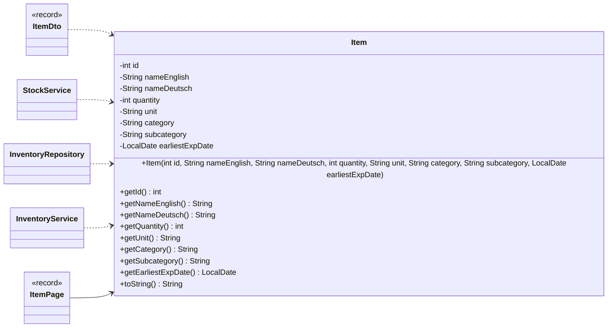
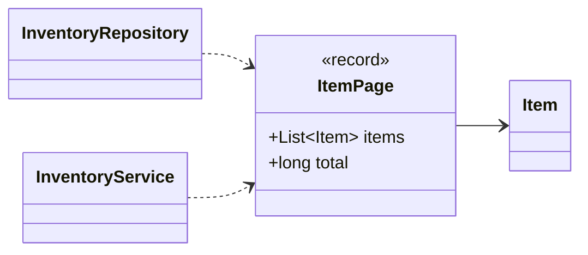

<!-- Generated by scripts/docs/generate_docs.py from src/main/java. Do not edit by hand; change the code or the generator. -->

# Package `inventory`

The item catalogue and the pantry.

4 types in 4 source files (`src/main/java/de/dahaem/inventory`). Back to the [class index](README.md).

## Overview

Arrows: `-->` has a field or record component of that type, `..>` takes it in its constructor or mentions it in a method signature, `<|--` extends, `<|..` implements, `*--` nested type. Only relationships inside this package are drawn here; each class below also shows its neighbours in other packages.

| Type | Kind | Role | What it is |
|------|------|------|------------|
| [`InventoryRepository`](#inventoryrepository) | class |  | All SQL for the inventory_item table lives here and nowhere else. |
| [`InventoryService`](#inventoryservice) | class |  | Business logic for inventory. |
| [`Item`](#item) | class |  | Plain data holder for one row of the inventory_item table. |
| [`ItemPage`](#itempage) | record |  | One page of inventory items plus how many items match in all pages. |

## InventoryRepository

*class*

All SQL for the inventory_item table lives here and nowhere else.
The rest of the app never writes SQL against inventory; it calls these methods.

| Field | Type |
|---|---|
| `ITEM_COLUMNS` | `String` |
| `STOCK_JOIN` | `String` |

| Member | Visibility | What it does |
|---|---|---|
| `long countAll()` | public |  |
| `List<Item> findAll(int householdId)` | public | Every catalogue item with the stock of this household. |
| `ItemPage search(int householdId, String query, String category, long offset, int limit)` | public | One page of the catalogue, ordered by English name. |
| `Optional<Item> findById(int householdId, int id)` | public | The catalogue item with the stock of this household, or empty if there is no such item. |
| `Optional<Item> findCatalogueItem(int id)` | public | The catalogue item WITHOUT any household's stock: quantity 0 and no expiry date. |
| `int findOrCreateGenericItem(Connection con, String nameEnglish, String nameDeutsch, String category, String unit)` | public | Find-or-create a generic inventory_item by (name_english, category), on the caller's transaction (see PurchaseRepository.openTransaction()/StoreRepository.openTransaction()). |
| `void updateQuantity(int householdId, int id, int newQuantity)` | public | Sets the quantity of this household's stock of an item (the expiry date stays as it is). |
| `Optional<Item> findByIdForUpdate(Connection con, int householdId, int id)` | public | The item with this household's stock, locked for the caller's transaction (see PurchaseRepository.openTransaction()). |
| `void setStock(Connection con, int householdId, int id, int quantity, LocalDate earliestExpDate)` | public | Sets this household's stock of an item and its earliest expiry date together (null date = none known). |

**Referenced by:** `BarcodeService`, `InventoryService`, `PurchaseService`, `ServiceConfig`, `ShoppingListService`, `StockService`

## InventoryService

*class*

Business logic for inventory. No SQL here, no UI here.
It asks the repository for data and answers questions about it.
This is the class your future web controllers will call.

| Field | Type |
|---|---|
| `repository` | `InventoryRepository` |

| Member | Visibility | What it does |
|---|---|---|
| `InventoryService(InventoryRepository repository)` | public |  |
| `long totalItemCount()` | public |  |
| `List<Item> allItems(int householdId)` | public | The catalogue with the stock of this household. |
| `ItemPage search(int householdId, String query, String category, long offset, int limit)` | public | One page of the catalogue filtered by name text and/or category (both optional); see InventoryRepository.search. |
| `List<Item> lowStock(int householdId, int threshold)` | public | Items at or below a stock threshold, e.g. |
| `List<Item> expiringWithin(int householdId, int days)` | public | Items with a known expiry date within the next N days. |

**Referenced by:** `InventoryController`, `ServiceConfig`

## Item

*class*

Plain data holder for one row of the inventory_item table.
No logic here on purpose: just the fields, a constructor, and getters.

| Field | Type |
|---|---|
| `id` | `int` |
| `nameEnglish` | `String` |
| `nameDeutsch` | `String` |
| `quantity` | `int` |
| `unit` | `String` |
| `category` | `String` |
| `subcategory` | `String` |
| `earliestExpDate` | `LocalDate` |

| Member | Visibility | What it does |
|---|---|---|
| `Item(int id, String nameEnglish, String nameDeutsch, int quantity, String unit, String category, String subcategory, LocalDate earliestExpDate)` | public |  |
| `int getId()` | public |  |
| `String getNameEnglish()` | public |  |
| `String getNameDeutsch()` | public |  |
| `int getQuantity()` | public |  |
| `String getUnit()` | public |  |
| `String getCategory()` | public |  |
| `String getSubcategory()` | public |  |
| `LocalDate getEarliestExpDate()` | public |  |
| `String toString()` | public |  |

**Referenced by:** `InventoryRepository`, `InventoryService`, `ItemDto`, `ItemPage`, `StockService`

## ItemPage

*record*

One page of inventory items plus how many items match in all pages.

| Component | Type |
|---|---|
| `items` | `List<Item>` |
| `total` | `long` |

**Referenced by:** `InventoryRepository`, `InventoryService`
