<!-- Generated by scripts/docs/generate_docs.py from src/main/java. Do not edit by hand; change the code or the generator. -->

# Package `mealplanner`

Recipes, ingredients, instructions, scaling and meal plans.

18 types in 13 source files (`src/main/java/de/dahaem/mealplanner`). Back to the [class index](README.md).

## Overview

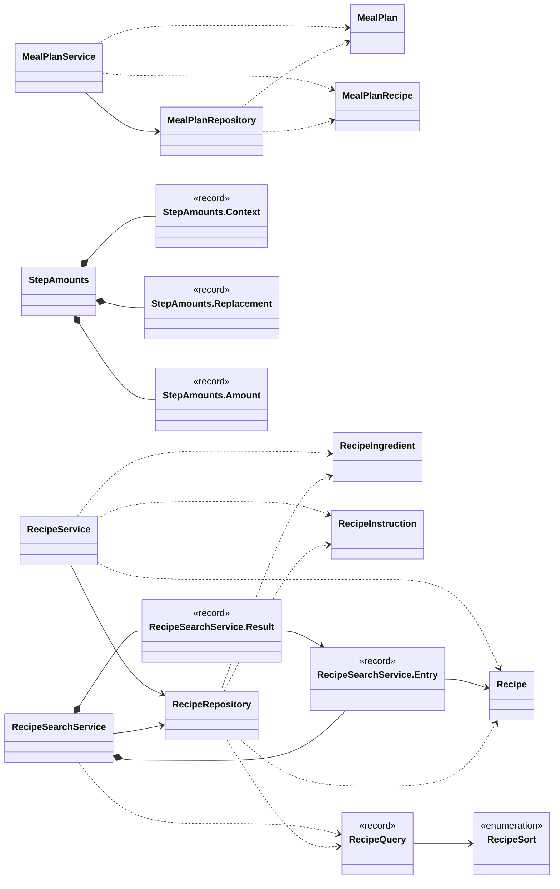

Arrows: `-->` has a field or record component of that type, `..>` takes it in its constructor or mentions it in a method signature, `<|--` extends, `<|..` implements, `*--` nested type. Only relationships inside this package are drawn here; each class below also shows its neighbours in other packages.

| Type | Kind | Role | What it is |
|------|------|------|------------|
| [`MealPlan`](#mealplan) | class |  | Plain data holder for one row of the meal_plan table. |
| [`MealPlanRecipe`](#mealplanrecipe) | class |  | Plain data holder for one row of the meal_plan_recipe table, joined to the recipe's name. |
| [`MealPlanRepository`](#mealplanrepository) | class |  | All SQL for the meal_plan and meal_plan_recipe tables lives here. |
| [`MealPlanService`](#mealplanservice) | class |  | Business logic for meal plans. |
| [`Recipe`](#recipe) | class |  | Plain data holder for one row of the Recipe table. |
| [`RecipeIngredient`](#recipeingredient) | class |  |  |
| [`RecipeInstruction`](#recipeinstruction) | class |  |  |
| [`RecipeQuery`](#recipequery) | record |  | What to look for in the recipe list; plain data, built and checked by .of. |
| [`RecipeRepository`](#reciperepository) | class |  | All SQL for the recipe, recipe_ingredient, recipe_instructions, recipe_tag tables lives here. |
| [`RecipeSearchService`](#recipesearchservice) | class |  | Search, filters, diet rules and paging for the recipe list. |
| [`RecipeSearchService.Entry`](#recipesearchserviceentry) | record |  | A recipe of a result page with its tag names and, when diet rules were given, its verdict (else null). |
| [`RecipeSearchService.Result`](#recipesearchserviceresult) | record |  | One page, the number of recipes that match in all pages, and the request that produced it. |
| [`RecipeService`](#recipeservice) | class |  | Business logic for recipes. |
| [`RecipeSort`](#recipesort) | enum |  | The sort orders of the recipe list. |
| [`StepAmounts`](#stepamounts) | class |  | Renders a cooking step's amounts for a number of people. |
| [`StepAmounts.Context`](#stepamountscontext) | record |  |  |
| [`StepAmounts.Replacement`](#stepamountsreplacement) | record |  | What replaces before[replaceFrom..] + bracket. |
| [`StepAmounts.Amount`](#stepamountsamount) | record |  | A parsed amount: one value or a range, and its unit (null when none). |

## MealPlan

*class*

Plain data holder for one row of the meal_plan table.
No logic here on purpose just the fields, a constructor, and getters.

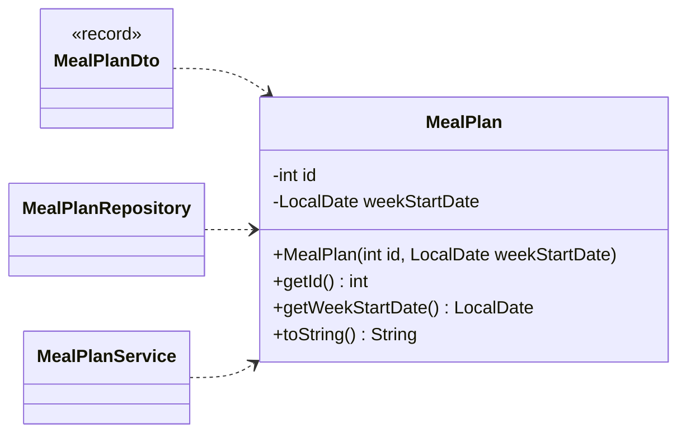

| Field | Type |
|---|---|
| `id` | `int` |
| `weekStartDate` | `LocalDate` |

| Member | Visibility | What it does |
|---|---|---|
| `MealPlan(int id, LocalDate weekStartDate)` | public |  |
| `int getId()` | public |  |
| `LocalDate getWeekStartDate()` | public |  |
| `String toString()` | public |  |

**Referenced by:** `MealPlanDto`, `MealPlanRepository`, `MealPlanService`

## MealPlanRecipe

*class*

Plain data holder for one row of the meal_plan_recipe table, joined to the recipe's name.
No logic here on purpose just the fields, a constructor, and getters.

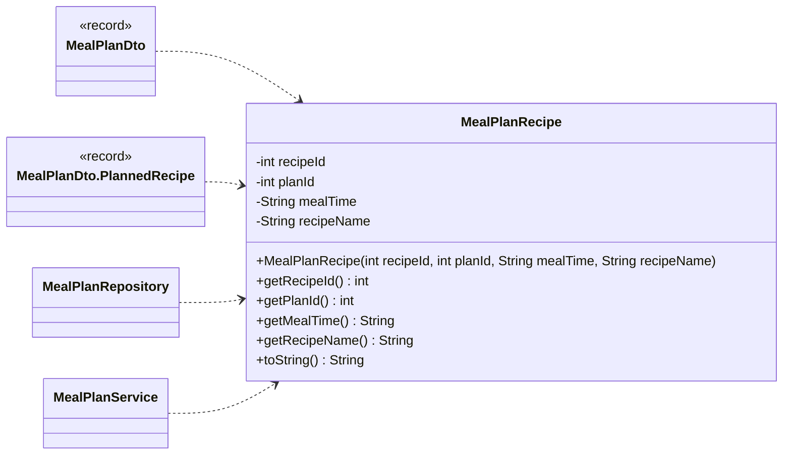

| Field | Type |
|---|---|
| `recipeId` | `int` |
| `planId` | `int` |
| `mealTime` | `String` |
| `recipeName` | `String` |

| Member | Visibility | What it does |
|---|---|---|
| `MealPlanRecipe(int recipeId, int planId, String mealTime, String recipeName)` | public |  |
| `int getRecipeId()` | public |  |
| `int getPlanId()` | public |  |
| `String getMealTime()` | public |  |
| `String getRecipeName()` | public |  |
| `String toString()` | public |  |

**Referenced by:** `MealPlanDto`, `MealPlanDto.PlannedRecipe`, `MealPlanRepository`, `MealPlanService`

## MealPlanRepository

*class*

All SQL for the meal_plan and meal_plan_recipe tables lives here.
The rest of the app never writes SQL against the database; it calls these methods.

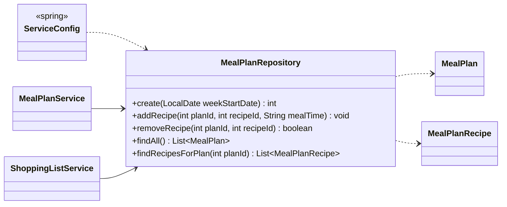

| Member | Visibility | What it does |
|---|---|---|
| `int create(LocalDate weekStartDate)` | public |  |
| `void addRecipe(int planId, int recipeId, String mealTime)` | public |  |
| `boolean removeRecipe(int planId, int recipeId)` | public | Removes a recipe from a plan. |
| `List<MealPlan> findAll()` | public |  |
| `List<MealPlanRecipe> findRecipesForPlan(int planId)` | public |  |

**Referenced by:** `MealPlanService`, `ServiceConfig`, `ShoppingListService`

## MealPlanService

*class*

Business logic for meal plans. No SQL here, no UI here.
It asks the repository for data and answers questions about it.
This is the class future web controllers will call.

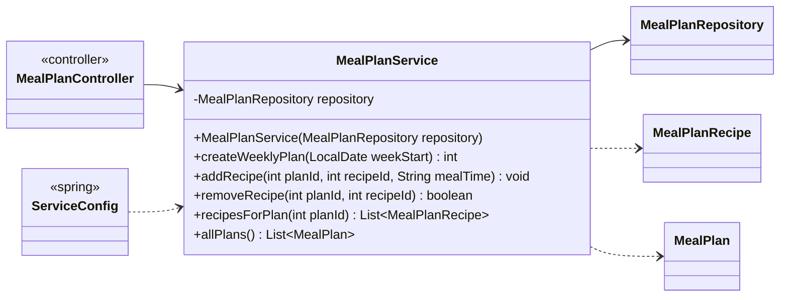

| Field | Type |
|---|---|
| `repository` | `MealPlanRepository` |

| Member | Visibility | What it does |
|---|---|---|
| `MealPlanService(MealPlanRepository repository)` | public |  |
| `int createWeeklyPlan(LocalDate weekStart)` | public |  |
| `void addRecipe(int planId, int recipeId, String mealTime)` | public |  |
| `boolean removeRecipe(int planId, int recipeId)` | public | Removes a recipe from a plan. |
| `List<MealPlanRecipe> recipesForPlan(int planId)` | public |  |
| `List<MealPlan> allPlans()` | public |  |

**Referenced by:** `MealPlanController`, `ServiceConfig`

## Recipe

*class*

Plain data holder for one row of the Recipe table.
No logic here on purpose just the fields, a constructor, and getters.

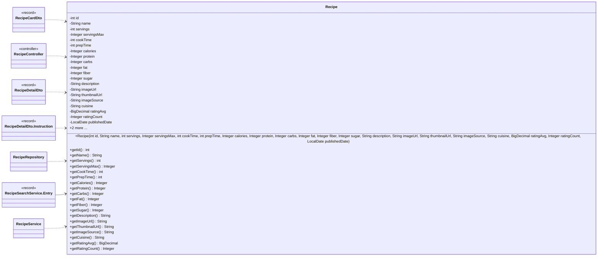

| Field | Type |
|---|---|
| `id` | `int` |
| `name` | `String` |
| `servings` | `int` |
| `servingsMax` | `Integer` |
| `cookTime` | `int` |
| `prepTime` | `int` |
| `calories` | `Integer` |
| `protein` | `Integer` |
| `carbs` | `Integer` |
| `fat` | `Integer` |
| `fiber` | `Integer` |
| `sugar` | `Integer` |
| `description` | `String` |
| `imageUrl` | `String` |
| `thumbnailUrl` | `String` |
| `imageSource` | `String` |
| `cuisine` | `String` |
| `ratingAvg` | `BigDecimal` |
| `ratingCount` | `Integer` |
| `publishedDate` | `LocalDate` |

| Member | Visibility | What it does |
|---|---|---|
| `Recipe(int id, String name, int servings, Integer servingsMax, int cookTime, int prepTime, Integer calories, Integer protein, Integer carbs, Integer fat, Integer fiber, Integer sugar, String description, String imageUrl, String thumbnailUrl, String imageSource, String cuisine, BigDecimal ratingAvg, Integer ratingCount, LocalDate publishedDate)` | public |  |
| `int getId()` | public |  |
| `String getName()` | public |  |
| `int getServings()` | public |  |
| `Integer getServingsMax()` | public |  |
| `int getCookTime()` | public |  |
| `int getPrepTime()` | public |  |
| `Integer getCalories()` | public |  |
| `Integer getProtein()` | public |  |
| `Integer getCarbs()` | public |  |
| `Integer getFat()` | public |  |
| `Integer getFiber()` | public |  |
| `Integer getSugar()` | public |  |
| `String getDescription()` | public |  |
| `String getImageUrl()` | public |  |
| `String getThumbnailUrl()` | public |  |
| `String getImageSource()` | public |  |
| `String getCuisine()` | public |  |
| `BigDecimal getRatingAvg()` | public |  |
| `Integer getRatingCount()` | public |  |
| `LocalDate getPublishedDate()` | public |  |
| `String toString()` | public |  |

**Referenced by:** `RecipeCardDto`, `RecipeController`, `RecipeDetailDto`, `RecipeDetailDto.Instruction`, `RecipeRepository`, `RecipeService`

## RecipeIngredient

*class*

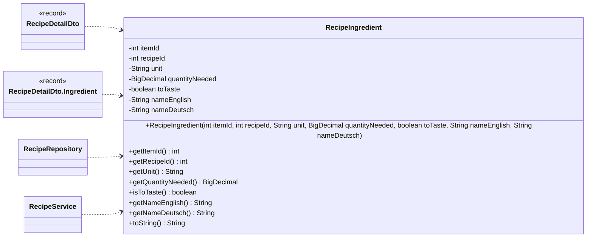

| Field | Type |
|---|---|
| `itemId` | `int` |
| `recipeId` | `int` |
| `unit` | `String` |
| `quantityNeeded` | `BigDecimal` |
| `toTaste` | `boolean` |
| `nameEnglish` | `String` |
| `nameDeutsch` | `String` |

| Member | Visibility | What it does |
|---|---|---|
| `RecipeIngredient(int itemId, int recipeId, String unit, BigDecimal quantityNeeded, boolean toTaste, String nameEnglish, String nameDeutsch)` | public | quantityNeeded is the exact stored amount (e.g. |
| `int getItemId()` | public |  |
| `int getRecipeId()` | public |  |
| `String getUnit()` | public |  |
| `BigDecimal getQuantityNeeded()` | public |  |
| `boolean isToTaste()` | public |  |
| `String getNameEnglish()` | public |  |
| `String getNameDeutsch()` | public |  |
| `String toString()` | public |  |

**Referenced by:** `RecipeDetailDto`, `RecipeDetailDto.Ingredient`, `RecipeRepository`, `RecipeService`

## RecipeInstruction

*class*

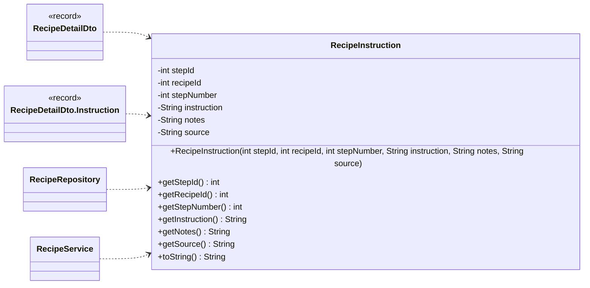

| Field | Type |
|---|---|
| `stepId` | `int` |
| `recipeId` | `int` |
| `stepNumber` | `int` |
| `instruction` | `String` |
| `notes` | `String` |
| `source` | `String` |

| Member | Visibility | What it does |
|---|---|---|
| `RecipeInstruction(int stepId, int recipeId, int stepNumber, String instruction, String notes, String source)` | public |  |
| `int getStepId()` | public |  |
| `int getRecipeId()` | public |  |
| `int getStepNumber()` | public |  |
| `String getInstruction()` | public |  |
| `String getNotes()` | public |  |
| `String getSource()` | public |  |
| `String toString()` | public |  |

**Referenced by:** `RecipeDetailDto`, `RecipeDetailDto.Instruction`, `RecipeRepository`, `RecipeService`

## RecipeQuery

*record*

What to look for in the recipe list; plain data, built and checked by .of. Every filter that is set must
hold (AND):

- nameWords: each word is contained in the recipe name;

- ingredients: for each text, the recipe has an ingredient whose German or English name contains it;

- tags: the recipe carries all these tags (by name);

- minTime / maxTime: total time (prep + cook) in minutes; a recipe without a time (0) is
      left out as soon as either is set;

- servings: the recipe is for this many people (a "3 - 4 Personen" recipe matches 3 and 4).

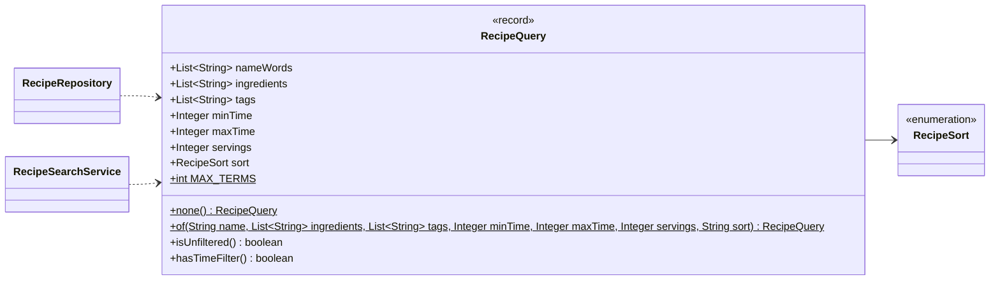

| Component | Type |
|---|---|
| `nameWords` | `List<String>` |
| `ingredients` | `List<String>` |
| `tags` | `List<String>` |
| `minTime` | `Integer` |
| `maxTime` | `Integer` |
| `servings` | `Integer` |
| `sort` | `RecipeSort` |
| `MAX_TERMS` | `int` |

| Member | Visibility | What it does |
|---|---|---|
| `RecipeQuery none()` | public static |  |
| `RecipeQuery of(String name, List<String> ingredients, List<String> tags, Integer minTime, Integer maxTime, Integer servings, String sort)` | public static | Cleans and checks raw request values; a bad value is an IllegalArgumentException (the API answers 400). |
| `boolean isUnfiltered()` | public | True if no filter is set (the sort does not filter). |
| `boolean hasTimeFilter()` | public | True if a time filter is set. |

**Referenced by:** `RecipeRepository`, `RecipeSearchService`

## RecipeRepository

*class*

All SQL for the recipe, recipe_ingredient, recipe_instructions, recipe_tag tables lives here.
The rest of the app never writes SQL against the database; it calls these methods.

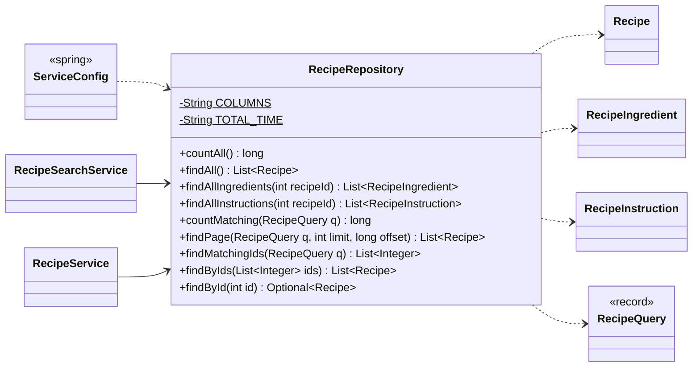

| Field | Type |
|---|---|
| `COLUMNS` | `String` |
| `TOTAL_TIME` | `String` |

| Member | Visibility | What it does |
|---|---|---|
| `long countAll()` | public |  |
| `List<Recipe> findAll()` | public |  |
| `List<RecipeIngredient> findAllIngredients(int recipeId)` | public |  |
| `List<RecipeInstruction> findAllInstructions(int recipeId)` | public |  |
| `long countMatching(RecipeQuery q)` | public | How many recipes match the query. |
| `List<Recipe> findPage(RecipeQuery q, int limit, long offset)` | public | One page of the recipes matching the query, in the query's (total) sort order. |
| `List<Integer> findMatchingIds(RecipeQuery q)` | public | The ids of every recipe matching the query, in the query's sort order (for paging after the diet filter). |
| `List<Recipe> findByIds(List<Integer> ids)` | public | The recipes with these ids, in the order of ids; an id without a recipe is skipped. |
| `Optional<Recipe> findById(int id)` | public |  |

**Referenced by:** `RecipeSearchService`, `RecipeService`, `ServiceConfig`

## RecipeSearchService

*class*

Search, filters, diet rules and paging for the recipe list. No SQL here: the repository narrows and sorts with
SQL; this class decides how the diet rules fit in.

- Without diet rules the database does everything: COUNT for the total, LIMIT / OFFSET for the page, and the
      tags are read for the rows of that page only.

- With diet rules a verdict is needed for every candidate before a page can be cut (the rules decide what is
      shown and in what order). The database still applies search and filters first and returns the candidate ids
      (ints only); the verdicts come from DietFilterService's in-memory snapshot, so a page request does
      not reload the facts of 11,000 recipes. Only the recipes of the requested page are then loaded.

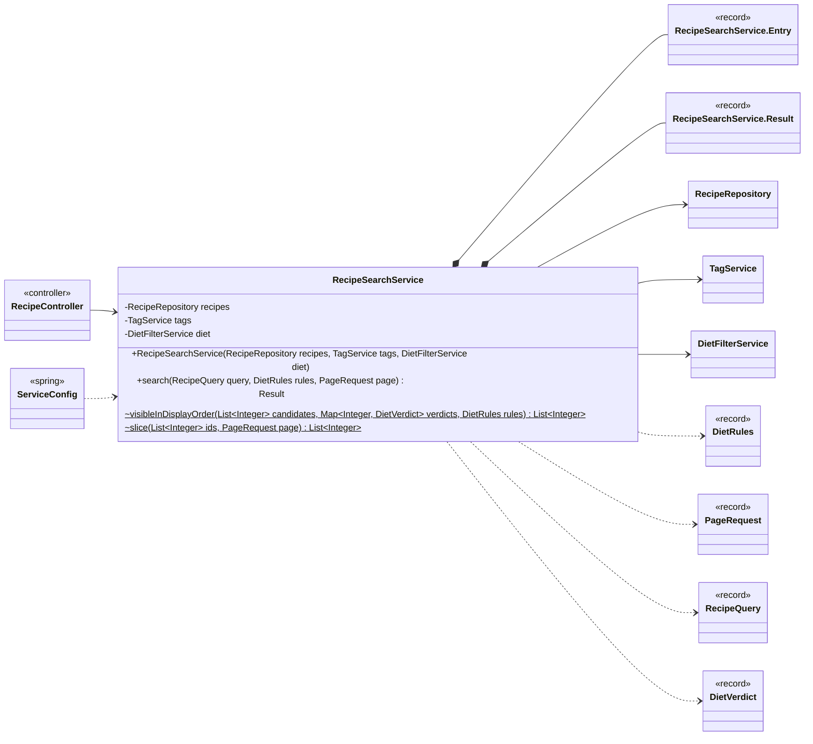

| Field | Type |
|---|---|
| `recipes` | `RecipeRepository` |
| `tags` | `TagService` |
| `diet` | `DietFilterService` |

| Member | Visibility | What it does |
|---|---|---|
| `RecipeSearchService(RecipeRepository recipes, TagService tags, DietFilterService diet)` | public |  |
| `Result search(RecipeQuery query, DietRules rules, PageRequest page)` | public |  |
| `List<Integer> visibleInDisplayOrder(List<Integer> candidates, Map<Integer, DietVerdict> verdicts, DietRules rules)` | package static | The candidates that are shown under the rules, in display order: no soft hit before soft hits, then OK, ANPASSBAR, UNCLEAR; the candidates' own (sort) order is kept within a group. |
| `List<Integer> slice(List<Integer> ids, PageRequest page)` | package static | The ids of the requested page; empty when the page is past the end. |

**Referenced by:** `RecipeController`, `ServiceConfig`

## RecipeSearchService.Entry

*record*

A recipe of a result page with its tag names and, when diet rules were given, its verdict (else null).

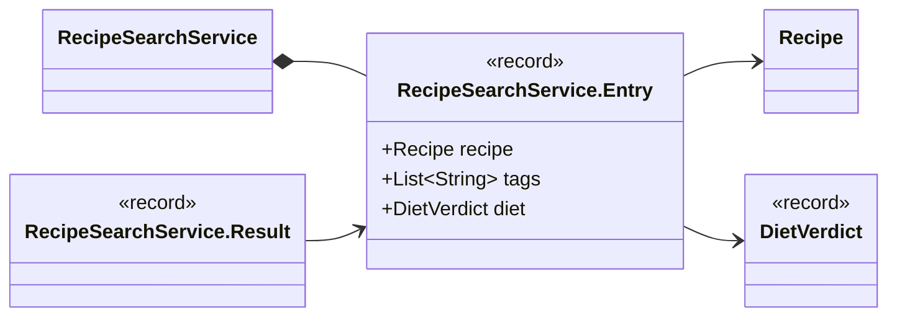

| Component | Type |
|---|---|
| `recipe` | `Recipe` |
| `tags` | `List<String>` |
| `diet` | `DietVerdict` |

**Referenced by:** `RecipeSearchService`

## RecipeSearchService.Result

*record*

One page, the number of recipes that match in all pages, and the request that produced it.

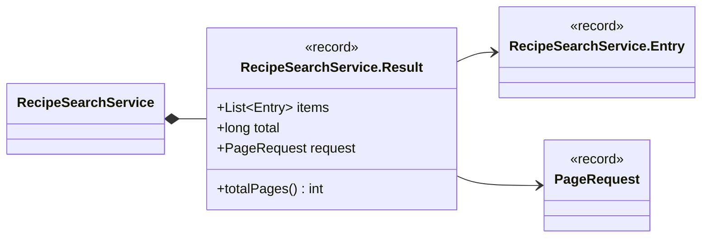

| Component | Type |
|---|---|
| `items` | `List<Entry>` |
| `total` | `long` |
| `request` | `PageRequest` |

| Member | Visibility | What it does |
|---|---|---|
| `int totalPages()` | public |  |

**Referenced by:** `RecipeSearchService`

## RecipeService

*class*

Business logic for recipes. No SQl here, no UI here
It asks the repository for data and answers questions about it.
This is the class future web controllers will call.

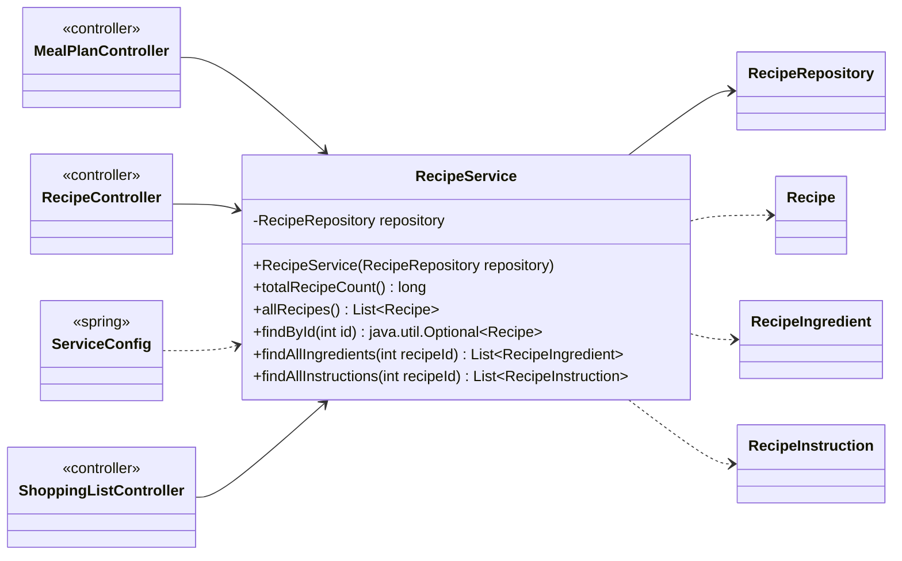

| Field | Type |
|---|---|
| `repository` | `RecipeRepository` |

| Member | Visibility | What it does |
|---|---|---|
| `RecipeService(RecipeRepository repository)` | public |  |
| `long totalRecipeCount()` | public |  |
| `List<Recipe> allRecipes()` | public |  |
| `java.util.Optional<Recipe> findById(int id)` | public | One recipe by id, or empty when there is none (a single-row query, not the whole table). |
| `List<RecipeIngredient> findAllIngredients(int recipeId)` | public |  |
| `List<RecipeInstruction> findAllInstructions(int recipeId)` | public |  |

**Referenced by:** `MealPlanController`, `RecipeController`, `ServiceConfig`, `ShoppingListController`

## RecipeSort

*enum*

The sort orders of the recipe list. Every order ends with the recipe id, so the order is total and paging never
repeats or skips a recipe. .orderBy() is a fixed fragment (never user text); the repository appends it.

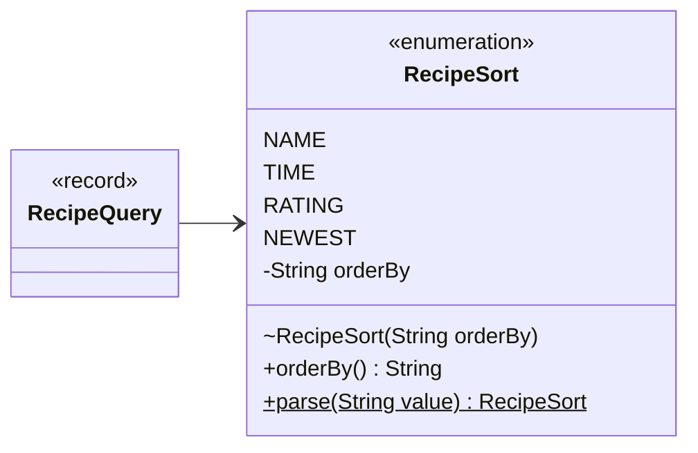

**Values:** `NAME`, `TIME`, `RATING`, `NEWEST`

| Field | Type |
|---|---|
| `orderBy` | `String` |

| Member | Visibility | What it does |
|---|---|---|
| `RecipeSort(String orderBy)` | package |  |
| `String orderBy()` | public |  |
| `RecipeSort parse(String value)` | public static | The sort for a request value (case-insensitive, null / blank = name); unknown is an IllegalArgumentException. |

**Referenced by:** `RecipeQuery`

## StepAmounts

*class*

Renders a cooking step's amounts for a number of people. HelloFresh writes step amounts as
1 EL [1,5 EL | 2 EL] Butter*: a bracket means 2 / 3 / 4 people in EVERY recipe, whatever its
servings say. The value outside is for 2 people, the first inside for 3 and the last inside for 4 (a
single value inside, 10 g [20 g] Öl*, is the 4-person one).

- A bracket is resolved for a target head count: people, or without it the recipe's own count
      (servings, or servingsMax with useMax), so the steps match the ingredient list. A target of
      2 / 3 / 4 uses HelloFresh's exact value and drops the bracket; any other count scales the 2-person
      (front) value with Portions.

- Amounts without a bracket are scaled only when people is given, from the recipe's servings, and
      only when they are a number plus a measuring unit (g, kg, ml, l, EL, TL, Prise, Msp.); °C, times,
      Stufe, lengths, Watt, % and plain counts ("2 Pfannen") are never touched.

- Brackets of words (Hälfte [drei Viertel | gesamte]) or of times, temperatures and settings
      (18 Min. [19 Min. | 20 Min.], 10 [12] Min., 200 [220] °C, Stufe 2 [3])
      pick HelloFresh's variant for 2 / 3 / 4 people and keep the 2-person text otherwise; never scaled.

- A pack size in parentheses after a word (1 Dose (400 g) Tomaten) is never scaled.

- Anything that can't be read safely (free text in brackets, broken numbers, a missing
      ]) stays exactly as written.

A * after a name marks a pantry item; it is part of the text after the amount and kept.
Without people the step comes back as written, with each readable bracket resolved for the
recipe's own head count.

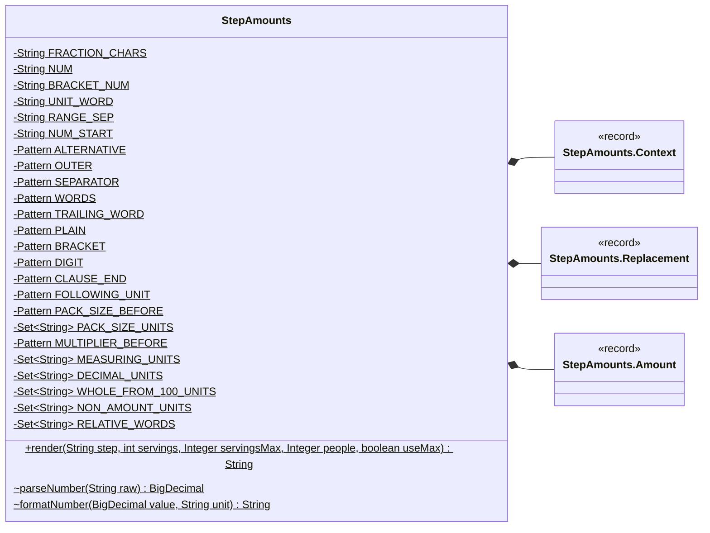

| Field | Type |
|---|---|
| `FRACTION_CHARS` | `String` |
| `NUM` | `String` |
| `BRACKET_NUM` | `String` |
| `UNIT_WORD` | `String` |
| `RANGE_SEP` | `String` |
| `NUM_START` | `String` |
| `ALTERNATIVE` | `Pattern` |
| `OUTER` | `Pattern` |
| `SEPARATOR` | `Pattern` |
| `WORDS` | `Pattern` |
| `TRAILING_WORD` | `Pattern` |
| `PLAIN` | `Pattern` |
| `BRACKET` | `Pattern` |
| `DIGIT` | `Pattern` |
| `CLAUSE_END` | `Pattern` |
| `FOLLOWING_UNIT` | `Pattern` |
| `PACK_SIZE_BEFORE` | `Pattern` |
| `PACK_SIZE_UNITS` | `Set<String>` |
| `MULTIPLIER_BEFORE` | `Pattern` |
| `MEASURING_UNITS` | `Set<String>` |
| `DECIMAL_UNITS` | `Set<String>` |
| `WHOLE_FROM_100_UNITS` | `Set<String>` |
| `NON_AMOUNT_UNITS` | `Set<String>` |
| `RELATIVE_WORDS` | `Set<String>` |

| Member | Visibility | What it does |
|---|---|---|
| `String render(String step, int servings, Integer servingsMax, Integer people, boolean useMax)` | public static | The step text for people (null = as written, brackets resolved for the recipe's own head count). |
| `BigDecimal parseNumber(String raw)` | package static | Parses one number as HelloFresh writes it; null when it isn't a plain amount. |
| `String formatNumber(BigDecimal value, String unit)` | package static | German number formatting: decimals with a comma for g / kg / ml / l and non-amount units (grams and millilitres to one decimal, from 100 up as whole numbers), ½ ¼ ¾ ⅛ ⅓ ⅔ for spoons, pinches and counts where they fit, otherwise a decimal. |

## StepAmounts.Context

*record*

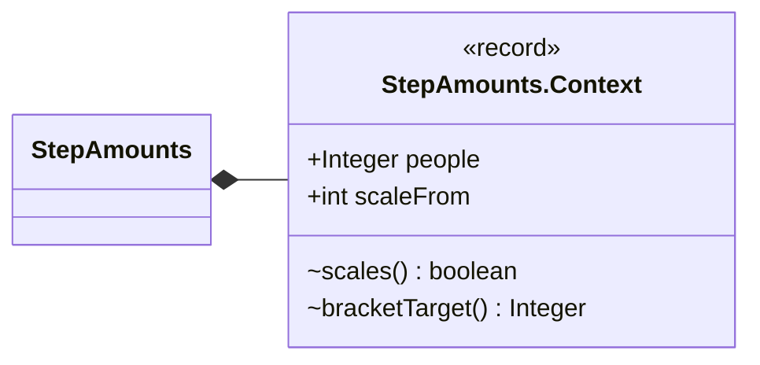

| Component | Type |
|---|---|
| `people` | `Integer` |
| `scaleFrom` | `int` |

| Member | Visibility | What it does |
|---|---|---|
| `boolean scales()` | package | Plain amounts (no bracket) scale from the recipe's servings, and only when people is given. |
| `Integer bracketTarget()` | package | The head count a bracket is resolved for: people, else the recipe's own count (so the steps match the ingredient list); null when that is unknown (servings 0). |

**Referenced by:** `StepAmounts`

## StepAmounts.Replacement

*record*

What replaces before[replaceFrom..] + bracket.

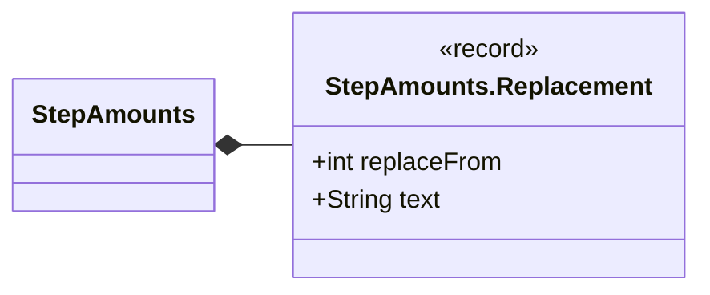

| Component | Type |
|---|---|
| `replaceFrom` | `int` |
| `text` | `String` |

**Referenced by:** `StepAmounts`

## StepAmounts.Amount

*record*

A parsed amount: one value or a range, and its unit (null when none).

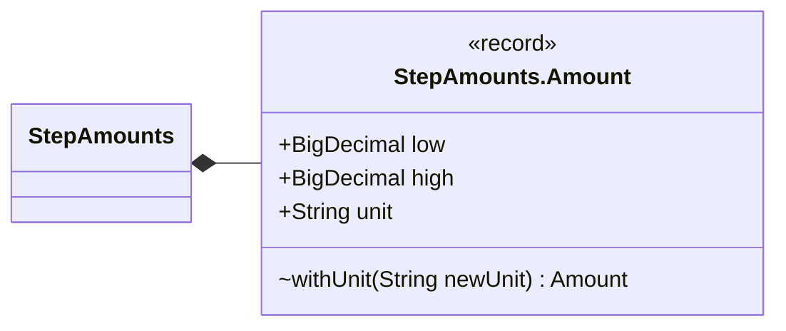

| Component | Type |
|---|---|
| `low` | `BigDecimal` |
| `high` | `BigDecimal` |
| `unit` | `String` |

| Member | Visibility | What it does |
|---|---|---|
| `Amount withUnit(String newUnit)` | package |  |

**Referenced by:** `StepAmounts`
