<!-- Generated by scripts/docs/generate_docs.py from src/main/java. Do not edit by hand; change the code or the generator. -->

# Package `receipts`

Receipt parsing (Penny, ALDI), matching to catalogue items and import.

30 types in 20 source files (`src/main/java/de/dahaem/receipts`). Back to the [class index](README.md).

## Overview

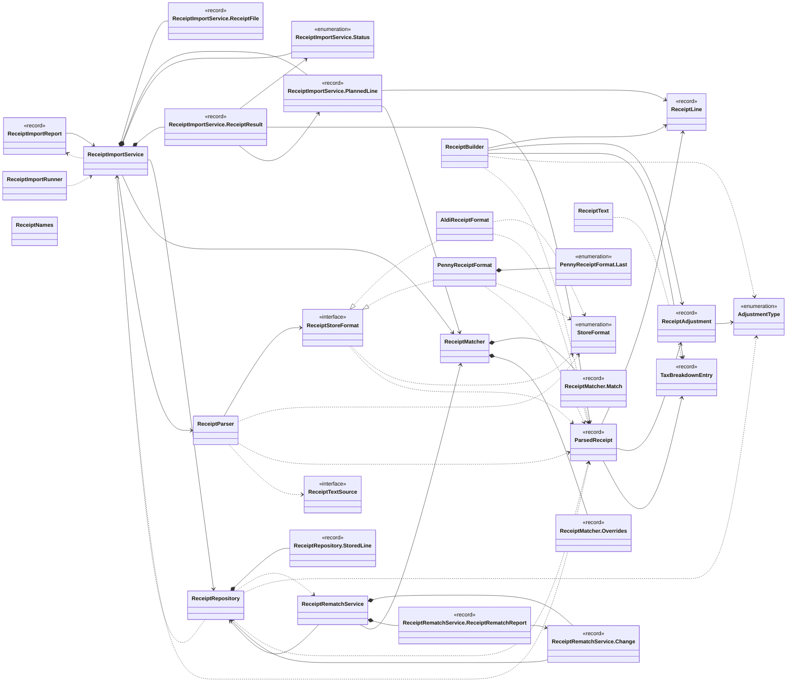

Arrows: `-->` has a field or record component of that type, `..>` takes it in its constructor or mentions it in a method signature, `<|--` extends, `<|..` implements, `*--` nested type. Only relationships inside this package are drawn here; each class below also shows its neighbours in other packages.

| Type | Kind | Role | What it is |
|------|------|------|------------|
| [`AdjustmentType`](#adjustmenttype) | enum |  | What kind of price change or deposit movement a receipt line is. |
| [`AldiReceiptFormat`](#aldireceiptformat) | class |  | ALDI layout. |
| [`ParsedReceipt`](#parsedreceipt) | record |  | Structured result of parsing one receipt's text. |
| [`PennyReceiptFormat`](#pennyreceiptformat) | class |  | PENNY (REWE Group) layout. |
| [`PennyReceiptFormat.Last`](#pennyreceiptformatlast) | enum |  | What the last booked line was, so an "n Stk x p" sub-line lands on the right thing. |
| [`ReceiptAdjustment`](#receiptadjustment) | record |  | A discount or deposit movement, kept apart from products (paid price != listed price != offer; deposit != discount). |
| [`ReceiptBuilder`](#receiptbuilder) | class |  | Mutable accumulator shared by the store handlers. |
| [`ReceiptImportReport`](#receiptimportreport) | record |  | What one receipt import did (or, in a dry run, would do): receipts new / duplicate / skipped, how the lines of the new receipts matched, the most frequent unmatched names, and per receipt the balance check (stored line paid totals + other a |
| [`ReceiptImportRunner`](#receiptimportrunner) | class | command-line tool | Command-line entry point for importing PENNY receipts as purchase history. |
| [`ReceiptImportService`](#receiptimportservice) | class |  | Imports PENNY receipt texts as purchase history into the receipt tables (migration 0008). |
| [`ReceiptImportService.ReceiptFile`](#receiptimportservicereceiptfile) | record |  |  |
| [`ReceiptImportService.PlannedLine`](#receiptimportserviceplannedline) | record |  | One product line as it will be stored. |
| [`ReceiptImportService.Status`](#receiptimportservicestatus) | enum |  |  |
| [`ReceiptImportService.ReceiptResult`](#receiptimportservicereceiptresult) | record |  | One receipt's outcome; receipt and lines are null/empty when it could not be read. |
| [`ReceiptLine`](#receiptline) | record |  | One purchasable product. |
| [`ReceiptMatcher`](#receiptmatcher) | class |  | Links one receipt line to an inventory item, or leaves it unmatched. |
| [`ReceiptMatcher.Match`](#receiptmatchermatch) | record |  | itemId null = no item; excluded = an override of 0 (left out on purpose). |
| [`ReceiptMatcher.Overrides`](#receiptmatcheroverrides) | record |  | Parsed config/receipt_overrides.json. |
| [`ReceiptNames`](#receiptnames) | class |  | Receipt-specific name handling, used only by the receipt import (offer matching keeps Normalizer as it is). |
| [`ReceiptParser`](#receiptparser) | class |  | Turns one receipt's raw text into a ParsedReceipt. |
| [`ReceiptRematchService`](#receiptrematchservice) | class |  | Re-runs the receipt matcher (the current config/receipt_overrides.json plus the name rules) on receipt lines that are already stored, so names can be mapped after the import without importing again. |
| [`ReceiptRematchService.Change`](#receiptrematchservicechange) | record |  | One stored line whose match changes. |
| [`ReceiptRematchService.ReceiptRematchReport`](#receiptrematchservicereceiptrematchreport) | record |  | What a rematch changed (or, in a dry run, would change). |
| [`ReceiptRepository`](#receiptrepository) | class |  | All SQL of the receipt import: purchase_receipt, purchase_receipt_line, purchase_receipt_adjustment (migration 0008) and the store lookup. |
| [`ReceiptRepository.StoredLine`](#receiptrepositorystoredline) | record |  | A stored receipt line as the rematch reads it. |
| [`ReceiptStoreFormat`](#receiptstoreformat) | interface |  | Per-store handler: recognises its receipts by header markers and parses their lines. |
| [`ReceiptText`](#receipttext) | class |  | Shared text helpers for the store handlers: number parsing, privacy filter, tax-table rows. |
| [`ReceiptTextSource`](#receipttextsource) | interface |  | Seam for whatever turns a receipt into text (OCR of a photo, a pasted string, a test fixture). |
| [`StoreFormat`](#storeformat) | enum |  | Which store's receipt layout a text follows; .UNKNOWN when no handler recognises it. |
| [`TaxBreakdownEntry`](#taxbreakdownentry) | record |  | One row of the receipt's own tax table; net/tax/gross are null when the row didn't print all three. |

## AdjustmentType

*enum*

What kind of price change or deposit movement a receipt line is.

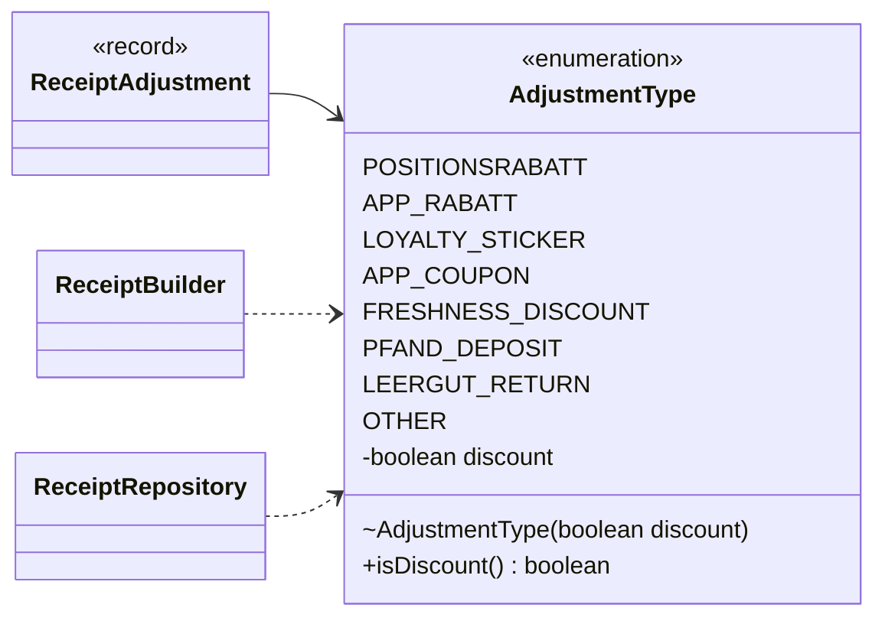

**Values:** `POSITIONSRABATT`, `APP_RABATT`, `LOYALTY_STICKER`, `APP_COUPON`, `FRESHNESS_DISCOUNT`, `PFAND_DEPOSIT`, `LEERGUT_RETURN`, `OTHER`

| Field | Type |
|---|---|
| `discount` | `boolean` |

| Member | Visibility | What it does |
|---|---|---|
| `AdjustmentType(boolean discount)` | package |  |
| `boolean isDiscount()` | public | True if this lowers what was paid for a product (as opposed to deposit movements). |

**Referenced by:** `ReceiptAdjustment`, `ReceiptBuilder`, `ReceiptRepository`

## AldiReceiptFormat

*class · implements ReceiptStoreFormat*

ALDI layout. Item lines end in a tax group digit ("NAME  7,99 € 1"); weight, multi-buy and
Positionsrabatt lines follow the item they belong to. Which digit means which rate is read
from the footer tax table, not assumed.

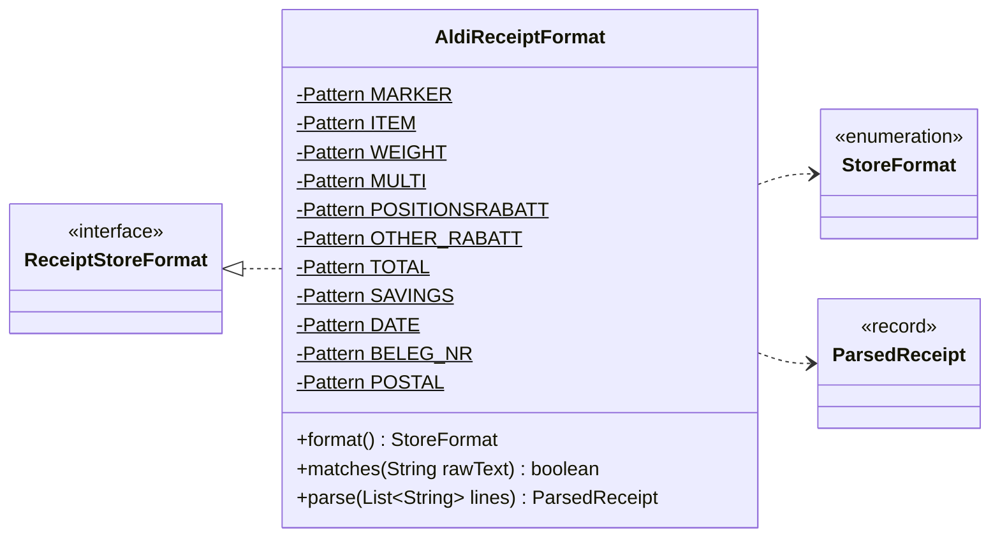

| Field | Type |
|---|---|
| `MARKER` | `Pattern` |
| `ITEM` | `Pattern` |
| `WEIGHT` | `Pattern` |
| `MULTI` | `Pattern` |
| `POSITIONSRABATT` | `Pattern` |
| `OTHER_RABATT` | `Pattern` |
| `TOTAL` | `Pattern` |
| `SAVINGS` | `Pattern` |
| `DATE` | `Pattern` |
| `BELEG_NR` | `Pattern` |
| `POSTAL` | `Pattern` |

| Member | Visibility | What it does |
|---|---|---|
| `StoreFormat format()` | public |  |
| `boolean matches(String rawText)` | public |  |
| `ParsedReceipt parse(List<String> lines)` | public |  |

## ParsedReceipt

*record*

Structured result of parsing one receipt's text. Fields the receipt didn't print are null.
unparsedLines holds every commercial line the handler didn't understand (never silently
dropped); payment/technical lines are removed before parsing and never appear here.

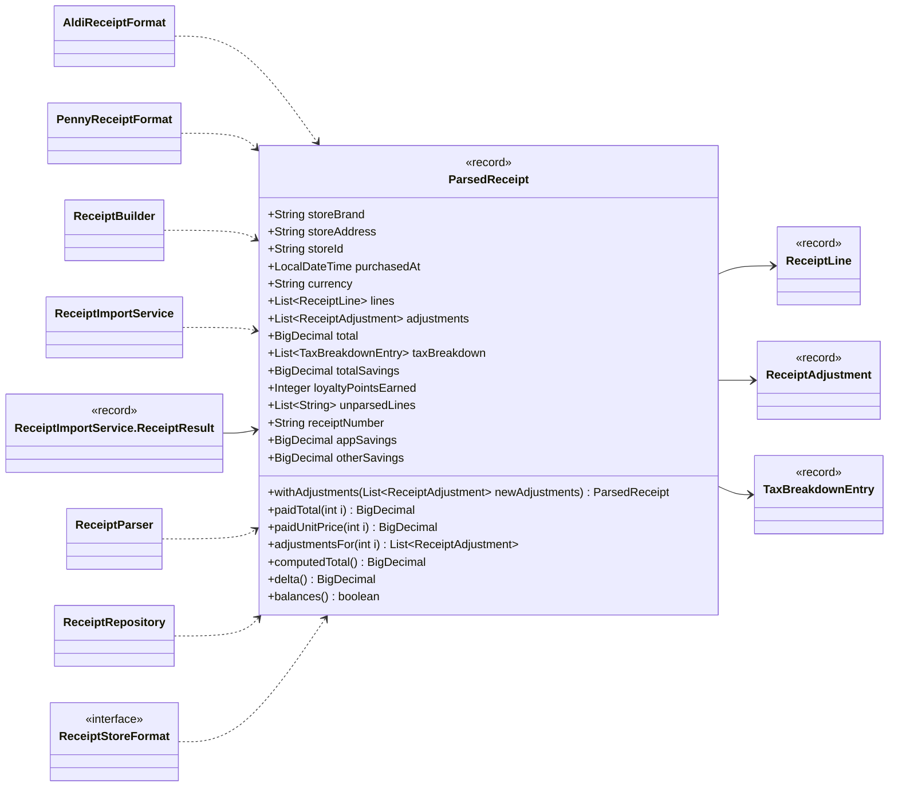

| Component | Type |
|---|---|
| `storeBrand` | `String` |
| `storeAddress` | `String` |
| `storeId` | `String` |
| `purchasedAt` | `LocalDateTime` |
| `currency` | `String` |
| `lines` | `List<ReceiptLine>` |
| `adjustments` | `List<ReceiptAdjustment>` |
| `total` | `BigDecimal` |
| `taxBreakdown` | `List<TaxBreakdownEntry>` |
| `totalSavings` | `BigDecimal` |
| `loyaltyPointsEarned` | `Integer` |
| `unparsedLines` | `List<String>` |
| `receiptNumber` | `String` |
| `appSavings` | `BigDecimal` |
| `otherSavings` | `BigDecimal` |

| Member | Visibility | What it does |
|---|---|---|
| `ParsedReceipt withAdjustments(List<ReceiptAdjustment> newAdjustments)` | public | The same receipt with other adjustments (e.g. |
| `BigDecimal paidTotal(int i)` | public | What was actually paid for line i: printed total plus the discounts attached to it. |
| `BigDecimal paidUnitPrice(int i)` | public | Paid price per unit (or per kg for weighed goods) after discounts. |
| `List<ReceiptAdjustment> adjustmentsFor(int i)` | public |  |
| `BigDecimal computedTotal()` | public | Sum of printed line totals plus every signed adjustment (discounts, deposits, returns). |
| `BigDecimal delta()` | public | computedTotal minus the printed total; null if no total was found. |
| `boolean balances()` | public | True if the parsed lines reconcile exactly with the printed total. |

**Referenced by:** `AldiReceiptFormat`, `PennyReceiptFormat`, `ReceiptBuilder`, `ReceiptImportService`, `ReceiptParser`, `ReceiptRepository`, `ReceiptStoreFormat`

## PennyReceiptFormat

*class · implements ReceiptStoreFormat*

PENNY (REWE Group) layout. Item lines end in a tax group letter ("NAME  2,79 B") -- the
opposite letter meaning to ALDI's digits, which is why the mapping is read from the footer.
A trailing " *" after the letter marks a product excluded from discounts. Discounts, app
coupons, Pfand, Leergut and Treueartikel are recognised before the generic item pattern,
because several of them end in "amount letter" too. Known header/footer and card-payment
lines are recognised and skipped; card number, Terminal-ID, Trace-Nr., Pos-Info, AS-Zeit and signature/serial lines are
never kept (most are already dropped by ReceiptText.lines).

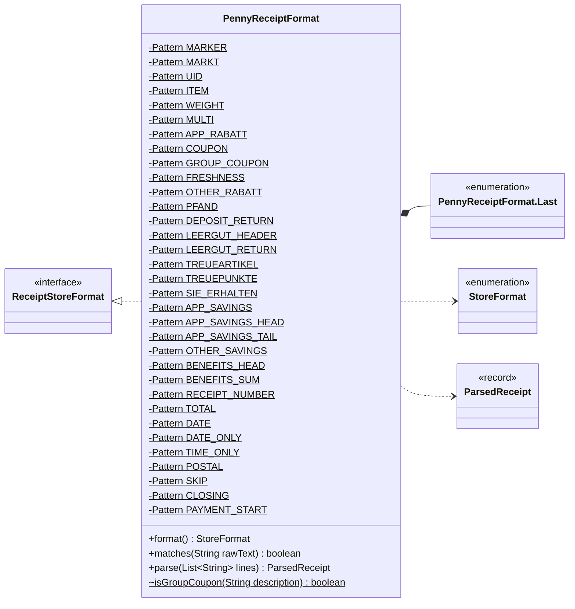

| Field | Type |
|---|---|
| `MARKER` | `Pattern` |
| `MARKT` | `Pattern` |
| `UID` | `Pattern` |
| `ITEM` | `Pattern` |
| `WEIGHT` | `Pattern` |
| `MULTI` | `Pattern` |
| `APP_RABATT` | `Pattern` |
| `COUPON` | `Pattern` |
| `GROUP_COUPON` | `Pattern` |
| `FRESHNESS` | `Pattern` |
| `OTHER_RABATT` | `Pattern` |
| `PFAND` | `Pattern` |
| `DEPOSIT_RETURN` | `Pattern` |
| `LEERGUT_HEADER` | `Pattern` |
| `LEERGUT_RETURN` | `Pattern` |
| `TREUEARTIKEL` | `Pattern` |
| `TREUEPUNKTE` | `Pattern` |
| `SIE_ERHALTEN` | `Pattern` |
| `APP_SAVINGS` | `Pattern` |
| `APP_SAVINGS_HEAD` | `Pattern` |
| `APP_SAVINGS_TAIL` | `Pattern` |
| `OTHER_SAVINGS` | `Pattern` |
| `BENEFITS_HEAD` | `Pattern` |
| `BENEFITS_SUM` | `Pattern` |
| `RECEIPT_NUMBER` | `Pattern` |
| `TOTAL` | `Pattern` |
| `DATE` | `Pattern` |
| `DATE_ONLY` | `Pattern` |
| `TIME_ONLY` | `Pattern` |
| `POSTAL` | `Pattern` |
| `SKIP` | `Pattern` |
| `CLOSING` | `Pattern` |
| `PAYMENT_START` | `Pattern` |

| Member | Visibility | What it does |
|---|---|---|
| `StoreFormat format()` | public |  |
| `boolean matches(String rawText)` | public |  |
| `ParsedReceipt parse(List<String> lines)` | public |  |
| `boolean isGroupCoupon(String description)` | package static | True for a group coupon ("App-Coupon 10% Waren"), which is booked without a product line. |

## PennyReceiptFormat.Last

*enum*

What the last booked line was, so an "n Stk x p" sub-line lands on the right thing.

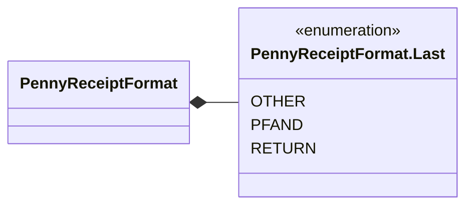

**Values:** `OTHER`, `PFAND`, `RETURN`

**Referenced by:** `PennyReceiptFormat`

## ReceiptAdjustment

*record*

A discount or deposit movement, kept apart from products (paid price != listed price != offer;
deposit != discount). amount is signed as it affects the total: discounts and returns
negative, deposits positive. lineIndex is the product line it attaches to, or null when
that can't be determined.

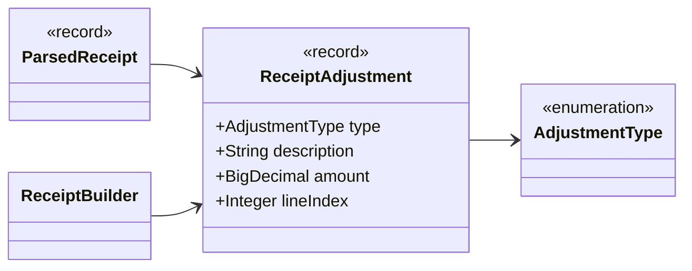

| Component | Type |
|---|---|
| `type` | `AdjustmentType` |
| `description` | `String` |
| `amount` | `BigDecimal` |
| `lineIndex` | `Integer` |

**Referenced by:** `ParsedReceipt`, `ReceiptBuilder`

## ReceiptBuilder

*class*

Mutable accumulator shared by the store handlers. Tracks whether the previous line was an item
(or one of its sub-lines) so discounts and deposits attach to a line only when that's determinable.

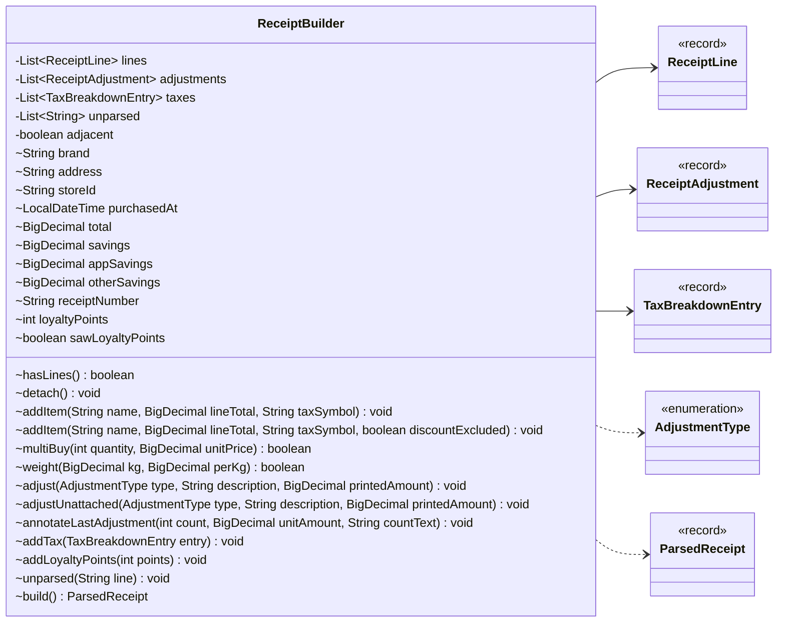

| Field | Type |
|---|---|
| `lines` | `List<ReceiptLine>` |
| `adjustments` | `List<ReceiptAdjustment>` |
| `taxes` | `List<TaxBreakdownEntry>` |
| `unparsed` | `List<String>` |
| `adjacent` | `boolean` |
| `brand` | `String` |
| `address` | `String` |
| `storeId` | `String` |
| `purchasedAt` | `LocalDateTime` |
| `total` | `BigDecimal` |
| `savings` | `BigDecimal` |
| `appSavings` | `BigDecimal` |
| `otherSavings` | `BigDecimal` |
| `receiptNumber` | `String` |
| `loyaltyPoints` | `int` |
| `sawLoyaltyPoints` | `boolean` |

| Member | Visibility | What it does |
|---|---|---|
| `boolean hasLines()` | package |  |
| `void detach()` | package | Call for any line that is not an item or item sub-line. |
| `void addItem(String name, BigDecimal lineTotal, String taxSymbol)` | package |  |
| `void addItem(String name, BigDecimal lineTotal, String taxSymbol, boolean discountExcluded)` | package |  |
| `boolean multiBuy(int quantity, BigDecimal unitPrice)` | package | Applies "n x price" to the current item; false if there is none. |
| `boolean weight(BigDecimal kg, BigDecimal perKg)` | package |  |
| `void adjust(AdjustmentType type, String description, BigDecimal printedAmount)` | package | Records an adjustment with its canonical sign (discounts and returns negative, deposits positive). |
| `void adjustUnattached(AdjustmentType type, String description, BigDecimal printedAmount)` | package | Records a discount that belongs to no single product line (a PENNY group coupon). |
| `void annotateLastAdjustment(int count, BigDecimal unitAmount, String countText)` | package | Applies an "n Stk x p" sub-line to the last adjustment (a multi-unit Pfand or Leergut line): the count goes into the description and, for Pfand, p becomes the per-unit deposit of the product it is attached to. |
| `void addTax(TaxBreakdownEntry entry)` | package |  |
| `void addLoyaltyPoints(int points)` | package |  |
| `void unparsed(String line)` | package |  |
| `ParsedReceipt build()` | package | Resolves each line's tax rate from the receipt's own footer table. |

## ReceiptImportReport

*record*

What one receipt import did (or, in a dry run, would do): receipts new / duplicate / skipped,
how the lines of the new receipts matched, the most frequent unmatched names, and per receipt
the balance check (stored line paid totals + other adjustments = printed total).

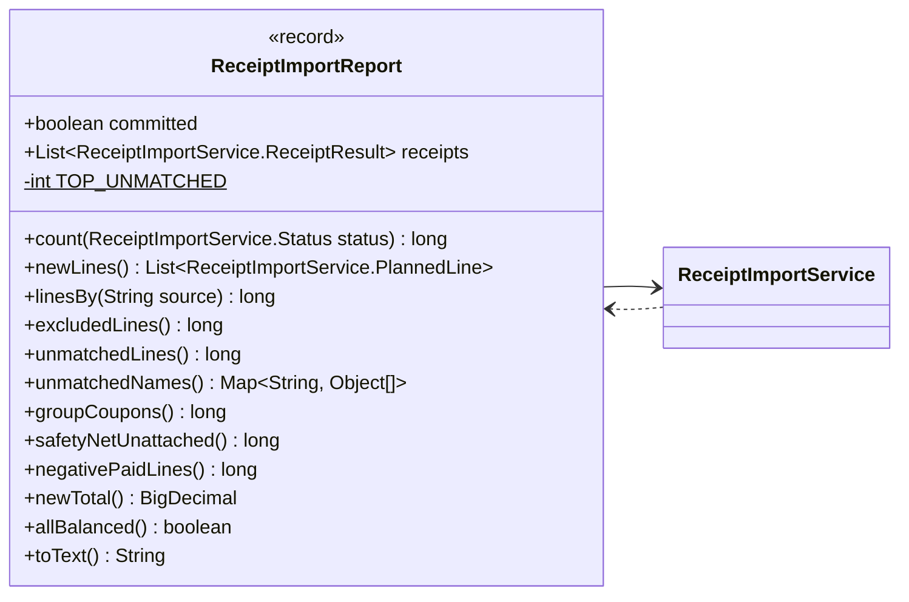

| Component | Type |
|---|---|
| `committed` | `boolean` |
| `receipts` | `List<ReceiptImportService.ReceiptResult>` |
| `TOP_UNMATCHED` | `int` |

| Member | Visibility | What it does |
|---|---|---|
| `long count(ReceiptImportService.Status status)` | public |  |
| `List<ReceiptImportService.PlannedLine> newLines()` | public | Lines of the NEW receipts (what is or would be written). |
| `long linesBy(String source)` | public |  |
| `long excludedLines()` | public |  |
| `long unmatchedLines()` | public |  |
| `Map<String, Object[]> unmatchedNames()` | public | Unmatched receipt key -> {count, an example name as printed}, most frequent first. |
| `long groupCoupons()` | public | PENNY group coupons ("App-Coupon 10% Waren") of the NEW receipts; they are stored without a line. |
| `long safetyNetUnattached()` | public | Discounts of the NEW receipts the negative-paid safety net stored without their line. |
| `long negativePaidLines()` | public | Lines of the NEW receipts whose paid total is below zero; 0 unless the safety net is broken. |
| `BigDecimal newTotal()` | public | Sum of the printed totals of the NEW receipts. |
| `boolean allBalanced()` | public |  |
| `String toText()` | public |  |

**Referenced by:** `ReceiptImportService`

## ReceiptImportRunner

*class · command-line tool*

Command-line entry point for importing PENNY receipts as purchase history.

  ReceiptImportRunner  [--commit] [--overrides ]
  ReceiptImportRunner --rematch [--commit] [--overrides ]

 holds one .txt per receipt, made with pdftotext -layout -enc UTF-8.
Without --commit it is a dry run: it reads the catalog and the stored receipt keys and
prints the report, writing nothing. With --commit all new receipts are written in one
transaction. Overrides default to config/receipt_overrides.json (run from the app directory).
--rematch reads no folder: it re-runs the matcher on the lines already stored (match_source
NULL, 'rule' or 'override', never 'manual') and changes item, match source and brand where the result
differs (ReceiptRematchService); dry run by default, --commit = one transaction.
The database comes from DAHAEM_DB_URL / DAHAEM_DB_USER / DAHAEM_DB_PASSWORD.

Exit code: 0 = OK, 1 = a receipt was skipped or the import failed (nothing written), 2 = bad arguments.

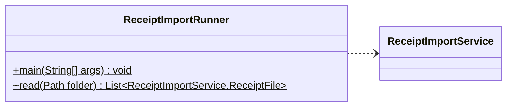

| Member | Visibility | What it does |
|---|---|---|
| `void main(String[] args)` | public static |  |
| `List<ReceiptImportService.ReceiptFile> read(Path folder)` | package static |  |

## ReceiptImportService

*class*

Imports PENNY receipt texts as purchase history into the receipt tables (migration 0008).
A dry run (the default) only reads: the catalog for matching and the receipt keys for
duplicates. With commit, every new receipt -- header, every line, every adjustment --
is written in ONE transaction (ReceiptRepository.saveReceipts); any error rolls all of it back.

A historical import never changes stock: it does not call PurchaseService and writes neither
purchase_history nor inventory_item. The household's stock is built from new purchases and
check-ins, not reconstructed from old receipts.

A receipt is skipped (and reported) if it is not a PENNY receipt, lacks its date, receipt
number or total, or does not balance to the cent; one already stored (same store, date-time and
receipt number) is a duplicate and is not written again.

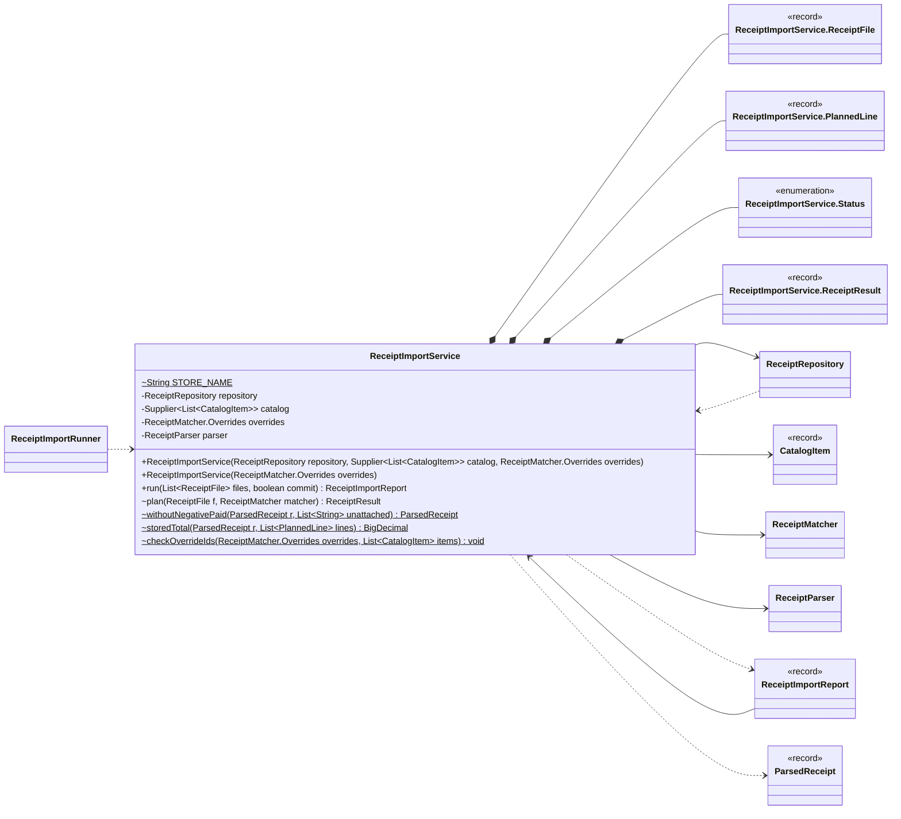

| Field | Type |
|---|---|
| `STORE_NAME` | `String` |
| `repository` | `ReceiptRepository` |
| `catalog` | `Supplier<List<CatalogItem>>` |
| `overrides` | `ReceiptMatcher.Overrides` |
| `parser` | `ReceiptParser` |

| Member | Visibility | What it does |
|---|---|---|
| `ReceiptImportService(ReceiptRepository repository, Supplier<List<CatalogItem>> catalog, ReceiptMatcher.Overrides overrides)` | public |  |
| `ReceiptImportService(ReceiptMatcher.Overrides overrides)` | public |  |
| `ReceiptImportReport run(List<ReceiptFile> files, boolean commit)` | public |  |
| `ReceiptResult plan(ReceiptFile f, ReceiptMatcher matcher)` | package | Parses one file and decides its lines and matches; no database access. |
| `ParsedReceipt withoutNegativePaid(ParsedReceipt r, List<String> unattached)` | package static | Safety net: a discount that would push its line's paid total below zero cannot belong to that line (a group coupon read as a single-product one). |
| `BigDecimal storedTotal(ParsedReceipt r, List<PlannedLine> lines)` | package static | Line paid totals plus every adjustment not already inside one of them (deposits, returns, unattached discounts). |
| `void checkOverrideIds(ReceiptMatcher.Overrides overrides, List<CatalogItem> items)` | package static | An override pointing at an id the catalog doesn't have would fail the whole commit; refuse up front. |

**Referenced by:** `ReceiptImportReport`, `ReceiptImportRunner`, `ReceiptRepository`

## ReceiptImportService.ReceiptFile

*record*

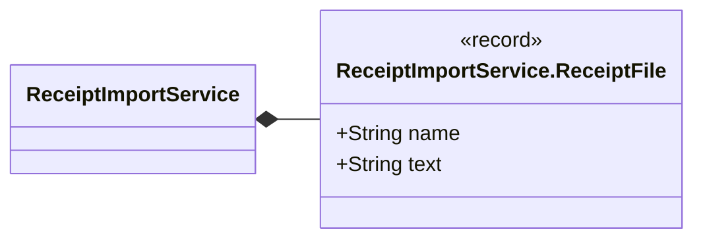

| Component | Type |
|---|---|
| `name` | `String` |
| `text` | `String` |

**Referenced by:** `ReceiptImportService`

## ReceiptImportService.PlannedLine

*record*

One product line as it will be stored.

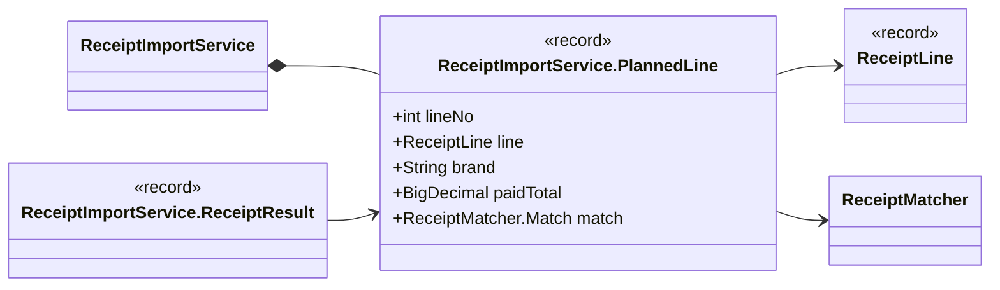

| Component | Type |
|---|---|
| `lineNo` | `int` |
| `line` | `ReceiptLine` |
| `brand` | `String` |
| `paidTotal` | `BigDecimal` |
| `match` | `ReceiptMatcher.Match` |

**Referenced by:** `ReceiptImportService`

## ReceiptImportService.Status

*enum*

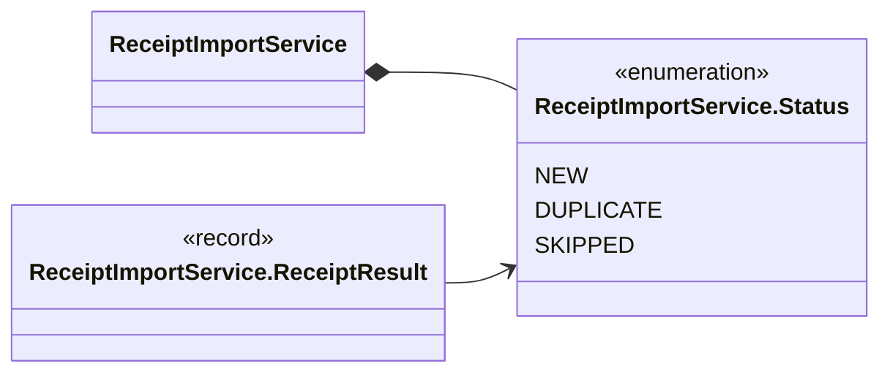

**Values:** `NEW`, `DUPLICATE`, `SKIPPED`

**Referenced by:** `ReceiptImportService`

## ReceiptImportService.ReceiptResult

*record*

One receipt's outcome; receipt and lines are null/empty when it could not be read.
unattached lists the discounts the negative-paid safety net moved off their line.

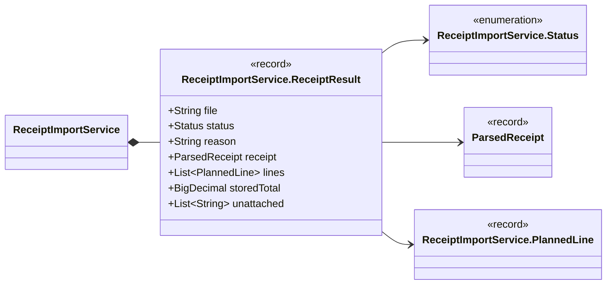

| Component | Type |
|---|---|
| `file` | `String` |
| `status` | `Status` |
| `reason` | `String` |
| `receipt` | `ParsedReceipt` |
| `lines` | `List<PlannedLine>` |
| `storedTotal` | `BigDecimal` |
| `unattached` | `List<String>` |

**Referenced by:** `ReceiptImportService`

## ReceiptLine

*record*

One purchasable product. lineTotal is the printed price before any adjustment; what was
actually paid is ParsedReceipt.paidTotal(int). taxSymbol is the receipt's own
marker (ALDI: 1/2, PENNY: A/B); taxRatePercent is resolved from the receipt's footer
table and is null if the footer didn't define the symbol. weightKg/pricePerKg
are set for weighed goods, deposit (Pfand per unit) for bottles whose deposit line
follows; the deposit itself is booked as an adjustment, never in lineTotal.
discountExcluded is the receipt's own "*" marker after the tax symbol (PENNY: "Keine
Rabatte auf die mit * gekennzeichnete Produkte").

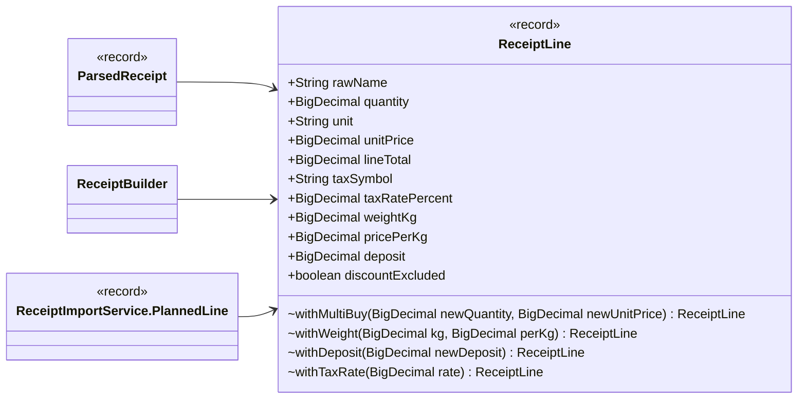

| Component | Type |
|---|---|
| `rawName` | `String` |
| `quantity` | `BigDecimal` |
| `unit` | `String` |
| `unitPrice` | `BigDecimal` |
| `lineTotal` | `BigDecimal` |
| `taxSymbol` | `String` |
| `taxRatePercent` | `BigDecimal` |
| `weightKg` | `BigDecimal` |
| `pricePerKg` | `BigDecimal` |
| `deposit` | `BigDecimal` |
| `discountExcluded` | `boolean` |

| Member | Visibility | What it does |
|---|---|---|
| `ReceiptLine withMultiBuy(BigDecimal newQuantity, BigDecimal newUnitPrice)` | package |  |
| `ReceiptLine withWeight(BigDecimal kg, BigDecimal perKg)` | package |  |
| `ReceiptLine withDeposit(BigDecimal newDeposit)` | package |  |
| `ReceiptLine withTaxRate(BigDecimal rate)` | package |  |

**Referenced by:** `ParsedReceipt`, `ReceiptBuilder`

## ReceiptMatcher

*class*

Links one receipt line to an inventory item, or leaves it unmatched. No SQL. Order:

- config/receipt_overrides.json exact: receipt key (see ReceiptNames.key) -> item id,
      tried for the full name, then for the name without its brand prefix. 0 = excluded on purpose.

- review: keys waiting for Nate's decision. They stay unmatched; the rules below are not
      asked, so a known wrong guess ("Krom FB Kirsche" -> cherries) can't slip in.

- the normal name rules of StoreMatchService, on the readable name without the brand.
      config/store_overrides.json is NOT used: its keys are offer names, and some differ in meaning on
      a receipt ("fruchtzwerge" -> plain yogurt there).

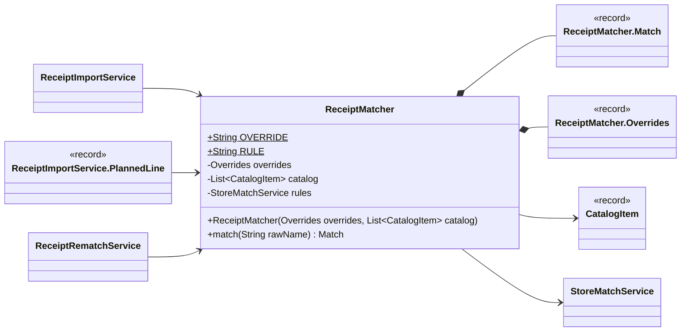

| Field | Type |
|---|---|
| `OVERRIDE` | `String` |
| `RULE` | `String` |
| `overrides` | `Overrides` |
| `catalog` | `List<CatalogItem>` |
| `rules` | `StoreMatchService` |

| Member | Visibility | What it does |
|---|---|---|
| `ReceiptMatcher(Overrides overrides, List<CatalogItem> catalog)` | public |  |
| `Match match(String rawName)` | public |  |

**Referenced by:** `ReceiptImportService`, `ReceiptRematchService`

## ReceiptMatcher.Match

*record*

itemId null = no item; excluded = an override of 0 (left out on purpose).

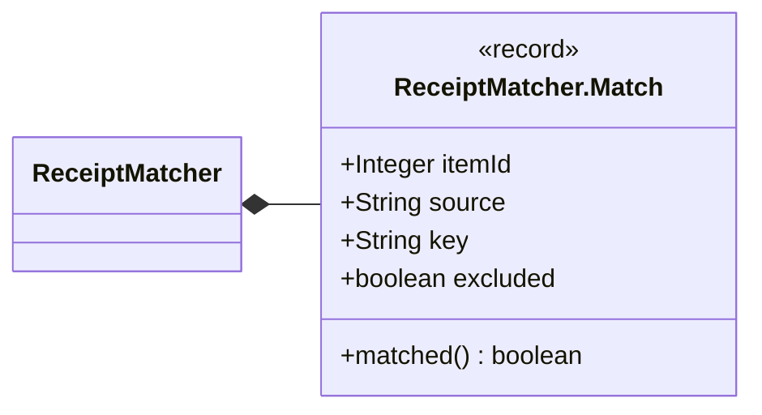

| Component | Type |
|---|---|
| `itemId` | `Integer` |
| `source` | `String` |
| `key` | `String` |
| `excluded` | `boolean` |

| Member | Visibility | What it does |
|---|---|---|
| `boolean matched()` | public |  |

**Referenced by:** `ReceiptMatcher`

## ReceiptMatcher.Overrides

*record*

Parsed config/receipt_overrides.json.

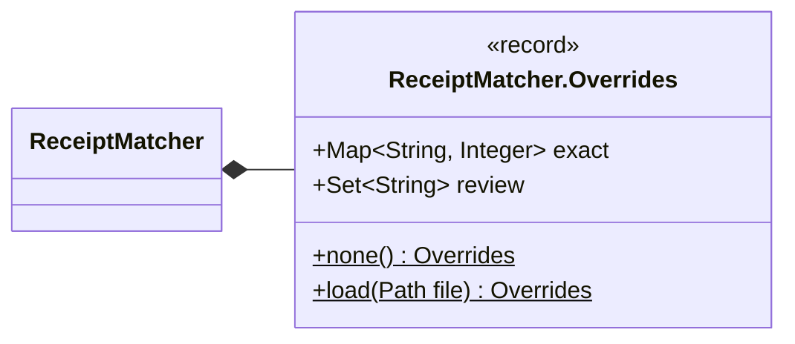

| Component | Type |
|---|---|
| `exact` | `Map<String, Integer>` |
| `review` | `Set<String>` |

| Member | Visibility | What it does |
|---|---|---|
| `Overrides none()` | public static |  |
| `Overrides load(Path file)` | public static | Reads {"exact": {"key": id}, "review": ["key", ...]}; a malformed file fails loudly. |

**Referenced by:** `ReceiptMatcher`

## ReceiptNames

*class*

Receipt-specific name handling, used only by the receipt import (offer matching keeps
Normalizer as it is). PENNY prints most names in ALL CAPS and without a brand
("ESL MILCH 3,5%"), which Normalizer would read as brand words and strip, so ALL-CAPS
words are written in normal case first. Known PENNY abbreviations are expanded ("Hä." ->
Hähnchen), and a brand is taken only from a known prefix ("LH" = Lindenhof), never guessed.

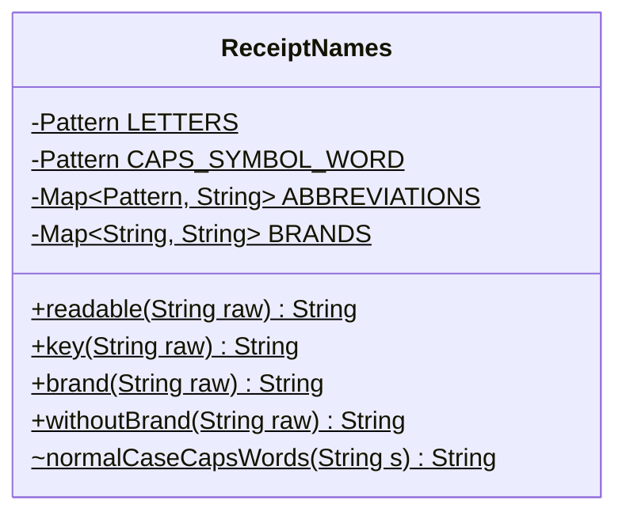

| Field | Type |
|---|---|
| `LETTERS` | `Pattern` |
| `CAPS_SYMBOL_WORD` | `Pattern` |
| `ABBREVIATIONS` | `Map<Pattern, String>` |
| `BRANDS` | `Map<String, String>` |

| Member | Visibility | What it does |
|---|---|---|
| `String readable(String raw)` | public static | "HACKFLEISCH GEM." -> "Hackfleisch gemischt", "Hä.-Brustfilet" -> "Hähnchen-Brustfilet". |
| `String key(String raw)` | public static | The comparable key of a receipt name, as used in config/receipt_overrides.json. |
| `String brand(String raw)` | public static | The brand of a known prefix ("LH FRISCHK.NATUR" -> "Lindenhof"), else null. |
| `String withoutBrand(String raw)` | public static | The name without its known brand prefix ("LH FRISCHK.NATUR" -> "FRISCHK.NATUR"); unchanged if none. |
| `String normalCaseCapsWords(String s)` | package static | Every run of two or more letters that is ALL CAPS becomes "Xxxx"; mixed-case words stay as printed. |

## ReceiptParser

*class*

Turns one receipt's raw text into a ParsedReceipt. No SQL, no I/O: OCR and persistence
sit on either side of this class. Payment/technical footer data is stripped before parsing, and
odd or mis-OCR'd input never throws -- unrecognised lines land in unparsedLines and
ParsedReceipt.balances() reports whether the numbers reconcile.

```mermaid
classDiagram
    direction LR
    class receipts_ReceiptParser["ReceiptParser"] {
        -List~ReceiptStoreFormat~ formats
        +ReceiptParser()
        +ReceiptParser(List~ReceiptStoreFormat~ formats)
        +detectFormat(String rawText) StoreFormat
        +parse(String rawText, StoreFormat format) ParsedReceipt
        +parse(ReceiptTextSource source) ParsedReceipt
    }
    class receipts_ReceiptStoreFormat["ReceiptStoreFormat"] {
        <<interface>>
    }
    class receipts_ReceiptImportService["ReceiptImportService"]
    class receipts_StoreFormat["StoreFormat"] {
        <<enumeration>>
    }
    class receipts_ParsedReceipt["ParsedReceipt"] {
        <<record>>
    }
    class receipts_ReceiptTextSource["ReceiptTextSource"] {
        <<interface>>
    }
    receipts_ReceiptParser --> receipts_ReceiptStoreFormat
    receipts_ReceiptParser ..> receipts_StoreFormat
    receipts_ReceiptParser ..> receipts_ParsedReceipt
    receipts_ReceiptParser ..> receipts_ReceiptTextSource
    receipts_ReceiptImportService --> receipts_ReceiptParser
```

| Field | Type |
|---|---|
| `formats` | `List<ReceiptStoreFormat>` |

| Member | Visibility | What it does |
|---|---|---|
| `ReceiptParser()` | public |  |
| `ReceiptParser(List<ReceiptStoreFormat> formats)` | public |  |
| `StoreFormat detectFormat(String rawText)` | public | Recognises the store from header markers; StoreFormat.UNKNOWN if none match. |
| `ParsedReceipt parse(String rawText, StoreFormat format)` | public |  |
| `ParsedReceipt parse(ReceiptTextSource source)` | public |  |

**Referenced by:** `ReceiptImportService`

## ReceiptRematchService

*class*

Re-runs the receipt matcher (the current config/receipt_overrides.json plus the name rules) on receipt
lines that are already stored, so names can be mapped after the import without importing again.

Only lines whose match_source is NULL, 'rule' or 'override' are looked at; a 'manual' line is never
changed. A line changes when its item, match source or brand differs from what the matcher gives now
(an override moved to review clears a former match). A dry run (the default) only reads; with
commit all changes are written in ONE transaction. Receipts, adjustments, inventory_item stock
and purchase_history are never touched. Override ids missing from inventory_item are refused, as in
the import.

```mermaid
classDiagram
    direction LR
    class receipts_ReceiptRematchService["ReceiptRematchService"] {
        +String MANUAL$
        -ReceiptRepository repository
        -Supplier~List~CatalogItem~~ catalog
        -ReceiptMatcher.Overrides overrides
        +ReceiptRematchService(ReceiptRepository repository, Supplier~List~CatalogItem~~ catalog, ReceiptMatcher.Overrides overrides)
        +ReceiptRematchService(ReceiptMatcher.Overrides overrides)
        +run(boolean commit) ReceiptRematchReport
    }
    class receipts_ReceiptRematchService_Change["ReceiptRematchService.Change"] {
        <<record>>
    }
    class receipts_ReceiptRematchService_ReceiptRematchReport["ReceiptRematchService.ReceiptRematchReport"] {
        <<record>>
    }
    class receipts_ReceiptRepository["ReceiptRepository"]
    class stores_CatalogItem["CatalogItem"] {
        <<record>>
    }
    class receipts_ReceiptMatcher["ReceiptMatcher"]
    receipts_ReceiptRematchService *-- receipts_ReceiptRematchService_Change
    receipts_ReceiptRematchService *-- receipts_ReceiptRematchService_ReceiptRematchReport
    receipts_ReceiptRematchService --> receipts_ReceiptRepository
    receipts_ReceiptRematchService --> stores_CatalogItem
    receipts_ReceiptRematchService --> receipts_ReceiptMatcher
    receipts_ReceiptRepository ..> receipts_ReceiptRematchService
```

| Field | Type |
|---|---|
| `MANUAL` | `String` |
| `repository` | `ReceiptRepository` |
| `catalog` | `Supplier<List<CatalogItem>>` |
| `overrides` | `ReceiptMatcher.Overrides` |

| Member | Visibility | What it does |
|---|---|---|
| `ReceiptRematchService(ReceiptRepository repository, Supplier<List<CatalogItem>> catalog, ReceiptMatcher.Overrides overrides)` | public |  |
| `ReceiptRematchService(ReceiptMatcher.Overrides overrides)` | public |  |
| `ReceiptRematchReport run(boolean commit)` | public |  |

**Referenced by:** `ReceiptRepository`

## ReceiptRematchService.Change

*record*

One stored line whose match changes.

```mermaid
classDiagram
    direction LR
    class receipts_ReceiptRematchService_Change["ReceiptRematchService.Change"] {
        <<record>>
        +ReceiptRepository.StoredLine line
        +Integer newItemId
        +String newSource
        +String newBrand
    }
    class receipts_ReceiptRematchService["ReceiptRematchService"]
    class receipts_ReceiptRepository["ReceiptRepository"]
    class receipts_ReceiptRematchService_ReceiptRematchReport["ReceiptRematchService.ReceiptRematchReport"] {
        <<record>>
    }
    receipts_ReceiptRematchService_Change --> receipts_ReceiptRepository
    receipts_ReceiptRematchService *-- receipts_ReceiptRematchService_Change
    receipts_ReceiptRematchService_ReceiptRematchReport --> receipts_ReceiptRematchService_Change
```

| Component | Type |
|---|---|
| `line` | `ReceiptRepository.StoredLine` |
| `newItemId` | `Integer` |
| `newSource` | `String` |
| `newBrand` | `String` |

**Referenced by:** `ReceiptRematchService`

## ReceiptRematchService.ReceiptRematchReport

*record*

What a rematch changed (or, in a dry run, would change).

```mermaid
classDiagram
    direction LR
    class receipts_ReceiptRematchService_ReceiptRematchReport["ReceiptRematchService.ReceiptRematchReport"] {
        <<record>>
        +boolean committed
        +int linesChecked
        +List~Change~ changes
        +Function~Integer, String~ itemName
        +nowMatched() long
        +nowUnmatched() long
        +toText() String
    }
    class receipts_ReceiptRematchService["ReceiptRematchService"]
    class receipts_ReceiptRematchService_Change["ReceiptRematchService.Change"] {
        <<record>>
    }
    receipts_ReceiptRematchService_ReceiptRematchReport --> receipts_ReceiptRematchService_Change
    receipts_ReceiptRematchService *-- receipts_ReceiptRematchService_ReceiptRematchReport
```

| Component | Type |
|---|---|
| `committed` | `boolean` |
| `linesChecked` | `int` |
| `changes` | `List<Change>` |
| `itemName` | `Function<Integer, String>` |

| Member | Visibility | What it does |
|---|---|---|
| `long nowMatched()` | public | Changed lines that end up with an item. |
| `long nowUnmatched()` | public | Changed lines that end up without an item (moved to review, or excluded with 0). |
| `String toText()` | public |  |

**Referenced by:** `ReceiptRematchService`

## ReceiptRepository

*class*

All SQL of the receipt import: purchase_receipt, purchase_receipt_line, purchase_receipt_adjustment
(migration 0008) and the store lookup. Every statement is parameterized. .saveReceipts writes
a whole import in ONE transaction: any failure rolls all of it back; .updateMatches does the same
for a rematch. Nothing here touches purchase_history or inventory_item.

```mermaid
classDiagram
    direction LR
    class receipts_ReceiptRepository["ReceiptRepository"] {
        +findStoreId(String name) Integer
        +exists(int storeId, LocalDateTime purchasedAt, String receiptNumber) boolean
        +saveReceipts(String storeName, List~ReceiptImportService.ReceiptResult~ receipts) void
        +findRematchCandidates() List~StoredLine~
        +updateMatches(List~ReceiptRematchService.Change~ changes) void
        +updateMatch(Connection con, ReceiptRematchService.Change c) void
        ~storedType(AdjustmentType t) String$
        ~findStoreId(Connection con, String name) Integer
        ~findOrCreateStore(Connection con, String name) int
        +insertReceipt(Connection con, int storeId, ParsedReceipt r) int
        +insertLine(Connection con, int receiptId, ReceiptImportService.PlannedLine l) int
        +insertAdjustment(Connection con, int receiptId, Integer lineId, String type, BigDecimal amount, String rawText) void
    }
    class receipts_ReceiptRepository_StoredLine["ReceiptRepository.StoredLine"] {
        <<record>>
    }
    class receipts_ReceiptImportService["ReceiptImportService"]
    class receipts_ReceiptRematchService["ReceiptRematchService"]
    class receipts_ReceiptRematchService_Change["ReceiptRematchService.Change"] {
        <<record>>
    }
    class receipts_AdjustmentType["AdjustmentType"] {
        <<enumeration>>
    }
    class receipts_ParsedReceipt["ParsedReceipt"] {
        <<record>>
    }
    receipts_ReceiptRepository *-- receipts_ReceiptRepository_StoredLine
    receipts_ReceiptRepository ..> receipts_ReceiptImportService
    receipts_ReceiptRepository ..> receipts_ReceiptRematchService
    receipts_ReceiptRepository ..> receipts_AdjustmentType
    receipts_ReceiptRepository ..> receipts_ParsedReceipt
    receipts_ReceiptImportService --> receipts_ReceiptRepository
    receipts_ReceiptRematchService --> receipts_ReceiptRepository
    receipts_ReceiptRematchService_Change --> receipts_ReceiptRepository
```

| Member | Visibility | What it does |
|---|---|---|
| `Integer findStoreId(String name)` | public | The store's id, or null if there is no such row (a dry run never creates one). |
| `boolean exists(int storeId, LocalDateTime purchasedAt, String receiptNumber)` | public | True if this receipt (store, date-time, receipt number) is already stored. |
| `void saveReceipts(String storeName, List<ReceiptImportService.ReceiptResult> receipts)` | public | Writes the receipts -- header, every line, every adjustment, and the store row if it is missing -- in one transaction. |
| `List<StoredLine> findRematchCandidates()` | public | The stored lines the rematch may change: match_source NULL, 'rule' or 'override'. |
| `void updateMatches(List<ReceiptRematchService.Change> changes)` | public | Writes the rematch's changes in ONE transaction; any failure rolls all of them back. |
| `void updateMatch(Connection con, ReceiptRematchService.Change c)` | public | One line's new match. |
| `String storedType(AdjustmentType t)` | package static | Parser adjustment type -> purchase_receipt_adjustment_type. |
| `Integer findStoreId(Connection con, String name)` | package |  |
| `int findOrCreateStore(Connection con, String name)` | package |  |
| `int insertReceipt(Connection con, int storeId, ParsedReceipt r)` | public |  |
| `int insertLine(Connection con, int receiptId, ReceiptImportService.PlannedLine l)` | public |  |
| `void insertAdjustment(Connection con, int receiptId, Integer lineId, String type, BigDecimal amount, String rawText)` | public |  |

**Referenced by:** `ReceiptImportService`, `ReceiptRematchService`

## ReceiptRepository.StoredLine

*record*

A stored receipt line as the rematch reads it.

```mermaid
classDiagram
    direction LR
    class receipts_ReceiptRepository_StoredLine["ReceiptRepository.StoredLine"] {
        <<record>>
        +int lineId
        +LocalDateTime purchasedAt
        +String receiptNumber
        +int lineNo
        +String rawName
        +String brand
        +Integer itemId
        +String matchSource
    }
    class receipts_ReceiptRepository["ReceiptRepository"]
    receipts_ReceiptRepository *-- receipts_ReceiptRepository_StoredLine
```

| Component | Type |
|---|---|
| `lineId` | `int` |
| `purchasedAt` | `LocalDateTime` |
| `receiptNumber` | `String` |
| `lineNo` | `int` |
| `rawName` | `String` |
| `brand` | `String` |
| `itemId` | `Integer` |
| `matchSource` | `String` |

**Referenced by:** `ReceiptRepository`

## ReceiptStoreFormat

*interface*

Per-store handler: recognises its receipts by header markers and parses their lines.

```mermaid
classDiagram
    direction LR
    class receipts_ReceiptStoreFormat["ReceiptStoreFormat"] {
        <<interface>>
        +format() StoreFormat
        +matches(String rawText) boolean
        +parse(List~String~ lines) ParsedReceipt
    }
    class receipts_AldiReceiptFormat["AldiReceiptFormat"]
    class receipts_PennyReceiptFormat["PennyReceiptFormat"]
    class receipts_ReceiptParser["ReceiptParser"]
    class receipts_StoreFormat["StoreFormat"] {
        <<enumeration>>
    }
    class receipts_ParsedReceipt["ParsedReceipt"] {
        <<record>>
    }
    receipts_ReceiptStoreFormat ..> receipts_StoreFormat
    receipts_ReceiptStoreFormat ..> receipts_ParsedReceipt
    receipts_ReceiptStoreFormat <|.. receipts_AldiReceiptFormat
    receipts_ReceiptStoreFormat <|.. receipts_PennyReceiptFormat
    receipts_ReceiptParser --> receipts_ReceiptStoreFormat
```

| Member | Visibility | What it does |
|---|---|---|
| `StoreFormat format()` | public |  |
| `boolean matches(String rawText)` | public | True if the raw receipt text carries this store's header markers. |
| `ParsedReceipt parse(List<String> lines)` | public | Parses already-sanitised, non-blank lines (see ReceiptText.lines). |

**Referenced by:** `AldiReceiptFormat`, `PennyReceiptFormat`, `ReceiptParser`

## ReceiptText

*class*

Shared text helpers for the store handlers: number parsing, privacy filter, tax-table rows.

```mermaid
classDiagram
    direction LR
    class receipts_ReceiptText["ReceiptText"] {
        ~String MONEY$
        -Pattern SENSITIVE_WORDS$
        -Pattern SENSITIVE_CODES$
        -Pattern MASKED_CARD$
        -Pattern LONG_DIGITS$
        -Pattern LONG_TOKEN$
        -Pattern BASE64_LINE$
        -Pattern BASE64_HINT$
        -Pattern SEPARATOR$
        -Pattern TAX_ROW$
        -Pattern TAX_HEADER$
        -Pattern MONEY_FIND$
        ~lines(String raw) List~String~$
        ~apostrophes(String s) String$
        ~isSensitive(String s) boolean$
        ~number(String s) BigDecimal$
        ~money(String s) BigDecimal$
        ~kilos(String s) BigDecimal$
        ~dateTime(String day, String month, String year, String hour, String minute) LocalDateTime$
        ~isTaxHeader(String line) boolean$
        ~taxRow(String line) TaxBreakdownEntry$
    }
    class receipts_TaxBreakdownEntry["TaxBreakdownEntry"] {
        <<record>>
    }
    receipts_ReceiptText ..> receipts_TaxBreakdownEntry
```

| Field | Type |
|---|---|
| `MONEY` | `String` |
| `SENSITIVE_WORDS` | `Pattern` |
| `SENSITIVE_CODES` | `Pattern` |
| `MASKED_CARD` | `Pattern` |
| `LONG_DIGITS` | `Pattern` |
| `LONG_TOKEN` | `Pattern` |
| `BASE64_LINE` | `Pattern` |
| `BASE64_HINT` | `Pattern` |
| `SEPARATOR` | `Pattern` |
| `TAX_ROW` | `Pattern` |
| `TAX_HEADER` | `Pattern` |
| `MONEY_FIND` | `Pattern` |

| Member | Visibility | What it does |
|---|---|---|
| `List<String> lines(String raw)` | package static | Non-blank, trimmed lines with separators and payment/technical data removed. |
| `String apostrophes(String s)` | package static | pdftotext turns the receipt font's apostrophe into a box-drawing character ("Ben & Jerry┤s"); it is put back so names read and match as printed. |
| `boolean isSensitive(String s)` | package static |  |
| `BigDecimal number(String s)` | package static | "1.234,56" / "-2,20" / "0,865" to BigDecimal (German decimal comma). |
| `BigDecimal money(String s)` | package static |  |
| `BigDecimal kilos(String s)` | package static |  |
| `LocalDateTime dateTime(String day, String month, String year, String hour, String minute)` | package static |  |
| `boolean isTaxHeader(String line)` | package static |  |
| `TaxBreakdownEntry taxRow(String line)` | package static | A footer tax-table row such as "1 7,00% 24,30 1.70 26,00" or "A= 19,0% ..."; null if not one. |

## ReceiptTextSource

*interface*

Seam for whatever turns a receipt into text (OCR of a photo, a pasted string, a test fixture).
The parser only ever sees the text, so the OCR engine can be chosen later without touching it.

```mermaid
classDiagram
    direction LR
    class receipts_ReceiptTextSource["ReceiptTextSource"] {
        <<interface>>
        +text() String
    }
    class receipts_ReceiptParser["ReceiptParser"]
    receipts_ReceiptParser ..> receipts_ReceiptTextSource
```

| Member | Visibility | What it does |
|---|---|---|
| `String text()` | public |  |

**Referenced by:** `ReceiptParser`

## StoreFormat

*enum*

Which store's receipt layout a text follows; .UNKNOWN when no handler recognises it.

```mermaid
classDiagram
    direction LR
    class receipts_StoreFormat["StoreFormat"] {
        <<enumeration>>
        ALDI
        PENNY
        UNKNOWN
    }
    class receipts_AldiReceiptFormat["AldiReceiptFormat"]
    class receipts_PennyReceiptFormat["PennyReceiptFormat"]
    class receipts_ReceiptParser["ReceiptParser"]
    class receipts_ReceiptStoreFormat["ReceiptStoreFormat"] {
        <<interface>>
    }
    receipts_AldiReceiptFormat ..> receipts_StoreFormat
    receipts_PennyReceiptFormat ..> receipts_StoreFormat
    receipts_ReceiptParser ..> receipts_StoreFormat
    receipts_ReceiptStoreFormat ..> receipts_StoreFormat
```

**Values:** `ALDI`, `PENNY`, `UNKNOWN`

**Referenced by:** `AldiReceiptFormat`, `PennyReceiptFormat`, `ReceiptParser`, `ReceiptStoreFormat`

## TaxBreakdownEntry

*record*

One row of the receipt's own tax table; net/tax/gross are null when the row didn't print all three.

```mermaid
classDiagram
    direction LR
    class receipts_TaxBreakdownEntry["TaxBreakdownEntry"] {
        <<record>>
        +String symbol
        +BigDecimal ratePercent
        +BigDecimal net
        +BigDecimal tax
        +BigDecimal gross
    }
    class receipts_ParsedReceipt["ParsedReceipt"] {
        <<record>>
    }
    class receipts_ReceiptBuilder["ReceiptBuilder"]
    class receipts_ReceiptText["ReceiptText"]
    receipts_ParsedReceipt --> receipts_TaxBreakdownEntry
    receipts_ReceiptBuilder --> receipts_TaxBreakdownEntry
    receipts_ReceiptText ..> receipts_TaxBreakdownEntry
```

| Component | Type |
|---|---|
| `symbol` | `String` |
| `ratePercent` | `BigDecimal` |
| `net` | `BigDecimal` |
| `tax` | `BigDecimal` |
| `gross` | `BigDecimal` |

**Referenced by:** `ParsedReceipt`, `ReceiptBuilder`, `ReceiptText`
