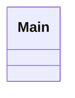
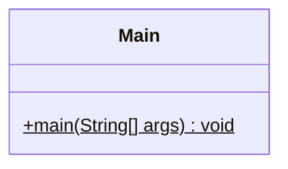

<!-- Generated by scripts/docs/generate_docs.py from src/main/java. Do not edit by hand; change the code or the generator. -->

# Package `root`

The `Main` console entry point that exercises the services.

1 types in 1 source files (`src/main/java/de/dahaem/`). Back to the [class index](README.md).

## Overview

Arrows: `-->` has a field or record component of that type, `..>` takes it in its constructor or mentions it in a method signature, `<|--` extends, `<|..` implements, `*--` nested type. Only relationships inside this package are drawn here; each class below also shows its neighbours in other packages.

| Type | Kind | Role | What it is |
|------|------|------|------------|
| [`Main`](#main) | class | command-line tool | Temporary console runner. |

## Main

*class · command-line tool*

Temporary console runner. This is how we test the engine before there is a web UI.
Later, a web controller replaces this file as the entry point; the services below stay the same.

| Member | Visibility | What it does |
|---|---|---|
| `void main(String[] args)` | public static |  |
