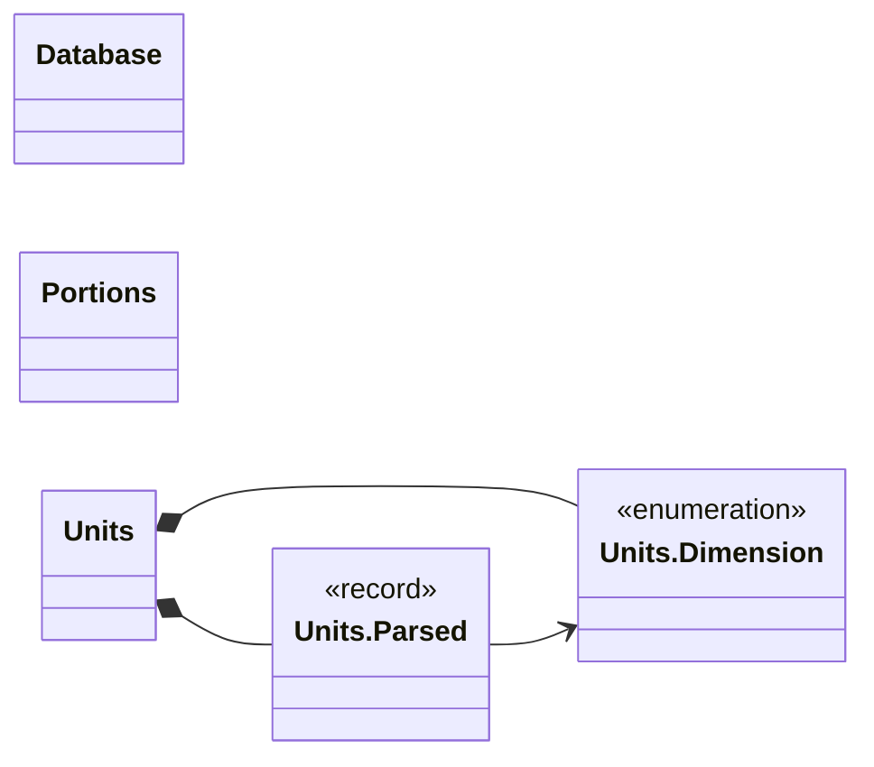
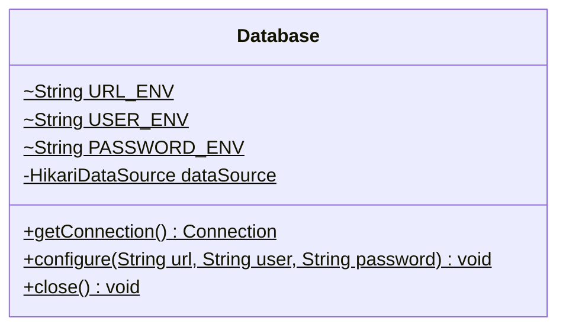
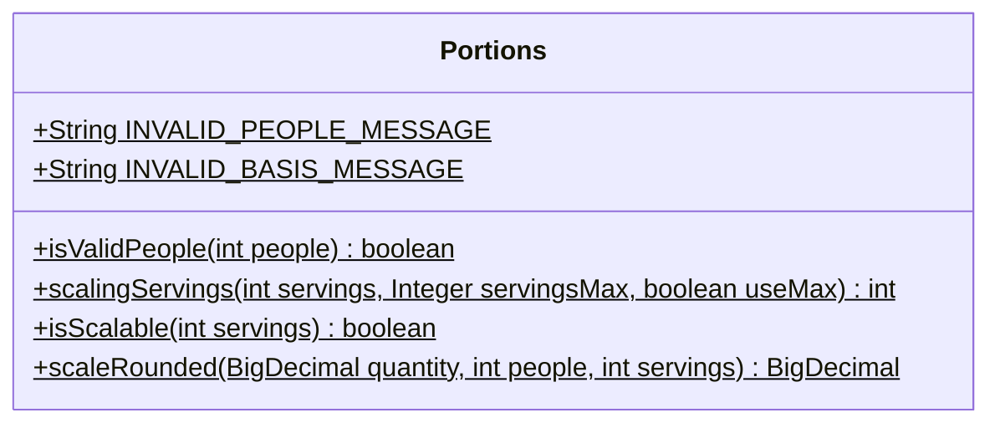
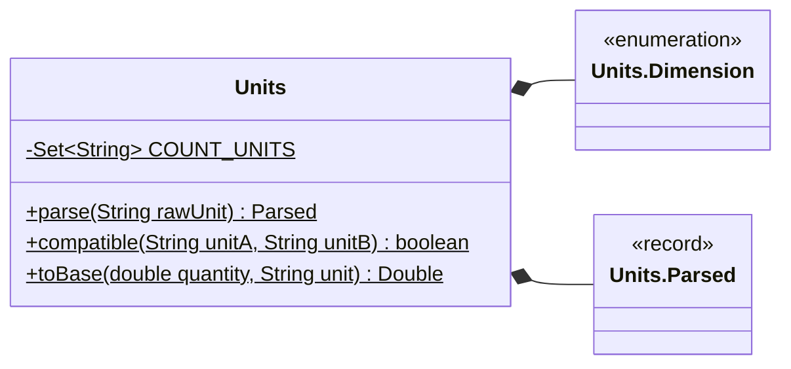
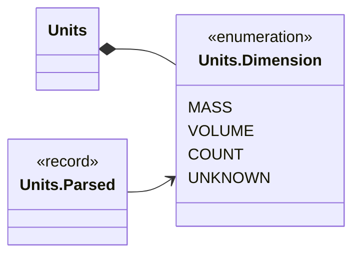
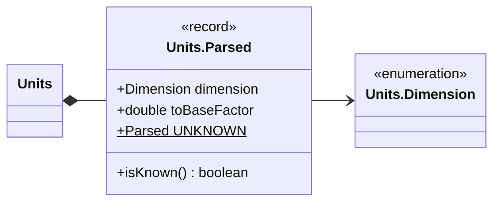

<!-- Generated by scripts/docs/generate_docs.py from src/main/java. Do not edit by hand; change the code or the generator. -->

# Package `shared`

The database connection pool, units and portion arithmetic.

5 types in 3 source files (`src/main/java/de/dahaem/shared`). Back to the [class index](README.md).

## Overview

Arrows: `-->` has a field or record component of that type, `..>` takes it in its constructor or mentions it in a method signature, `<|--` extends, `<|..` implements, `*--` nested type. Only relationships inside this package are drawn here; each class below also shows its neighbours in other packages.

| Type | Kind | Role | What it is |
|------|------|------|------------|
| [`Database`](#database) | class |  | Single place that knows how to open a database connection. |
| [`Portions`](#portions) | class |  | The single definition of portion scaling: a recipe written for servings people is scaled to people by the factor people / servings. |
| [`Units`](#units) | class |  | Parses a recipe/store unit string into a physical dimension plus a factor to its base unit, so quantities can be compared or converted only when it is actually meaningful. |
| [`Units.Dimension`](#unitsdimension) | enum |  |  |
| [`Units.Parsed`](#unitsparsed) | record |  | A parsed unit: its dimension, and the factor that converts a quantity in it to the dimension's base unit. |

## Database

*class*

Single place that knows how to open a database connection.
Every repository asks Database for a connection; nobody else builds the URL.

The database is MariaDB, reached through a HikariCP pool. Settings come from the
environment so no secret lives in the repo:

- DAHAEM_DB_URL e.g. jdbc:mariadb://db:3306/dahaem

- DAHAEM_DB_USER

- DAHAEM_DB_PASSWORD

Callers keep using .getConnection() and close the connection as before; closing
returns it to the pool.

| Field | Type |
|---|---|
| `URL_ENV` | `String` |
| `USER_ENV` | `String` |
| `PASSWORD_ENV` | `String` |
| `dataSource` | `HikariDataSource` |

| Member | Visibility | What it does |
|---|---|---|
| `Connection getConnection()` | public static |  |
| `void configure(String url, String user, String password)` | public static | Points the pool at a different database, closing the previous pool. |
| `void close()` | public static | Closes the pool. |

## Portions

*class*

The single definition of portion scaling: a recipe written for servings people is
scaled to people by the factor people / servings. Used by the recipe detail
endpoint; the shopping list applies the same rule inside its aggregation SQL
(ShoppingListRepository.aggregateIngredients), always from servings (a range's lower
bound, see .scalingServings), with the same guards — people must be at
least 1, and a recipe whose servings is not positive is not scaled. "To taste" ingredients have
no quantity and are never scaled (nor put on a shopping list).

| Field | Type |
|---|---|
| `INVALID_PEOPLE_MESSAGE` | `String` |
| `INVALID_BASIS_MESSAGE` | `String` |

| Member | Visibility | What it does |
|---|---|---|
| `boolean isValidPeople(int people)` | public static | Whether people is a usable head count (at least 1). |
| `int scalingServings(int servings, Integer servingsMax, boolean useMax)` | public static | The servings count to scale a recipe from. |
| `boolean isScalable(int servings)` | public static | Whether a recipe with this many servings can be scaled at all (servings must be positive). |
| `BigDecimal scaleRounded(BigDecimal quantity, int people, int servings)` | public static | quantity * people / servings on exact decimals (the stored DECIMAL(10,3) amount), multiplied before dividing exactly as the shopping list SQL does, and rounded half-up to 2 decimals once, at the end (0.5 Stück at 4 people of 2 → 1.00; 1 Stü |

## Units

*class*

Parses a recipe/store unit string into a physical dimension plus a factor to its base unit, so
quantities can be compared or converted only when it is actually meaningful. Two units are
comparable only within the same dimension (mass with mass, volume with volume, count with
count) — this deliberately never converts across dimensions (e.g. no density-based g&harr;ml
guessing), since that would fabricate a number nobody can trust.

| Field | Type |
|---|---|
| `COUNT_UNITS` | `Set<String>` |

| Member | Visibility | What it does |
|---|---|---|
| `Parsed parse(String rawUnit)` | public static | Parses a unit string, case-insensitively and tolerant of German umlauts and trailing junk. |
| `boolean compatible(String unitA, String unitB)` | public static | True only when both units are known and share the same dimension; never true across dimensions. |
| `Double toBase(double quantity, String unit)` | public static | The quantity converted to its dimension's base unit, or null when the unit isn't recognized. |

## Units.Dimension

*enum*

**Values:** `MASS`, `VOLUME`, `COUNT`, `UNKNOWN`

**Referenced by:** `Units`

## Units.Parsed

*record*

A parsed unit: its dimension, and the factor that converts a quantity in it to the dimension's base unit.

| Component | Type |
|---|---|
| `dimension` | `Dimension` |
| `toBaseFactor` | `double` |
| `UNKNOWN` | `Parsed` |

| Member | Visibility | What it does |
|---|---|---|
| `boolean isKnown()` | public |  |

**Referenced by:** `Units`
