<!-- Generated by scripts/docs/generate_docs.py from src/main/java. Do not edit by hand; change the code or the generator. -->

# Package `shopping`

Shopping-list generation from recipes and the store options per line.

12 types in 12 source files (`src/main/java/de/dahaem/shopping`). Back to the [class index](README.md).

## Overview

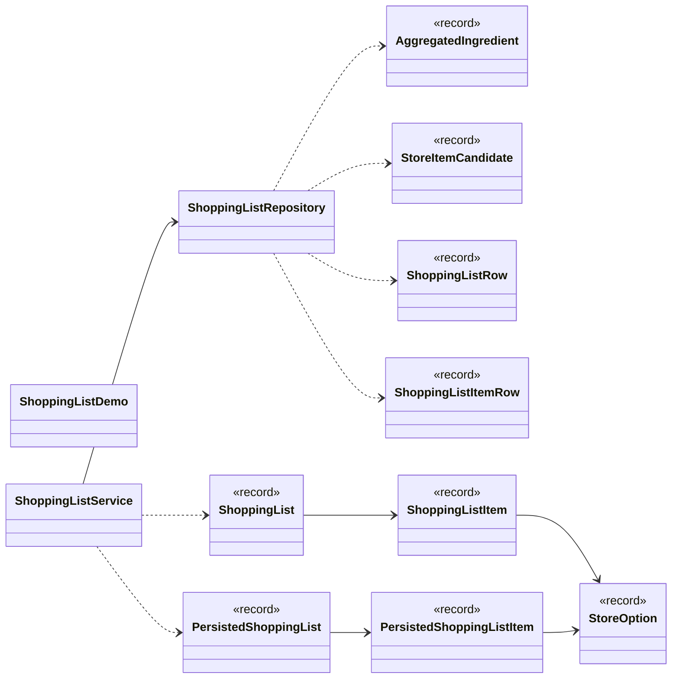

Arrows: `-->` has a field or record component of that type, `..>` takes it in its constructor or mentions it in a method signature, `<|--` extends, `<|..` implements, `*--` nested type. Only relationships inside this package are drawn here; each class below also shows its neighbours in other packages.

| Type | Kind | Role | What it is |
|------|------|------|------------|
| [`AggregatedIngredient`](#aggregatedingredient) | record |  | One inventory item's combined need across a set of recipes, before any store matching. |
| [`PersistedShoppingList`](#persistedshoppinglist) | record |  | A previously generated shopping_list row, reloaded together with its persisted items. |
| [`PersistedShoppingListItem`](#persistedshoppinglistitem) | record |  | One persisted shopping_list_item line: the inventory item it is for (null only for a purely manual line with no catalog match), its German/English name, how much is still needed, every current store option for it (the same options a freshly |
| [`ShoppingList`](#shoppinglist) | record |  | A shopping list built from a set of recipes: one line per distinct (item, unit) need. |
| [`ShoppingListDemo`](#shoppinglistdemo) | class | command-line tool | Temporary console runner for the shopping-list slice, same idea as de.dahaem.Main: proves the aggregation + store-matching logic works before there is a UI for it. |
| [`ShoppingListItem`](#shoppinglistitem) | record |  | One line of a shopping list: an inventory item, how much of it is needed in total across the recipes it came from, and every store's current option for it (ordered cheapest-till-price first, but not pre-chosen — DAHÄM surfaces the options a |
| [`ShoppingListItemRow`](#shoppinglistitemrow) | record |  | Raw shopping_list_item row, joined to its inventory_item's names and unit. |
| [`ShoppingListRepository`](#shoppinglistrepository) | class |  | All SQL for building a shopping list lives here: summing recipe_ingredient across recipes, finding store_item candidates (with brand/store and any current store_discount) for one inventory item, and persisting a generated list to shopping_l |
| [`ShoppingListRow`](#shoppinglistrow) | record |  | Raw shopping_list row, before its items are attached. |
| [`ShoppingListService`](#shoppinglistservice) | class |  | Turns a set of recipes into a shopping list: sums what they need, then for each item collects every store's current option for it. |
| [`StoreItemCandidate`](#storeitemcandidate) | record |  | One store_item that can satisfy an inventory item, with its brand/store and (if one is running today) its current store_discount. |
| [`StoreOption`](#storeoption) | record |  | The chosen way to buy one shopping-list line item at one store: what it costs today, whether that's a sale price, and the price you'd actually see at the till (sale/deal price where one applies, plus deposit). |

## AggregatedIngredient

*record*

One inventory item's combined need across a set of recipes, before any store matching.
Quantities are only summed within the same unit, so the same item can appear as more
than one AggregatedIngredient if recipes ask for it in different units.

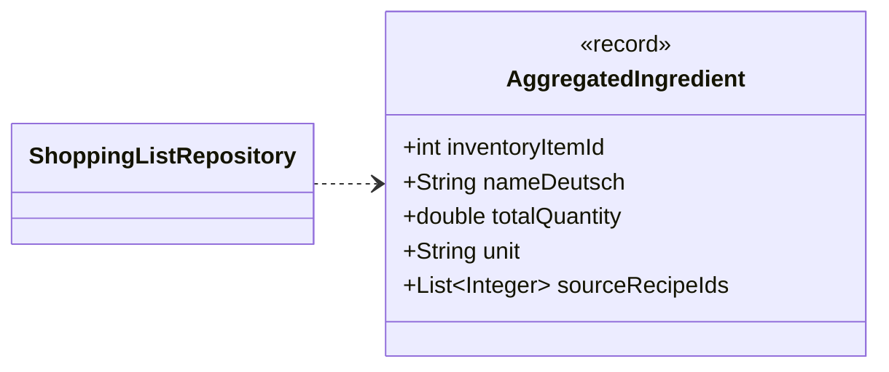

| Component | Type |
|---|---|
| `inventoryItemId` | `int` |
| `nameDeutsch` | `String` |
| `totalQuantity` | `double` |
| `unit` | `String` |
| `sourceRecipeIds` | `List<Integer>` |

**Referenced by:** `ShoppingListRepository`

## PersistedShoppingList

*record*

A previously generated shopping_list row, reloaded together with its persisted items.

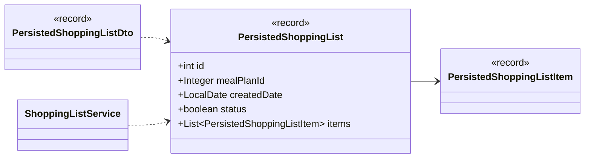

| Component | Type |
|---|---|
| `id` | `int` |
| `mealPlanId` | `Integer` |
| `createdDate` | `LocalDate` |
| `status` | `boolean` |
| `items` | `List<PersistedShoppingListItem>` |

**Referenced by:** `PersistedShoppingListDto`, `ShoppingListService`

## PersistedShoppingListItem

*record*

One persisted shopping_list_item line: the inventory item it is for (null only for a purely
manual line with no catalog match), its German/English name, how much is still needed, every
current store option for it (the same options a freshly built line would show, cheapest
till-price first, none pre-chosen), and the store_item the user has selected so far, if any.

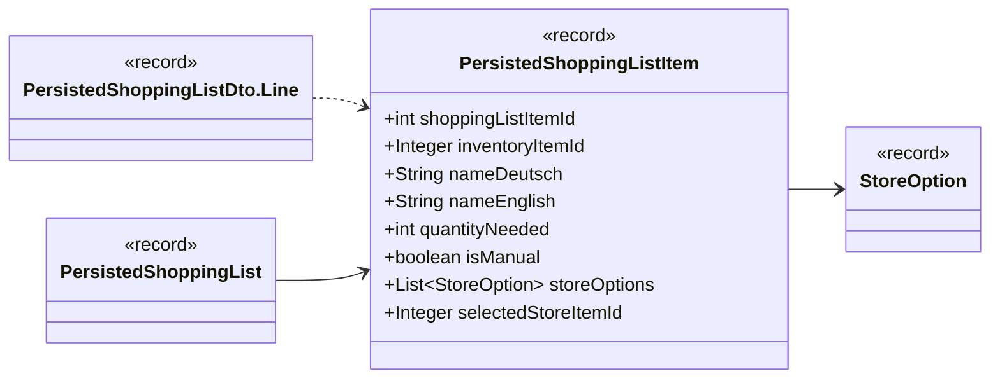

| Component | Type |
|---|---|
| `shoppingListItemId` | `int` |
| `inventoryItemId` | `Integer` |
| `nameDeutsch` | `String` |
| `nameEnglish` | `String` |
| `quantityNeeded` | `int` |
| `isManual` | `boolean` |
| `storeOptions` | `List<StoreOption>` |
| `selectedStoreItemId` | `Integer` |

**Referenced by:** `PersistedShoppingList`, `PersistedShoppingListDto.Line`

## ShoppingList

*record*

A shopping list built from a set of recipes: one line per distinct (item, unit) need.

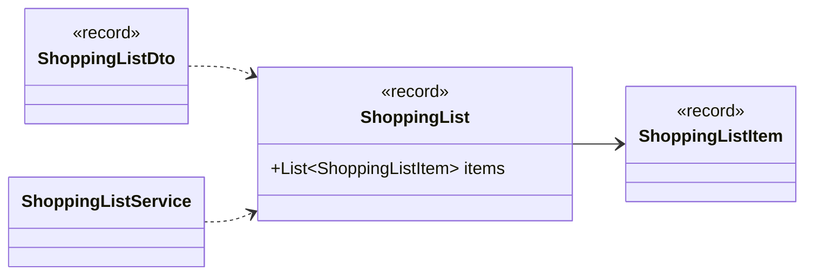

| Component | Type |
|---|---|
| `items` | `List<ShoppingListItem>` |

**Referenced by:** `ShoppingListDto`, `ShoppingListService`

## ShoppingListDemo

*class · command-line tool*

Temporary console runner for the shopping-list slice, same idea as de.dahaem.Main:
proves the aggregation + store-matching logic works before there is a UI for it.

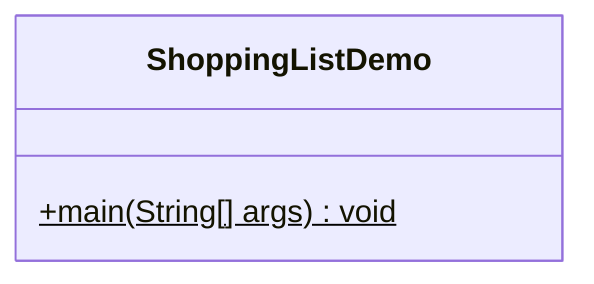

| Member | Visibility | What it does |
|---|---|---|
| `void main(String[] args)` | public static |  |

## ShoppingListItem

*record*

One line of a shopping list: an inventory item, how much of it is needed in total across
the recipes it came from, and every store's current option for it (ordered cheapest-till-price
first, but not pre-chosen — DAHÄM surfaces the options and the user decides). selectedStoreItemId
is the store_item the user has picked for a persisted line, or null while it is still undecided.

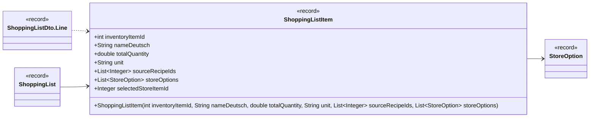

| Component | Type |
|---|---|
| `inventoryItemId` | `int` |
| `nameDeutsch` | `String` |
| `totalQuantity` | `double` |
| `unit` | `String` |
| `sourceRecipeIds` | `List<Integer>` |
| `storeOptions` | `List<StoreOption>` |
| `selectedStoreItemId` | `Integer` |

| Member | Visibility | What it does |
|---|---|---|
| `ShoppingListItem(int inventoryItemId, String nameDeutsch, double totalQuantity, String unit, List<Integer> sourceRecipeIds, List<StoreOption> storeOptions)` | public | A freshly built line, before any store item has been selected. |

**Referenced by:** `ShoppingList`, `ShoppingListDto.Line`

## ShoppingListItemRow

*record*

Raw shopping_list_item row, joined to its inventory_item's names and unit. inventoryItemId,
nameDeutsch, nameEnglish and unit are all null for a purely manual line with no catalog match.
unit is the inventory_item's own tracking unit (inventory_item_unit) — quantityNeeded was
computed against that unit at generation time, so it doubles as the line's needed unit for
unit-aware pricing.

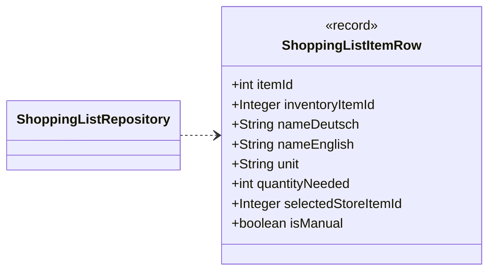

| Component | Type |
|---|---|
| `itemId` | `int` |
| `inventoryItemId` | `Integer` |
| `nameDeutsch` | `String` |
| `nameEnglish` | `String` |
| `unit` | `String` |
| `quantityNeeded` | `int` |
| `selectedStoreItemId` | `Integer` |
| `isManual` | `boolean` |

**Referenced by:** `ShoppingListRepository`

## ShoppingListRepository

*class*

All SQL for building a shopping list lives here: summing recipe_ingredient across recipes,
finding store_item candidates (with brand/store and any current store_discount) for one
inventory item, and persisting a generated list to shopping_list/shopping_list_item. The
rest of the shopping slice never writes SQL; it calls these methods.

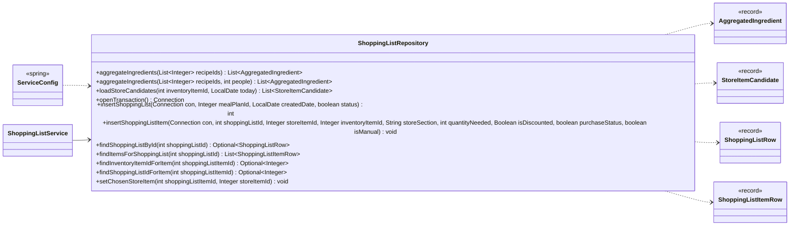

| Member | Visibility | What it does |
|---|---|---|
| `List<AggregatedIngredient> aggregateIngredients(List<Integer> recipeIds)` | public | Sums recipe_ingredient_quantity_needed per (inventory item, unit) across the given recipes, and collects which recipes contributed. |
| `List<AggregatedIngredient> aggregateIngredients(List<Integer> recipeIds, int people)` | public | Same as .aggregateIngredients(List), but scales each recipe's ingredient quantities by people / recipe_servings before summing across recipes — so a 2-serving recipe's ingredients double at people=4. |
| `List<StoreItemCandidate> loadStoreCandidates(int inventoryItemId, LocalDate today)` | public | Every store_item that can supply the given inventory item, with its brand and store name, and its store_discount for today if one is currently running. |
| `Connection openTransaction()` | public | Opens a connection with auto-commit off, for a caller that needs to combine several writes atomically. |
| `int insertShoppingList(Connection con, Integer mealPlanId, LocalDate createdDate, boolean status)` | public | Inserts a new shopping_list row, on the caller's transaction. |
| `void insertShoppingListItem(Connection con, int shoppingListId, Integer storeItemId, Integer inventoryItemId, String storeSection, int quantityNeeded, Boolean isDiscounted, boolean purchaseStatus, boolean isManual)` | public | Inserts one shopping_list_item row, on the caller's transaction. |
| `Optional<ShoppingListRow> findShoppingListById(int shoppingListId)` | public | The shopping_list row for a persisted list, or empty if no such list exists. |
| `List<ShoppingListItemRow> findItemsForShoppingList(int shoppingListId)` | public | Every shopping_list_item on a persisted list, joined to its inventory_item's names (both null for a manual line with no catalog match), ordered by insertion. |
| `Optional<Integer> findInventoryItemIdForItem(int shoppingListItemId)` | public | The inventory_item_id a shopping_list_item is for, or empty if the item doesn't exist or has no catalog link (a manual line). |
| `Optional<Integer> findShoppingListIdForItem(int shoppingListItemId)` | public | The shopping_list_id a shopping_list_item belongs to, or empty if no such item exists. |
| `void setChosenStoreItem(int shoppingListItemId, Integer storeItemId)` | public | Sets (or, with null, clears) the store_item the user chose for this line. |

**Referenced by:** `ServiceConfig`, `ShoppingListService`

## ShoppingListRow

*record*

Raw shopping_list row, before its items are attached.

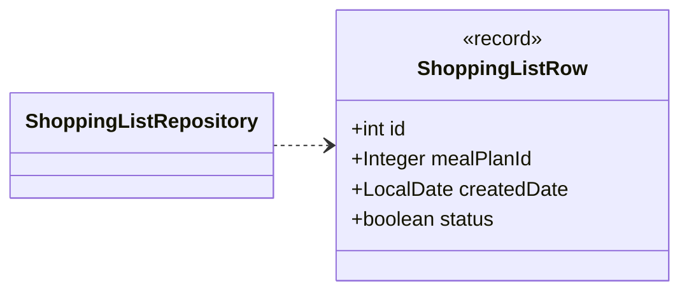

| Component | Type |
|---|---|
| `id` | `int` |
| `mealPlanId` | `Integer` |
| `createdDate` | `LocalDate` |
| `status` | `boolean` |

**Referenced by:** `ShoppingListRepository`

## ShoppingListService

*class*

Turns a set of recipes into a shopping list: sums what they need, then for each item collects
every store's current option for it. It surfaces those options; it never picks one for the user.
No SQL here, no UI here; it only asks the repository for data.

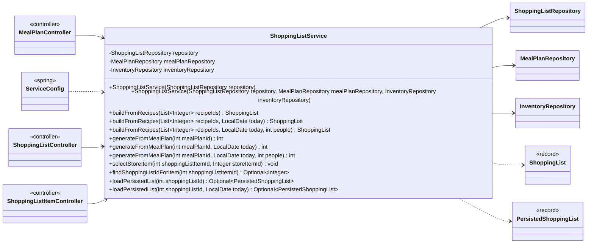

| Field | Type |
|---|---|
| `repository` | `ShoppingListRepository` |
| `mealPlanRepository` | `MealPlanRepository` |
| `inventoryRepository` | `InventoryRepository` |

| Member | Visibility | What it does |
|---|---|---|
| `ShoppingListService(ShoppingListRepository repository)` | public |  |
| `ShoppingListService(ShoppingListRepository repository, MealPlanRepository mealPlanRepository, InventoryRepository inventoryRepository)` | public |  |
| `ShoppingList buildFromRecipes(List<Integer> recipeIds)` | public |  |
| `ShoppingList buildFromRecipes(List<Integer> recipeIds, LocalDate today)` | public | Overload that takes "today" explicitly, so callers (and tests) control which discounts count as current. |
| `ShoppingList buildFromRecipes(List<Integer> recipeIds, LocalDate today, int people)` | public | Scales each recipe's ingredient quantities by people / recipe_servings before summing across recipes (see ShoppingListRepository.aggregateIngredients(List, int)). |
| `int generateFromMealPlan(int mealPlanId)` | public |  |
| `int generateFromMealPlan(int mealPlanId, LocalDate today)` | public | Builds a shopping list from a meal plan's recipes, subtracts what is already in inventory, and persists it: a shopping_list row linked to the plan, plus one shopping_list_item per item still missing (an item already fully in stock is droppe |
| `int generateFromMealPlan(int mealPlanId, LocalDate today, int people)` | public | Scales each recipe's ingredient quantities by people / recipe_servings before summing (see .buildFromRecipes(List, LocalDate, int)), otherwise identical to .generateFromMealPlan(int, LocalDate). |
| `void selectStoreItem(int shoppingListItemId, Integer storeItemId)` | public | Records the store_item the user picked for a persisted shopping_list_item line, or clears the choice when storeItemId is null. |
| `Optional<Integer> findShoppingListIdForItem(int shoppingListItemId)` | public | The shopping_list a persisted shopping_list_item belongs to, or empty if the item doesn't exist. |
| `Optional<PersistedShoppingList> loadPersistedList(int shoppingListId)` | public |  |
| `Optional<PersistedShoppingList> loadPersistedList(int shoppingListId, LocalDate today)` | public | Reloads a persisted shopping_list by id with its items, or empty if no such list exists. |

**Referenced by:** `MealPlanController`, `ServiceConfig`, `ShoppingListController`, `ShoppingListItemController`

## StoreItemCandidate

*record*

One store_item that can satisfy an inventory item, with its brand/store and (if one is
running today) its current store_discount. productLastSeen/productAvailable come from the
linked store_product and are null when the store_item has no such link (e.g. a flyer-only item).

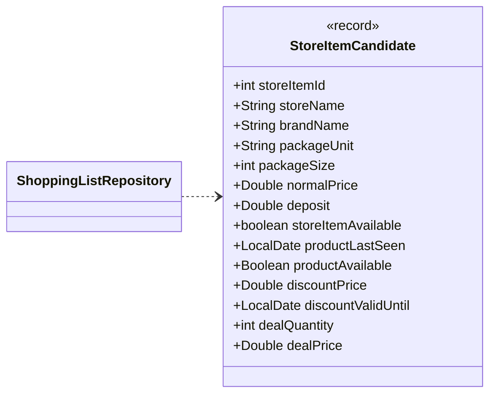

| Component | Type |
|---|---|
| `storeItemId` | `int` |
| `storeName` | `String` |
| `brandName` | `String` |
| `packageUnit` | `String` |
| `packageSize` | `int` |
| `normalPrice` | `Double` |
| `deposit` | `Double` |
| `storeItemAvailable` | `boolean` |
| `productLastSeen` | `LocalDate` |
| `productAvailable` | `Boolean` |
| `discountPrice` | `Double` |
| `discountValidUntil` | `LocalDate` |
| `dealQuantity` | `int` |
| `dealPrice` | `Double` |

**Referenced by:** `ShoppingListRepository`

## StoreOption

*record*

The chosen way to buy one shopping-list line item at one store: what it costs today,
whether that's a sale price, and the price you'd actually see at the till (sale/deal
price where one applies, plus deposit).

unitCompatible says whether this pack's unit is even the same physical dimension (mass,
volume or count) as what the line needs — see de.dahaem.shared.Units. Only when it is
true do packsNeeded/packsTotalPrice carry a real pack count and its total price; when the units
don't reconcile (or either is unrecognized), both stay null rather than fabricate a number from
a price that isn't actually for the needed quantity.

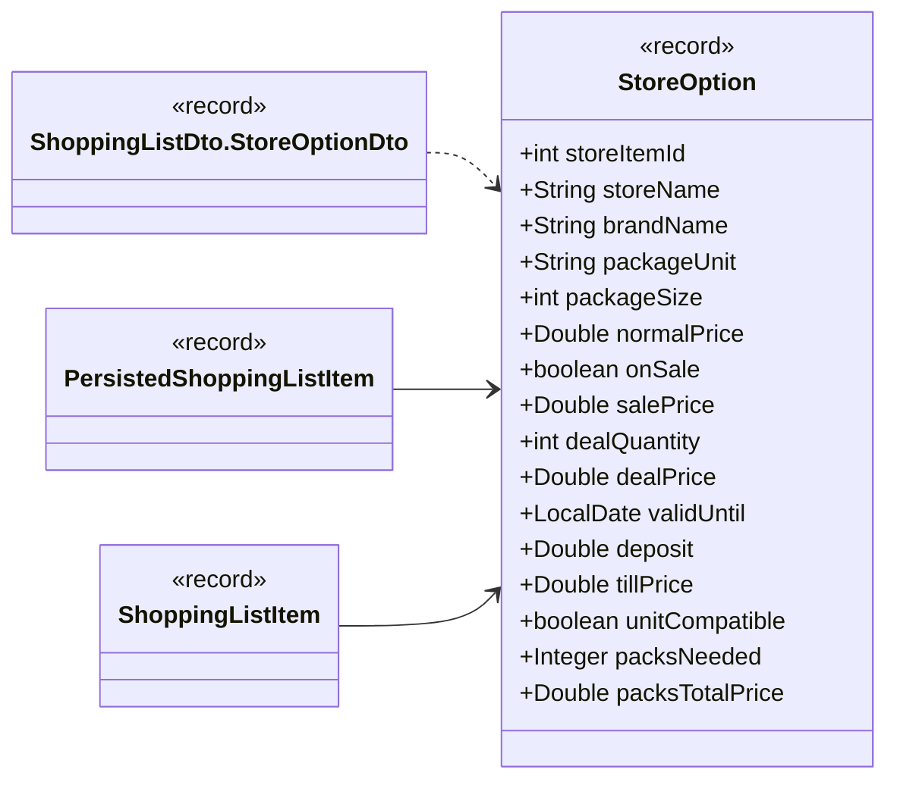

| Component | Type |
|---|---|
| `storeItemId` | `int` |
| `storeName` | `String` |
| `brandName` | `String` |
| `packageUnit` | `String` |
| `packageSize` | `int` |
| `normalPrice` | `Double` |
| `onSale` | `boolean` |
| `salePrice` | `Double` |
| `dealQuantity` | `int` |
| `dealPrice` | `Double` |
| `validUntil` | `LocalDate` |
| `deposit` | `Double` |
| `tillPrice` | `Double` |
| `unitCompatible` | `boolean` |
| `packsNeeded` | `Integer` |
| `packsTotalPrice` | `Double` |

**Referenced by:** `PersistedShoppingListItem`, `ShoppingListDto.StoreOptionDto`, `ShoppingListItem`
