<!-- Generated by scripts/docs/generate_docs.py from src/main/java. Do not edit by hand; change the code or the generator. -->

# Package `shopping`

Shopping-list generation from recipes and the store options per line.

15 types in 15 source files (`src/main/java/de/dahaem/shopping`). Back to the [class index](README.md).

## Overview

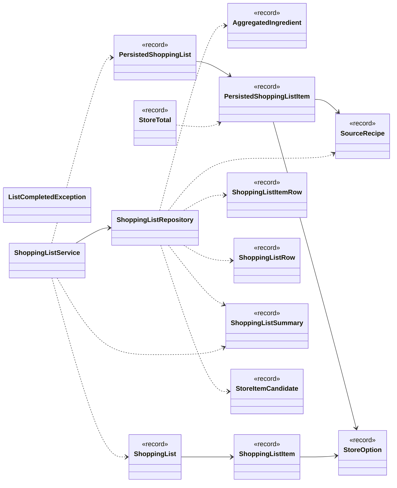

Arrows: `-->` has a field or record component of that type, `..>` takes it in its constructor or mentions it in a method signature, `<|--` extends, `<|..` implements, `*--` nested type. Only relationships inside this package are drawn here; each class below also shows its neighbours in other packages.

| Type | Kind | Role | What it is |
|------|------|------|------------|
| [`AggregatedIngredient`](#aggregatedingredient) | record |  | One inventory item's combined need across a set of recipes, before any store matching. |
| [`ListCompletedException`](#listcompletedexception) | class |  | A completed shopping list cannot be changed (reopen it first). |
| [`PersistedShoppingList`](#persistedshoppinglist) | record |  | A previously generated shopping_list row, reloaded together with its persisted items. |
| [`PersistedShoppingListItem`](#persistedshoppinglistitem) | record |  | One persisted shopping_list_item line: the inventory item it is for (null only for a purely manual line with no catalog match), its German/English name, how much is still needed and in which unit, the recipes that need it, every current sto |
| [`ShoppingList`](#shoppinglist) | record |  | A shopping list built from a set of recipes: one line per distinct (item, unit) need. |
| [`ShoppingListItem`](#shoppinglistitem) | record |  | One line of a shopping list: an inventory item, how much of it is needed in total across the recipes it came from, and every store's current option for it (ordered cheapest-till-price first, but not pre-chosen — DAHÄM surfaces the options a |
| [`ShoppingListItemRow`](#shoppinglistitemrow) | record |  | Raw shopping_list_item row, joined to its inventory_item. |
| [`ShoppingListRepository`](#shoppinglistrepository) | class |  | All SQL for building a shopping list lives here: summing recipe_ingredient across recipes, finding store_item candidates (with brand/store and any current store_discount) for one inventory item, and persisting a generated list to shopping_l |
| [`ShoppingListRow`](#shoppinglistrow) | record |  | Raw shopping_list row, before its items are attached. |
| [`ShoppingListService`](#shoppinglistservice) | class |  | Turns a set of recipes into a shopping list: sums what they need, then for each item collects every store's current option for it. |
| [`ShoppingListSummary`](#shoppinglistsummary) | record |  | One saved list in short: when it was made, for which shopping day, from which meal day, how many lines and how many of them are ticked as bought ("3 von 8 gekauft"). |
| [`SourceRecipe`](#sourcerecipe) | record |  | A recipe that needs a shopping list line ("für Kartoffelsuppe, Lachs"). |
| [`StoreItemCandidate`](#storeitemcandidate) | record |  | One store_item that can satisfy an inventory item, with its brand/store and (if one is running today) its current store_discount. |
| [`StoreOption`](#storeoption) | record |  | The chosen way to buy one shopping-list line item at one store: what it costs today, whether that's a sale price, and the price you'd actually see at the till (sale/deal price where one applies, plus deposit). |
| [`StoreTotal`](#storetotal) | record |  | What the lines still to buy would cost at one store, for the user to compare. |

## AggregatedIngredient

*record*

One inventory item's combined need across a set of recipes, before any store matching.
Quantities are only summed within the same unit, so the same item can appear as more
than one AggregatedIngredient if recipes ask for it in different units.

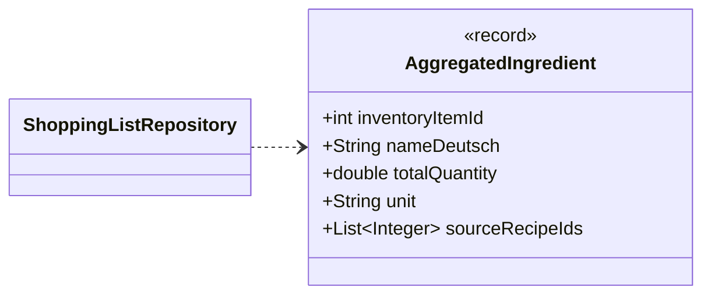

| Component | Type |
|---|---|
| `inventoryItemId` | `int` |
| `nameDeutsch` | `String` |
| `totalQuantity` | `double` |
| `unit` | `String` |
| `sourceRecipeIds` | `List<Integer>` |

**Referenced by:** `ShoppingListRepository`

## ListCompletedException

*class · extends RuntimeException*

A completed shopping list cannot be changed (reopen it first).

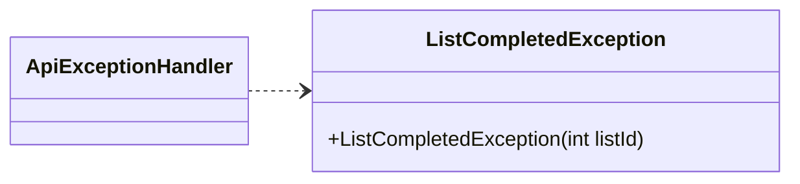

| Member | Visibility | What it does |
|---|---|---|
| `ListCompletedException(int listId)` | public |  |

**Referenced by:** `ApiExceptionHandler`

## PersistedShoppingList

*record*

A previously generated shopping_list row, reloaded together with its persisted items. shoppingDate is the day of the
trip the list was made for and fromDate the first meal day it counts (both null on a list made before they existed).

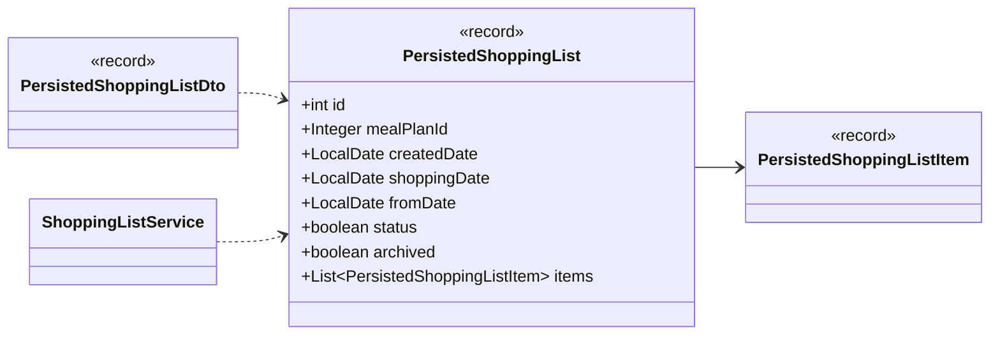

| Component | Type |
|---|---|
| `id` | `int` |
| `mealPlanId` | `Integer` |
| `createdDate` | `LocalDate` |
| `shoppingDate` | `LocalDate` |
| `fromDate` | `LocalDate` |
| `status` | `boolean` |
| `archived` | `boolean` |
| `items` | `List<PersistedShoppingListItem>` |

**Referenced by:** `PersistedShoppingListDto`, `ShoppingListService`

## PersistedShoppingListItem

*record*

One persisted shopping_list_item line: the inventory item it is for (null only for a purely manual line with no
catalog match), its German/English name, how much is still needed and in which unit, the recipes that need it, every
current store option for it (the same options a freshly built line would show, cheapest till-price first, none
pre-chosen), and the store_item the user has selected so far, if any.

available is false when no store currently sells the item: the line is kept so the list is never silently
shorter than the plan. needsReview is true when stock exists but its unit differs from the line's, so nothing was
subtracted and a person checks the line; purchased is the tick "bought" on the shopping trip; stockQuantity / stockUnit show what the household has.

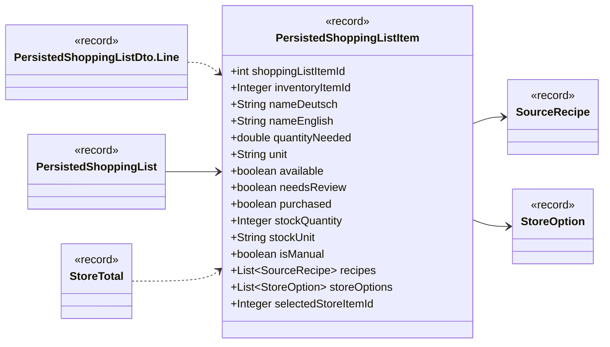

| Component | Type |
|---|---|
| `shoppingListItemId` | `int` |
| `inventoryItemId` | `Integer` |
| `nameDeutsch` | `String` |
| `nameEnglish` | `String` |
| `quantityNeeded` | `double` |
| `unit` | `String` |
| `available` | `boolean` |
| `needsReview` | `boolean` |
| `purchased` | `boolean` |
| `stockQuantity` | `Integer` |
| `stockUnit` | `String` |
| `isManual` | `boolean` |
| `recipes` | `List<SourceRecipe>` |
| `storeOptions` | `List<StoreOption>` |
| `selectedStoreItemId` | `Integer` |

**Referenced by:** `PersistedShoppingList`, `PersistedShoppingListDto.Line`, `StoreTotal`

## ShoppingList

*record*

A shopping list built from a set of recipes: one line per distinct (item, unit) need.

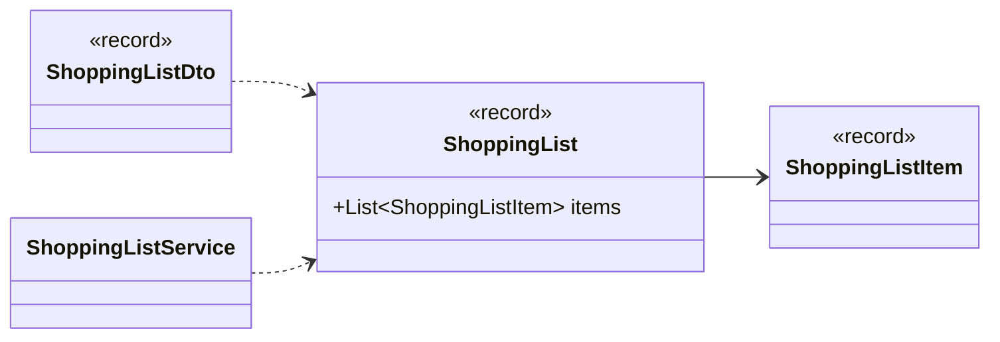

| Component | Type |
|---|---|
| `items` | `List<ShoppingListItem>` |

**Referenced by:** `ShoppingListDto`, `ShoppingListService`

## ShoppingListItem

*record*

One line of a shopping list: an inventory item, how much of it is needed in total across
the recipes it came from, and every store's current option for it (ordered cheapest-till-price
first, but not pre-chosen — DAHÄM surfaces the options and the user decides). selectedStoreItemId
is the store_item the user has picked for a persisted line, or null while it is still undecided.

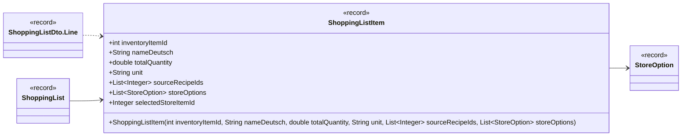

| Component | Type |
|---|---|
| `inventoryItemId` | `int` |
| `nameDeutsch` | `String` |
| `totalQuantity` | `double` |
| `unit` | `String` |
| `sourceRecipeIds` | `List<Integer>` |
| `storeOptions` | `List<StoreOption>` |
| `selectedStoreItemId` | `Integer` |

| Member | Visibility | What it does |
|---|---|---|
| `ShoppingListItem(int inventoryItemId, String nameDeutsch, double totalQuantity, String unit, List<Integer> sourceRecipeIds, List<StoreOption> storeOptions)` | public | A freshly built line, before any store item has been selected. |

**Referenced by:** `ShoppingList`, `ShoppingListDto.Line`

## ShoppingListItemRow

*record*

Raw shopping_list_item row, joined to its inventory_item. inventoryItemId, nameDeutsch, nameEnglish, stockQuantity
and stockUnit are null for a purely manual line with no catalog match. unit is the unit of the amount: the
line's own unit, or for a line made before migration 0017 the inventory_item's tracking unit. stockQuantity /
stockUnit is what the household has now, in the item's own unit (shown when a line needs review).

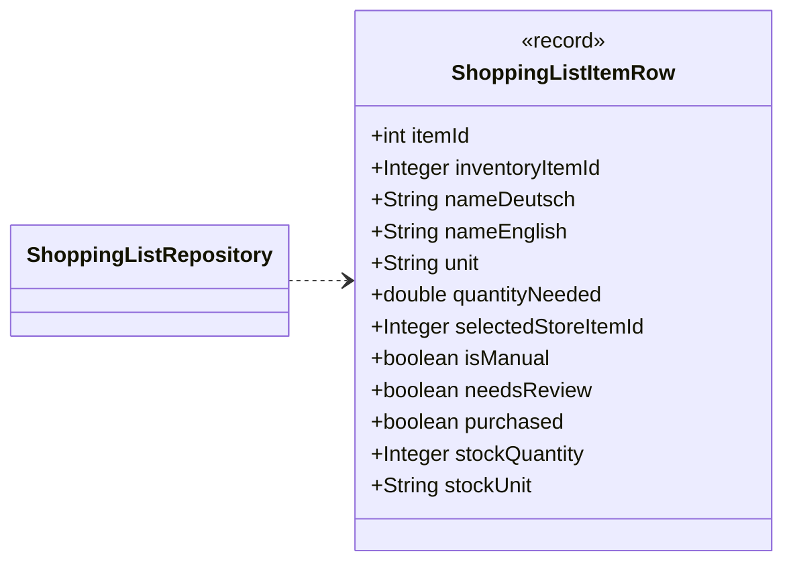

| Component | Type |
|---|---|
| `itemId` | `int` |
| `inventoryItemId` | `Integer` |
| `nameDeutsch` | `String` |
| `nameEnglish` | `String` |
| `unit` | `String` |
| `quantityNeeded` | `double` |
| `selectedStoreItemId` | `Integer` |
| `isManual` | `boolean` |
| `needsReview` | `boolean` |
| `purchased` | `boolean` |
| `stockQuantity` | `Integer` |
| `stockUnit` | `String` |

**Referenced by:** `ShoppingListRepository`

## ShoppingListRepository

*class*

All SQL for building a shopping list lives here: summing recipe_ingredient across recipes,
finding store_item candidates (with brand/store and any current store_discount) for one
inventory item, and persisting a generated list to shopping_list/shopping_list_item. The
rest of the shopping slice never writes SQL; it calls these methods.

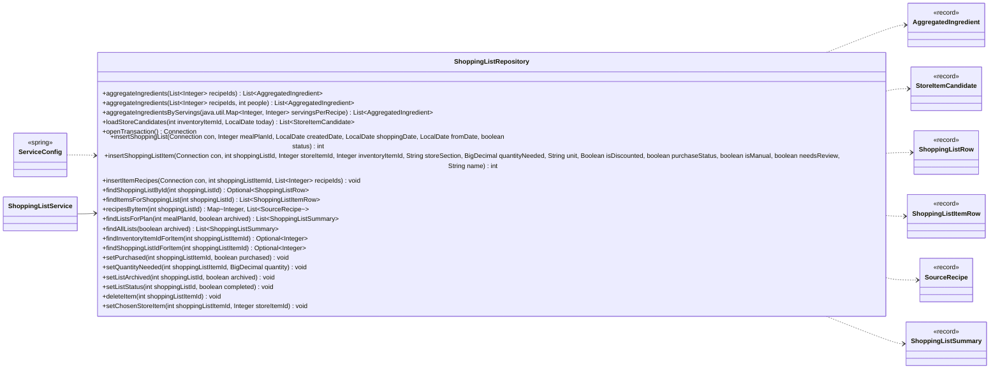

| Member | Visibility | What it does |
|---|---|---|
| `List<AggregatedIngredient> aggregateIngredients(List<Integer> recipeIds)` | public | Sums recipe_ingredient_quantity_needed per (inventory item, unit) across the given recipes, and collects which recipes contributed. |
| `List<AggregatedIngredient> aggregateIngredients(List<Integer> recipeIds, int people)` | public | Same as .aggregateIngredients(List), but scales each recipe's ingredient quantities by people / recipe_servings before summing across recipes — so a 2-serving recipe's ingredients double at people=4. |
| `List<AggregatedIngredient> aggregateIngredientsByServings(java.util.Map<Integer, Integer> servingsPerRecipe)` | public | Same as .aggregateIngredients(List, int), but every recipe has its own head count: the map gives, per recipe id, the total number of servings planned across all its meals (a recipe planned twice, for 2 and for 4, is 6). |
| `List<StoreItemCandidate> loadStoreCandidates(int inventoryItemId, LocalDate today)` | public | Every store_item that can supply the given inventory item, with its brand and store name, and its store_discount for today if one is currently running. |
| `Connection openTransaction()` | public | Opens a connection with auto-commit off, for a caller that needs to combine several writes atomically. |
| `int insertShoppingList(Connection con, Integer mealPlanId, LocalDate createdDate, LocalDate shoppingDate, LocalDate fromDate, boolean status)` | public | Inserts a new shopping_list row, on the caller's transaction. |
| `int insertShoppingListItem(Connection con, int shoppingListId, Integer storeItemId, Integer inventoryItemId, String storeSection, BigDecimal quantityNeeded, String unit, Boolean isDiscounted, boolean purchaseStatus, boolean isManual, boolean needsReview, String name)` | public | Inserts one shopping_list_item row, on the caller's transaction, and returns its id. |
| `void insertItemRecipes(Connection con, int shoppingListItemId, List<Integer> recipeIds)` | public | Records which recipes need a line, on the caller's transaction. |
| `Optional<ShoppingListRow> findShoppingListById(int shoppingListId)` | public | The shopping_list row for a persisted list, or empty if no such list exists. |
| `List<ShoppingListItemRow> findItemsForShoppingList(int shoppingListId)` | public | Every shopping_list_item on a persisted list, joined to its inventory_item's names (a free-text line has no catalogue item: its own text is given as both names), ordered by insertion. |
| `Map<Integer, List<SourceRecipe>> recipesByItem(int shoppingListId)` | public | The recipes that need each line of a list (line id -> recipes, by name). |
| `List<ShoppingListSummary> findListsForPlan(int mealPlanId, boolean archived)` | public | The saved lists of a meal plan, newest first, each with its number of lines; only archived ones, or only the others. |
| `List<ShoppingListSummary> findAllLists(boolean archived)` | public | Every saved list, newest first (lists that belong to no plan included); only archived ones, or only the others. |
| `Optional<Integer> findInventoryItemIdForItem(int shoppingListItemId)` | public | The inventory_item_id a shopping_list_item is for, or empty if the item doesn't exist or has no catalog link (a manual line). |
| `Optional<Integer> findShoppingListIdForItem(int shoppingListItemId)` | public | The shopping_list_id a shopping_list_item belongs to, or empty if no such item exists. |
| `void setPurchased(int shoppingListItemId, boolean purchased)` | public | Ticks a line as bought (or unticks it). |
| `void setQuantityNeeded(int shoppingListItemId, BigDecimal quantity)` | public | Changes the amount of a line (its unit stays). |
| `void setListArchived(int shoppingListId, boolean archived)` | public | Archives a list (hidden from the overview, not deleted) or brings it back. |
| `void setListStatus(int shoppingListId, boolean completed)` | public | Opens or completes a list. |
| `void deleteItem(int shoppingListItemId)` | public | Removes one line of a list together with the recipe links that belong to it. |
| `void setChosenStoreItem(int shoppingListItemId, Integer storeItemId)` | public | Sets (or, with null, clears) the store_item the user chose for this line. |

**Referenced by:** `ServiceConfig`, `ShoppingListService`

## ShoppingListRow

*record*

Raw shopping_list row, before its items are attached. shoppingDate (the day of the trip, offers are judged on it) and
fromDate (the first meal day the list counts) are null on a list made before migration 0017.

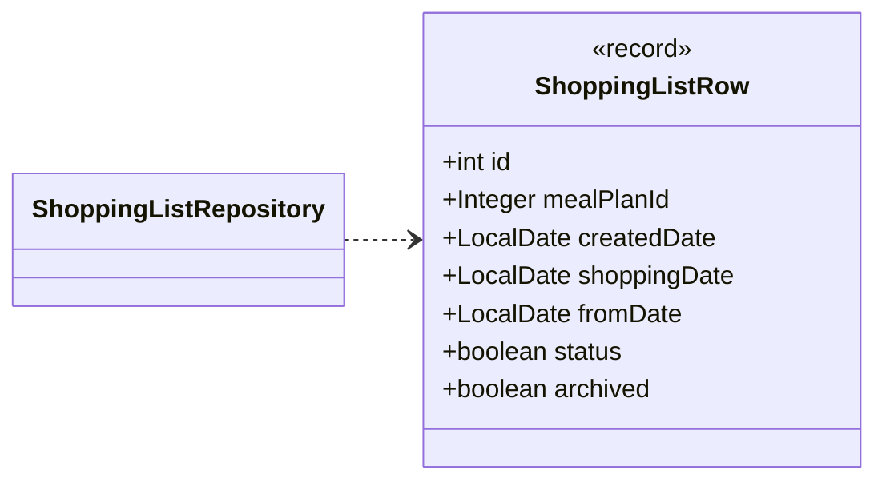

| Component | Type |
|---|---|
| `id` | `int` |
| `mealPlanId` | `Integer` |
| `createdDate` | `LocalDate` |
| `shoppingDate` | `LocalDate` |
| `fromDate` | `LocalDate` |
| `status` | `boolean` |
| `archived` | `boolean` |

**Referenced by:** `ShoppingListRepository`

## ShoppingListService

*class*

Turns a set of recipes into a shopping list: sums what they need, then for each item collects
every store's current option for it. It surfaces those options; it never picks one for the user.
No SQL here, no UI here; it only asks the repository for data.

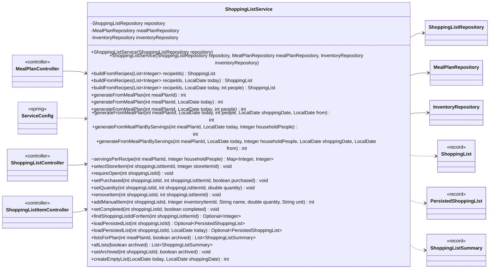

| Field | Type |
|---|---|
| `repository` | `ShoppingListRepository` |
| `mealPlanRepository` | `MealPlanRepository` |
| `inventoryRepository` | `InventoryRepository` |

| Member | Visibility | What it does |
|---|---|---|
| `ShoppingListService(ShoppingListRepository repository)` | public |  |
| `ShoppingListService(ShoppingListRepository repository, MealPlanRepository mealPlanRepository, InventoryRepository inventoryRepository)` | public |  |
| `ShoppingList buildFromRecipes(List<Integer> recipeIds)` | public |  |
| `ShoppingList buildFromRecipes(List<Integer> recipeIds, LocalDate today)` | public | Overload that takes "today" explicitly, so callers (and tests) control which discounts count as current. |
| `ShoppingList buildFromRecipes(List<Integer> recipeIds, LocalDate today, int people)` | public | Scales each recipe's ingredient quantities by people / recipe_servings before summing across recipes (see ShoppingListRepository.aggregateIngredients(List, int)). |
| `int generateFromMealPlan(int mealPlanId)` | public |  |
| `int generateFromMealPlan(int mealPlanId, LocalDate today)` | public | Builds a shopping list from a meal plan's recipes, subtracts what is already in inventory, and persists it: a shopping_list row linked to the plan, plus one shopping_list_item per item still missing (an item already fully in stock is droppe |
| `int generateFromMealPlan(int mealPlanId, LocalDate today, int people)` | public | Scales each recipe's ingredient quantities by people / recipe_servings before summing (see .buildFromRecipes(List, LocalDate, int)), otherwise identical to .generateFromMealPlan(int, LocalDate). |
| `int generateFromMealPlan(int mealPlanId, LocalDate today, int people, LocalDate shoppingDate, LocalDate from)` | public | As .generateFromMealPlan(int, LocalDate, int) for a shopping trip on shoppingDate (offers are judged on that day, and stock that has expired by then is not subtracted) counting the meals from from on (null = all meals of the plan). |
| `int generateFromMealPlanByServings(int mealPlanId, LocalDate today, Integer householdPeople)` | public | Builds and persists a shopping list in which every planned meal is scaled by its OWN servings: the meal's own number, then its recipe's preferred servings, then householdPeople, then 2 (see MealServings). |
| `int generateFromMealPlanByServings(int mealPlanId, LocalDate today, Integer householdPeople, LocalDate shoppingDate, LocalDate from)` | public | As .generateFromMealPlanByServings(int, LocalDate, Integer) for a shopping trip on shoppingDate (offers are judged on that day, stock that has expired by then is not subtracted), counting the meals from from on (null = all). |
| `Map<Integer, Integer> servingsPerRecipe(int mealPlanId, Integer householdPeople)` | package | Per recipe on the plan, the servings of all its meals added up (a recipe planned for 2 and for 4 is 6). |
| `void selectStoreItem(int shoppingListItemId, Integer storeItemId)` | public | Records the store_item the user picked for a persisted shopping_list_item line, or clears the choice when storeItemId is null. |
| `void requireOpen(int shoppingListId)` | public | Throws ListCompletedException when the list is completed; a list that does not exist passes (callers check). |
| `void setPurchased(int shoppingListId, int shoppingListItemId, boolean purchased)` | public | Ticks a line as bought, or unticks it. |
| `void setQuantity(int shoppingListId, int shoppingListItemId, double quantity)` | public | Changes the amount of a line; its unit stays and the amount must be above 0. |
| `void removeItem(int shoppingListId, int shoppingListItemId)` | public |  |
| `int addManualItem(int shoppingListId, Integer inventoryItemId, String name, double quantity, String unit)` | public | Adds a line the user wants on the list by hand (stock is not looked at: the user asked for it): either for a catalogue item (inventoryItemId; unit then defaults to the item's own unit) or as free text (name, for things like "Backpapier"; no |
| `void setCompleted(int shoppingListId, boolean completed)` | public | Completes a list (it becomes read-only) or reopens it. |
| `Optional<Integer> findShoppingListIdForItem(int shoppingListItemId)` | public | The shopping_list a persisted shopping_list_item belongs to, or empty if the item doesn't exist. |
| `Optional<PersistedShoppingList> loadPersistedList(int shoppingListId)` | public |  |
| `Optional<PersistedShoppingList> loadPersistedList(int shoppingListId, LocalDate today)` | public | Reloads a persisted shopping_list by id with its items, or empty if no such list exists. |
| `List<ShoppingListSummary> listsForPlan(int mealPlanId, boolean archived)` | public | The saved lists of a meal plan, newest first: the archived ones or the others. |
| `List<ShoppingListSummary> allLists(boolean archived)` | public | Every saved list, newest first, including the ones that belong to no meal plan: the archived ones or the others. |
| `void setArchived(int shoppingListId, boolean archived)` | public | Archives a list (hidden from the overview, nothing is deleted) or brings it back. |
| `int createEmptyList(LocalDate today, LocalDate shoppingDate)` | public | Makes an empty list that belongs to no meal plan, for a trip without planned meals (the user adds the lines by hand). |

**Referenced by:** `MealPlanController`, `ServiceConfig`, `ShoppingListController`, `ShoppingListItemController`

## ShoppingListSummary

*record*

One saved list in short: when it was made, for which shopping day, from which meal day, how many lines and how many of
them are ticked as bought ("3 von 8 gekauft").

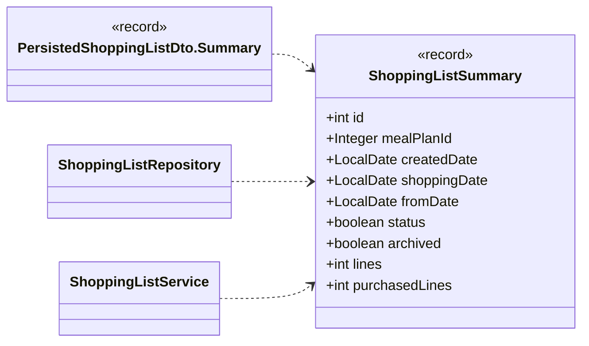

| Component | Type |
|---|---|
| `id` | `int` |
| `mealPlanId` | `Integer` |
| `createdDate` | `LocalDate` |
| `shoppingDate` | `LocalDate` |
| `fromDate` | `LocalDate` |
| `status` | `boolean` |
| `archived` | `boolean` |
| `lines` | `int` |
| `purchasedLines` | `int` |

**Referenced by:** `PersistedShoppingListDto.Summary`, `ShoppingListRepository`, `ShoppingListService`

## SourceRecipe

*record*

A recipe that needs a shopping list line ("für Kartoffelsuppe, Lachs").

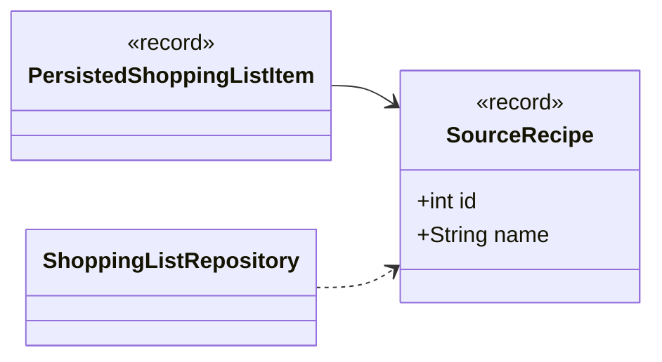

| Component | Type |
|---|---|
| `id` | `int` |
| `name` | `String` |

**Referenced by:** `PersistedShoppingListItem`, `ShoppingListRepository`

## StoreItemCandidate

*record*

One store_item that can satisfy an inventory item, with its brand/store and (if one is
running today) its current store_discount. productLastSeen/productAvailable come from the
linked store_product and are null when the store_item has no such link (e.g. a flyer-only item).

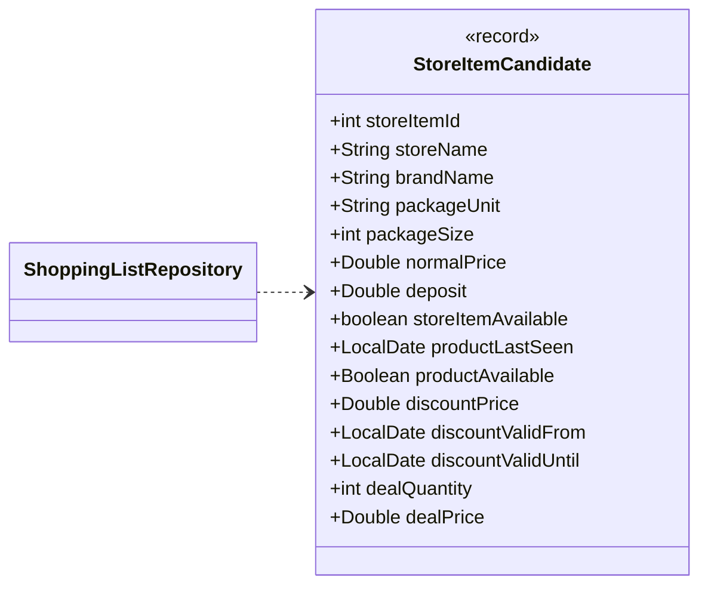

| Component | Type |
|---|---|
| `storeItemId` | `int` |
| `storeName` | `String` |
| `brandName` | `String` |
| `packageUnit` | `String` |
| `packageSize` | `int` |
| `normalPrice` | `Double` |
| `deposit` | `Double` |
| `storeItemAvailable` | `boolean` |
| `productLastSeen` | `LocalDate` |
| `productAvailable` | `Boolean` |
| `discountPrice` | `Double` |
| `discountValidFrom` | `LocalDate` |
| `discountValidUntil` | `LocalDate` |
| `dealQuantity` | `int` |
| `dealPrice` | `Double` |

**Referenced by:** `ShoppingListRepository`

## StoreOption

*record*

The chosen way to buy one shopping-list line item at one store: what it costs today,
whether that's a sale price, and the price you'd actually see at the till (sale/deal
price where one applies, plus deposit).

unitCompatible says whether this pack's unit is even the same physical dimension (mass,
volume or count) as what the line needs — see de.dahaem.shared.Units. Only when it is
true do packsNeeded/packsTotalPrice carry a real pack count and its total price; when the units
don't reconcile (or either is unrecognized), both stay null rather than fabricate a number from
a price that isn't actually for the needed quantity.

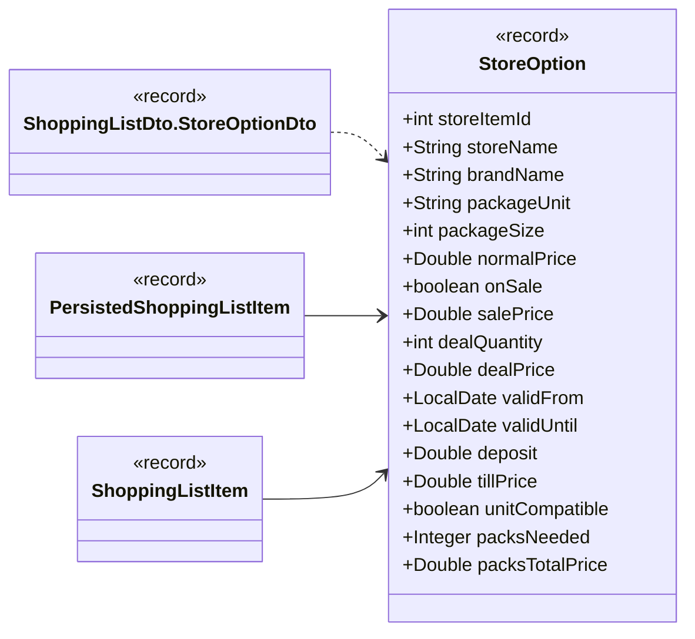

| Component | Type |
|---|---|
| `storeItemId` | `int` |
| `storeName` | `String` |
| `brandName` | `String` |
| `packageUnit` | `String` |
| `packageSize` | `int` |
| `normalPrice` | `Double` |
| `onSale` | `boolean` |
| `salePrice` | `Double` |
| `dealQuantity` | `int` |
| `dealPrice` | `Double` |
| `validFrom` | `LocalDate` |
| `validUntil` | `LocalDate` |
| `deposit` | `Double` |
| `tillPrice` | `Double` |
| `unitCompatible` | `boolean` |
| `packsNeeded` | `Integer` |
| `packsTotalPrice` | `Double` |

**Referenced by:** `PersistedShoppingListItem`, `ShoppingListDto.StoreOptionDto`, `ShoppingListItem`

## StoreTotal

*record*

What the lines still to buy would cost at one store, for the user to compare. It never picks a store: every store that
sells something on the list gets a row. linesCovered is how many of the linesToBuy lines the store has
with a known pack price; total adds the cheapest such option of the store per covered line. A line the store
does not cover is not in the total, so compare the totals together with the coverage.

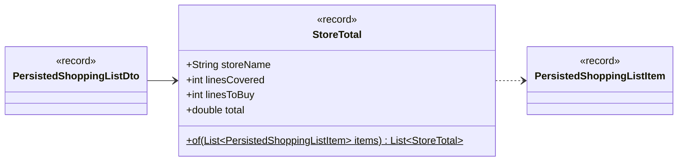

| Component | Type |
|---|---|
| `storeName` | `String` |
| `linesCovered` | `int` |
| `linesToBuy` | `int` |
| `total` | `double` |

| Member | Visibility | What it does |
|---|---|---|
| `List<StoreTotal> of(List<PersistedShoppingListItem> items)` | public static | One row per store, most lines covered first, then cheapest. |

**Referenced by:** `PersistedShoppingListDto`
