<!-- Generated by scripts/docs/generate_docs.py from src/main/java. Do not edit by hand; change the code or the generator. -->

# Package `stores`

Store offers: clients, the raw and verified data model, matching, promotions, scheduled refresh.

41 types in 32 source files (`src/main/java/de/dahaem/stores`). Back to the [class index](README.md).

## Overview

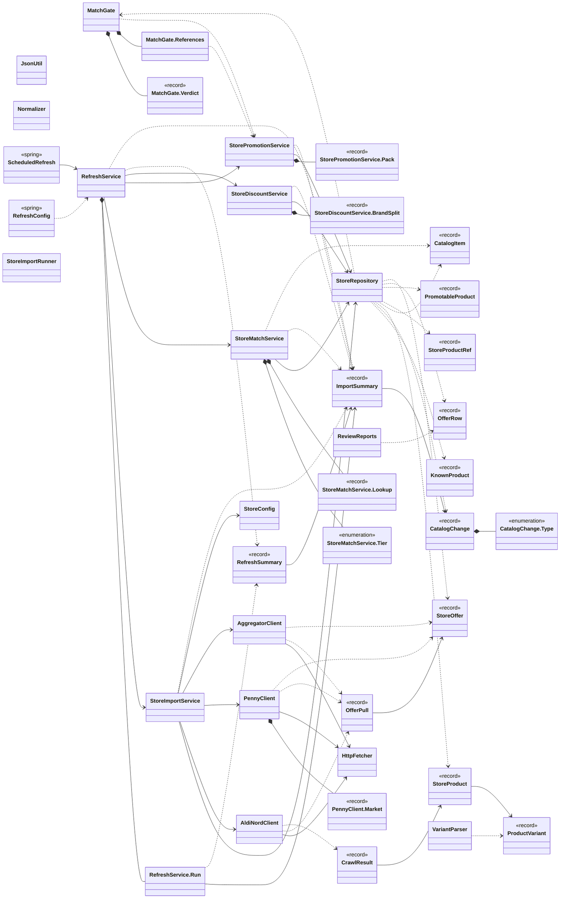

Arrows: `-->` has a field or record component of that type, `..>` takes it in its constructor or mentions it in a method signature, `<|--` extends, `<|..` implements, `*--` nested type. Only relationships inside this package are drawn here; each class below also shows its neighbours in other packages.

| Type | Kind | Role | What it is |
|------|------|------|------------|
| [`AggregatorClient`](#aggregatorclient) | class |  | Pulls weekly offers from the aggregator aktionspreis.de (SECONDARY source). |
| [`AldiNordClient`](#aldinordclient) | class |  | Reads ALDI Nord's public website. |
| [`CatalogChange`](#catalogchange) | record |  | One difference found by the range comparator between the last pull and this one. |
| [`CatalogChange.Type`](#catalogchangetype) | enum |  |  |
| [`CatalogItem`](#catalogitem) | record |  | One inventory_item catalog row, with its normalized names cached for matching. |
| [`CrawlResult`](#crawlresult) | record |  | Result of crawling a chain's full range. |
| [`HttpFetcher`](#httpfetcher) | class |  | Fetches public web pages / JSON politely: a normal browser User-Agent, timeouts, a few retries with growing backoff, and a pause after every successful request. |
| [`ImportSummary`](#importsummary) | record |  | What one import run did; printed by StoreImportRunner. |
| [`JsonUtil`](#jsonutil) | class |  | Small null-safe helpers for reading store JSON. |
| [`KnownProduct`](#knownproduct) | record |  | What the database already knows about a store product. |
| [`MatchGate`](#matchgate) | class |  | Plausibility gate between "the name matched an inventory_item" and "create a store_item + discount". |
| [`MatchGate.Verdict`](#matchgateverdict) | record |  |  |
| [`MatchGate.References`](#matchgatereferences) | class |  | Reference prices per base unit, by inventory_item id and unit family. |
| [`Normalizer`](#normalizer) | class |  | Turns a German product or ingredient name into a comparable key: lowercase, umlauts to ae/oe/ue/ss, allergen markers and leading ALL-CAPS brand words removed, punctuation to spaces. |
| [`OfferPull`](#offerpull) | record |  | Offers pulled from one chain, plus the requests that failed (so a run can be marked PARTIAL). |
| [`OfferRow`](#offerrow) | record |  | One store_offer row loaded for discount promotion, with its store id. |
| [`PennyClient`](#pennyclient) | class |  | Reads Penny's weekly offers from the JSON API behind www.penny.de/angebote. |
| [`PennyClient.Market`](#pennyclientmarket) | record |  | A Penny store and the price regions it belongs to this week and next week. |
| [`ProductVariant`](#productvariant) | record |  | One flavour/size of a store product, e.g. |
| [`PromotableProduct`](#promotableproduct) | record |  | A matched store_product considered for promotion into the verified store_item layer. |
| [`RefreshConfig`](#refreshconfig) | class | configuration | Switches scheduling on, but only when dahaem.refresh.enabled=true: with the default (false) no scheduler infrastructure, RefreshService or ScheduledRefresh bean exists at all. |
| [`RefreshService`](#refreshservice) | class |  | The store-data refresh pipelines, shared by the CLI (StoreImportRunner refresh ...) and the in-app scheduler (ScheduledRefresh). |
| [`RefreshService.Run`](#refreshservicerun) | class |  | Collects step results for one flow, running every step regardless of earlier failures. |
| [`RefreshSummary`](#refreshsummary) | record |  | Outcome of one refresh flow ("weekly" / "monthly"): the summary of every step that returned one, plus a message for every step that threw. |
| [`ReviewReports`](#reviewreports) | class |  | Row builders for the review reports (unmatched_offers.tsv, review_matches.tsv, review_prices.tsv). |
| [`ScheduledRefresh`](#scheduledrefresh) | class | Spring component | Runs the weekly / monthly refresh on a cron schedule inside the long-running API process. |
| [`StoreConfig`](#storeconfig) | class |  | Settings for the store importers, read from config/stores.properties (relative to the working directory, like the database path). |
| [`StoreDiscountService`](#storediscountservice) | class |  | Turns pulled flyer offers into the verified layer: each matched offer becomes (or refreshes) a store_item shell for its chain, plus a store_discount holding the flyer price and dates. |
| [`StoreDiscountService.BrandSplit`](#storediscountservicebrandsplit) | record |  | Brand to file the offer under (null = no brand) and the text to match against the catalog. |
| [`StoreImportRunner`](#storeimportrunner) | class | command-line tool | Command-line entry point for the store imports. |
| [`StoreImportService`](#storeimportservice) | class |  | Runs the store imports and decides what changed. |
| [`StoreMatchService`](#storematchservice) | class |  | Links store_product/store_offer rows to inventory_item catalog rows by name (no SQL, no web). |
| [`StoreMatchService.Tier`](#storematchservicetier) | enum |  |  |
| [`StoreMatchService.Lookup`](#storematchservicelookup) | record |  | id == null && !tie: no catalog term fits; tie: several equally good items, left unmatched. |
| [`StoreOffer`](#storeoffer) | record |  | One weekly offer as pulled from a chain's website; maps to a row in store_offer. |
| [`StoreProduct`](#storeproduct) | record |  | One product from a chain's full range, as pulled from its website. |
| [`StoreProductRef`](#storeproductref) | record |  | Minimal store_product row for matching: id, name, category. |
| [`StorePromotionService`](#storepromotionservice) | class |  | Promotes RAW store_product rows into the VERIFIED store_item layer that the shopping list reads. |
| [`StorePromotionService.Pack`](#storepromotionservicepack) | record |  | A pack size reduced to an integer count of a base unit. |
| [`StoreRepository`](#storerepository) | class |  | All SQL for pulled store data: store_product (+ variants, price history), store_offer, store_catalog_change and store_import_run. |
| [`VariantParser`](#variantparser) | class |  | Splits the "Sorten:" block of an ALDI product description into flavour/size variants. |

## AggregatorClient

*class*

Pulls weekly offers from the aggregator aktionspreis.de (SECONDARY source).

It is used for the chains we have no clean direct feed for (Netto, Edeka, Rewe,
Lidl, famila) and, for ALDI, as a cross-check against the direct pull. The data
is second-hand (the aggregator re-typing each flyer), so every offer is tagged
source = AGGREGATOR downstream and ranked below a direct store pull.

Page: https://www.aktionspreis.de/prospekt/-angebote . No bot protection;
plain HTML. Each offer is a `div.produkt_box` inside an ``:
  - discount %  : span.percent_new  ("55%")   -> used to derive the old price
  - name+brand  : first ** ("Arla Buko
 versch. Sorten")
  - size        : the anchor title attribute ("Buko (200g)")
  - sale price  : the red ** (color #c03938, "0,89 €")
  - base price  : "4,45 € je kg"
  - TIEFSTPREIS : lowest-price badge (kept in promoText)
There is no explicit old price and no Pfand on the tiles; the old price is
derived from the discount %. Offers only, no full range.

Dates: the tiles have none; the page header gives the week ("Angebote vom 05.10. - 11.10.2026"),
which every offer on the page gets. Next week's flyer is at
/prospekte/-angebote-naechsteWoche once the site has it.

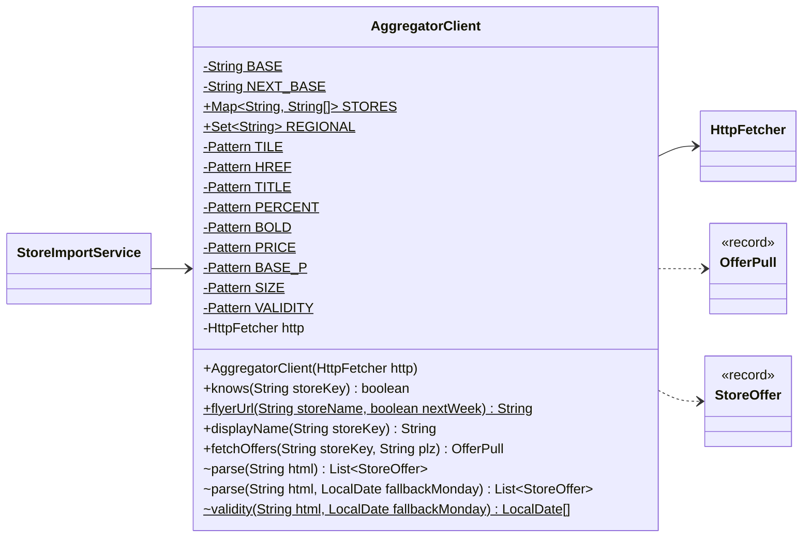

| Field | Type |
|---|---|
| `BASE` | `String` |
| `NEXT_BASE` | `String` |
| `STORES` | `Map<String, String[]>` |
| `REGIONAL` | `Set<String>` |
| `TILE` | `Pattern` |
| `HREF` | `Pattern` |
| `TITLE` | `Pattern` |
| `PERCENT` | `Pattern` |
| `BOLD` | `Pattern` |
| `PRICE` | `Pattern` |
| `BASE_P` | `Pattern` |
| `SIZE` | `Pattern` |
| `VALIDITY` | `Pattern` |
| `http` | `HttpFetcher` |

| Member | Visibility | What it does |
|---|---|---|
| `AggregatorClient(HttpFetcher http)` | public |  |
| `boolean knows(String storeKey)` | public |  |
| `String flyerUrl(String storeName, boolean nextWeek)` | public static | The flyer page a chain's aggregator offers were read from (current or next week), or null for an unknown chain. |
| `String displayName(String storeKey)` | public |  |
| `OfferPull fetchOffers(String storeKey, String plz)` | public | Fetches and parses one chain's offers page. |
| `List<StoreOffer> parse(String html)` | package |  |
| `List<StoreOffer> parse(String html, LocalDate fallbackMonday)` | package | Offers valid for the range in the page header ("Angebote vom 05.10. |
| `LocalDate[] validity(String html, LocalDate fallbackMonday)` | package static | [from, until] from "Angebote vom 05.10. |

**Referenced by:** `StoreImportService`

## AldiNordClient

*class*

Reads ALDI Nord's public website. The site is a Next.js app: every page embeds
its data as JSON in <script id="__NEXT_DATA__">.

 - Weekly offers: pageProps.apiData (itself a JSON string) holds an "OFFER_GET"
   call whose result "algoliaDataMap" maps product id -> product. The preview
   page carries next week's offers the same way.
 - Full range: every /sortiment/... category page embeds its product list in
   pageProps.algoliaState.initialResults (up to 1000 products per page).

No API key, no login: we fetch the same pages a browser does.

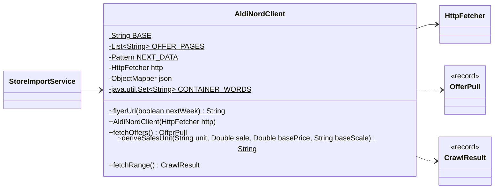

| Field | Type |
|---|---|
| `BASE` | `String` |
| `OFFER_PAGES` | `List<String>` |
| `NEXT_DATA` | `Pattern` |
| `http` | `HttpFetcher` |
| `json` | `ObjectMapper` |
| `CONTAINER_WORDS` | `java.util.Set<String>` |

| Member | Visibility | What it does |
|---|---|---|
| `String flyerUrl(boolean nextWeek)` | package static | The ALDI page the offers come from: this week's or the preview page. |
| `AldiNordClient(HttpFetcher http)` | public |  |
| `OfferPull fetchOffers()` | public | This week's offers plus next week's preview. |
| `String deriveSalesUnit(String unit, Double sale, Double basePrice, String baseScale)` | package static | ALDI sometimes gives only a container word as the pack size ("Packung") but always the price per kg or l. |
| `CrawlResult fetchRange()` | public | Walks the category tree from /sortiment.html downwards and collects every product, deduped by ALDI's product id. |

**Referenced by:** `StoreImportService`

## CatalogChange

*record*

One difference found by the range comparator between the last pull and this one.
Stored in store_catalog_change so the app can later show "what changed at ALDI".

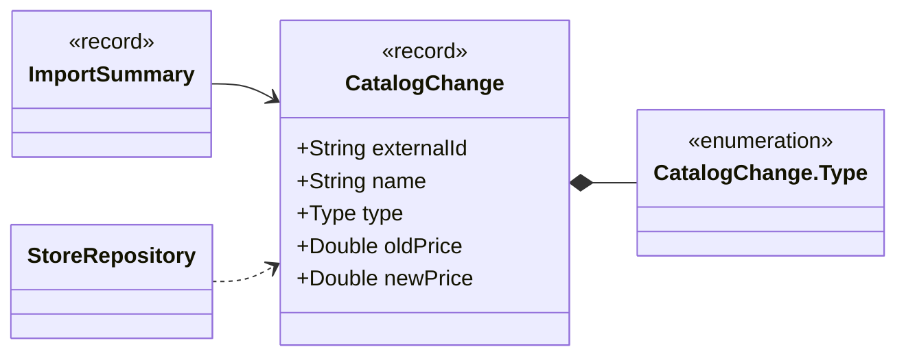

| Component | Type |
|---|---|
| `externalId` | `String` |
| `name` | `String` |
| `type` | `Type` |
| `oldPrice` | `Double` |
| `newPrice` | `Double` |

**Referenced by:** `ImportSummary`, `StoreRepository`

## CatalogChange.Type

*enum*

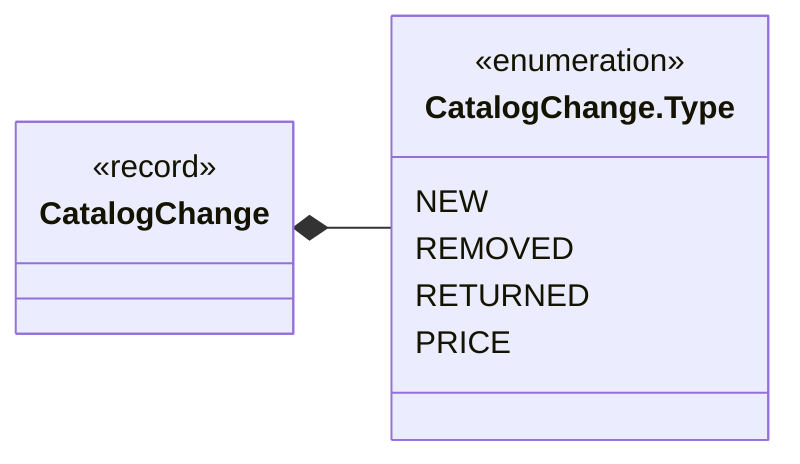

**Values:** `NEW`, `REMOVED`, `RETURNED`, `PRICE`

**Referenced by:** `CatalogChange`

## CatalogItem

*record*

One inventory_item catalog row, with its normalized names cached for matching.

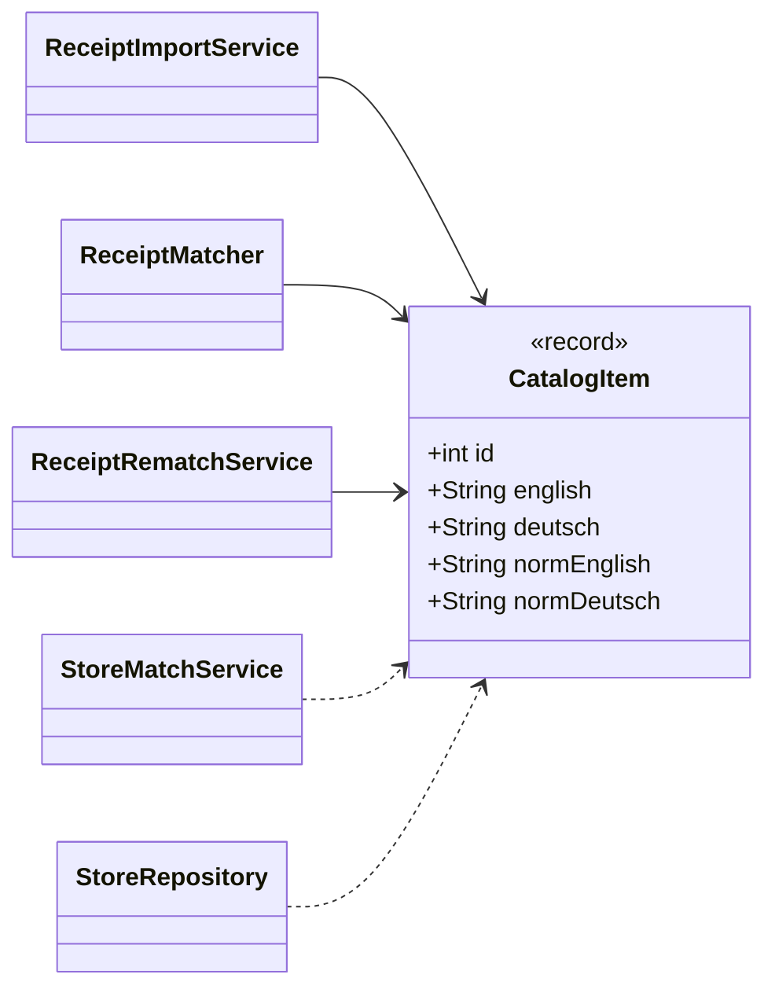

| Component | Type |
|---|---|
| `id` | `int` |
| `english` | `String` |
| `deutsch` | `String` |
| `normEnglish` | `String` |
| `normDeutsch` | `String` |

**Referenced by:** `ReceiptImportService`, `ReceiptMatcher`, `ReceiptRematchService`, `StoreMatchService`, `StoreRepository`

## CrawlResult

*record*

Result of crawling a chain's full range. failedPages / truncatedPages tell the
comparator whether the pull was complete enough to trust missing products as removed.

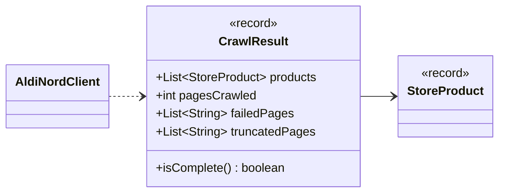

| Component | Type |
|---|---|
| `products` | `List<StoreProduct>` |
| `pagesCrawled` | `int` |
| `failedPages` | `List<String>` |
| `truncatedPages` | `List<String>` |

| Member | Visibility | What it does |
|---|---|---|
| `boolean isComplete()` | public |  |

**Referenced by:** `AldiNordClient`

## HttpFetcher

*class*

Fetches public web pages / JSON politely: a normal browser User-Agent, timeouts,
a few retries with growing backoff, and a pause after every successful request.
A 404 is not retried; it throws FileNotFoundException so callers can skip it.

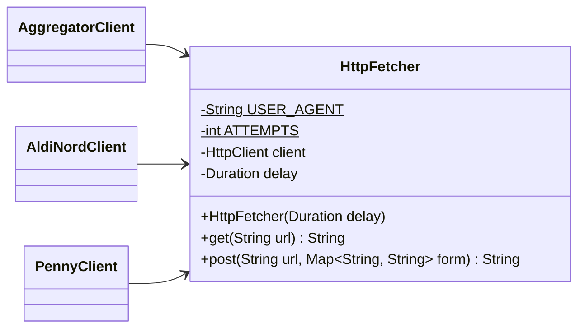

| Field | Type |
|---|---|
| `USER_AGENT` | `String` |
| `ATTEMPTS` | `int` |
| `client` | `HttpClient` |
| `delay` | `Duration` |

| Member | Visibility | What it does |
|---|---|---|
| `HttpFetcher(Duration delay)` | public |  |
| `String get(String url)` | public |  |
| `String post(String url, Map<String, String> form)` | public | Form-urlencoded POST, sharing the cookie session with get(). |

**Referenced by:** `AggregatorClient`, `AldiNordClient`, `PennyClient`

## ImportSummary

*record*

What one import run did; printed by StoreImportRunner. status is OK, PARTIAL or FAILED.

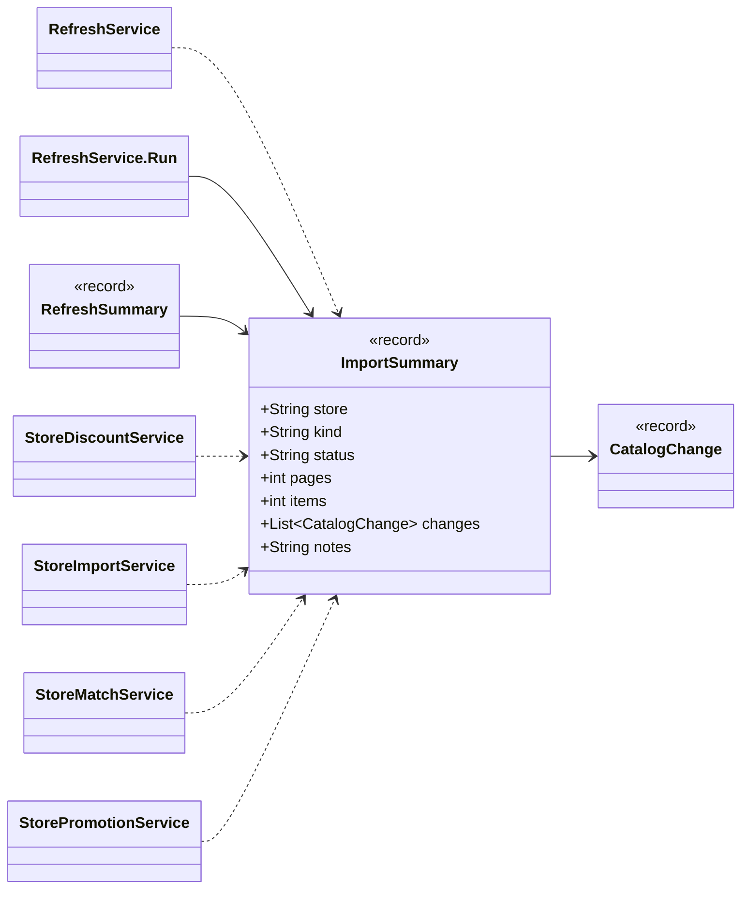

| Component | Type |
|---|---|
| `store` | `String` |
| `kind` | `String` |
| `status` | `String` |
| `pages` | `int` |
| `items` | `int` |
| `changes` | `List<CatalogChange>` |
| `notes` | `String` |

**Referenced by:** `RefreshService`, `RefreshSummary`, `StoreDiscountService`, `StoreImportService`, `StoreMatchService`, `StorePromotionService`

## JsonUtil

*class*

Small null-safe helpers for reading store JSON. Package-private: only the store clients use it.

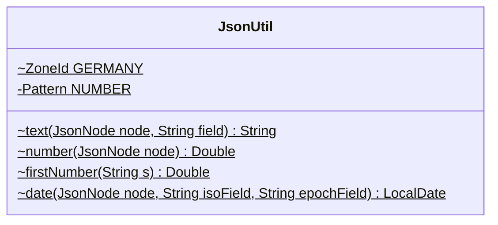

| Field | Type |
|---|---|
| `GERMANY` | `ZoneId` |
| `NUMBER` | `Pattern` |

| Member | Visibility | What it does |
|---|---|---|
| `String text(JsonNode node, String field)` | package static | Text of a field, or null if missing / empty. |
| `Double number(JsonNode node)` | package static | A price-like value: real JSON numbers, or strings such as "3.99", "1.99²" or "1,5". |
| `Double firstNumber(String s)` | package static |  |
| `LocalDate date(JsonNode node, String isoField, String epochField)` | package static | Date from a "yyyy-MM-dd" text field, falling back to an epoch-seconds field. |

## KnownProduct

*record*

What the database already knows about a store product. Loaded before a range
import so the new pull can be compared against it.

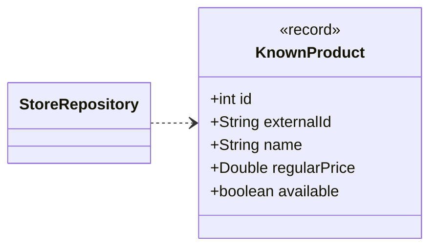

| Component | Type |
|---|---|
| `id` | `int` |
| `externalId` | `String` |
| `name` | `String` |
| `regularPrice` | `Double` |
| `available` | `boolean` |

**Referenced by:** `StoreRepository`

## MatchGate

*class*

Plausibility gate between "the name matched an inventory_item" and "create a store_item + discount".
A match that fails creates nothing; the offer goes to the review report instead.

UNIT: the pack's unit family must fit the item's unit. Families are weight (g, kg), volume (ml, cl, l) and
pieces (Stück), plus "WL" (wash loads) as a family of its own. An item whose unit is a container word ("Packung", "Flasche", "Glas", "Dose", ...) carries
no quantity, so it accepts a pack of any family: there is nothing to contradict. A weight item does not
accept a volume or piece pack (a 750 ml soft drink is not "zitrone"; "15 Stück" is not a number of grams).

PRICE: price per base unit (g / ml / piece) of the offer versus the median of the item's reference prices
in the same family, beyond .MAX_RATIO either way fails. References come only from STORE-sourced
data (store_product regular prices); aggregator offers are not used because their prices are what is
being checked. With fewer than .MIN_REFERENCES references there is no basis, so the check passes.

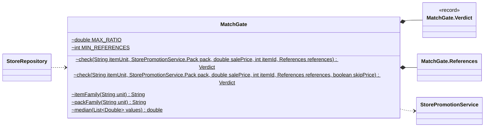

| Field | Type |
|---|---|
| `MAX_RATIO` | `double` |
| `MIN_REFERENCES` | `int` |

| Member | Visibility | What it does |
|---|---|---|
| `Verdict check(String itemUnit, StorePromotionService.Pack pack, double salePrice, int itemId, References references)` | package static |  |
| `Verdict check(String itemUnit, StorePromotionService.Pack pack, double salePrice, int itemId, References references, boolean skipPrice)` | package static | price is not second-guessed. |
| `String itemFamily(String unit)` | package static | "g"/"kg" -> g, "ml"/"cl"/"l" -> ml, "stück"/"st" -> stück; null for anything else (container words). |
| `String packFamily(String unit)` | package static |  |
| `double median(List<Double> values)` | package static |  |

**Referenced by:** `StoreRepository`

## MatchGate.Verdict

*record*

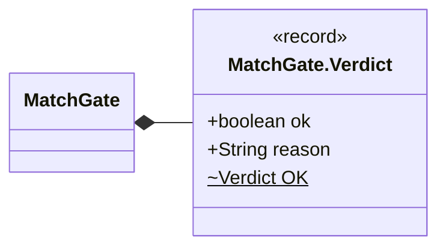

| Component | Type |
|---|---|
| `ok` | `boolean` |
| `reason` | `String` |
| `OK` | `Verdict` |

**Referenced by:** `MatchGate`

## MatchGate.References

*class*

Reference prices per base unit, by inventory_item id and unit family.

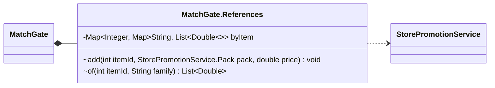

| Field | Type |
|---|---|
| `byItem` | `Map<Integer, Map<String, List<Double>>>` |

| Member | Visibility | What it does |
|---|---|---|
| `void add(int itemId, StorePromotionService.Pack pack, double price)` | package |  |
| `List<Double> of(int itemId, String family)` | package |  |

**Referenced by:** `MatchGate`

## Normalizer

*class*

Turns a German product or ingredient name into a comparable key: lowercase,
umlauts to ae/oe/ue/ss, allergen markers and leading ALL-CAPS brand words
removed, punctuation to spaces. Same idea as the recipe importer's normalize,
kept here so store matching and (later) recipe matching can converge in Java.

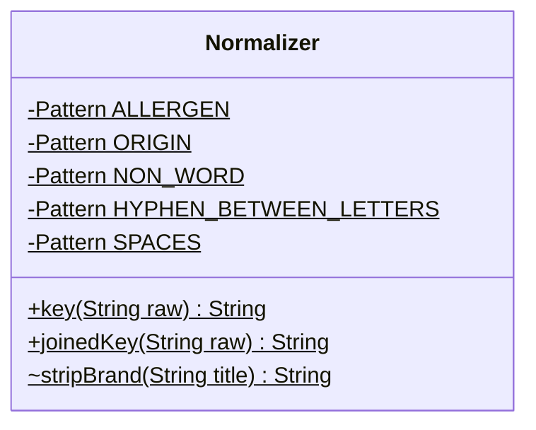

| Field | Type |
|---|---|
| `ALLERGEN` | `Pattern` |
| `ORIGIN` | `Pattern` |
| `NON_WORD` | `Pattern` |
| `HYPHEN_BETWEEN_LETTERS` | `Pattern` |
| `SPACES` | `Pattern` |

| Member | Visibility | What it does |
|---|---|---|
| `String key(String raw)` | public static | Full normalize, brand words (leading ALL-CAPS tokens) stripped. |
| `String joinedKey(String raw)` | public static | Like .key, but a hyphen between two letters is removed instead of becoming a space, so "Hähnchen-Brustfilets" gives "haehnchenbrustfilets" (one word) rather than "haehnchen brustfilets". |
| `String stripBrand(String title)` | package static | Drops leading ALL-CAPS brand words ("MILSANI Streichfein" -> "Streichfein"); keeps all if every word is caps. |

## OfferPull

*record*

Offers pulled from one chain, plus the requests that failed (so a run can be marked PARTIAL).

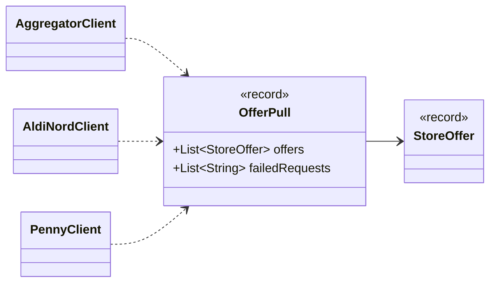

| Component | Type |
|---|---|
| `offers` | `List<StoreOffer>` |
| `failedRequests` | `List<String>` |

**Referenced by:** `AggregatorClient`, `AldiNordClient`, `PennyClient`

## OfferRow

*record*

One store_offer row loaded for discount promotion, with its store id.
salePrice is the flyer price (the discount). normalPrice is the "was" price when the
flyer shows one, else null (then the bootstrapped store_item has no known normal price).
storeName / source / externalId / the dates identify the offer in the review reports, so a row can be checked against the flyer.

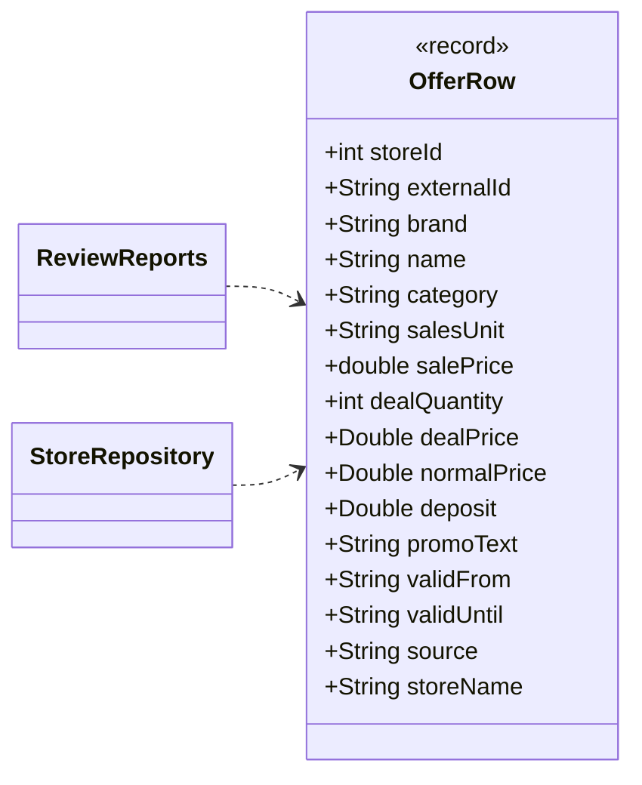

| Component | Type |
|---|---|
| `storeId` | `int` |
| `externalId` | `String` |
| `brand` | `String` |
| `name` | `String` |
| `category` | `String` |
| `salesUnit` | `String` |
| `salePrice` | `double` |
| `dealQuantity` | `int` |
| `dealPrice` | `Double` |
| `normalPrice` | `Double` |
| `deposit` | `Double` |
| `promoText` | `String` |
| `validFrom` | `String` |
| `validUntil` | `String` |
| `source` | `String` |
| `storeName` | `String` |

**Referenced by:** `ReviewReports`, `StoreRepository`

## PennyClient

*class*

Reads Penny's weekly offers from the JSON API behind www.penny.de/angebote.

 1. /.rest/market lists every Penny store with its price region ("sellingRegion").
 2. The offers page names the current / next calendar week (data-current-week,
    data-next-week) and the offer categories per week with the day they start
    (Mo-Sa, Do-Sa, Fr-Sa; see categoryStarts). Next week's offers appear there from Friday.
 3. /.rest/offers/by-category/{week}/{category}?region={sellingRegion}
    returns the offer tiles of one category.

Penny only publishes offers, not its full range, and prices depend on the
store's region, so the store id comes from config.

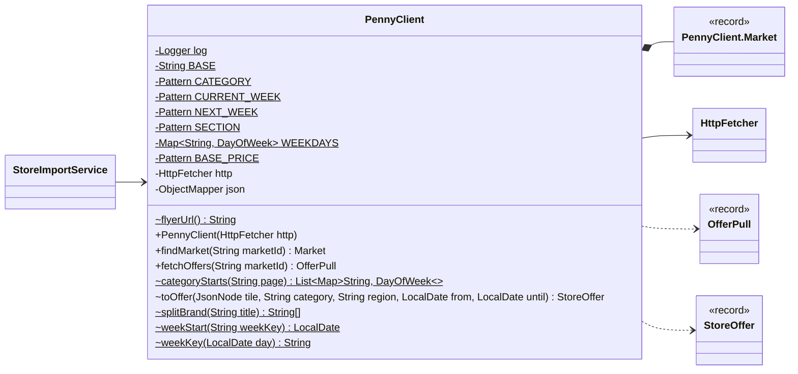

| Field | Type |
|---|---|
| `log` | `Logger` |
| `BASE` | `String` |
| `CATEGORY` | `Pattern` |
| `CURRENT_WEEK` | `Pattern` |
| `NEXT_WEEK` | `Pattern` |
| `SECTION` | `Pattern` |
| `WEEKDAYS` | `Map<String, DayOfWeek>` |
| `BASE_PRICE` | `Pattern` |
| `http` | `HttpFetcher` |
| `json` | `ObjectMapper` |

| Member | Visibility | What it does |
|---|---|---|
| `String flyerUrl()` | package static | Penny's offers page. |
| `PennyClient(HttpFetcher http)` | public |  |
| `Market findMarket(String marketId)` | public |  |
| `OfferPull fetchOffers(String marketId)` | public | Offers of this week and (if already published) next week for the given store. |
| `List<Map<String, DayOfWeek>> categoryStarts(String page)` | package static | The offers page has one section per category and week, e.g. |
| `StoreOffer toOffer(JsonNode tile, String category, String region, LocalDate from, LocalDate until)` | package |  |
| `String[] splitBrand(String title)` | package static | "MÜHLENHOF Frisches Puten-Gulasch" -> {"MÜHLENHOF", "Frisches Puten-Gulasch"}; no caps prefix -> {null, title}. |
| `LocalDate weekStart(String weekKey)` | package static | Penny week keys look like "2026-39" (ISO year and week). |
| `String weekKey(LocalDate day)` | package static |  |

**Referenced by:** `StoreImportService`

## PennyClient.Market

*record*

A Penny store and the price regions it belongs to this week and next week.

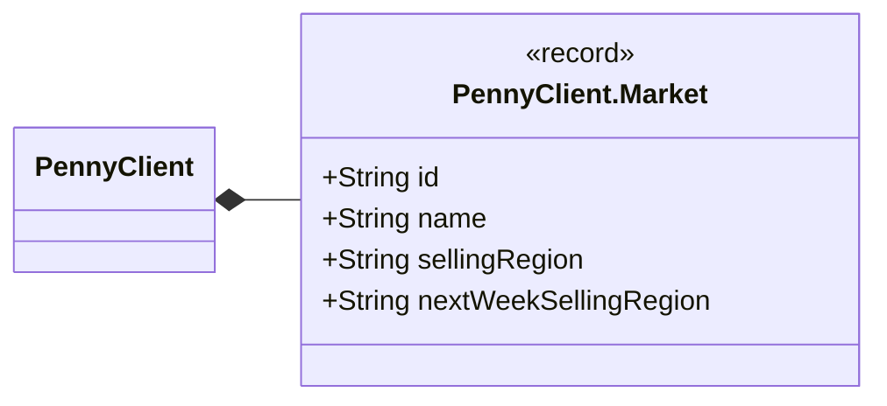

| Component | Type |
|---|---|
| `id` | `String` |
| `name` | `String` |
| `sellingRegion` | `String` |
| `nextWeekSellingRegion` | `String` |

**Referenced by:** `PennyClient`

## ProductVariant

*record*

One flavour/size of a store product, e.g. "Natur, 150 g" of ALDI's "Ziegenkäse".

A record is Java's built-in plain data holder: the compiler generates the
fields, constructor, getters (named like the fields: name(), size()),
equals, hashCode and toString.

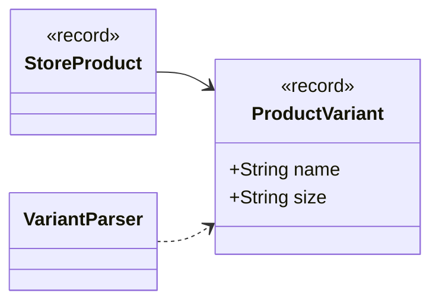

| Component | Type |
|---|---|
| `name` | `String` |
| `size` | `String` |

**Referenced by:** `StoreProduct`, `VariantParser`

## PromotableProduct

*record*

A matched store_product considered for promotion into the verified store_item layer.
Carries only what a store_item needs; completeness (parseable size, brand, price) is
decided in StorePromotionService.

```mermaid
classDiagram
    direction LR
    class stores_PromotableProduct["PromotableProduct"] {
        <<record>>
        +int storeProductId
        +int storeId
        +String brand
        +String name
        +String salesUnit
        +Double regularPrice
        +Double deposit
        +boolean available
        +int inventoryItemId
    }
    class stores_StoreRepository["StoreRepository"]
    stores_StoreRepository ..> stores_PromotableProduct
```

| Component | Type |
|---|---|
| `storeProductId` | `int` |
| `storeId` | `int` |
| `brand` | `String` |
| `name` | `String` |
| `salesUnit` | `String` |
| `regularPrice` | `Double` |
| `deposit` | `Double` |
| `available` | `boolean` |
| `inventoryItemId` | `int` |

**Referenced by:** `StoreRepository`

## RefreshConfig

*class · configuration*

Switches scheduling on, but only when dahaem.refresh.enabled=true: with the default
(false) no scheduler infrastructure, RefreshService or ScheduledRefresh bean exists at all.

```mermaid
classDiagram
    direction LR
    class stores_RefreshConfig["RefreshConfig"] {
        <<spring>>
        ~refreshService() RefreshService
    }
    class stores_RefreshService["RefreshService"]
    stores_RefreshConfig ..> stores_RefreshService
```

| Member | Visibility | What it does |
|---|---|---|
| `RefreshService refreshService()` | package |  |

## RefreshService

*class*

The store-data refresh pipelines, shared by the CLI (StoreImportRunner refresh ...)
and the in-app scheduler (ScheduledRefresh). See docs/refresh.md.

  weekly:  offers aldi -> offers penny -> offers aggregator (each chain) -> discounts
  monthly: range aldi -> match aldi -> promote -> discounts

Each step is independent: one that throws is recorded and the next still runs. The match,
promote and discount services are created lazily per step, so a failure while building one
(e.g. a malformed config/store_overrides.json) only fails that step.

```mermaid
classDiagram
    direction LR
    class stores_RefreshService["RefreshService"] {
        -Logger log$
        ~Path DATA_DIR$
        -StoreImportService importService
        -Supplier~StoreMatchService~ matcher
        -Supplier~StorePromotionService~ promoter
        -Supplier~StoreDiscountService~ discounts
        +RefreshService(StoreImportService importService, Supplier~StoreMatchService~ matcher, Supplier~StorePromotionService~ promoter, Supplier~StoreDiscountService~ discounts)
        +create() RefreshService$
        +refreshWeekly() RefreshSummary
        +refreshMonthly() RefreshSummary
        ~matchAldi() ImportSummary
        ~discounts() ImportSummary
        ~loadOverrides() Map~String, Integer~$
    }
    class stores_RefreshService_Run["RefreshService.Run"]
    class stores_StoreImportService["StoreImportService"]
    class stores_StoreMatchService["StoreMatchService"]
    class stores_StorePromotionService["StorePromotionService"]
    class stores_StoreDiscountService["StoreDiscountService"]
    class stores_ScheduledRefresh["ScheduledRefresh"] {
        <<spring>>
    }
    class stores_RefreshSummary["RefreshSummary"] {
        <<record>>
    }
    class stores_ImportSummary["ImportSummary"] {
        <<record>>
    }
    class stores_RefreshConfig["RefreshConfig"] {
        <<spring>>
    }
    stores_RefreshService *-- stores_RefreshService_Run
    stores_RefreshService --> stores_StoreImportService
    stores_RefreshService --> stores_StoreMatchService
    stores_RefreshService --> stores_StorePromotionService
    stores_RefreshService --> stores_StoreDiscountService
    stores_RefreshService ..> stores_RefreshSummary
    stores_RefreshService ..> stores_ImportSummary
    stores_RefreshConfig ..> stores_RefreshService
    stores_ScheduledRefresh --> stores_RefreshService
```

| Field | Type |
|---|---|
| `log` | `Logger` |
| `DATA_DIR` | `Path` |
| `importService` | `StoreImportService` |
| `matcher` | `Supplier<StoreMatchService>` |
| `promoter` | `Supplier<StorePromotionService>` |
| `discounts` | `Supplier<StoreDiscountService>` |

| Member | Visibility | What it does |
|---|---|---|
| `RefreshService(StoreImportService importService, Supplier<StoreMatchService> matcher, Supplier<StorePromotionService> promoter, Supplier<StoreDiscountService> discounts)` | public |  |
| `RefreshService create()` | public static | Production wiring: real HTTP clients and repository, config read from the working directory. |
| `RefreshSummary refreshWeekly()` | public |  |
| `RefreshSummary refreshMonthly()` | public |  |
| `ImportSummary matchAldi()` | package | The "match aldi" step; also used by the standalone CLI job. |
| `ImportSummary discounts()` | package | The "discounts" step; also used by the standalone CLI job. |
| `Map<String, Integer> loadOverrides()` | package static | config/store_overrides.json: {"exact": {"": }}. |

**Referenced by:** `RefreshConfig`, `ScheduledRefresh`

## RefreshService.Run

*class*

Collects step results for one flow, running every step regardless of earlier failures.

```mermaid
classDiagram
    direction LR
    class stores_RefreshService_Run["RefreshService.Run"] {
        -String flow
        -List~ImportSummary~ results
        -List~String~ failures
        ~Run(String flow)
        ~step(String name, Supplier~ImportSummary~ action) void
        ~finish() RefreshSummary
    }
    class stores_RefreshService["RefreshService"]
    class stores_ImportSummary["ImportSummary"] {
        <<record>>
    }
    class stores_RefreshSummary["RefreshSummary"] {
        <<record>>
    }
    stores_RefreshService_Run --> stores_ImportSummary
    stores_RefreshService_Run ..> stores_RefreshSummary
    stores_RefreshService *-- stores_RefreshService_Run
```

| Field | Type |
|---|---|
| `flow` | `String` |
| `results` | `List<ImportSummary>` |
| `failures` | `List<String>` |

| Member | Visibility | What it does |
|---|---|---|
| `Run(String flow)` | package |  |
| `void step(String name, Supplier<ImportSummary> action)` | package |  |
| `RefreshSummary finish()` | package |  |

**Referenced by:** `RefreshService`

## RefreshSummary

*record*

Outcome of one refresh flow ("weekly" / "monthly"): the summary of every step that returned
one, plus a message for every step that threw. .allOk() is what the CLI turns into
its exit code.

```mermaid
classDiagram
    direction LR
    class stores_RefreshSummary["RefreshSummary"] {
        <<record>>
        +String flow
        +List~ImportSummary~ results
        +List~String~ failures
        +allOk() boolean
    }
    class stores_ImportSummary["ImportSummary"] {
        <<record>>
    }
    class stores_RefreshService["RefreshService"]
    class stores_RefreshService_Run["RefreshService.Run"]
    stores_RefreshSummary --> stores_ImportSummary
    stores_RefreshService ..> stores_RefreshSummary
    stores_RefreshService_Run ..> stores_RefreshSummary
```

| Component | Type |
|---|---|
| `flow` | `String` |
| `results` | `List<ImportSummary>` |
| `failures` | `List<String>` |

| Member | Visibility | What it does |
|---|---|---|
| `boolean allOk()` | public |  |

**Referenced by:** `RefreshService`

## ReviewReports

*class*

Row builders for the review reports (unmatched_offers.tsv, review_matches.tsv, review_prices.tsv).
Every row carries what is needed to find the offer in the flyer again: store name, source, external id,
the flyer page it was read from, pack size, price and validity. The original leading columns stay where they were.

```mermaid
classDiagram
    direction LR
    class stores_ReviewReports["ReviewReports"] {
        ~String EXTRA$
        ~flyerUrl(OfferRow o, LocalDate today) String$
        ~unmatched(OfferRow o, LocalDate today) String$
        ~held(OfferRow o, String proposedItem, String reason, LocalDate today) String$
        ~badPrice(OfferRow o, LocalDate today) String$
    }
    class stores_OfferRow["OfferRow"] {
        <<record>>
    }
    stores_ReviewReports ..> stores_OfferRow
```

| Field | Type |
|---|---|
| `EXTRA` | `String` |

| Member | Visibility | What it does |
|---|---|---|
| `String flyerUrl(OfferRow o, LocalDate today)` | package static | The flyer page an offer was read from; empty when the source is unknown. |
| `String unmatched(OfferRow o, LocalDate today)` | package static | unmatched_offers.tsv: store_id, brand, name, then the identification columns. |
| `String held(OfferRow o, String proposedItem, String reason, LocalDate today)` | package static | review_matches.tsv: store_id, external_id, offer, sales_unit, sale_price, proposed_item, reason, then store..valid_until. |
| `String badPrice(OfferRow o, LocalDate today)` | package static | review_prices.tsv: store_id, external_id, offer, sales_unit, sale_price, then store..valid_until. |

## ScheduledRefresh

*class · Spring component*

Runs the weekly / monthly refresh on a cron schedule inside the long-running API process.
Opt-in: only registered when dahaem.refresh.enabled=true, because the importers
scrape external sites. Cron expressions and time zone come from dahaem.refresh.*.

Weekly and monthly share one guard, so they never run at the same time (both write the same
tables); a run that finds another in progress is skipped, not queued. Scheduled methods
never throw, so a failure cannot stop later runs.

```mermaid
classDiagram
    direction LR
    class stores_ScheduledRefresh["ScheduledRefresh"] {
        <<spring>>
        -Logger log$
        -RefreshService refreshService
        -AtomicBoolean running
        +ScheduledRefresh(RefreshService refreshService)
        +weekly() void
        +monthly() void
    }
    class stores_RefreshService["RefreshService"]
    stores_ScheduledRefresh --> stores_RefreshService
```

| Field | Type |
|---|---|
| `log` | `Logger` |
| `refreshService` | `RefreshService` |
| `running` | `AtomicBoolean` |

| Member | Visibility | What it does |
|---|---|---|
| `ScheduledRefresh(RefreshService refreshService)` | public |  |
| `void weekly()` | public |  |
| `void monthly()` | public |  |

## StoreConfig

*class*

Settings for the store importers, read from config/stores.properties
(relative to the working directory, like the database path).
The file is optional; missing keys fall back to defaults.

Later the Penny store should come from a "current location" setting in the
app (home vs. vacation), not from this file. See HANDOFF.md.

```mermaid
classDiagram
    direction LR
    class stores_StoreConfig["StoreConfig"] {
        -String CONFIG_PATH$
        -Properties properties
        +StoreConfig()
        +pennyMarketId() String
        +aggregatorPlz() String
        +requestDelay() Duration
    }
    class stores_StoreImportService["StoreImportService"]
    stores_StoreImportService --> stores_StoreConfig
```

| Field | Type |
|---|---|
| `CONFIG_PATH` | `String` |
| `properties` | `Properties` |

| Member | Visibility | What it does |
|---|---|---|
| `StoreConfig()` | public |  |
| `String pennyMarketId()` | public | Penny store id ("wwIdent"); its price region decides which offers you see. |
| `String aggregatorPlz()` | public | Postal code for regional aggregator chains (famila): aktionspreis.de gates their offers behind a PLZ. |
| `Duration requestDelay()` | public | Pause after every web request, so we never hammer a store's server. |

**Referenced by:** `StoreImportService`

## StoreDiscountService

*class*

Turns pulled flyer offers into the verified layer: each matched offer becomes (or refreshes)
a store_item shell for its chain, plus a store_discount holding the flyer price and dates.

A flyer price is a DISCOUNT, not a normal price, so the store_item's normal price is set only
from a "was" price when the flyer shows one (else left null until a receipt fills it in). The
flyer price always lands on the store_discount. This is also how the offer-only chains (Penny +
all aggregator chains, which have no range/store_product) get their store_items bootstrapped,
without hand-entering every product.

An offer is promoted only when its name matches a generic inventory_item and its pack size parses;
everything else is written to a review file, never guessed into the verified layer.

```mermaid
classDiagram
    direction LR
    class stores_StoreDiscountService["StoreDiscountService"] {
        ~String NO_BRAND$
        -StoreRepository repository
        -Map~String, Integer~ overrides
        +StoreDiscountService(StoreRepository repository, Map~String, Integer~ overrides)
        +promoteOffers(Integer storeId, Path reviewFile) ImportSummary
        ~resolveBrand(String brand, String name, Map~String, String~ knownBrands) BrandSplit$
    }
    class stores_StoreDiscountService_BrandSplit["StoreDiscountService.BrandSplit"] {
        <<record>>
    }
    class stores_StoreRepository["StoreRepository"]
    class stores_RefreshService["RefreshService"]
    class stores_ImportSummary["ImportSummary"] {
        <<record>>
    }
    stores_StoreDiscountService *-- stores_StoreDiscountService_BrandSplit
    stores_StoreDiscountService --> stores_StoreRepository
    stores_StoreDiscountService ..> stores_ImportSummary
    stores_RefreshService --> stores_StoreDiscountService
```

| Field | Type |
|---|---|
| `NO_BRAND` | `String` |
| `repository` | `StoreRepository` |
| `overrides` | `Map<String, Integer>` |

| Member | Visibility | What it does |
|---|---|---|
| `StoreDiscountService(StoreRepository repository, Map<String, Integer> overrides)` | public |  |
| `ImportSummary promoteOffers(Integer storeId, Path reviewFile)` | public |  |
| `BrandSplit resolveBrand(String brand, String name, Map<String, String> knownBrands)` | package static | A flyer brand wins. |

**Referenced by:** `RefreshService`

## StoreDiscountService.BrandSplit

*record*

Brand to file the offer under (null = no brand) and the text to match against the catalog.

```mermaid
classDiagram
    direction LR
    class stores_StoreDiscountService_BrandSplit["StoreDiscountService.BrandSplit"] {
        <<record>>
        +String brand
        +String matchName
    }
    class stores_StoreDiscountService["StoreDiscountService"]
    stores_StoreDiscountService *-- stores_StoreDiscountService_BrandSplit
```

| Component | Type |
|---|---|
| `brand` | `String` |
| `matchName` | `String` |

**Referenced by:** `StoreDiscountService`

## StoreImportRunner

*class · command-line tool*

Command-line entry point for the store imports. Meant for cron / a systemd
timer on the server, and for running from IntelliJ during development.
Run it from the app directory (the one containing data/ and config/).

  range aldi     ALDI Nord full range; first run = initial load, then monthly comparison
  offers aldi    ALDI Nord offers, this week + next week's preview
  offers penny   Penny offers for the store in config/stores.properties
  offers all     both offer imports (one failing doesn't stop the other)
  match aldi     link ALDI store_product rows to inventory_item; unmatched -> data/stores/unmatched_aldi.tsv
  refresh weekly   orchestrator: offers all -> offers aggregator all -> discounts
  refresh monthly  orchestrator: range aldi -> match aldi -> promote -> discounts

The refresh jobs delegate to RefreshService (shared with the in-app scheduler,
see docs/refresh.md); each step still runs independently of the others' success.

Exit code: 0 = all OK, 1 = something failed or was only partial, 2 = bad arguments.

```mermaid
classDiagram
    direction LR
    class stores_StoreImportRunner["StoreImportRunner"] {
        -int MAX_LISTED_CHANGES$
        +main(String[] args) void$
    }
```

| Field | Type |
|---|---|
| `MAX_LISTED_CHANGES` | `int` |

| Member | Visibility | What it does |
|---|---|---|
| `void main(String[] args)` | public static |  |

## StoreImportService

*class*

Runs the store imports and decides what changed. No SQL (StoreRepository),
no web parsing (AldiNordClient / PennyClient): only the rules.

Range import = monthly comparator:
 - first run is the initial load: everything is stored, no change rows logged
 - later runs log NEW / PRICE / RETURNED / REMOVED in store_catalog_change
 - products are only marked REMOVED if the crawl was complete and not
   suspiciously small, so a network hiccup can't "remove" half the range
 - a sale price never overwrites the stored normal price

```mermaid
classDiagram
    direction LR
    class stores_StoreImportService["StoreImportService"] {
        +String ALDI$
        +String PENNY$
        -double MIN_COMPLETE_SHARE$
        -double PRICE_EPSILON$
        +String SRC_STORE$
        +String SRC_AGGREGATOR$
        -StoreRepository repository
        -AldiNordClient aldi
        -PennyClient penny
        -AggregatorClient aggregator
        -StoreConfig config
        +StoreImportService(StoreRepository repository, AldiNordClient aldi, PennyClient penny, AggregatorClient aggregator, StoreConfig config)
        +importAldiRange() ImportSummary
        +importAldiOffers() ImportSummary
        +importAggregatorOffers(String storeKey) ImportSummary
        +importPennyOffers() ImportSummary
    }
    class stores_StoreRepository["StoreRepository"]
    class stores_AldiNordClient["AldiNordClient"]
    class stores_PennyClient["PennyClient"]
    class stores_AggregatorClient["AggregatorClient"]
    class stores_StoreConfig["StoreConfig"]
    class stores_RefreshService["RefreshService"]
    class stores_ImportSummary["ImportSummary"] {
        <<record>>
    }
    stores_StoreImportService --> stores_StoreRepository
    stores_StoreImportService --> stores_AldiNordClient
    stores_StoreImportService --> stores_PennyClient
    stores_StoreImportService --> stores_AggregatorClient
    stores_StoreImportService --> stores_StoreConfig
    stores_StoreImportService ..> stores_ImportSummary
    stores_RefreshService --> stores_StoreImportService
```

| Field | Type |
|---|---|
| `ALDI` | `String` |
| `PENNY` | `String` |
| `MIN_COMPLETE_SHARE` | `double` |
| `PRICE_EPSILON` | `double` |
| `SRC_STORE` | `String` |
| `SRC_AGGREGATOR` | `String` |
| `repository` | `StoreRepository` |
| `aldi` | `AldiNordClient` |
| `penny` | `PennyClient` |
| `aggregator` | `AggregatorClient` |
| `config` | `StoreConfig` |

| Member | Visibility | What it does |
|---|---|---|
| `StoreImportService(StoreRepository repository, AldiNordClient aldi, PennyClient penny, AggregatorClient aggregator, StoreConfig config)` | public |  |
| `ImportSummary importAldiRange()` | public |  |
| `ImportSummary importAldiOffers()` | public |  |
| `ImportSummary importAggregatorOffers(String storeKey)` | public | Aggregator offers for one chain (SECONDARY). |
| `ImportSummary importPennyOffers()` | public |  |

**Referenced by:** `RefreshService`

## StoreMatchService

*class*

Links store_product/store_offer rows to inventory_item catalog rows by name (no SQL, no web).

A store sells specific branded items ("MILSANI Streichfein ungesalzen"); the
catalog holds generic ingredients ("butter"), so a perfect match rate is not
expected. We match conservatively and leave the rest for review, rather than
inventing catalog rows: bulk-adding 1700 store items (much of it non-food:
cosmetics, detergent, wine, gift cards) would wreck the curated catalog.

Match order per store product/offer (after brand-stripping + normalizing):
  1. store_overrides.json exact map  (normalized store name -> catalog id) — always
     wins, regardless of every rule below (a human override overrules the guard too).
  2. non-food guard: reject outright when the product's name or category carries a
     cleaning/hygiene/household marker (see NON_FOOD_MARKERS) — a "WC-Reiniger Zitrone"
     must never resolve to the catalog's lemon just because the word appears.
  3. exact: normalized store name equals a catalog item's normalized de/en name
  4. German-aware fuzzy match, HEAD NOUN ONLY: a size/number/descriptor stoplist is
     dropped from the (space-split) name, and only the last remaining word — the head
     noun — is compared against catalog terms, never any earlier word. This is what
     keeps "Kartoffel-Ringe" (head "ringe") and "Kartoffel Püree" (head "püree") from
     matching the catalog's "kartoffel" just because that word appears earlier in the
     name; "Kartoffeln" (head "kartoffeln") still matches, since the head noun itself
     folds onto the catalog term. Dropped before the head is picked:
     - a small DESCRIPTOR stoplist (colors, sizes, "frisch"/"Aktion", and a handful of
       fused cut/part suffixes like "-herzen"/"-scheiben");
     - size/quantity tokens ("100", "750ml", "3x32g", a bare unit like "g"/"stück").
     A word NOT on either stoplist (e.g. "Plus" in "Zitrone Plus") is kept and, if it
     ends up as the head, blocks the match — it is not silently treated as a descriptor.
     The head noun then matches a catalog term the same way the old word-by-word scan
     did:
     - EXACTLY when the head equals the term, or equals the term plus a common German
       plural/inflection ending (süßkartoffeln  süßkartoffel);
     - as a COMPOUND HEAD when the head word *ends with* the term (optionally
       inflected) and has a non-empty prefix (gemüsezwiebeln ends with zwiebeln ->
       zwiebel). Terms under 4 chars are never used for compound matching, and the
       match must land on the word's end, never the middle or start, so "bell" never
       fires inside "kabellose". A multi-word catalog term (e.g. an English phrase)
       still falls back to the old whole-name "contains" check, independent of the
       head-noun restriction.
     - the longest matching catalog term wins; ties of equal length prefer an
       EXACT hit over a COMPOUND one; a remaining tie (same length, same kind,
       different catalog items) is left unmatched rather than guessed.
Unmatched or rejected products are written to a review file; nothing is guessed into
the DB — an uncertain or non-food-flagged match is left for a human, per the review
workflow below, rather than linked speculatively.
See docs/store-matching.md for the grow-from-review workflow (review file ->
config/store_overrides.json).

```mermaid
classDiagram
    direction LR
    class stores_StoreMatchService["StoreMatchService"] {
        -Set~String~ DESCRIPTORS$
        -Set~String~ TRAILING_QUALIFIERS$
        -List~String~ INFLECTION_SUFFIXES$
        -int MIN_COMPOUND_TERM_LENGTH$
        -Set~String~ BARE_SIZE_UNITS$
        -Pattern SIZE_TOKEN$
        -Set~String~ NON_FOOD_MARKERS$
        -StoreRepository repository
        -Map~String, Integer~ overrides
        +StoreMatchService(StoreRepository repository, Map~String, Integer~ overrides)
        +matchStore(String storeName, Path reviewFile) ImportSummary
        +match(String storeName, List~CatalogItem~ catalog) Integer
        ~int EXCLUDED$
        ~isExcluded(Integer itemId) boolean$
        ~overrideFor(String fullName) Integer
        ~overrideFor(String brand, String fullName) Integer
        ~normalCase(String s) String$
        ~match(String storeName, String category, List~CatalogItem~ catalog) Integer
    }
    class stores_StoreMatchService_Tier["StoreMatchService.Tier"] {
        <<enumeration>>
    }
    class stores_StoreMatchService_Lookup["StoreMatchService.Lookup"] {
        <<record>>
    }
    class stores_StoreRepository["StoreRepository"]
    class receipts_ReceiptMatcher["ReceiptMatcher"]
    class stores_RefreshService["RefreshService"]
    class stores_ImportSummary["ImportSummary"] {
        <<record>>
    }
    class stores_CatalogItem["CatalogItem"] {
        <<record>>
    }
    stores_StoreMatchService *-- stores_StoreMatchService_Tier
    stores_StoreMatchService *-- stores_StoreMatchService_Lookup
    stores_StoreMatchService --> stores_StoreRepository
    stores_StoreMatchService ..> stores_ImportSummary
    stores_StoreMatchService ..> stores_CatalogItem
    receipts_ReceiptMatcher --> stores_StoreMatchService
    stores_RefreshService --> stores_StoreMatchService
```

| Field | Type |
|---|---|
| `DESCRIPTORS` | `Set<String>` |
| `TRAILING_QUALIFIERS` | `Set<String>` |
| `INFLECTION_SUFFIXES` | `List<String>` |
| `MIN_COMPOUND_TERM_LENGTH` | `int` |
| `BARE_SIZE_UNITS` | `Set<String>` |
| `SIZE_TOKEN` | `Pattern` |
| `NON_FOOD_MARKERS` | `Set<String>` |
| `repository` | `StoreRepository` |
| `overrides` | `Map<String, Integer>` |
| `EXCLUDED` | `int` |

| Member | Visibility | What it does |
|---|---|---|
| `StoreMatchService(StoreRepository repository, Map<String, Integer> overrides)` | public |  |
| `ImportSummary matchStore(String storeName, Path reviewFile)` | public |  |
| `Integer match(String storeName, List<CatalogItem> catalog)` | public | Convenience overload for callers with no category available (guard is skipped). |
| `boolean isExcluded(Integer itemId)` | package static | True for an override value of 0 (or below): the name is excluded from matching on purpose. |
| `Integer overrideFor(String fullName)` | package | The override for the offer's FULL name, if any. |
| `Integer overrideFor(String brand, String fullName)` | package | Like .overrideFor(String), but first tries the brand-qualified name ("Volvic Mineralwasser"): store offers carry the brand in its own field, so several brands share the bare name "Mineralwasser" or "Cola" and a name-only key cannot tell the |
| `String normalCase(String s)` | package static | "VOLVIC" -> "Volvic", "DR PEPPER" -> "Dr Pepper", "COCA-COLA" -> "Coca-Cola". |
| `Integer match(String storeName, String category, List<CatalogItem> catalog)` | package |  |

**Referenced by:** `ReceiptMatcher`, `RefreshService`

## StoreMatchService.Tier

*enum*

```mermaid
classDiagram
    direction LR
    class stores_StoreMatchService_Tier["StoreMatchService.Tier"] {
        <<enumeration>>
        NONE
        COMPOUND
        EXACT
    }
    class stores_StoreMatchService["StoreMatchService"]
    stores_StoreMatchService *-- stores_StoreMatchService_Tier
```

**Values:** `NONE`, `COMPOUND`, `EXACT`

**Referenced by:** `StoreMatchService`

## StoreMatchService.Lookup

*record*

id == null && !tie: no catalog term fits; tie: several equally good items, left unmatched.

```mermaid
classDiagram
    direction LR
    class stores_StoreMatchService_Lookup["StoreMatchService.Lookup"] {
        <<record>>
        +Integer id
        +boolean tie
    }
    class stores_StoreMatchService["StoreMatchService"]
    stores_StoreMatchService *-- stores_StoreMatchService_Lookup
```

| Component | Type |
|---|---|
| `id` | `Integer` |
| `tie` | `boolean` |

**Referenced by:** `StoreMatchService`

## StoreOffer

*record*

One weekly offer as pulled from a chain's website; maps to a row in store_offer.

salePrice is the price per unit during the offer. For multi-buy deals
("3 for 5 €") dealQuantity is how many units you must buy and dealPrice the
total for them; a normal offer has dealQuantity 1 and dealPrice null.
normalPrice is the crossed-out "statt" price when the store shows one.
deposit is the Pfand per unit (null = none).
region is the store's price region (Penny), or "" for chains with one national
price list (ALDI Nord). It is part of the offer's identity, so it must not be null.

```mermaid
classDiagram
    direction LR
    class stores_StoreOffer["StoreOffer"] {
        <<record>>
        +String externalId
        +String brand
        +String name
        +String salesUnit
        +double salePrice
        +int dealQuantity
        +Double dealPrice
        +Double normalPrice
        +Double basePrice
        +String baseUnit
        +Double deposit
        +String promoText
        +String category
        +String region
        +LocalDate validFrom
        +LocalDate validUntil
        +tillPrice() double
    }
    class stores_OfferPull["OfferPull"] {
        <<record>>
    }
    class stores_AggregatorClient["AggregatorClient"]
    class stores_PennyClient["PennyClient"]
    class stores_StoreRepository["StoreRepository"]
    stores_AggregatorClient ..> stores_StoreOffer
    stores_OfferPull --> stores_StoreOffer
    stores_PennyClient ..> stores_StoreOffer
    stores_StoreRepository ..> stores_StoreOffer
```

| Component | Type |
|---|---|
| `externalId` | `String` |
| `brand` | `String` |
| `name` | `String` |
| `salesUnit` | `String` |
| `salePrice` | `double` |
| `dealQuantity` | `int` |
| `dealPrice` | `Double` |
| `normalPrice` | `Double` |
| `basePrice` | `Double` |
| `baseUnit` | `String` |
| `deposit` | `Double` |
| `promoText` | `String` |
| `category` | `String` |
| `region` | `String` |
| `validFrom` | `LocalDate` |
| `validUntil` | `LocalDate` |

| Member | Visibility | What it does |
|---|---|---|
| `double tillPrice()` | public | What you actually pay at the till to get this deal: all units plus their deposit. |

**Referenced by:** `AggregatorClient`, `OfferPull`, `PennyClient`, `StoreRepository`

## StoreProduct

*record*

One product from a chain's full range, as pulled from its website.
Not matched to an inventory_item yet; maps to a row in store_product.

regularPrice is the normal shelf price. promoPriceOnly is true when the site
showed only a promotion price for this product (no crossed-out normal price),
so regularPrice can't be trusted as the normal price on this pull.
basePrice/baseUnit is the price per kg / Liter the store prints on the label.
deposit is the Pfand per unit (null = none); it belongs to the product, not to an offer.

```mermaid
classDiagram
    direction LR
    class stores_StoreProduct["StoreProduct"] {
        <<record>>
        +String externalId
        +String brand
        +String name
        +String salesUnit
        +Double regularPrice
        +boolean promoPriceOnly
        +Double basePrice
        +String baseUnit
        +Double deposit
        +String category
        +String description
        +String url
        +boolean available
        +List~ProductVariant~ variants
        +withRegularPrice(Double price) StoreProduct
    }
    class stores_ProductVariant["ProductVariant"] {
        <<record>>
    }
    class stores_CrawlResult["CrawlResult"] {
        <<record>>
    }
    class stores_StoreRepository["StoreRepository"]
    stores_StoreProduct --> stores_ProductVariant
    stores_CrawlResult --> stores_StoreProduct
    stores_StoreRepository ..> stores_StoreProduct
```

| Component | Type |
|---|---|
| `externalId` | `String` |
| `brand` | `String` |
| `name` | `String` |
| `salesUnit` | `String` |
| `regularPrice` | `Double` |
| `promoPriceOnly` | `boolean` |
| `basePrice` | `Double` |
| `baseUnit` | `String` |
| `deposit` | `Double` |
| `category` | `String` |
| `description` | `String` |
| `url` | `String` |
| `available` | `boolean` |
| `variants` | `List<ProductVariant>` |

| Member | Visibility | What it does |
|---|---|---|
| `StoreProduct withRegularPrice(Double price)` | public | Same product with a different regular price (records are immutable, so we build a copy). |

**Referenced by:** `CrawlResult`, `StoreRepository`

## StoreProductRef

*record*

Minimal store_product row for matching: id, name, category.

```mermaid
classDiagram
    direction LR
    class stores_StoreProductRef["StoreProductRef"] {
        <<record>>
        +int id
        +String name
        +String category
    }
    class stores_StoreRepository["StoreRepository"]
    stores_StoreRepository ..> stores_StoreProductRef
```

| Component | Type |
|---|---|
| `id` | `int` |
| `name` | `String` |
| `category` | `String` |

**Referenced by:** `StoreRepository`

## StorePromotionService

*class*

Promotes RAW store_product rows into the VERIFIED store_item layer that the
shopping list reads. A product is promoted only when it is "complete": matched
to an inventory_item, available, with a brand, a price, and a parseable pack size.
Everything else stays raw and is reported, never guessed into store_item.

The size string ("500-g-Packung", "1,5-l-Flasche") is normalised to an integer in
a base unit (g / ml / Stück), so 1,5 l becomes 1500 ml and pack sizes are comparable.
Promotion is idempotent: re-running refreshes price/availability in place.

Offer -> store_discount linking (and offer-only chains like Penny/aggregator, which
have no store_product) are a separate step; this only handles the range products.

```mermaid
classDiagram
    direction LR
    class stores_StorePromotionService["StorePromotionService"] {
        -StoreRepository repository
        +StorePromotionService(StoreRepository repository)
        -Pattern THOUSANDS$
        -Pattern CAPITAL_I_LITRE$
        -Pattern RANGE$
        -Pattern MULTIPACK$
        -Pattern YIELD_PRODUCT$
        -Pattern SIZE$
        +promote() ImportSummary
        ~parseSize(String salesUnit) Pack$
        ~parseSize(String salesUnit, String productName) Pack$
    }
    class stores_StorePromotionService_Pack["StorePromotionService.Pack"] {
        <<record>>
    }
    class stores_StoreRepository["StoreRepository"]
    class stores_RefreshService["RefreshService"]
    class stores_ImportSummary["ImportSummary"] {
        <<record>>
    }
    class stores_MatchGate["MatchGate"]
    class stores_MatchGate_References["MatchGate.References"]
    stores_StorePromotionService *-- stores_StorePromotionService_Pack
    stores_StorePromotionService --> stores_StoreRepository
    stores_StorePromotionService ..> stores_ImportSummary
    stores_MatchGate ..> stores_StorePromotionService
    stores_MatchGate_References ..> stores_StorePromotionService
    stores_RefreshService --> stores_StorePromotionService
```

| Field | Type |
|---|---|
| `repository` | `StoreRepository` |
| `THOUSANDS` | `Pattern` |
| `CAPITAL_I_LITRE` | `Pattern` |
| `RANGE` | `Pattern` |
| `MULTIPACK` | `Pattern` |
| `YIELD_PRODUCT` | `Pattern` |
| `SIZE` | `Pattern` |

| Member | Visibility | What it does |
|---|---|---|
| `StorePromotionService(StoreRepository repository)` | public |  |
| `ImportSummary promote()` | public |  |
| `Pack parseSize(String salesUnit)` | package static | "500-g-Packung" -> 500 g; "1,5-l-Flasche" -> 1500 ml; "6 x 0,33 l" -> 1980 ml; null if unparseable. |
| `Pack parseSize(String salesUnit, String productName)` | package static | Like .parseSize(String), with the product name for the cases where the name changes the reading. |

**Referenced by:** `MatchGate`, `RefreshService`

## StorePromotionService.Pack

*record*

A pack size reduced to an integer count of a base unit.

```mermaid
classDiagram
    direction LR
    class stores_StorePromotionService_Pack["StorePromotionService.Pack"] {
        <<record>>
        +int size
        +String unit
    }
    class stores_StorePromotionService["StorePromotionService"]
    stores_StorePromotionService *-- stores_StorePromotionService_Pack
```

| Component | Type |
|---|---|
| `size` | `int` |
| `unit` | `String` |

**Referenced by:** `StorePromotionService`

## StoreRepository

*class*

All SQL for pulled store data: store_product (+ variants, price history),
store_offer, store_catalog_change and store_import_run.

These are the RAW layer: what a chain sells, not yet matched to your catalog.
The existing store_item / store_discount tables stay the MATCHED layer
(they require a brand and an inventory item); filling them from here is a later step.

```mermaid
classDiagram
    direction LR
    class stores_StoreRepository["StoreRepository"] {
        +findOrCreateStore(String name) int
        +startRun(int storeId, String kind) int
        +finishRun(int runId, String status, int pages, int items, String notes) void
        +loadKnownProducts(int storeId) Map~String, KnownProduct~
        +saveRange(int storeId, int runId, List~StoreProduct~ products, Map~String, KnownProduct~ known, List~Integer~ removedIds, List~CatalogChange~ changes, Set~String~ recordPriceFor, LocalDate today) void
        +loadCatalog() List~CatalogItem~
        +loadItemUnits() Map~Integer, String~
        +loadReferencePrices() MatchGate.References
        +loadStoreProductsForMatch(int storeId) List~StoreProductRef~
        +loadPromotableProducts() List~PromotableProduct~
        +findOrCreateBrand(Connection con, String name) int
        +findOrCreateStoreItem(Connection con, int storeId, int brandId, int itemId, String unit, int size, Double normalPrice) int
        +deleteLegacyStoreItems(Connection con) int
        +upsertStoreItem(Connection con, int storeProductId, int storeId, int brandId, int itemId, String unit, int size, double price, boolean available, Double deposit) boolean
        +loadKnownOfferBrands() Set~String~
        +loadOffersForPromotion(Integer storeId, LocalDate today) List~OfferRow~
        +upsertStoreItemFromOffer(Connection con, int storeId, String externalId, int brandId, int itemId, String unit, int size, Double normalPrice, boolean available, Double deposit) int
        +upsertDiscount(Connection con, int storeItemId, String startDate, String endDate, double price, int dealQuantity, Double dealPrice, String notes) boolean
        +openTransaction() Connection
        +saveMatches(Map~Integer, Integer~ matches) void
        +saveOffers(int storeId, List~StoreOffer~ offers, LocalDate pulledOn, String source) int
    }
    class finance_PurchaseService["PurchaseService"]
    class stores_StoreDiscountService["StoreDiscountService"]
    class stores_StoreImportService["StoreImportService"]
    class stores_StoreMatchService["StoreMatchService"]
    class stores_StorePromotionService["StorePromotionService"]
    class stores_KnownProduct["KnownProduct"] {
        <<record>>
    }
    class stores_CatalogChange["CatalogChange"] {
        <<record>>
    }
    class stores_StoreProduct["StoreProduct"] {
        <<record>>
    }
    class stores_CatalogItem["CatalogItem"] {
        <<record>>
    }
    class stores_MatchGate["MatchGate"]
    class stores_StoreProductRef["StoreProductRef"] {
        <<record>>
    }
    class stores_PromotableProduct["PromotableProduct"] {
        <<record>>
    }
    class stores_OfferRow["OfferRow"] {
        <<record>>
    }
    class stores_StoreOffer["StoreOffer"] {
        <<record>>
    }
    class api_ServiceConfig["ServiceConfig"] {
        <<spring>>
    }
    stores_StoreRepository ..> stores_KnownProduct
    stores_StoreRepository ..> stores_CatalogChange
    stores_StoreRepository ..> stores_StoreProduct
    stores_StoreRepository ..> stores_CatalogItem
    stores_StoreRepository ..> stores_MatchGate
    stores_StoreRepository ..> stores_StoreProductRef
    stores_StoreRepository ..> stores_PromotableProduct
    stores_StoreRepository ..> stores_OfferRow
    stores_StoreRepository ..> stores_StoreOffer
    api_ServiceConfig ..> stores_StoreRepository
    finance_PurchaseService --> stores_StoreRepository
    stores_StoreDiscountService --> stores_StoreRepository
    stores_StoreImportService --> stores_StoreRepository
    stores_StoreMatchService --> stores_StoreRepository
    stores_StorePromotionService --> stores_StoreRepository
```

| Member | Visibility | What it does |
|---|---|---|
| `int findOrCreateStore(String name)` | public | Id of a row in the existing `store` table, creating it if the chain isn't there yet. |
| `int startRun(int storeId, String kind)` | public |  |
| `void finishRun(int runId, String status, int pages, int items, String notes)` | public |  |
| `Map<String, KnownProduct> loadKnownProducts(int storeId)` | public | Everything already stored for a chain, keyed by the chain's product id. |
| `void saveRange(int storeId, int runId, List<StoreProduct> products, Map<String, KnownProduct> known, List<Integer> removedIds, List<CatalogChange> changes, Set<String> recordPriceFor, LocalDate today)` | public | Saves one range pull in a single transaction (all or nothing): inserts new products, updates known ones, replaces their variants, records price history for `recordPriceFor`, marks `removedIds` unavailable and stores the changes. |
| `List<CatalogItem> loadCatalog()` | public | All inventory_item rows with their names pre-normalized for matching. |
| `Map<Integer, String> loadItemUnits()` | public | inventory_item_id -> inventory_item_unit ("g", "ml", "Stück", or a container word like "Packung"). |
| `MatchGate.References loadReferencePrices()` | public | Reference prices for the match gate: matched store_product rows (STORE data), never offers. |
| `List<StoreProductRef> loadStoreProductsForMatch(int storeId)` | public | Store products of one store that aren't linked to a catalog item yet. |
| `List<PromotableProduct> loadPromotableProducts()` | public | Sets store_product_inventory_item_id for the matched products, in one transaction. |
| `int findOrCreateBrand(Connection con, String name)` | public | brand_id for a brand name, inserting the brand if it's new (brand_name is UNIQUE). |
| `int findOrCreateStoreItem(Connection con, int storeId, int brandId, int itemId, String unit, int size, Double normalPrice)` | public | Find-or-create a store_item for a manual/receipt purchase, keyed by (store, brand, inventory item, package unit, package size) — the natural key for a product with no store_product or offer external_id. |
| `int deleteLegacyStoreItems(Connection con)` | public | Removes promotion rows made before per-product keying existed (store_product_id IS NULL). |
| `boolean upsertStoreItem(Connection con, int storeProductId, int storeId, int brandId, int itemId, String unit, int size, double price, boolean available, Double deposit)` | public | Insert or refresh one verified store_item, keyed by its source store_product, so each distinct product is its own store_item and nothing collapses. |
| `Set<String> loadKnownOfferBrands()` | public | Brands the stores themselves report (offer brands and range brands), unlike the brand table, which also holds names the old first-word heuristic invented. |
| `List<OfferRow> loadOffersForPromotion(Integer storeId, LocalDate today)` | public | Offers still valid on today (valid_until >= today), for discount promotion. |
| `int upsertStoreItemFromOffer(Connection con, int storeId, String externalId, int brandId, int itemId, String unit, int size, Double normalPrice, boolean available, Double deposit)` | public | Find-or-create a flyer-bootstrapped store_item, keyed by (store, external_id). |
| `boolean upsertDiscount(Connection con, int storeItemId, String startDate, String endDate, double price, int dealQuantity, Double dealPrice, String notes)` | public | Insert or refresh a store_discount on a store_item, keyed by (store_item, start_date). |
| `Connection openTransaction()` | public | Opens one connection/transaction for a batch of store_item upserts (used by StorePromotionService). |
| `void saveMatches(Map<Integer, Integer> matches)` | public |  |
| `int saveOffers(int storeId, List<StoreOffer> offers, LocalDate pulledOn, String source)` | public | Inserts offers, or refreshes them if the same offer (store, product, start date, region) was pulled before, e.g. |

**Referenced by:** `PurchaseService`, `ServiceConfig`, `StoreDiscountService`, `StoreImportService`, `StoreMatchService`, `StorePromotionService`

## VariantParser

*class*

Splits the "Sorten:" block of an ALDI product description into flavour/size variants.

  "Sorten:\n\n * Paprika-Kräuter, 125 g\n * Natur, 150 g"
    -> [Paprika-Kräuter / 125 g, Natur / 150 g]

Bullets without a size keep size null. No "Sorten:" block -> empty list.

```mermaid
classDiagram
    direction LR
    class stores_VariantParser["VariantParser"] {
        -Pattern HEADER$
        -Pattern SIZE$
        ~parse(String description) List~ProductVariant~$
    }
    class stores_ProductVariant["ProductVariant"] {
        <<record>>
    }
    stores_VariantParser ..> stores_ProductVariant
```

| Field | Type |
|---|---|
| `HEADER` | `Pattern` |
| `SIZE` | `Pattern` |

| Member | Visibility | What it does |
|---|---|---|
| `List<ProductVariant> parse(String description)` | package static |  |
