<!-- Generated by scripts/docs/generate_docs.py from src/main/java. Do not edit by hand; change the code or the generator. -->

# Package `suggestions`

Recipe suggestions by savings and by expiring stock.

12 types in 9 source files (`src/main/java/de/dahaem/suggestions`). Back to the [class index](README.md).

## Overview

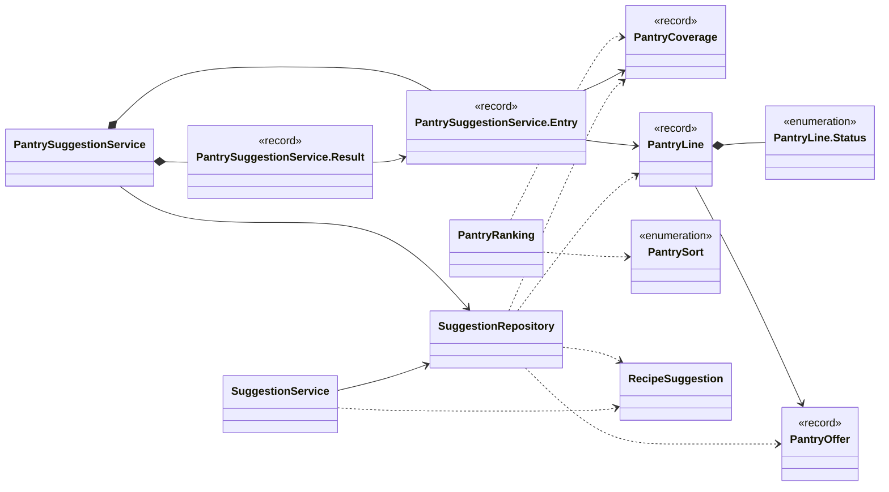

Arrows: `-->` has a field or record component of that type, `..>` takes it in its constructor or mentions it in a method signature, `<|--` extends, `<|..` implements, `*--` nested type. Only relationships inside this package are drawn here; each class below also shows its neighbours in other packages.

| Type | Kind | Role | What it is |
|------|------|------|------------|
| [`PantryCoverage`](#pantrycoverage) | record |  | How well one recipe is covered by what the household already has and by what is on sale. |
| [`PantryLine`](#pantryline) | record |  | One ingredient of a suggested recipe and where it stands: in stock, expiring soon, missing, or "to taste". |
| [`PantryLine.Status`](#pantrylinestatus) | enum |  |  |
| [`PantryOffer`](#pantryoffer) | record |  | One offer that is on sale today for an ingredient: the store, the pack it is for, and the prices. |
| [`PantryRanking`](#pantryranking) | class |  | The ranking rules of the pantry-first suggestions, as pure functions (no database). |
| [`PantrySort`](#pantrysort) | enum |  | The orders offered for the pantry-first suggestions; the user picks one, the default is .BEST. |
| [`PantrySuggestionService`](#pantrysuggestionservice) | class |  | Recipe suggestions that serve the purpose of the app: healthy meals (all recipe data is cooked from fresh ingredients) at the lowest shopping cost. |
| [`PantrySuggestionService.Entry`](#pantrysuggestionserviceentry) | record |  | A suggested recipe with its tag names, its coverage counts and its ingredient lines (offers on missing ones). |
| [`PantrySuggestionService.Result`](#pantrysuggestionserviceresult) | record |  | One page, the number of recipes that fit in all pages, and the request that produced it. |
| [`RecipeSuggestion`](#recipesuggestion) | class |  | Plain data holder for one ranked recipe suggestion: the recipe, how many of its ingredients matched the signal (expiring soon / on sale), and which inventory items matched. |
| [`SuggestionRepository`](#suggestionrepository) | class |  | All SQL for ranking recipes by matching ingredients lives here and nowhere else. |
| [`SuggestionService`](#suggestionservice) | class |  | Business logic for recipe suggestions. |

## PantryCoverage

*record*

How well one recipe is covered by what the household already has and by what is on sale. Plain data.
Ingredients that are only "to taste" (salt) are not counted. An ingredient is in stock when its inventory
quantity is above zero; the amount the recipe needs is not compared with the amount in stock yet.

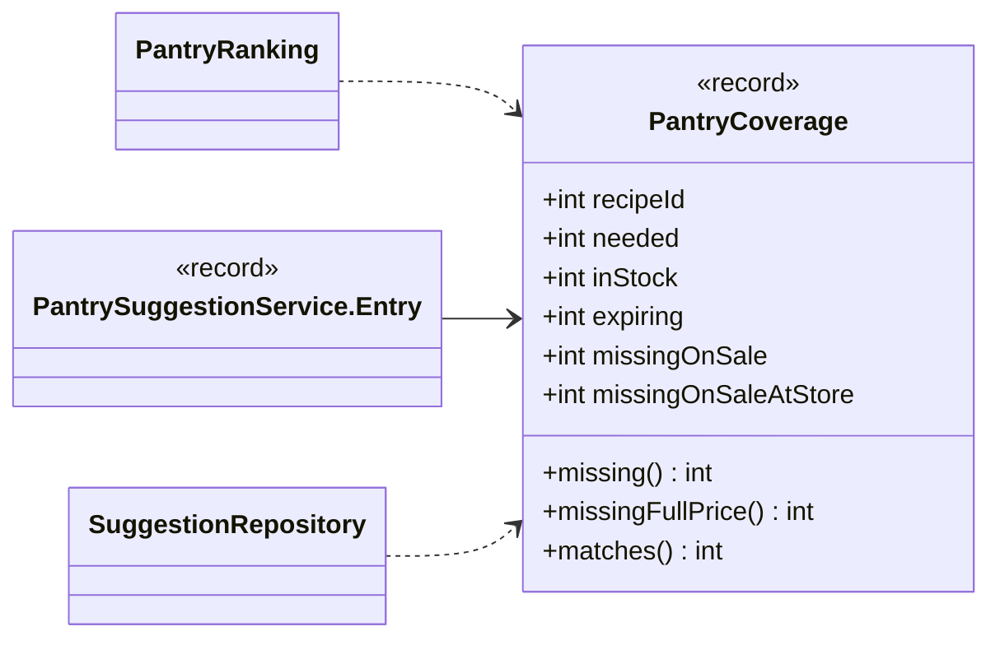

| Component | Type |
|---|---|
| `recipeId` | `int` |
| `needed` | `int` |
| `inStock` | `int` |
| `expiring` | `int` |
| `missingOnSale` | `int` |
| `missingOnSaleAtStore` | `int` |

| Member | Visibility | What it does |
|---|---|---|
| `int missing()` | public | Ingredients still to buy. |
| `int missingFullPrice()` | public | Ingredients still to buy that are not on sale. |
| `int matches()` | public | What makes the recipe fit now: ingredients in stock plus missing ones that are on sale. |

**Referenced by:** `PantryRanking`, `SuggestionRepository`

## PantryLine

*record*

One ingredient of a suggested recipe and where it stands: in stock, expiring soon, missing, or "to taste".
Missing ingredients carry the offers that are on sale today (every store, never one picked for the user).

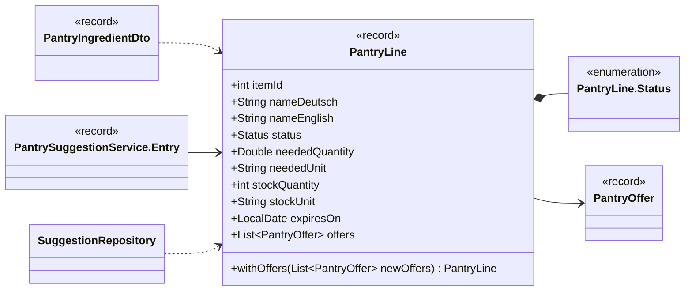

| Component | Type |
|---|---|
| `itemId` | `int` |
| `nameDeutsch` | `String` |
| `nameEnglish` | `String` |
| `status` | `Status` |
| `neededQuantity` | `Double` |
| `neededUnit` | `String` |
| `stockQuantity` | `int` |
| `stockUnit` | `String` |
| `expiresOn` | `LocalDate` |
| `offers` | `List<PantryOffer>` |

| Member | Visibility | What it does |
|---|---|---|
| `PantryLine withOffers(List<PantryOffer> newOffers)` | public |  |

**Referenced by:** `PantryIngredientDto`, `SuggestionRepository`

## PantryLine.Status

*enum*

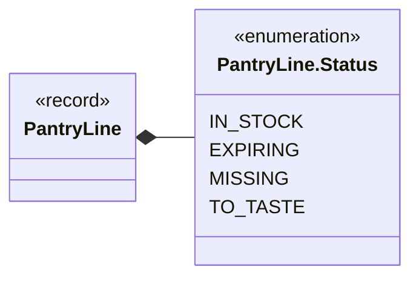

**Values:** `IN_STOCK`, `EXPIRING`, `MISSING`, `TO_TASTE`

**Referenced by:** `PantryLine`

## PantryOffer

*record*

One offer that is on sale today for an ingredient: the store, the pack it is for, and the prices.

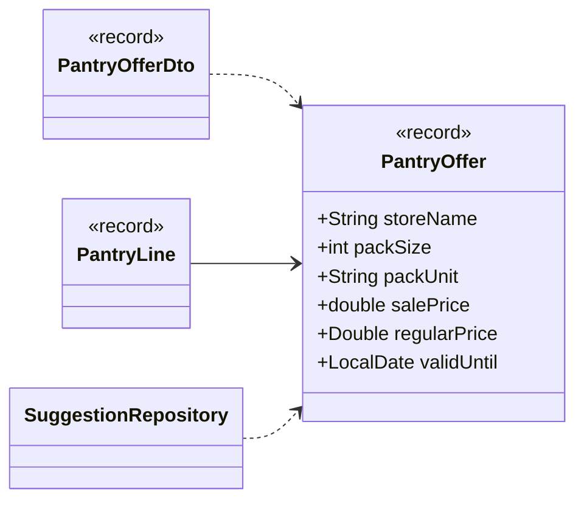

| Component | Type |
|---|---|
| `storeName` | `String` |
| `packSize` | `int` |
| `packUnit` | `String` |
| `salePrice` | `double` |
| `regularPrice` | `Double` |
| `validUntil` | `LocalDate` |

**Referenced by:** `PantryLine`, `PantryOfferDto`, `SuggestionRepository`

## PantryRanking

*class*

The ranking rules of the pantry-first suggestions, as pure functions (no database). The purpose is healthy
meals at the lowest shopping cost: use up what is already in the pantry before it expires, and buy as little
as possible, preferably what is on sale. So pantry ingredients rank a recipe HIGHER, never lower.
The weights below are the product decision to tune; every order is a choice the user can change.

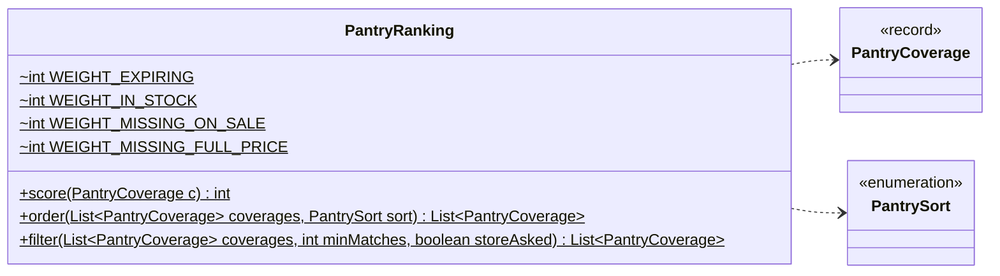

| Field | Type |
|---|---|
| `WEIGHT_EXPIRING` | `int` |
| `WEIGHT_IN_STOCK` | `int` |
| `WEIGHT_MISSING_ON_SALE` | `int` |
| `WEIGHT_MISSING_FULL_PRICE` | `int` |

| Member | Visibility | What it does |
|---|---|---|
| `int score(PantryCoverage c)` | public static | The weighted score used by PantrySort.BEST: higher is better. |
| `List<PantryCoverage> order(List<PantryCoverage> coverages, PantrySort sort)` | public static | Orders coverages for BEST, FEWEST_TO_BUY or EXPIRING. |
| `List<PantryCoverage> filter(List<PantryCoverage> coverages, int minMatches, boolean storeAsked)` | public static | Keeps the coverages that fit now: at least minMatches ingredients in stock or on sale, and, when storeAsked, at least one missing ingredient on sale at that store. |

## PantrySort

*enum*

The orders offered for the pantry-first suggestions; the user picks one, the default is .BEST.

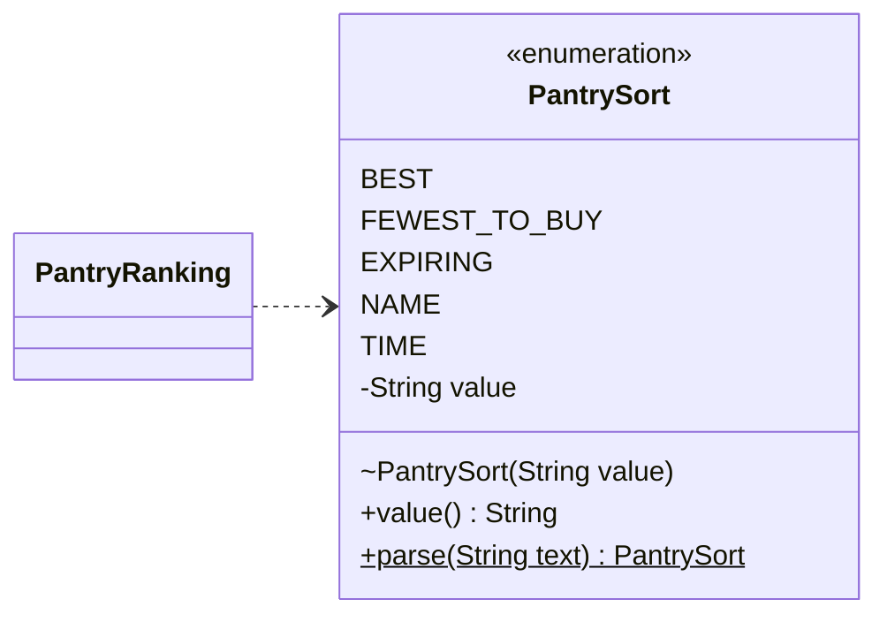

**Values:** `BEST`, `FEWEST_TO_BUY`, `EXPIRING`, `NAME`, `TIME`

| Field | Type |
|---|---|
| `value` | `String` |

| Member | Visibility | What it does |
|---|---|---|
| `PantrySort(String value)` | package |  |
| `String value()` | public |  |
| `PantrySort parse(String text)` | public static | Null or blank is .BEST; an unknown value is an IllegalArgumentException (the API answers 400). |

**Referenced by:** `PantryRanking`

## PantrySuggestionService

*class*

Recipe suggestions that serve the purpose of the app: healthy meals (all recipe data is cooked from fresh
ingredients) at the lowest shopping cost. It ranks the recipes by what the household already has (items about to
expire first), then by how little is left to buy and how much of that is on sale, see PantryRanking.
It only ranks and presents: the offers are listed per store, no store and no recipe is picked for the user.
No SQL here; the counts come from SuggestionRepository, the filters and the sort by name or time from the
recipe search.

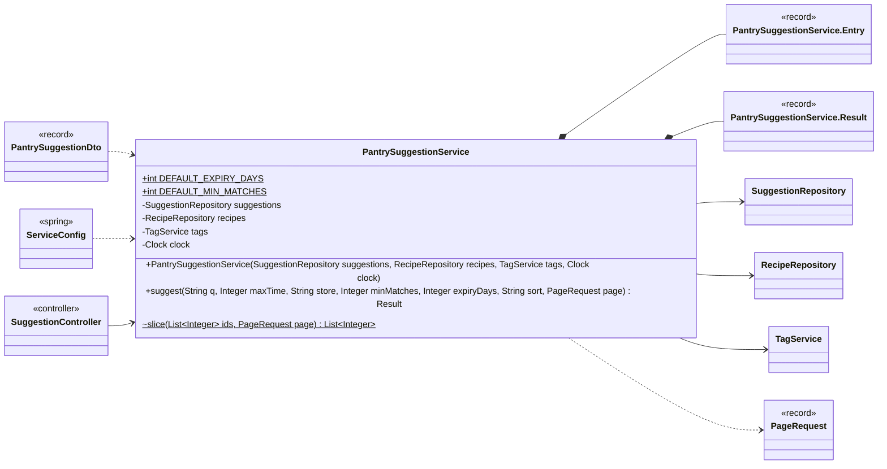

| Field | Type |
|---|---|
| `DEFAULT_EXPIRY_DAYS` | `int` |
| `DEFAULT_MIN_MATCHES` | `int` |
| `suggestions` | `SuggestionRepository` |
| `recipes` | `RecipeRepository` |
| `tags` | `TagService` |
| `clock` | `Clock` |

| Member | Visibility | What it does |
|---|---|---|
| `PantrySuggestionService(SuggestionRepository suggestions, RecipeRepository recipes, TagService tags, Clock clock)` | public |  |
| `Result suggest(String q, Integer maxTime, String store, Integer minMatches, Integer expiryDays, String sort, PageRequest page)` | public | Bad values are an IllegalArgumentException (the API answers 400). |
| `List<Integer> slice(List<Integer> ids, PageRequest page)` | package static | The ids of the requested page; empty when the page is past the end. |

**Referenced by:** `PantrySuggestionDto`, `ServiceConfig`, `SuggestionController`

## PantrySuggestionService.Entry

*record*

A suggested recipe with its tag names, its coverage counts and its ingredient lines (offers on missing ones).

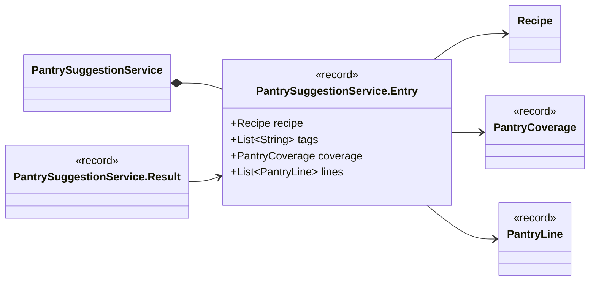

| Component | Type |
|---|---|
| `recipe` | `Recipe` |
| `tags` | `List<String>` |
| `coverage` | `PantryCoverage` |
| `lines` | `List<PantryLine>` |

**Referenced by:** `PantrySuggestionService`

## PantrySuggestionService.Result

*record*

One page, the number of recipes that fit in all pages, and the request that produced it.

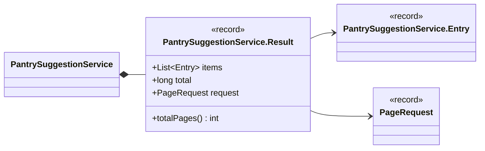

| Component | Type |
|---|---|
| `items` | `List<Entry>` |
| `total` | `long` |
| `request` | `PageRequest` |

| Member | Visibility | What it does |
|---|---|---|
| `int totalPages()` | public |  |

**Referenced by:** `PantrySuggestionService`

## RecipeSuggestion

*class*

Plain data holder for one ranked recipe suggestion: the recipe, how many of its
ingredients matched the signal (expiring soon / on sale), and which inventory items matched.
No logic here on purpose, just the fields, a constructor, and getters.

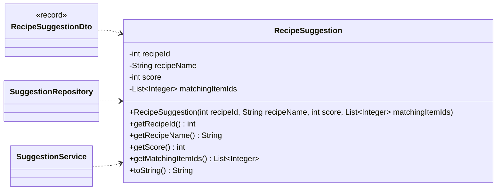

| Field | Type |
|---|---|
| `recipeId` | `int` |
| `recipeName` | `String` |
| `score` | `int` |
| `matchingItemIds` | `List<Integer>` |

| Member | Visibility | What it does |
|---|---|---|
| `RecipeSuggestion(int recipeId, String recipeName, int score, List<Integer> matchingItemIds)` | public |  |
| `int getRecipeId()` | public |  |
| `String getRecipeName()` | public |  |
| `int getScore()` | public |  |
| `List<Integer> getMatchingItemIds()` | public |  |
| `String toString()` | public |  |

**Referenced by:** `RecipeSuggestionDto`, `SuggestionRepository`, `SuggestionService`

## SuggestionRepository

*class*

All SQL for ranking recipes by matching ingredients lives here and nowhere else.
The rest of the app never writes SQL against recipe/recipe_ingredient/inventory_item/
store_item/store_discount for suggestions; it calls these methods.

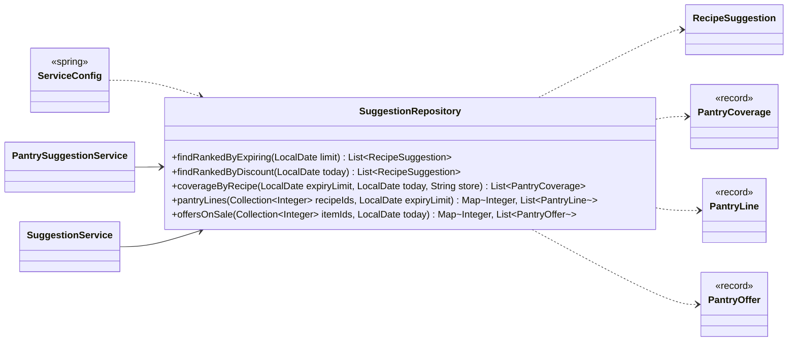

| Member | Visibility | What it does |
|---|---|---|
| `List<RecipeSuggestion> findRankedByExpiring(LocalDate limit)` | public | Recipes ranked by how many ingredients are inventory items expiring on or before `limit`. |
| `List<RecipeSuggestion> findRankedByDiscount(LocalDate today)` | public | Recipes ranked by how many ingredients map to a store_item with a discount current on `today`. |
| `List<PantryCoverage> coverageByRecipe(LocalDate expiryLimit, LocalDate today, String store)` | public | For every recipe: how many ingredients it needs, how many are in stock, how many of those expire on or before expiryLimit, how many of the missing ones are on sale on today, and how many of them at the store named store (null = no store ask |
| `Map<Integer, List<PantryLine>> pantryLines(Collection<Integer> recipeIds, LocalDate expiryLimit)` | public | The ingredients of these recipes with the stock of each (recipe id -> lines, by name). |
| `Map<Integer, List<PantryOffer>> offersOnSale(Collection<Integer> itemIds, LocalDate today)` | public | The offers that are on sale on today for these inventory items (item id -> offers), by store name, then pack size. |

**Referenced by:** `PantrySuggestionService`, `ServiceConfig`, `SuggestionService`

## SuggestionService

*class*

Business logic for recipe suggestions. No SQL here, no UI here.
It only ranks and surfaces candidates from two signals (soon-to-expire inventory,
ingredients currently on sale); it never picks a recipe on the user's behalf.

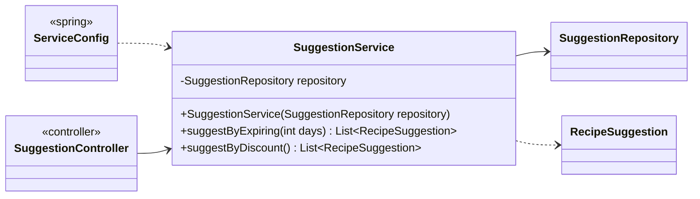

| Field | Type |
|---|---|
| `repository` | `SuggestionRepository` |

| Member | Visibility | What it does |
|---|---|---|
| `SuggestionService(SuggestionRepository repository)` | public |  |
| `List<RecipeSuggestion> suggestByExpiring(int days)` | public | Recipes ranked by how many ingredients are inventory items expiring within the next `days` days. |
| `List<RecipeSuggestion> suggestByDiscount()` | public | Recipes ranked by how many ingredients are currently on sale. |

**Referenced by:** `ServiceConfig`, `SuggestionController`
