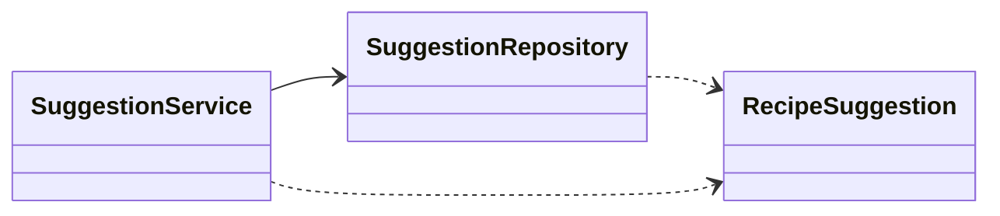
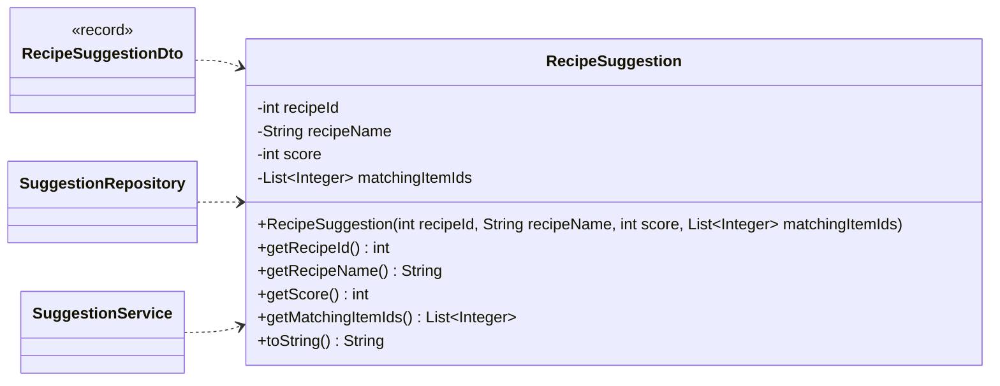
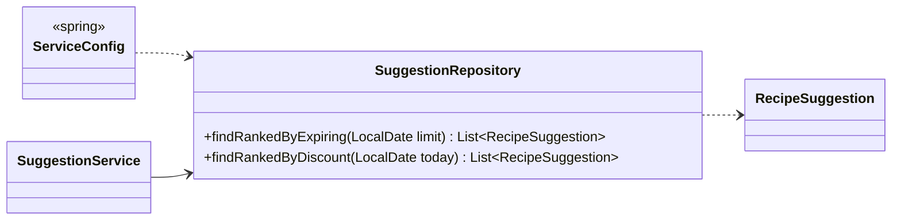
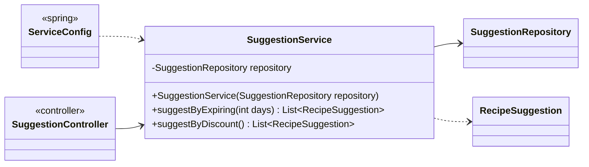

<!-- Generated by scripts/docs/generate_docs.py from src/main/java. Do not edit by hand; change the code or the generator. -->

# Package `suggestions`

Recipe suggestions by savings and by expiring stock.

3 types in 3 source files (`src/main/java/de/dahaem/suggestions`). Back to the [class index](README.md).

## Overview

Arrows: `-->` has a field or record component of that type, `..>` takes it in its constructor or mentions it in a method signature, `<|--` extends, `<|..` implements, `*--` nested type. Only relationships inside this package are drawn here; each class below also shows its neighbours in other packages.

| Type | Kind | Role | What it is |
|------|------|------|------------|
| [`RecipeSuggestion`](#recipesuggestion) | class |  | Plain data holder for one ranked recipe suggestion: the recipe, how many of its ingredients matched the signal (expiring soon / on sale), and which inventory items matched. |
| [`SuggestionRepository`](#suggestionrepository) | class |  | All SQL for ranking recipes by matching ingredients lives here and nowhere else. |
| [`SuggestionService`](#suggestionservice) | class |  | Business logic for recipe suggestions. |

## RecipeSuggestion

*class*

Plain data holder for one ranked recipe suggestion: the recipe, how many of its
ingredients matched the signal (expiring soon / on sale), and which inventory items matched.
No logic here on purpose, just the fields, a constructor, and getters.

| Field | Type |
|---|---|
| `recipeId` | `int` |
| `recipeName` | `String` |
| `score` | `int` |
| `matchingItemIds` | `List<Integer>` |

| Member | Visibility | What it does |
|---|---|---|
| `RecipeSuggestion(int recipeId, String recipeName, int score, List<Integer> matchingItemIds)` | public |  |
| `int getRecipeId()` | public |  |
| `String getRecipeName()` | public |  |
| `int getScore()` | public |  |
| `List<Integer> getMatchingItemIds()` | public |  |
| `String toString()` | public |  |

**Referenced by:** `RecipeSuggestionDto`, `SuggestionRepository`, `SuggestionService`

## SuggestionRepository

*class*

All SQL for ranking recipes by matching ingredients lives here and nowhere else.
The rest of the app never writes SQL against recipe/recipe_ingredient/inventory_item/
store_item/store_discount for suggestions; it calls these methods.

| Member | Visibility | What it does |
|---|---|---|
| `List<RecipeSuggestion> findRankedByExpiring(LocalDate limit)` | public | Recipes ranked by how many ingredients are inventory items expiring on or before `limit`. |
| `List<RecipeSuggestion> findRankedByDiscount(LocalDate today)` | public | Recipes ranked by how many ingredients map to a store_item with a discount current on `today`. |

**Referenced by:** `ServiceConfig`, `SuggestionService`

## SuggestionService

*class*

Business logic for recipe suggestions. No SQL here, no UI here.
It only ranks and surfaces candidates from two signals (soon-to-expire inventory,
ingredients currently on sale); it never picks a recipe on the user's behalf.

| Field | Type |
|---|---|
| `repository` | `SuggestionRepository` |

| Member | Visibility | What it does |
|---|---|---|
| `SuggestionService(SuggestionRepository repository)` | public |  |
| `List<RecipeSuggestion> suggestByExpiring(int days)` | public | Recipes ranked by how many ingredients are inventory items expiring within the next `days` days. |
| `List<RecipeSuggestion> suggestByDiscount()` | public | Recipes ranked by how many ingredients are currently on sale. |

**Referenced by:** `ServiceConfig`, `SuggestionController`
