<!-- Generated by scripts/docs/generate_docs.py from src/main/java. Do not edit by hand; change the code or the generator. -->

# Package `tags`

Recipe tags derived from the data, animals per item, the tagger and its runners.

29 types in 17 source files (`src/main/java/de/dahaem/tags`). Back to the [class index](README.md).

## Overview

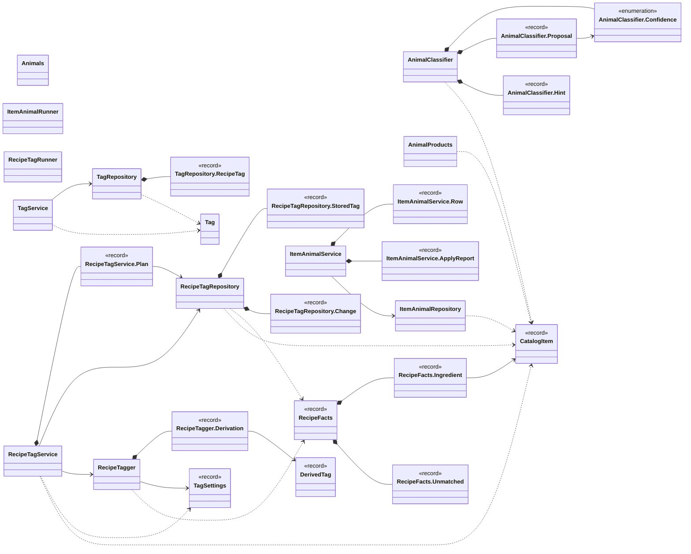

Arrows: `-->` has a field or record component of that type, `..>` takes it in its constructor or mentions it in a method signature, `<|--` extends, `<|..` implements, `*--` nested type. Only relationships inside this package are drawn here; each class below also shows its neighbours in other packages.

| Type | Kind | Role | What it is |
|------|------|------|------------|
| [`AnimalClassifier`](#animalclassifier) | class |  | Proposes the animal(s) and the alcohol flag of a catalogue item from its name. |
| [`AnimalClassifier.Confidence`](#animalclassifierconfidence) | enum |  |  |
| [`AnimalClassifier.Proposal`](#animalclassifierproposal) | record |  | animals are the certain ones, possibleAnimals the ones the generic item may come from; no animal is in both lists. |
| [`AnimalClassifier.Hint`](#animalclassifierhint) | record |  |  |
| [`AnimalProducts`](#animalproducts) | class |  | Which catalogue items stop a recipe from being vegetarisch / vegan. |
| [`Animals`](#animals) | class |  | The animal values an item can have: the Tier tags, in display order. |
| [`CatalogItem`](#catalogitem) | record |  | One inventory_item as the tag logic sees it. |
| [`DerivedTag`](#derivedtag) | record |  | A tag the tagger derives: a name in a tag group (tag_category). |
| [`ItemAnimalRepository`](#itemanimalrepository) | class |  | All SQL for inventory_item_animal and the alcohol flag, and the read-only catalogue queries the animal tool needs. |
| [`ItemAnimalRunner`](#itemanimalrunner) | class | command-line tool | Command-line tool for the item → animal table (inventory_item_animal). |
| [`ItemAnimalService`](#itemanimalservice) | class |  | Proposes which animal(s) the meat / fish items of the catalogue come from, which generic items (Salami, Gelatine ...) MAY come from which animals, and which items contain alcohol, as a TSV for Nate to review; and applies the reviewed TSV. |
| [`ItemAnimalService.Row`](#itemanimalservicerow) | record |  | One TSV line. |
| [`ItemAnimalService.ApplyReport`](#itemanimalserviceapplyreport) | record |  | Result of .apply. |
| [`RecipeFacts`](#recipefacts) | record |  | What the tagger needs to know about one recipe. |
| [`RecipeFacts.Ingredient`](#recipefactsingredient) | record |  | One ingredient line. |
| [`RecipeFacts.Unmatched`](#recipefactsunmatched) | record |  | A row of recipe_unmatched_ingredient: lineNo is null for an 'unchecked' recipe. |
| [`RecipeTagRepository`](#recipetagrepository) | class |  | All SQL for the derived-tag run: reads the recipes and their tags, and writes derived recipe_tag rows. |
| [`RecipeTagRepository.StoredTag`](#recipetagrepositorystoredtag) | record |  | One recipe_tag row as stored. |
| [`RecipeTagRepository.Change`](#recipetagrepositorychange) | record |  | One change to apply: tag a recipe as derived, or remove a derived tag. |
| [`RecipeTagRunner`](#recipetagrunner) | class | command-line tool | Command-line tool that derives recipe tags from DAHÄM's own data. |
| [`RecipeTagService`](#recipetagservice) | class |  | Derives the tags of every recipe and replaces ONLY the recipe_tag rows whose source is 'derived'. |
| [`RecipeTagService.Plan`](#recipetagserviceplan) | record |  | What a run would do (or did). |
| [`RecipeTagger`](#recipetagger) | class |  | Works out the tags a recipe gets from DAHÄM's own data. |
| [`RecipeTagger.Derivation`](#recipetaggerderivation) | record |  | The result for one recipe. |
| [`Tag`](#tag) | class |  | Plain data holder for one row of the tag table. |
| [`TagRepository`](#tagrepository) | class |  | All SQL for the tag and recipe_tag tables lives here. |
| [`TagRepository.RecipeTag`](#tagrepositoryrecipetag) | record |  |  |
| [`TagService`](#tagservice) | class |  | Business logic for tags. |
| [`TagSettings`](#tagsettings) | record |  | Thresholds for the derived recipe tags, from config/recipe_tags.properties (all per serving). |

## AnimalClassifier

*class*

Proposes the animal(s) and the alcohol flag of a catalogue item from its name. Pure: no SQL, no I/O.

Three kinds of evidence, kept apart on purpose (surface, don't decide):

- the name SAYS the animal ("Hähnchenbrustfilet", "Rinderhackfleisch", "Entenbrust", "Lachsfilet") →
      certain animals, Confidence.CONFIDENT;

- the animal is only implied and the product is made from one animal ("Kasseler", "Speck",
      "Schinken") → a suggestion of certain animals, always Confidence.REVIEW;

- the product is generic and exists from different animals, the recipe does not say which
      ("Salami", "Fleischwurst", "Wiener", "Lyoner", "Leberwurst", "Chorizo", "Gelatine") → POSSIBLE
      animals, always REVIEW: they give no Tier tag, but they block vegetarisch and make a recipe
      "anpassbar" for a household that excludes one of them;

- no evidence at all → REVIEW with no proposal (and, for the fish categories, the animal
      the subcategory points at as the suggestion).

Nothing is stored without Nate. Alcohol is proposed the same way: a drinks subcategory that is alcoholic
is CONFIDENT, an alcohol word in the name of something else is REVIEW.

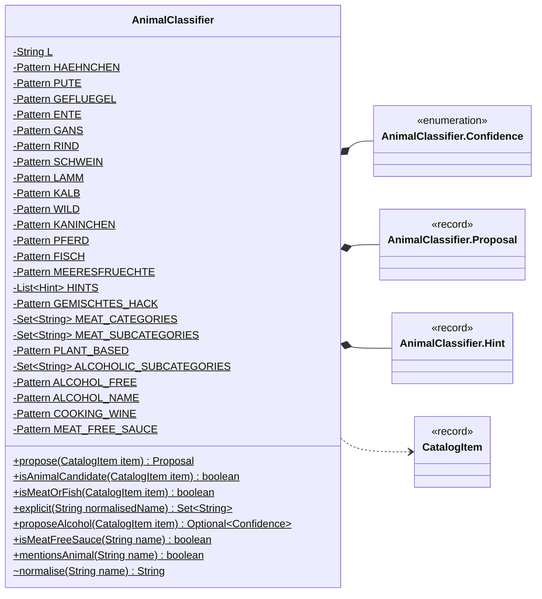

| Field | Type |
|---|---|
| `L` | `String` |
| `HAEHNCHEN` | `Pattern` |
| `PUTE` | `Pattern` |
| `GEFLUEGEL` | `Pattern` |
| `ENTE` | `Pattern` |
| `GANS` | `Pattern` |
| `RIND` | `Pattern` |
| `SCHWEIN` | `Pattern` |
| `LAMM` | `Pattern` |
| `KALB` | `Pattern` |
| `WILD` | `Pattern` |
| `KANINCHEN` | `Pattern` |
| `PFERD` | `Pattern` |
| `FISCH` | `Pattern` |
| `MEERESFRUECHTE` | `Pattern` |
| `HINTS` | `List<Hint>` |
| `GEMISCHTES_HACK` | `Pattern` |
| `MEAT_CATEGORIES` | `Set<String>` |
| `MEAT_SUBCATEGORIES` | `Set<String>` |
| `PLANT_BASED` | `Pattern` |
| `ALCOHOLIC_SUBCATEGORIES` | `Set<String>` |
| `ALCOHOL_FREE` | `Pattern` |
| `ALCOHOL_NAME` | `Pattern` |
| `COOKING_WINE` | `Pattern` |
| `MEAT_FREE_SAUCE` | `Pattern` |

| Member | Visibility | What it does |
|---|---|---|
| `Proposal propose(CatalogItem item)` | public static | Proposal for an item; call only for items that .isAnimalCandidate accepts. |
| `boolean isAnimalCandidate(CatalogItem item)` | public static | True for the items the animal tool proposes something for: every meat / fish item, and any other item whose name is a generic animal product (Gelatine, Schmalz, Worcestersauce ...). |
| `boolean isMeatOrFish(CatalogItem item)` | public static | Where meat / fish live in the catalogue: whole categories, plus single subcategories of other categories. |
| `Set<String> explicit(String normalisedName)` | public static | Animals the name itself says, in canonical order; empty when the name does not say one. |
| `Optional<Confidence> proposeAlcohol(CatalogItem item)` | public static | Alcohol proposal for an item, empty when none: an alcoholic drinks subcategory is CONFIDENT (unless the name says alcohol-free), an alcohol word in the name of anything else is REVIEW, cooking wine is CONFIDENT. |
| `boolean isMeatFreeSauce(String name)` | public static | True for a sauce that is only named after a meat dish; such an item names no animal. |
| `boolean mentionsAnimal(String name)` | public static | True if the name says or implies an animal (used to keep such items out of vegetarian recipes). |
| `String normalise(String name)` | package static |  |

## AnimalClassifier.Confidence

*enum*

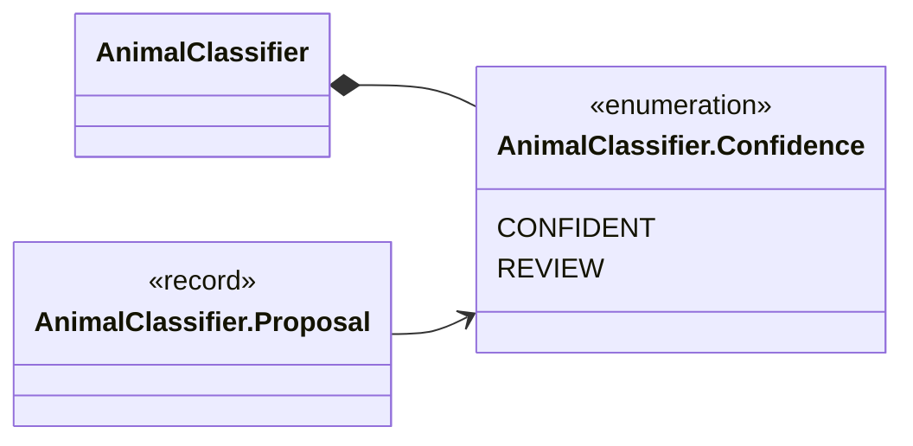

**Values:** `CONFIDENT`, `REVIEW`

**Referenced by:** `AnimalClassifier`

## AnimalClassifier.Proposal

*record*

animals are the certain ones, possibleAnimals the ones the generic item may come from;
no animal is in both lists.

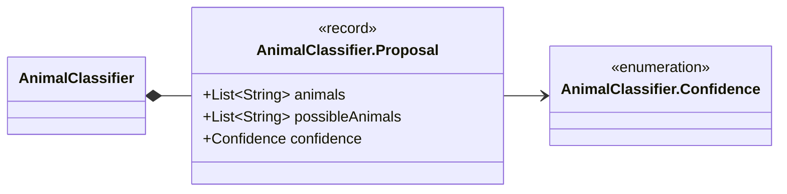

| Component | Type |
|---|---|
| `animals` | `List<String>` |
| `possibleAnimals` | `List<String>` |
| `confidence` | `Confidence` |

**Referenced by:** `AnimalClassifier`

## AnimalClassifier.Hint

*record*

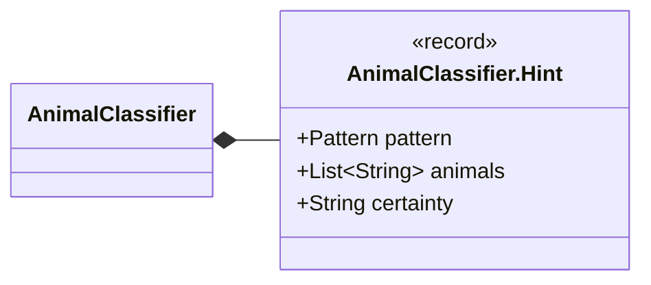

| Component | Type |
|---|---|
| `pattern` | `Pattern` |
| `animals` | `List<String>` |
| `certainty` | `String` |

**Referenced by:** `AnimalClassifier`

## AnimalProducts

*class*

Which catalogue items stop a recipe from being vegetarisch / vegan. Pure: no SQL.

The rules are a heuristic over category, subcategory and name, written so that doubt blocks the
tag: a missing "vegan" costs nothing, a wrong one is a claim about food. The runner can print every
catalogue item together with the rule that blocks it (RecipeTagRunner --animal-products) so
the list can be reviewed and extended here.

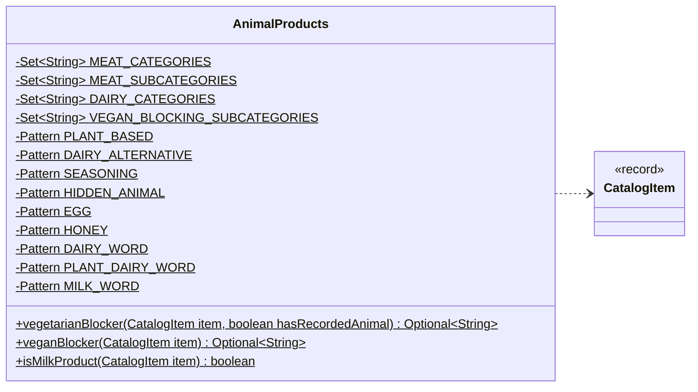

| Field | Type |
|---|---|
| `MEAT_CATEGORIES` | `Set<String>` |
| `MEAT_SUBCATEGORIES` | `Set<String>` |
| `DAIRY_CATEGORIES` | `Set<String>` |
| `VEGAN_BLOCKING_SUBCATEGORIES` | `Set<String>` |
| `PLANT_BASED` | `Pattern` |
| `DAIRY_ALTERNATIVE` | `Pattern` |
| `SEASONING` | `Pattern` |
| `HIDDEN_ANIMAL` | `Pattern` |
| `EGG` | `Pattern` |
| `HONEY` | `Pattern` |
| `DAIRY_WORD` | `Pattern` |
| `PLANT_DAIRY_WORD` | `Pattern` |
| `MILK_WORD` | `Pattern` |

| Member | Visibility | What it does |
|---|---|---|
| `Optional<String> vegetarianBlocker(CatalogItem item, boolean hasRecordedAnimal)` | public static | Why this item keeps a recipe from being vegetarian, or empty if it does not. |
| `Optional<String> veganBlocker(CatalogItem item)` | public static | Why this item (which is not meat / fish) keeps a recipe from being vegan: dairy, egg, honey or another animal product; empty if it does not. |
| `boolean isMilkProduct(CatalogItem item)` | public static | True if the item is a milk product (milk, cream, butter, cheese, yoghurt ...). |

## Animals

*class*

The animal values an item can have: the Tier tags, in display order. The same list is the CHECK in
inventory_item_animal (migrations 0011 / 0012), so a value outside it cannot be stored.

Geflügel is mixed or unspecified poultry; Ente, Gans, Kaninchen and Pferd are their own values
because rabbit and horse are not kosher, horse is disputed for halal and some people do not eat duck.

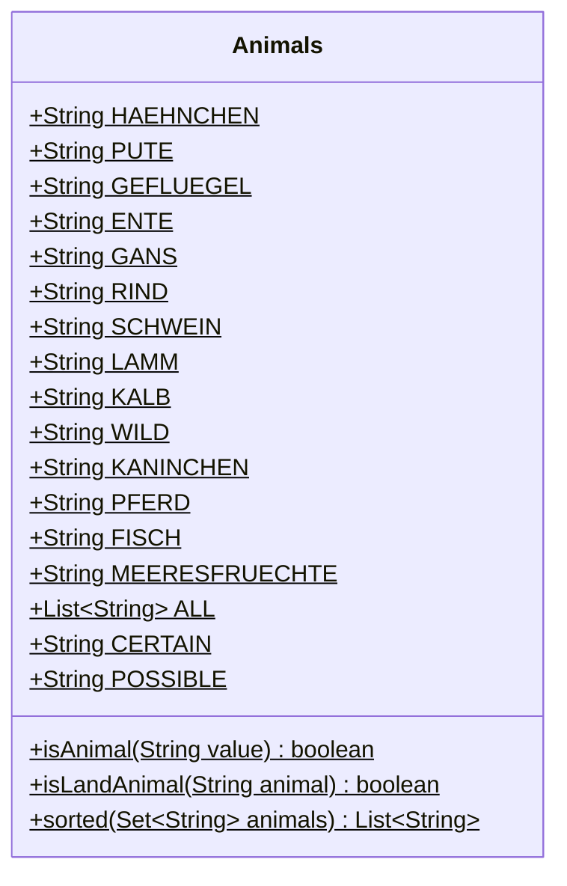

| Field | Type |
|---|---|
| `HAEHNCHEN` | `String` |
| `PUTE` | `String` |
| `GEFLUEGEL` | `String` |
| `ENTE` | `String` |
| `GANS` | `String` |
| `RIND` | `String` |
| `SCHWEIN` | `String` |
| `LAMM` | `String` |
| `KALB` | `String` |
| `WILD` | `String` |
| `KANINCHEN` | `String` |
| `PFERD` | `String` |
| `FISCH` | `String` |
| `MEERESFRUECHTE` | `String` |
| `ALL` | `List<String>` |
| `CERTAIN` | `String` |
| `POSSIBLE` | `String` |

| Member | Visibility | What it does |
|---|---|---|
| `boolean isAnimal(String value)` | public static |  |
| `boolean isLandAnimal(String animal)` | public static | True for animals that live on land (everything except fish and seafood): the meat of "Fleisch mit Milch". |
| `List<String> sorted(Set<String> animals)` | public static | The given animals in the canonical order of .ALL. |

## CatalogItem

*record*

One inventory_item as the tag logic sees it. name is the German name, or the English one when
the item has no German name (items added later were entered in German only). alcohol is the item's
alcohol flag (migration 0012): it contains alcohol as an ingredient.

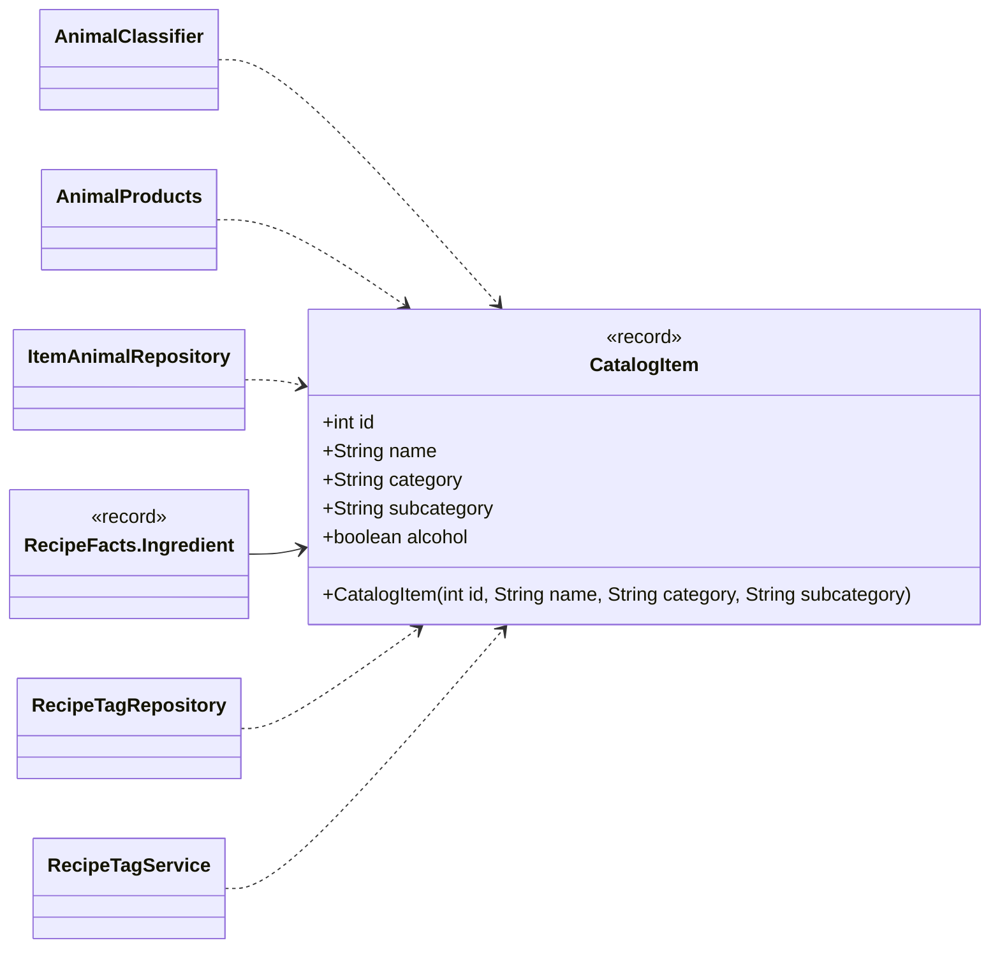

| Component | Type |
|---|---|
| `id` | `int` |
| `name` | `String` |
| `category` | `String` |
| `subcategory` | `String` |
| `alcohol` | `boolean` |

| Member | Visibility | What it does |
|---|---|---|
| `CatalogItem(int id, String name, String category, String subcategory)` | public |  |

**Referenced by:** `AnimalClassifier`, `AnimalProducts`, `ItemAnimalRepository`, `RecipeTagRepository`, `RecipeTagService`

## DerivedTag

*record*

A tag the tagger derives: a name in a tag group (tag_category).

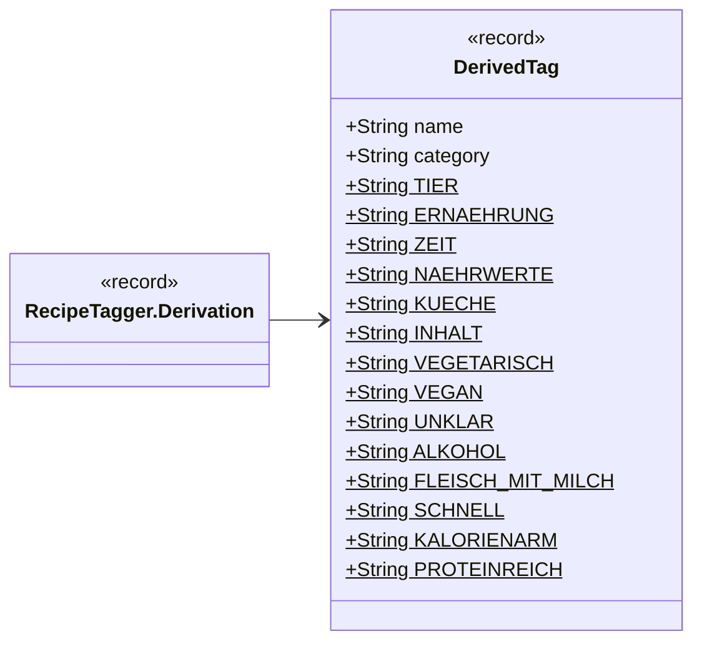

| Component | Type |
|---|---|
| `name` | `String` |
| `category` | `String` |
| `TIER` | `String` |
| `ERNAEHRUNG` | `String` |
| `ZEIT` | `String` |
| `NAEHRWERTE` | `String` |
| `KUECHE` | `String` |
| `INHALT` | `String` |
| `VEGETARISCH` | `String` |
| `VEGAN` | `String` |
| `UNKLAR` | `String` |
| `ALKOHOL` | `String` |
| `FLEISCH_MIT_MILCH` | `String` |
| `SCHNELL` | `String` |
| `KALORIENARM` | `String` |
| `PROTEINREICH` | `String` |

## ItemAnimalRepository

*class*

All SQL for inventory_item_animal and the alcohol flag, and the read-only catalogue queries the animal tool needs.

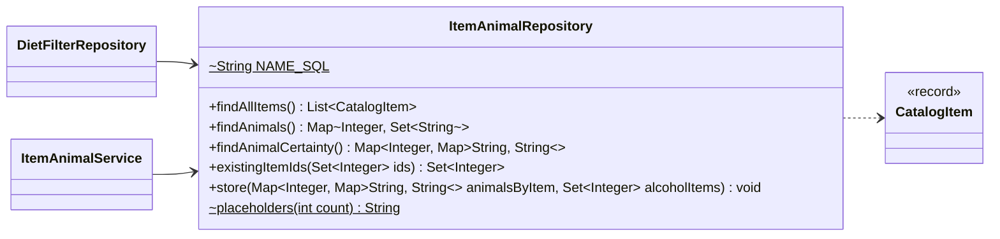

| Field | Type |
|---|---|
| `NAME_SQL` | `String` |

| Member | Visibility | What it does |
|---|---|---|
| `List<CatalogItem> findAllItems()` | public | Every catalogue item, by id (read-only); the animal tool and the diet filter work from this list. |
| `Map<Integer, Set<String>> findAnimals()` | public | item id → animals already stored (certain and possible). |
| `Map<Integer, Map<String, String>> findAnimalCertainty()` | public | item id → (animal → 'certain' \| 'possible') already stored. |
| `Set<Integer> existingItemIds(Set<Integer> ids)` | public | The ids of the given items that exist in the catalogue. |
| `void store(Map<Integer, Map<String, String>> animalsByItem, Set<Integer> alcoholItems)` | public | Stores the reviewed animals (item id → animal → certainty) and sets the alcohol flag of the given items, all in ONE transaction. |
| `String placeholders(int count)` | package static |  |

**Referenced by:** `DietFilterRepository`, `ItemAnimalService`

## ItemAnimalRunner

*class · command-line tool*

Command-line tool for the item → animal table (inventory_item_animal).

  ItemAnimalRunner [--all] [--out items.tsv]               propose animals + alcohol (read-only), write a TSV
  ItemAnimalRunner --apply reviewed.tsv [--commit]         store the CONFIDENT / reviewed rows

Proposing only reads the catalogue. Items that are already classified (an animal stored, or the alcohol
flag set) stay out of the proposal unless --all is given. The TSV has the CERTAIN animals (the item IS
from them), the POSSIBLE animals (a generic item such as Salami or Gelatine that exists from several animals)
and an alcohol column (yes / no). Applying is a dry run unless --commit is given; with it all rows go
in one transaction. Rows marked REVIEW are never stored; to accept one, fix the columns and change its status
to REVIEWED (or OK). The database comes from DAHAEM_DB_URL / _USER / _PASSWORD (migration 0012 must be applied).

Exit code: 0 = OK, 1 = failed (nothing written), 2 = bad arguments.

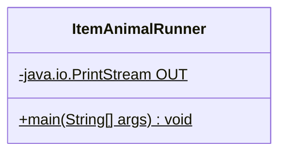

| Field | Type |
|---|---|
| `OUT` | `java.io.PrintStream` |

| Member | Visibility | What it does |
|---|---|---|
| `void main(String[] args)` | public static |  |

## ItemAnimalService

*class*

Proposes which animal(s) the meat / fish items of the catalogue come from, which generic items (Salami,
Gelatine ...) MAY come from which animals, and which items contain alcohol, as a TSV for Nate to review;
and applies the reviewed TSV. No SQL here (see ItemAnimalRepository), no console I/O.

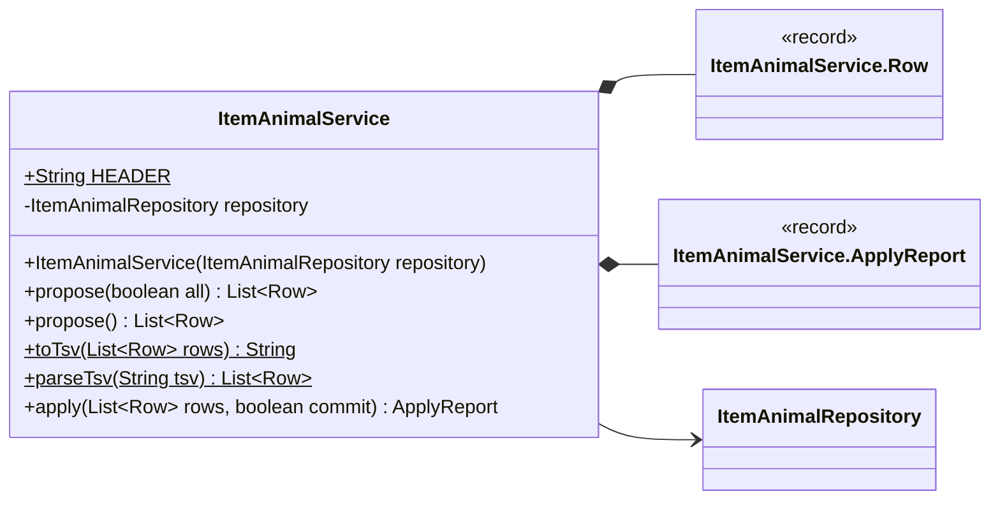

| Field | Type |
|---|---|
| `HEADER` | `String` |
| `repository` | `ItemAnimalRepository` |

| Member | Visibility | What it does |
|---|---|---|
| `ItemAnimalService(ItemAnimalRepository repository)` | public |  |
| `List<Row> propose(boolean all)` | public | The proposal for every item the classifier has something to say about (meat / fish items, generic animal products, alcohol) that is not classified yet: no animal stored and no alcohol flag. |
| `List<Row> propose()` | public |  |
| `String toTsv(List<Row> rows)` | public static |  |
| `List<Row> parseTsv(String tsv)` | public static | Parses a TSV written by .toTsv (and edited by hand). |
| `ApplyReport apply(List<Row> rows, boolean commit)` | public | Stores the rows marked CONFIDENT, REVIEWED or OK; REVIEW rows (and anything else) are skipped. |

## ItemAnimalService.Row

*record*

One TSV line. animals are the certain animals (the item IS from them), possibleAnimals
the ones a generic item may be from; alcohol is the proposal that the item contains alcohol.

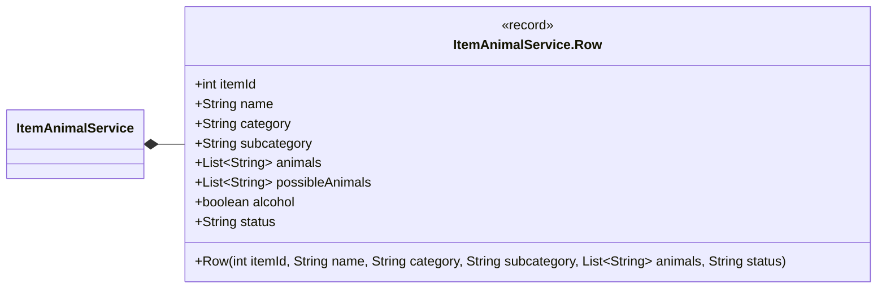

| Component | Type |
|---|---|
| `itemId` | `int` |
| `name` | `String` |
| `category` | `String` |
| `subcategory` | `String` |
| `animals` | `List<String>` |
| `possibleAnimals` | `List<String>` |
| `alcohol` | `boolean` |
| `status` | `String` |

| Member | Visibility | What it does |
|---|---|---|
| `Row(int itemId, String name, String category, String subcategory, List<String> animals, String status)` | public |  |

**Referenced by:** `ItemAnimalService`

## ItemAnimalService.ApplyReport

*record*

Result of .apply.

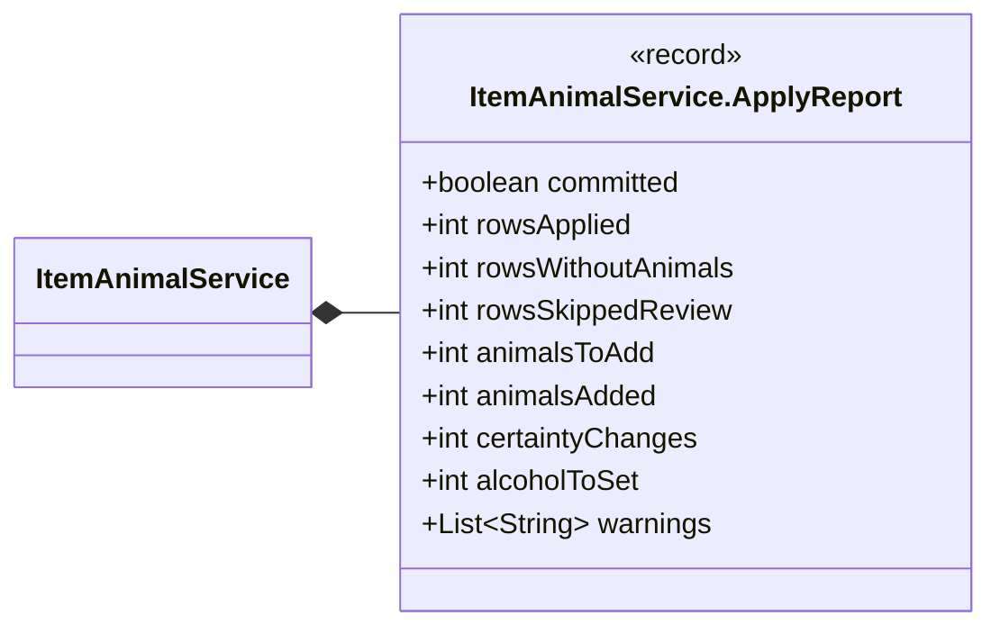

| Component | Type |
|---|---|
| `committed` | `boolean` |
| `rowsApplied` | `int` |
| `rowsWithoutAnimals` | `int` |
| `rowsSkippedReview` | `int` |
| `animalsToAdd` | `int` |
| `animalsAdded` | `int` |
| `certaintyChanges` | `int` |
| `alcoholToSet` | `int` |
| `warnings` | `List<String>` |

**Referenced by:** `ItemAnimalService`

## RecipeFacts

*record*

What the tagger needs to know about one recipe. Nutrition is per serving, times are minutes;
cuisine is null when the recipe has none (or the column does not exist yet).
unmatched are the recipe's rows in recipe_unmatched_ingredient (lines the importer could not match,
or one 'unchecked' row): any of them makes the recipe "unklar".

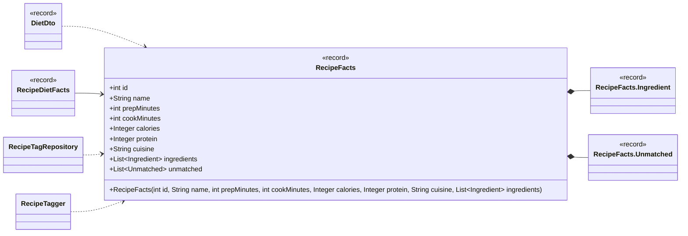

| Component | Type |
|---|---|
| `id` | `int` |
| `name` | `String` |
| `prepMinutes` | `int` |
| `cookMinutes` | `int` |
| `calories` | `Integer` |
| `protein` | `Integer` |
| `cuisine` | `String` |
| `ingredients` | `List<Ingredient>` |
| `unmatched` | `List<Unmatched>` |

| Member | Visibility | What it does |
|---|---|---|
| `RecipeFacts(int id, String name, int prepMinutes, int cookMinutes, Integer calories, Integer protein, String cuisine, List<Ingredient> ingredients)` | public |  |

**Referenced by:** `DietDto`, `RecipeDietFacts`, `RecipeTagRepository`, `RecipeTagger`

## RecipeFacts.Ingredient

*record*

One ingredient line. item is null when the line has no catalogue item, which makes the recipe's diet
unknown. animals are the CERTAIN animals stored for the item (they give Tier tags),
possibleAnimals the ones a generic item may come from (no Tier tag; they block vegetarisch).

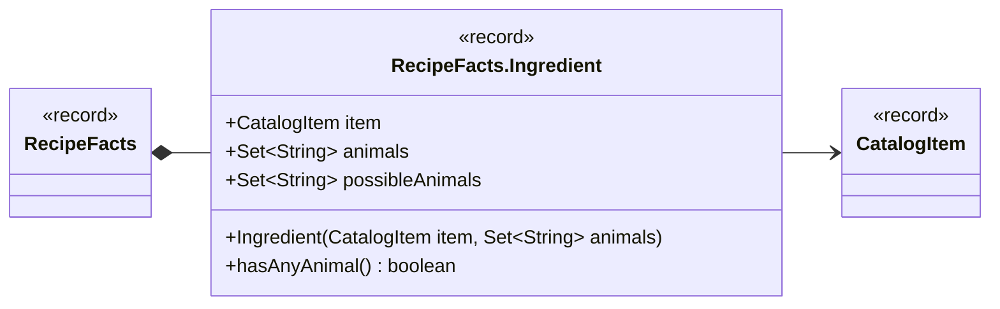

| Component | Type |
|---|---|
| `item` | `CatalogItem` |
| `animals` | `Set<String>` |
| `possibleAnimals` | `Set<String>` |

| Member | Visibility | What it does |
|---|---|---|
| `Ingredient(CatalogItem item, Set<String> animals)` | public |  |
| `boolean hasAnyAnimal()` | public | True if the item has any animal, certain or possible. |

**Referenced by:** `RecipeFacts`

## RecipeFacts.Unmatched

*record*

A row of recipe_unmatched_ingredient: lineNo is null for an 'unchecked' recipe.

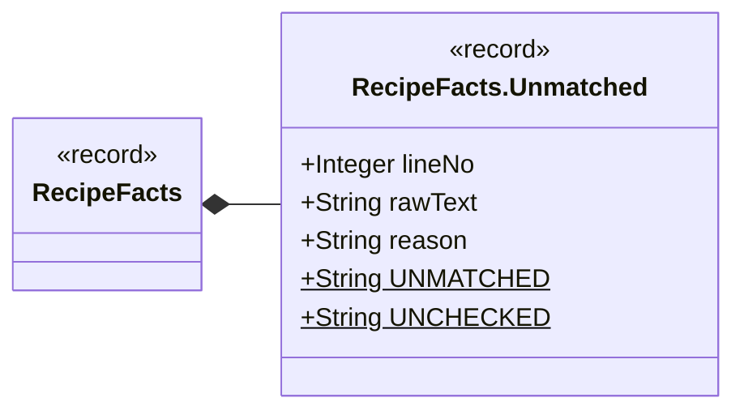

| Component | Type |
|---|---|
| `lineNo` | `Integer` |
| `rawText` | `String` |
| `reason` | `String` |
| `UNMATCHED` | `String` |
| `UNCHECKED` | `String` |

**Referenced by:** `RecipeFacts`

## RecipeTagRepository

*class*

All SQL for the derived-tag run: reads the recipes and their tags, and writes derived recipe_tag rows.

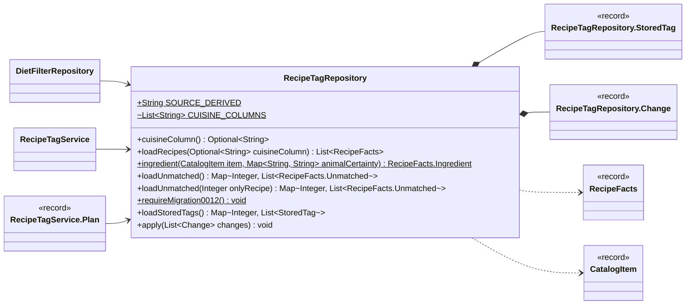

| Field | Type |
|---|---|
| `SOURCE_DERIVED` | `String` |
| `CUISINE_COLUMNS` | `List<String>` |

| Member | Visibility | What it does |
|---|---|---|
| `Optional<String> cuisineColumn()` | public | The recipe table's cuisine column, if it has one yet. |
| `List<RecipeFacts> loadRecipes(Optional<String> cuisineColumn)` | public | Every recipe with its ingredients (and their items and stored animals), by recipe id. |
| `RecipeFacts.Ingredient ingredient(CatalogItem item, Map<String, String> animalCertainty)` | public static | An ingredient with its animals split by certainty. |
| `Map<Integer, List<RecipeFacts.Unmatched>> loadUnmatched()` | public | recipe id → its rows in recipe_unmatched_ingredient (lines the importer could not match). |
| `Map<Integer, List<RecipeFacts.Unmatched>> loadUnmatched(Integer onlyRecipe)` | public | Same for one recipe (onlyRecipe not null), or all recipes (null). |
| `void requireMigration0012()` | public static | Stops with a clear message when migration 0012 is not applied yet (instead of an unknown-column error). |
| `Map<Integer, List<StoredTag>> loadStoredTags()` | public | recipe id → the tags it has now (manual and derived). |
| `void apply(List<Change> changes)` | public | Applies the changes in ONE transaction: a tag is created in tag when it does not exist, then linked with source 'derived'; a removal deletes only a 'derived' link. |

**Referenced by:** `DietFilterRepository`, `RecipeTagService`

## RecipeTagRepository.StoredTag

*record*

One recipe_tag row as stored.

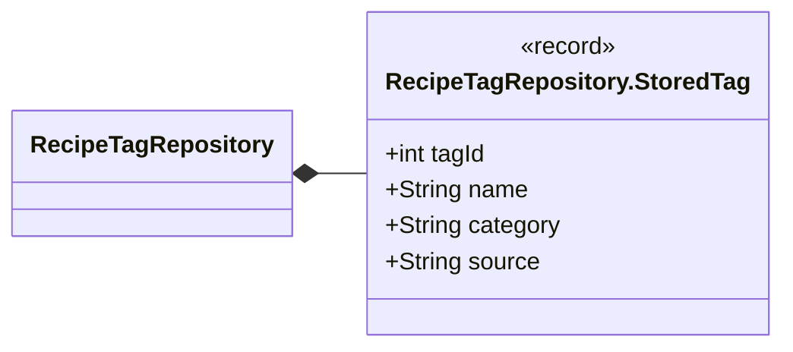

| Component | Type |
|---|---|
| `tagId` | `int` |
| `name` | `String` |
| `category` | `String` |
| `source` | `String` |

**Referenced by:** `RecipeTagRepository`

## RecipeTagRepository.Change

*record*

One change to apply: tag a recipe as derived, or remove a derived tag.

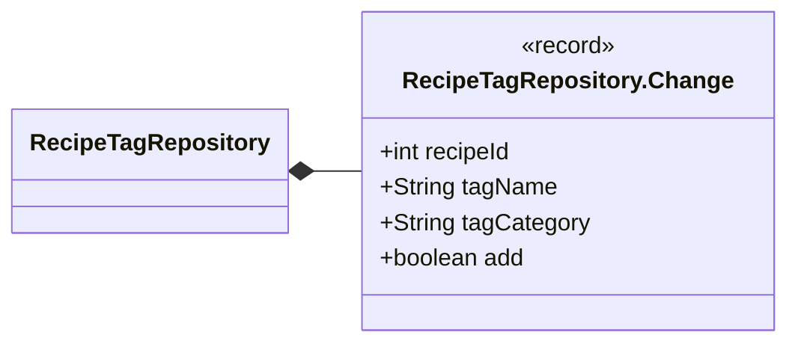

| Component | Type |
|---|---|
| `recipeId` | `int` |
| `tagName` | `String` |
| `tagCategory` | `String` |
| `add` | `boolean` |

**Referenced by:** `RecipeTagRepository`

## RecipeTagRunner

*class · command-line tool*

Command-line tool that derives recipe tags from DAHÄM's own data.

  RecipeTagRunner [--commit] [--config config/recipe_tags.properties]
  RecipeTagRunner --animal-products

Without --commit it is a dry run: it prints how many recipes would carry each tag, with
10 example recipes per tag, and writes nothing. With --commit the changes go in one transaction;
only recipe_tag rows with source 'derived' are ever replaced, manual tags stay. --animal-products
only prints which catalogue items block vegetarisch / vegan, and why. The database comes from
DAHAEM_DB_URL / _USER / _PASSWORD.

Exit code: 0 = OK, 1 = failed (nothing written), 2 = bad arguments.

```mermaid
classDiagram
    direction LR
    class tags_RecipeTagRunner["RecipeTagRunner"] {
        -java.io.PrintStream OUT$
        +main(String[] args) void$
    }
```

| Field | Type |
|---|---|
| `OUT` | `java.io.PrintStream` |

| Member | Visibility | What it does |
|---|---|---|
| `void main(String[] args)` | public static |  |

## RecipeTagService

*class*

Derives the tags of every recipe and replaces ONLY the recipe_tag rows whose source is 'derived'.
Manual tags are never read as candidates for removal, and a tag a recipe already has by hand is not
added a second time. No SQL here (see RecipeTagRepository).

```mermaid
classDiagram
    direction LR
    class tags_RecipeTagService["RecipeTagService"] {
        ~int EXAMPLES_PER_TAG$
        -RecipeTagRepository repository
        -RecipeTagger tagger
        +RecipeTagService(RecipeTagRepository repository, TagSettings settings)
        +plan() Plan
        +commit(Plan plan) Plan
        +animalProducts() Map~String, List~CatalogItem~~
    }
    class tags_RecipeTagService_Plan["RecipeTagService.Plan"] {
        <<record>>
    }
    class tags_RecipeTagRepository["RecipeTagRepository"]
    class tags_RecipeTagger["RecipeTagger"]
    class tags_TagSettings["TagSettings"] {
        <<record>>
    }
    class tags_CatalogItem["CatalogItem"] {
        <<record>>
    }
    tags_RecipeTagService *-- tags_RecipeTagService_Plan
    tags_RecipeTagService --> tags_RecipeTagRepository
    tags_RecipeTagService --> tags_RecipeTagger
    tags_RecipeTagService ..> tags_TagSettings
    tags_RecipeTagService ..> tags_CatalogItem
```

| Field | Type |
|---|---|
| `EXAMPLES_PER_TAG` | `int` |
| `repository` | `RecipeTagRepository` |
| `tagger` | `RecipeTagger` |

| Member | Visibility | What it does |
|---|---|---|
| `RecipeTagService(RecipeTagRepository repository, TagSettings settings)` | public |  |
| `Plan plan()` | public | Reads everything and computes the plan. |
| `Plan commit(Plan plan)` | public | Writes the plan's changes in one transaction. |
| `Map<String, List<CatalogItem>> animalProducts()` | public | Every catalogue item that blocks vegetarisch (non-meat reasons only) or vegan, with the rule that does it, grouped by rule. |

## RecipeTagService.Plan

*record*

What a run would do (or did).

```mermaid
classDiagram
    direction LR
    class tags_RecipeTagService_Plan["RecipeTagService.Plan"] {
        <<record>>
        +Optional~String~ cuisineColumn
        +int recipes
        +Map~String, Integer~ recipesPerTag
        +Map~String, String~ categoryPerTag
        +Map~String, List~String~~ examplesPerTag
        +int recipesDietUnknown
        +int recipesWithoutIngredients
        +int recipesWithUnlinkedIngredient
        +int recipesUnmatched
        +int recipesUnchecked
        +List~RecipeTagRepository.Change~ changes
        +boolean committed
        +added() int
        +removed() int
        +toText() String
    }
    class tags_RecipeTagService["RecipeTagService"]
    class tags_RecipeTagRepository["RecipeTagRepository"]
    tags_RecipeTagService_Plan --> tags_RecipeTagRepository
    tags_RecipeTagService *-- tags_RecipeTagService_Plan
```

| Component | Type |
|---|---|
| `cuisineColumn` | `Optional<String>` |
| `recipes` | `int` |
| `recipesPerTag` | `Map<String, Integer>` |
| `categoryPerTag` | `Map<String, String>` |
| `examplesPerTag` | `Map<String, List<String>>` |
| `recipesDietUnknown` | `int` |
| `recipesWithoutIngredients` | `int` |
| `recipesWithUnlinkedIngredient` | `int` |
| `recipesUnmatched` | `int` |
| `recipesUnchecked` | `int` |
| `changes` | `List<RecipeTagRepository.Change>` |
| `committed` | `boolean` |

| Member | Visibility | What it does |
|---|---|---|
| `int added()` | public |  |
| `int removed()` | public |  |
| `String toText()` | public |  |

**Referenced by:** `RecipeTagService`

## RecipeTagger

*class*

Works out the tags a recipe gets from DAHÄM's own data. Pure: no SQL, no I/O.

- **Tier**: every CERTAIN animal of every ingredient item. A possible animal (Salami: Schwein, Rind,
      Geflügel) gives no Tier tag.

- **vegetarisch**: only when EVERY ingredient has a catalogue item and none of them is meat / fish
      or has an animal, certain OR possible; **vegan**: vegetarisch and no dairy, egg, honey or other animal
      product (AnimalProducts). A recipe with a row in recipe_unmatched_ingredient (a line the importer
      could not match, or a recipe whose page was not checked) is **unklar** (Ernährung) and never
      vegetarisch / vegan, since unknown is not vegetarian. A recipe without any ingredient is unklar too.

- **Alkohol** (Inhalt): an ingredient item with the alcohol flag. **Fleisch mit Milch** (Inhalt): an
      item with a land animal (certain or possible, not Fisch / Meeresfrüchte) together with a milk product.

- **schnell**: prep + cook at most the configured minutes, only when the total is above 0
      (imported recipes store the total time as cook time, prep 0).

- **kalorienarm**: at most the configured kcal per serving. **proteinreich**: at least 20 % of the energy
      from protein (EU "high protein", Regulation (EC) No 1924/2006) and at least 20 g protein per serving.

- **Küche**: the recipe's cuisine.

```mermaid
classDiagram
    direction LR
    class tags_RecipeTagger["RecipeTagger"] {
        -TagSettings settings
        +RecipeTagger(TagSettings settings)
        +derive(RecipeFacts recipe) Derivation
        ~isHighProtein(RecipeFacts recipe) boolean
        ~meatWithMilk(RecipeFacts recipe) boolean$
    }
    class tags_RecipeTagger_Derivation["RecipeTagger.Derivation"] {
        <<record>>
    }
    class tags_TagSettings["TagSettings"] {
        <<record>>
    }
    class tags_RecipeTagService["RecipeTagService"]
    class tags_RecipeFacts["RecipeFacts"] {
        <<record>>
    }
    tags_RecipeTagger *-- tags_RecipeTagger_Derivation
    tags_RecipeTagger --> tags_TagSettings
    tags_RecipeTagger ..> tags_RecipeFacts
    tags_RecipeTagService --> tags_RecipeTagger
```

| Field | Type |
|---|---|
| `settings` | `TagSettings` |

| Member | Visibility | What it does |
|---|---|---|
| `RecipeTagger(TagSettings settings)` | public |  |
| `Derivation derive(RecipeFacts recipe)` | public |  |
| `boolean isHighProtein(RecipeFacts recipe)` | package | "Proteinreich": at least the configured share of the energy from protein (EU "high protein", Regulation (EC) No 1924/2006: 20 %, protein counted as 4 kcal per gram) AND at least the configured grams per serving. |
| `boolean meatWithMilk(RecipeFacts recipe)` | package static | A land animal (certain or possible) in one item and a milk product in another. |

**Referenced by:** `RecipeTagService`

## RecipeTagger.Derivation

*record*

The result for one recipe. dietKnown is false when vegetarisch / vegan could not be judged (the recipe is "unklar").

```mermaid
classDiagram
    direction LR
    class tags_RecipeTagger_Derivation["RecipeTagger.Derivation"] {
        <<record>>
        +Set~DerivedTag~ tags
        +boolean dietKnown
    }
    class tags_RecipeTagger["RecipeTagger"]
    class tags_DerivedTag["DerivedTag"] {
        <<record>>
    }
    tags_RecipeTagger_Derivation --> tags_DerivedTag
    tags_RecipeTagger *-- tags_RecipeTagger_Derivation
```

| Component | Type |
|---|---|
| `tags` | `Set<DerivedTag>` |
| `dietKnown` | `boolean` |

**Referenced by:** `RecipeTagger`

## Tag

*class*

Plain data holder for one row of the tag table.
No logic here on purpose just the fields, a constructor, and getters.

```mermaid
classDiagram
    direction LR
    class tags_Tag["Tag"] {
        -int id
        -String name
        -String category
        +Tag(int id, String name, String category)
        +getId() int
        +getName() String
        +getCategory() String
        +toString() String
    }
    class api_TagDto["TagDto"] {
        <<record>>
    }
    class tags_TagRepository["TagRepository"]
    class tags_TagService["TagService"]
    api_TagDto ..> tags_Tag
    tags_TagRepository ..> tags_Tag
    tags_TagService ..> tags_Tag
```

| Field | Type |
|---|---|
| `id` | `int` |
| `name` | `String` |
| `category` | `String` |

| Member | Visibility | What it does |
|---|---|---|
| `Tag(int id, String name, String category)` | public |  |
| `int getId()` | public |  |
| `String getName()` | public |  |
| `String getCategory()` | public |  |
| `String toString()` | public |  |

**Referenced by:** `TagDto`, `TagRepository`, `TagService`

## TagRepository

*class*

All SQL for the tag and recipe_tag tables lives here.
The rest of the app never writes SQL against the database; it calls these methods.

```mermaid
classDiagram
    direction LR
    class tags_TagRepository["TagRepository"] {
        +findOrCreateTag(String name, String category) Tag
        +findByName(String name) Optional~Tag~
        +tagRecipe(int recipeId, int tagId) void
        +tagsForRecipe(int recipeId) List~Tag~
        +recipeTagsForRecipe(int recipeId) List~RecipeTag~
        +tagNamesByRecipe() java.util.Map~Integer, List~String~~
        +tagNamesForRecipes(java.util.Collection~Integer~ recipeIds) java.util.Map~Integer, List~String~~
        +recipesForTag(int tagId) List~Integer~
        +allTags() List~Tag~
    }
    class tags_TagRepository_RecipeTag["TagRepository.RecipeTag"] {
        <<record>>
    }
    class diet_DietFilterRepository["DietFilterRepository"]
    class tags_TagService["TagService"]
    class tags_Tag["Tag"]
    class api_RecipeDetailDto["RecipeDetailDto"] {
        <<record>>
    }
    class api_RecipeDetailDto_Tag["RecipeDetailDto.Tag"] {
        <<record>>
    }
    class api_ServiceConfig["ServiceConfig"] {
        <<spring>>
    }
    tags_TagRepository *-- tags_TagRepository_RecipeTag
    tags_TagRepository ..> tags_Tag
    api_RecipeDetailDto ..> tags_TagRepository
    api_RecipeDetailDto_Tag ..> tags_TagRepository
    api_ServiceConfig ..> tags_TagRepository
    diet_DietFilterRepository --> tags_TagRepository
    tags_TagService --> tags_TagRepository
```

| Member | Visibility | What it does |
|---|---|---|
| `Tag findOrCreateTag(String name, String category)` | public |  |
| `Optional<Tag> findByName(String name)` | public |  |
| `void tagRecipe(int recipeId, int tagId)` | public |  |
| `List<Tag> tagsForRecipe(int recipeId)` | public |  |
| `List<RecipeTag> recipeTagsForRecipe(int recipeId)` | public |  |
| `java.util.Map<Integer, List<String>> tagNamesByRecipe()` | public |  |
| `java.util.Map<Integer, List<String>> tagNamesForRecipes(java.util.Collection<Integer> recipeIds)` | public |  |
| `List<Integer> recipesForTag(int tagId)` | public |  |
| `List<Tag> allTags()` | public |  |

**Referenced by:** `DietFilterRepository`, `RecipeDetailDto`, `RecipeDetailDto.Tag`, `ServiceConfig`, `TagService`

## TagRepository.RecipeTag

*record*

```mermaid
classDiagram
    direction LR
    class tags_TagRepository_RecipeTag["TagRepository.RecipeTag"] {
        <<record>>
        +String name
        +String category
        +String source
    }
    class tags_TagRepository["TagRepository"]
    tags_TagRepository *-- tags_TagRepository_RecipeTag
```

| Component | Type |
|---|---|
| `name` | `String` |
| `category` | `String` |
| `source` | `String` |

**Referenced by:** `TagRepository`

## TagService

*class*

Business logic for tags. No SQL here, no UI here.
It asks the repository for data and answers questions about it.

```mermaid
classDiagram
    direction LR
    class tags_TagService["TagService"] {
        -TagRepository repository
        +TagService(TagRepository repository)
        +addTagToRecipe(int recipeId, String name, String category) Tag
        +tagsForRecipe(int recipeId) List~Tag~
        +recipeTagsForRecipe(int recipeId) List~TagRepository.RecipeTag~
        +tagNamesByRecipe() java.util.Map~Integer, List~String~~
        +tagNamesForRecipes(java.util.Collection~Integer~ recipeIds) java.util.Map~Integer, List~String~~
        +recipesWithTag(String name) List~Integer~
    }
    class tags_TagRepository["TagRepository"]
    class api_RecipeController["RecipeController"] {
        <<controller>>
    }
    class mealplanner_RecipeSearchService["RecipeSearchService"]
    class tags_Tag["Tag"]
    class api_ServiceConfig["ServiceConfig"] {
        <<spring>>
    }
    tags_TagService --> tags_TagRepository
    tags_TagService ..> tags_Tag
    api_RecipeController --> tags_TagService
    api_ServiceConfig ..> tags_TagService
    mealplanner_RecipeSearchService --> tags_TagService
```

| Field | Type |
|---|---|
| `repository` | `TagRepository` |

| Member | Visibility | What it does |
|---|---|---|
| `TagService(TagRepository repository)` | public |  |
| `Tag addTagToRecipe(int recipeId, String name, String category)` | public |  |
| `List<Tag> tagsForRecipe(int recipeId)` | public |  |
| `List<TagRepository.RecipeTag> recipeTagsForRecipe(int recipeId)` | public |  |
| `java.util.Map<Integer, List<String>> tagNamesByRecipe()` | public |  |
| `java.util.Map<Integer, List<String>> tagNamesForRecipes(java.util.Collection<Integer> recipeIds)` | public |  |
| `List<Integer> recipesWithTag(String name)` | public |  |

**Referenced by:** `RecipeController`, `RecipeSearchService`, `ServiceConfig`

## TagSettings

*record*

Thresholds for the derived recipe tags, from config/recipe_tags.properties (all per serving).

highProteinEnergyShare and highProteinMinGrams together are the "proteinreich" rule: the EU
claim "high protein" (Regulation (EC) No 1924/2006, Annex) needs at least 20 % of the energy from protein, and
the household also wants at least 20 g per serving. Protein gives 4 kcal per gram.

```mermaid
classDiagram
    direction LR
    class tags_TagSettings["TagSettings"] {
        <<record>>
        +int quickMaxMinutes
        +int lowCalorieMaxKcal
        +double highProteinEnergyShare
        +int highProteinMinGrams
        +defaults() TagSettings$
        +load(Path file) TagSettings$
    }
    class tags_RecipeTagger["RecipeTagger"]
    class tags_RecipeTagService["RecipeTagService"]
    tags_RecipeTagService ..> tags_TagSettings
    tags_RecipeTagger --> tags_TagSettings
```

| Component | Type |
|---|---|
| `quickMaxMinutes` | `int` |
| `lowCalorieMaxKcal` | `int` |
| `highProteinEnergyShare` | `double` |
| `highProteinMinGrams` | `int` |

| Member | Visibility | What it does |
|---|---|---|
| `TagSettings defaults()` | public static |  |
| `TagSettings load(Path file)` | public static | Reads the properties file; a missing file or key falls back to the default. |

**Referenced by:** `RecipeTagService`, `RecipeTagger`
